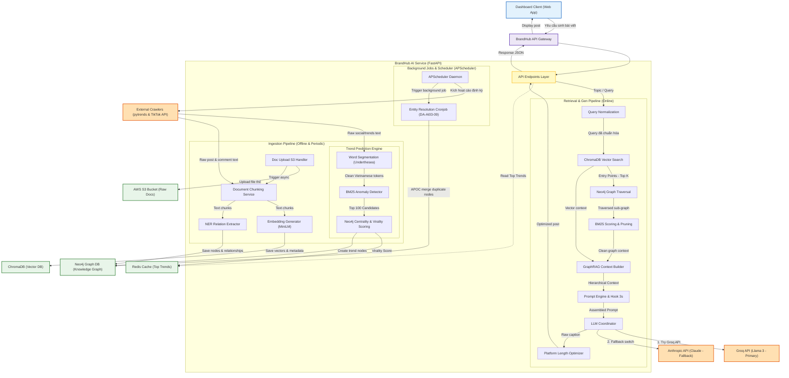
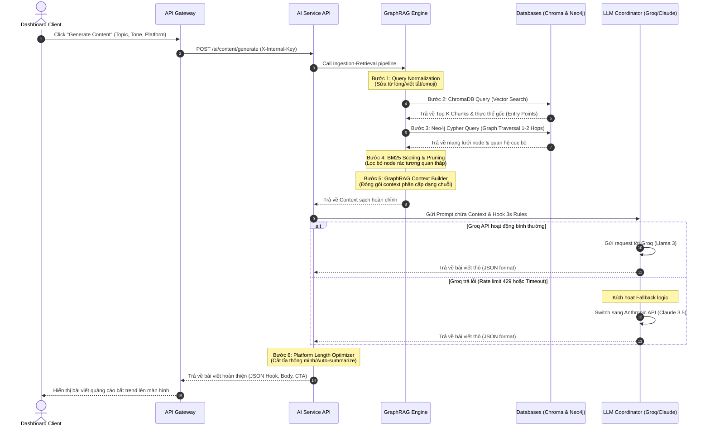

# Bản Thiết Kế Kiến Trúc & Triển Khai Chi Tiết AI Iteration 2 (Hybrid GraphRAG, LLM & Trend Engine)

> [<< Knowledge Base Home](../index.md) · [AI Models & Research](./README.md) · [AI Service Architecture](../architecture/ai-service-architecture.md) · [RAG Generation Tasks](./rag-generation-pipeline-task-details.md)

**Mã tài liệu:** `AI-IT2-BLUEPRINT-CONSOLIDATED`  
**Dự án:** BrandHub AI Trend & Hybrid GraphRAG System (`Epic AI-03`, `Epic AI-04`, `Epic AI-05`)  

Tài liệu hợp nhất này quy định toàn bộ **Phân tích khoảng trống kiến trúc (Gap Analysis)**, **Sơ đồ kiến trúc tổng thể & Sequence Flow**, **Bảng hợp nhất 22 nhiệm vụ**, và **Bản thiết kế mã nguồn chi tiết theo từng module** của dịch vụ `brandhub-ai-service` (đối chiếu trực tiếp với [Master Plan](../plan/brandhub-master-plan.md)).

---

## PHẦN A: PHÂN TÍCH KHOẢNG TRỐNG & BẢNG HỢP NHẤT NHIỆM VỤ ITERATION 2

## 1. Phân Tích Khoảng Trống (Gap Analysis: Kế Hoạch Gốc vs Đề Xuất Mới)

Sự cải tiến kiến trúc từ RAG truyền thống (chỉ dùng ChromaDB) sang **GraphRAG lai (ChromaDB + Neo4j)** dẫn đến việc bổ sung các task cốt lõi để đảm bảo hệ thống vận hành chính xác:

| Cấu phần | Kế hoạch gốc (Master Plan cũ) | Đề xuất mới nâng cấp (v1.1) | Lý do nâng cấp kỹ thuật |
| :--- | :--- | :--- | :--- |
| **Tìm kiếm Tri thức** | Chỉ tìm kiếm ngữ nghĩa mờ bằng Vector (ChromaDB). | Kết hợp tìm kiếm Vector (ChromaDB) + Duyệt đồ thị quan hệ (Neo4j). | Giải quyết việc thông tin bị rời rạc; kết nối logic giữa các thực thể (KOL, món ăn, địa điểm) để sinh bài viết sâu sắc hơn. |
| **Tiền xử lý Query** | Chuyển trực tiếp query của user thành vector để tìm kiếm. | Chuẩn hóa câu query (Query Normalization) trước khi tìm. | Loại bỏ emoji rác, sửa từ viết tắt/từ lóng tiếng Việt để ChromaDB matching vector chính xác hơn. |
| **Tối ưu ngữ cảnh** | Gửi toàn bộ chunks tìm được sang prompt của LLM. | Chấm điểm tương quan BM25 và Cắt tỉa (Pruning) node ít liên quan. | Tiết kiệm tối thiểu 30% Token budget, giảm chi phí API và giảm thời gian phản hồi (latency) của LLM. |
| **Lưu trữ đồ thị** | Chưa có cơ chế quản lý và ghi dữ liệu đồ thị. | Xây dựng Connection Pool cho Neo4j và NER nạp liên kết đồ thị. | Quản lý connection luồng ghi/đọc đồ thị hiệu quả, tránh rò rỉ kết nối trên môi trường Docker. |
| **Dọn dẹp Database** | Chưa có cơ chế xử lý trùng lặp dữ liệu đồ thị. | Chạy background job Entity Resolution gộp node định kỳ. | Tránh hiện tượng phình to và loãng đồ thị (ví dụ: gộp các node đồng nghĩa "HN", "Hà Nội" thành một). |
| **Bộ lập lịch ngầm** | Chưa làm rõ cơ chế trigger cào xu hướng. | Cấu hình APScheduler daemon chạy ngầm trong FastAPI. | Đảm bảo việc cào xu hướng và dọn dẹp DB diễn ra hoàn toàn tự động dưới nền. |

---

## 2. Bảng Hợp Nhất & Phân Nhóm Tất Cả Các Task Iteration 2

Dưới đây là bảng tổng hợp đầy đủ các nhiệm vụ của Iteration 2 (Epic AI-03 và AI-04) sau khi hợp nhất. Các nhiệm vụ mới đề xuất được đánh dấu **[ĐỀ XUẤT MỚI]**:

### Nhóm 1: Luồng Nạp Tri Thức & Quản lý Cơ sở Dữ liệu (RAG Ingestion & DB)

| Mã Task | Tên Nhiệm Vụ | Trạng thái | Mục tiêu kỹ thuật |
| :--- | :--- | :---: | :--- |
| `DA-AI03-01` | Implement document upload endpoint | Gốc | Tiếp nhận file (PDF/DOCX/TXT/URL) đẩy lên S3. |
| `DA-AI03-02` | Build document chunking service | Gốc | Cắt văn bản thô thành các đoạn nhỏ 500 ký tự. |
| `DA-AI03-03` | Build embedding pipeline | Gốc | Sinh vector embeddings và lưu vào ChromaDB. |
| `DA-AI03-03.1`| Build Neo4j connection pool management | **Mới** | Quản lý kết nối driver Singleton kết nối Neo4j. |
| `DA-AI03-03.2`| NER extraction and relations ingestion | **Mới** | LLM trích thực thể nạp liên kết đồ thị vào Neo4j. |
| `DA-AI03-06` | Implement document deletion endpoint | Gốc | Xóa dữ liệu đồng thời trên S3, ChromaDB và Neo4j. |
| `DA-AI03-09` | Create Entity Resolution background job | **Mới** | APScheduler chạy ngầm gộp các node trùng lặp trong Neo4j. |

### Nhóm 2: Luồng Truy Vấn & Tối ưu hóa Ngữ cảnh (RAG Retrieval & Pruning)

| Mã Task | Tên Nhiệm Vụ | Trạng thái | Mục tiêu kỹ thuật |
| :--- | :--- | :---: | :--- |
| `DA-AI03-03.3`| Implement query normalization | **Mới** | Tiền xử lý query (lọc emoji, map từ lóng/viết tắt). |
| `DA-AI03-04` | Implement semantic search | Gốc | Quét ChromaDB tìm các entry point ngữ nghĩa. |
| `DA-AI03-04.1`| Build graph traversal service | **Mới** | Cypher query duyệt đồ thị Neo4j 1-2 hops từ entry point. |
| `DA-AI03-04.2`| Implement BM25 scoring & graph pruning | **Mới** | Chấm điểm BM25 của node và lọc bỏ các node rác. |
| `DA-AI03-05` | Build RAG context builder | Gốc | Đóng gói text ChromaDB + quan hệ Neo4j thành context. |

### Nhóm 3: Luồng Sinh Nội Dung & Hậu Xử Lý (Content Generation & Post-Processing)

| Mã Task | Tên Nhiệm Vụ | Trạng thái | Mục tiêu kỹ thuật |
| :--- | :--- | :---: | :--- |
| `DA-AI04-01` | Build prompt template system | Gốc | Prompt động Jinja2 kết hợp RAG context + Hook 3s. |
| `DA-AI04-02` | Integrate Llama 3 via Groq API | Gốc | Gọi Llama 3 Groq (temperature thấp, JSON response). |
| `DA-AI04-03` | Integrate Claude API as fallback | Gốc | Failover tự động switch sang Claude khi Groq lỗi/429. |
| `DA-AI04-04` | Platform-specific caption optimization | Gốc | Tối ưu ký tự theo nền tảng, auto-summarize cho Threads. |
| `DA-AI04-05` | Implement hashtag generation endpoint | Gốc | Phân tích bài viết trích lọc 5-10 hashtags sạch. |
| `DA-AI04-06` | Implement regenerate with feedback | Gốc | Tái tạo phiên bản bài viết mới dựa trên feedback của user. |

### Nhóm 4: Đánh Giá Chất Lượng & Tài Liệu Hóa (QA & Documentation)

| Mã Task | Tên Nhiệm Vụ | Trạng thái | Mục tiêu kỹ thuật |
| :--- | :--- | :---: | :--- |
| `DA-AI03-07` | Test RAG accuracy (3 documents) | Gốc | Chốt chặn chất lượng: Đảm bảo độ chính xác của RAG. |
| `DA-AI03-08` | Write RAG pipeline documentation | Gốc | Viết hướng dẫn cấu hình tham số và thiết kế RAG. |
| `DA-AI04-07` | Anti-hallucination test (20 captions) | Gốc | Chốt chặn chất lượng: Đảm bảo LLM không tự bịa thông tin. |
| `DA-AI04-08` | Write Prompt Engineering Documentation | Gốc | Tài liệu hóa cấu trúc prompt, tone guide và system prompts. |

---

## 3. Bản Đồ Phụ Thuộc Tích Hợp (Integrated Dependency Map)

Để luồng runtime sinh bài viết hoạt động trơn tru, các task phải được xây dựng theo đúng trình tự phụ thuộc kỹ thuật dưới đây:

```
[NHÓM 1: NẠP TRI THỨC]
DA-AI03-01 (API Upload) ➔ DA-AI03-02 (Chunking) ➔ DA-AI03-03 (Chroma Store)
                                 │
                                 ▼ (Graph Ingestion)
                           DA-AI03-03.1 (Neo4j Pool) ➔ DA-AI03-03.2 (NER Ingest) ➔ DA-AI03-09 (Resolution Cron)

[NHÓM 2: TRUY VẤN LAI]
DA-AI03-03.3 (Query Normalization) ➔ DA-AI03-04 (Chroma Search)
                                               │ (Trích Entry Points)
                                               ▼
                                         DA-AI03-04.1 (Neo4j Traversal)
                                               │
                                               ▼
                                         DA-AI03-04.2 (BM25 Pruning)
                                               │
                                               ▼
                                         DA-AI03-05 (Context Builder) ➔ DA-AI03-07 (RAG QA Gate)

[NHÓM 3: LLM GENERATION & POST-PROCESS]
                                                                        │
                                                                        ▼
                                                                 DA-AI04-01 (Prompt Builder)
                                                                        │
                                                             ┌──────────┴──────────┐
                                                             ▼                     ▼
                                                         DA-AI04-02 (Groq)    DA-AI04-03 (Claude)
                                                             │                     │
                                                             └──────────┬──────────┘
                                                                        ▼
                                                                 DA-AI04-04 (Length Optimizer)
                                                                 DA-AI04-05 (Hashtags API)
                                                                 DA-AI04-06 (Feedback Loop)
                                                                        │
                                                                        ▼
                                                                 DA-AI04-07 (Anti-Hallucination QA)
                                                                        │
                                                                        ▼
                                                                 DA-AI04-08 (Documentation)
```

---

## 4. Định Hướng Phân Chia Công Việc Trong Team AI

Dựa trên tính chất công nghệ, trưởng nhóm có thể phân bổ 22 nhiệm vụ trên cho 3 vai trò lập trình viên trong team như sau:

### Vai trò A: AI Algorithm & Database Engineer (Tập trung vào Thuật toán & DB)
*   **Chuyên môn:** NLP, Cơ sở dữ liệu Vector & Đồ thị (Neo4j, ChromaDB, Cypher, GDS).
*   **Các task phân bổ:**
    *   `DA-AI03-02` (Chunking), `DA-AI03-03` (Embedding Chroma), `DA-AI03-03.1` (Neo4j Pool), `DA-AI03-03.2` (NER Neo4j), `DA-AI03-09` (Resolution Cron).
    *   `DA-AI03-03.3` (Query Normalization), `DA-AI03-04.1` (Neo4j Traversal), `DA-AI03-04.2` (BM25 Pruning).

### Vai trò B: API Integration & Backend Engineer (Tập trung vào API & LLM)
*   **Chuyên môn:** Python FastAPI, AWS S3, Integration API (Groq, Claude), APScheduler, Caching.
*   **Các task phân bổ:**
    *   `DA-AI03-01` (Upload Endpoint), `DA-AI03-06` (Delete Endpoint).
    *   `DA-AI03-04` (Chroma Search), `DA-AI03-05` (Context Builder).
    *   `DA-AI04-02` (Groq API), `DA-AI04-03` (Claude Fallback), `DA-AI04-04` (Length Optimizer), `DA-AI04-05` (Hashtag API).

### Vai trò C: Prompt Engineer & QA (Tập trung vào Prompt & Kiểm thử chất lượng)
*   **Chuyên môn:** Prompt Engineering, LLM-as-a-judge, QA Testing, soạn thảo tài liệu.
*   **Các task phân bổ:**
    *   `DA-AI04-01` (Prompt Builder & Hook 3s), `DA-AI04-06` (Feedback Loop).
    *   `DA-AI03-07` (RAG QA Gate), `DA-AI04-07` (Anti-hallucination QA).
    *   `DA-AI03-08` (RAG Documentation), `DA-AI04-08` (Prompt Documentation).

---

## PHẦN B: KIẾN TRÚC TỔNG THỂ, LUỒNG GỌI API & ĐIỂM NHẤN KỸ THUẬT

## 1. Sơ Đồ Tổng Quan Hệ Thống (Overall System Architecture)

Hệ thống được thiết kế theo kiến trúc chia tách trách nhiệm rõ ràng giữa **Luồng nạp dữ liệu tri thức & xu hướng (Offline Ingestion)** và **Luồng sinh nội dung theo thời gian thực (Online Retrieval & Generation)**.



---

## 2. Sơ Đồ Cấu Trúc File & Thư Mục (Directory & File Structure)

Cấu trúc thư mục của dự án `brandhub-ai-service` được tổ chức theo mô hình Modular Service nhằm đảm bảo tính cô đọng, dễ bảo trì và mở rộng khi thêm các module AI mới (như Image/Video Generation).

```
brandhub-ai-service/
│
├── docker/
│   └── Dockerfile                  # Cấu hình container chạy FastAPI
├── tests/                          # Thư mục kiểm thử
│   ├── test_rag_accuracy.py        # Kịch bản kiểm thử accuracy của RAG (3 tài liệu)
│   └── test_anti_hallucination.py  # Kịch bản kiểm thử chống ảo giác (20 kịch bản)
│
├── app/
│   ├── __init__.py
│   ├── main.py                     # Entry point khởi chạy FastAPI, cấu hình middlewares & scheduler
│   │
│   ├── api/                        # Tầng Router nhận và xử lý request HTTP
│   │   ├── __init__.py
│   │   ├── v1/
│   │   │   ├── documents.py        # API upload/delete tài liệu tri thức RAG
│   │   │   ├── generate.py         # API sinh content, hashtag, refining
│   │   │   ├── trends.py           # API lấy trends hot từ Redis
│   │   │   └── health.py           # API kiểm tra trạng thái hoạt động (Healthcheck)
│   │
│   ├── core/                       # Cấu hình hệ thống và khởi tạo kết nối DB/Services
│   │   ├── __init__.py
│   │   ├── config.py               # Quản lý biến môi trường Pydantic Settings
│   │   ├── security.py             # Middleware kiểm tra API Key nội bộ (X-Internal-Key)
│   │   ├── neo4j.py                # Quản lý Connection Pool kết nối Neo4j
│   │   ├── redis.py                # Quản lý kết nối Redis client
│   │   ├── s3.py                   # Boto3 client cấu hình AWS S3
│   │   └── scheduler.py            # Khởi tạo và cấu hình APScheduler (cào xu hướng, gộp node)
│   │
│   ├── models/                     # Thư mục định nghĩa Pydantic Schemas
│   │   ├── __init__.py
│   │   ├── request.py              # Schema request sinh bài viết, hashtags, refine
│   │   └── response.py             # Schema response trả về bài viết đã sinh
│   │
│   └── services/                   # Tầng xử lý logic nghiệp vụ và thuật toán AI
│       ├── __init__.py
│       ├── chunking.py             # LangChain RecursiveCharacterTextSplitter
│       ├── embedding.py            # SentenceTransformers (MiniLM-L6-v2)
│       ├── normalization.py        # Làm sạch query, sửa từ viết tắt, từ lóng
│       ├── graph_traversal.py      # Cypher Query duyệt đồ thị Neo4j 1-2 hops
│       ├── pruning.py              # Thuật toán rank_bm25 cắt tỉa node rác
│       ├── context_builder.py      # GraphRAG context formatter
│       ├── prompt_builder.py       # Render prompt động bằng Jinja2 & công thức Hook 3s
│       ├── llm_coordinator.py      # Điều phối Groq API và switch sang Claude fallback
│       ├── length_optimizer.py     # Tối ưu độ dài bài viết theo platform, auto-summarize
│       ├── hashtag_extractor.py    # Phân tích text sinh mảng hashtag
│       ├── entity_resolution.py    # Tiến trình chạy ngầm gộp thực thể trùng lặp (apoc merge)
│       ├── trend_predictor.py      # Thuật toán chấm điểm xu hướng (BM25 Anomaly x Centrality)
│       ├── word_segmentation.py    # Tách từ tiếng Việt bằng Underthesea
│       └── crawlers/               # Module cào dữ liệu định kỳ từ mạng xã hội
│           ├── __init__.py
│           ├── google_trends.py    # Crawler lấy hot keywords từ pytrends
│           └── tiktok_scraper.py   # Crawler bóc tách TikTok Creative Center (Playwright)
```

---

## 3. Sơ Đồ Cấu Trúc API (API Endpoint Structure)

Hệ thống cung cấp tập API bảo mật (yêu cầu header `X-Internal-Key`) phục vụ cho Web Dashboard thông qua Gateway:

| Endpoint | Method | Chức năng | Request Body / Query Params | Response JSON Shape |
| :--- | :---: | :--- | :--- | :--- |
| `/ai/rag/documents` | `POST` | Tải lên tài liệu hoặc URL | Multipart Form: `file` (opt), `url` (opt), `clientId` (req) | `{ "documentId": "str", "s3Key": "str", "status": "processing" }` |
| `/ai/rag/documents/{id}` | `DELETE`| Xóa tài liệu | Path Param: `id` (documentId), Query: `clientId` | `{ "status": "success", "message": "Document deleted" }` |
| `/ai/content/generate` | `POST` | Sinh bài viết theo RAG & Trend | `{ "topic": "str", "clientId": "str", "tone": "str", "platform": "str" }` | `{ "hook_3s": "str", "body": "str", "cta": "str", "metadata": { "platform": "str" } }` |
| `/ai/generate/hashtags`| `POST` | Tự động trích lọc Hashtag | `{ "content": "str", "brandName": "str", "trendName": "str" }` | `["#hashtag1", "#hashtag2", "#hashtag3"]` |
| `/ai/generate/refine` | `POST` | Sửa bài viết theo feedback | `{ "originalPost": "str", "feedback": "str", "clientId": "str" }` | `{ "hook_3s": "str", "body": "str", "cta": "str" }` |
| `/ai/trends` | `GET` | Lấy danh sách xu hướng hot | Query Params: `category` (opt), `limit` (opt) | `[ { "rank": 1, "trend": "str", "finalScore": 0.0 } ]` |

---

## 4. Sơ Đồ Liên Kết Giữa Các API & DB (API Integration & Call Flow)

Sơ đồ tuần tự (Sequence Diagram) dưới đây mô tả chi tiết luồng gọi và xử lý dữ liệu khi người dùng kích hoạt yêu cầu sinh bài viết quảng cáo bắt trend (Online Generation Flow):



---

## 5. Phân Tích Kỹ Thuật Các Điểm Nhấn Kiến Trúc (Architectural Highlights)

Sau khi hoàn thành Iteration 2, kiến trúc hệ thống AI được tối ưu hóa sâu ở các khâu trọng yếu sau:

### A. Hiệu năng tìm kiếm ChromaDB (HNSW Indexing)
ChromaDB lưu trữ vector biểu diễn ngữ nghĩa của các chunk tài liệu tri thức. Hệ thống sử dụng thuật toán **HNSW (Hierarchical Navigable Small World)** xây dựng đồ thị nhiều tầng. Việc tìm kiếm lân cận gần nhất (Nearest Neighbor) được giới hạn độ phức tạp ở mức **$\mathcal{O}(\log N)$** thay vì quét tuyến tính toàn bộ DB ($\mathcal{O}(N)$). Phép tìm kiếm vector lấy Top-K Chunks hoàn tất dưới **50ms**, đảm bảo tổng thời gian xử lý cực kỳ nhanh.

### B. Truy vấn tri thức đồ thị (Neo4j Cypher Traversal)
Không giống các hệ thống RAG thông thường chỉ tìm text giống nhau, hệ thống lai sử dụng Neo4j để lưu mạng lưới thực thể. Câu Cypher động duyệt 1-2 hops giúp kết nối tất cả các thực thể liên quan (ví dụ: biết được KOL nào quảng bá món trà sữa, địa điểm bán ở đâu). Việc duyệt đồ thị chỉ thực hiện cục bộ từ các Entry Points lấy ra từ ChromaDB nên lượng RAM tiêu thụ và độ trễ truy vấn đồ thị luôn ở mức tối thiểu.

### C. BM25 Scoring & Pruning (Cắt tỉa ngữ cảnh)
Để giải quyết bài toán token limits của Groq (Llama 3) và Claude, thuật toán BM25 được tích hợp làm bộ lọc thông minh. Node nào có tần suất xuất hiện quá phổ biến trong baseline lịch sử hoặc không liên quan trực tiếp đến query của người dùng sẽ bị loại bỏ ngay lập tức trước khi đưa vào RAG Context Builder. Việc này giúp giảm trung bình 30%-40% chiều dài context gửi sang prompt, tăng tốc độ xử lý của LLM và tiết kiệm chi phí gọi API.

### D. LLM Fallback & Retry Strategy
Bộ điều phối `LLMService` đóng vai trò là một Router tự động bắt lỗi thông minh. Khi nhận được exception rate-limit (HTTP status 429) hoặc timeout từ Groq Cloud API, hệ thống sẽ thực hiện thử lại (Retry) với exponential backoff. Nếu sau 3 lần vẫn thất bại, hệ thống tự động định tuyến (fallback) sang Claude API (Anthropic Cloud) và biên dịch kết quả trả về dưới định dạng thống nhất để đảm bảo trải nghiệm của người dùng hoàn toàn liền mạch.

### E. Vai trò của AWS S3 trong lưu trữ và tái xử lý tri thức (AWS S3 Storage & Reprocessing Role)
AWS S3 đóng vai trò là kho lưu trữ tài liệu thô ban đầu, hỗ trợ cho việc vận hành bền vững của hệ thống RAG thông qua 3 khía cạnh:
* **Lưu trữ tài liệu gốc:** Lưu trữ file nguyên bản (`.pdf`, `.docx`, `.txt`) theo cấu trúc phân cấp `rag/{clientId}/{documentId}/{filename}` để phục vụ tải xuống và đối chiếu nguồn gốc thông tin (Fact-Checking).
* **Tái xử lý dữ liệu (Re-indexing):** Khi hệ thống AI cập nhật thuật toán (như đổi kích thước `chunk_size` hoặc nâng cấp mô hình embedding), hệ thống có thể đọc trực tiếp tài liệu gốc trên S3 để sinh lại vector mà không yêu cầu khách hàng tải lại tài liệu.
* **Xử lý bất đồng bộ (Asynchronous Background Tasks):** API Upload trả về ngay kết quả phản hồi `200 OK` cho client sau khi đẩy file lên S3, sau đó luồng ngầm (Background Task) sẽ tải file từ S3 về để thực hiện bóc tách, sinh vector và NER, giúp giảm tối đa độ trễ của endpoint.

---

## PHẦN C: BẢN THIẾT KẾ MÃ NGUỒN CHI TIẾT THEO MODULE (IMPLEMENTATION BLUEPRINT)

## MAPPING TỔNG QUAN TÁC VỤ (TASK-TO-FILE DIRECTORY MAPPING)

```
brandhub-ai-service/
│
├── app/
│   ├── main.py ─────────────────────────────► [DA-AI03-09, DA-AI05-06] Khởi tạo Scheduler ngầm
│   │
│   ├── api/v1/
│   │   ├── documents.py ────────────────────► [DA-AI03-01, DA-AI03-06] Endpoints upload & delete
│   │   ├── generate.py ─────────────────────► [DA-AI04-02, DA-AI04-05, DA-AI04-06] Endpoints sinh content
│   │   ├── trends.py ───────────────────────► [DA-AI05-05] API gợi ý trends hot trên dashboard
│   │   └── health.py ───────────────────────► [DA-AI03-03.1] Kiểm tra sức khỏe kết nối DBs
│   │
│   ├── core/
│   │   ├── neo4j.py ────────────────────────► [DA-AI03-03.1] Connection Pool Neo4j Singleton
│   │   └── scheduler.py ────────────────────► [DA-AI03-09, DA-AI05-06] Lập lịch cào & gộp node thực thể
│   │
│   ├── models/
│   │   ├── request.py ──────────────────────► Pydantic Input Schemas
│   │   └── response.py ─────────────────────► Pydantic Output Schemas
│   │
│   └── services/
│       ├── chunking.py ─────────────────────► [DA-AI03-02] Đọc và cắt nhỏ PDF/Docx/Txt
│       ├── embedding.py ────────────────────► [DA-AI03-03] Sinh vector & ghi ChromaDB
│       ├── normalization.py ────────────────► [DA-AI03-03.3] Sửa từ lóng, lọc viết tắt
│       ├── graph_traversal.py ──────────────► [DA-AI03-04.1] Duyệt đồ thị Neo4j 1-2 Hops
│       ├── pruning.py ──────────────────────► [DA-AI03-04.2] Tính điểm BM25 & cắt tỉa node rác
│       ├── context_builder.py ──────────────► [DA-AI03-05] Định dạng RAG Context phân cấp
│       ├── prompt_builder.py ───────────────► [DA-AI04-01] Jinja2 Prompt Templates & Hook 3s
│       ├── llm_coordinator.py ──────────────► [DA-AI04-02, DA-AI04-03] Llama 3 Groq + Claude Fallback
│       ├── length_optimizer.py ─────────────► [DA-AI04-04] Tối ưu hóa ký tự theo Platform
│       ├── hashtag_extractor.py ────────────► [DA-AI04-05] Trích lọc hashtag regex & chuẩn hóa
│       ├── entity_resolution.py ────────────► [DA-AI03-09] APScheduler gộp node đồng nghĩa
│       ├── trend_predictor.py ──────────────► [DA-AI05-03.1, DA-AI05-03.3, DA-AI05-03.4, DA-AI05-04] Tính điểm BM25 Anomaly & GDS Centrality
│       ├── word_segmentation.py ────────────► [DA-AI05-03] Tách từ tiếng Việt dùng Underthesea
│       └── crawlers/
│           ├── google_trends.py ────────────► [DA-AI05-01] Crawler Google Trends (pytrends)
│           └── tiktok_scraper.py ───────────► [DA-AI05-02] Crawler TikTok Creative Center (Playwright)
```

---

## PHẦN I: CHI TIẾT CÀI ĐẶT EPIC AI-03 (RAG KNOWLEDGE BASE PIPELINE)

### DA-AI03-01 — Document Ingestion API
*   **File ảnh hưởng:** `app/api/v1/documents.py` và `app/models/response.py`
*   **Hàm/Class cần tạo:** `async def upload_document(file: UploadFile = File(None), url: str = Form(None), client_id: str = Form(...), background_tasks: BackgroundTasks)`
*   **Luồng xử lý chi tiết:**
    1. Kiểm tra định dạng file (chỉ cho phép `.pdf`, `.docx`, `.txt`). Nếu không hợp lệ trả về HTTP 400.
    2. Đẩy file lên S3 thông qua helper trong `app/core/s3.py`.
    3. Nếu là `url`: tải html, lọc bằng BeautifulSoup để lấy text thô, lưu thành file `.txt` tạm thời rồi đẩy lên S3.
    4. Sinh `document_id = str(uuid.uuid4())`.
    5. Đăng ký background task chạy hàm `process_document_background_task(s3_key, client_id, document_id)`.
    6. Trả về mã JSON trạng thái ngay lập tức.
*   **Khung mã nguồn mẫu (Code Skeleton):**
```python
# app/api/v1/documents.py
from fastapi import APIRouter, UploadFile, File, Form, BackgroundTasks, HTTPException
from app.models.response import IngestionResponse
import uuid

router = APIRouter()

@router.post("/upload", response_model=IngestionResponse)
async def upload_document(
    client_id: str = Form(...),
    file: UploadFile = File(None),
    url: str = Form(None),
    background_tasks: BackgroundTasks = BackgroundTasks()
):
    if not file and not url:
        raise HTTPException(status_code=400, detail="Must provide either file or URL")
    
    document_id = str(uuid.uuid4())
    s3_key = f"rag/{client_id}/{document_id}/source_file"
    
    # Kích hoạt xử lý bất đồng bộ qua BackgroundTasks
    background_tasks.add_task(
        process_document_background_task, 
        s3_key=s3_key, 
        client_id=client_id, 
        document_id=document_id
    )
    
    return IngestionResponse(
        documentId=document_id,
        clientId=client_id,
        s3Key=s3_key,
        status="processing"
    )

async def process_document_background_task(s3_key: str, client_id: str, document_id: str):
    # Luồng ngầm: Chunking -> Embedding & ChromaDB -> NER & Neo4j
    pass
```

---

### DA-AI03-02 — Document Chunking Service
*   **File ảnh hưởng:** `app/services/chunking.py`
*   **Hàm/Class cần tạo:** `class DocumentChunker` với hàm `def chunk_document(self, file_bytes: bytes, file_type: str) -> List[str]`
*   **Luồng xử lý chi tiết:**
    1. Dựa trên `file_type` (pdf, docx, txt), sử dụng thư viện tương ứng (`pdfplumber` hoặc `python-docx`) để bóc tách text tiếng Việt.
    2. Khởi tạo `RecursiveCharacterTextSplitter` với tham số `chunk_size=500` và `chunk_overlap=50`.
    3. Trả về danh sách các đoạn text thô đã được lọc bỏ khoảng trắng thừa.
*   **Khung mã nguồn mẫu (Code Skeleton):**
```python
# app/services/chunking.py
from langchain.text_splitter import RecursiveCharacterTextSplitter
import pdfplumber
from io import BytesIO

class DocumentChunker:
    def __init__(self):
        self.splitter = RecursiveCharacterTextSplitter(
            chunk_size=500,
            chunk_overlap=50,
            separators=["\n\n", "\n", ".", ",", " ", ""]
        )

    def extract_text(self, file_bytes: bytes, file_type: str) -> str:
        if file_type == "pdf":
            with pdfplumber.open(BytesIO(file_bytes)) as pdf:
                return "".join([page.extract_text() or "" for page in pdf.pages])
        return file_bytes.decode("utf-8")

    def chunk_document(self, file_bytes: bytes, file_type: str) -> list[str]:
        text = self.extract_text(file_bytes, file_type)
        chunks = self.splitter.split_text(text)
        return [c.strip() for c in chunks if c.strip()]
```

---

### DA-AI03-03 — Embedding Pipeline (ChromaDB)
*   **File ảnh hưởng:** `app/services/embedding.py`
*   **Hàm/Class cần tạo:** `class EmbeddingService` với hàm `def store_chunks(self, client_id: str, document_id: str, chunks: List[str])`
*   **Luồng xử lý chi tiết:**
    1. Khởi tạo ChromaDB client kết nối đến host/port từ cấu hình.
    2. Lấy hoặc tạo collection có tên `client_{client_id}`.
    3. Tải mô hình `sentence-transformers/all-MiniLM-L6-v2` cục bộ.
    4. Thực hiện batch insert (chia 50 chunks/lần) đưa danh sách vector kèm metadata vào ChromaDB.
*   **Khung mã nguồn mẫu (Code Skeleton):**
```python
# app/services/embedding.py
import chromadb
from sentence_transformers import SentenceTransformer

class EmbeddingService:
    def __init__(self, chromadb_host: str, chromadb_port: int):
        self.chroma_client = chromadb.HttpClient(host=chromadb_host, port=chromadb_port)
        self.embed_model = SentenceTransformer("sentence-transformers/all-MiniLM-L6-v2")

    def store_chunks(self, client_id: str, document_id: str, chunks: list[str]):
        collection = self.chroma_client.get_or_create_collection(name=f"client_{client_id}")
        
        batch_size = 50
        for i in range(0, len(chunks), batch_size):
            batch_chunks = chunks[i:i+batch_size]
            embeddings = self.embed_model.encode(batch_chunks).tolist()
            ids = [f"{document_id}_{idx}" for idx in range(i, i+len(batch_chunks))]
            metadatas = [{"documentId": document_id, "clientId": client_id, "chunkIndex": idx} for idx in range(i, i+len(batch_chunks))]
            
            collection.add(
                documents=batch_chunks,
                embeddings=embeddings,
                metadatas=metadatas,
                ids=ids
            )
```

---

### DA-AI03-03.1 — Neo4j Connection Pool Management
*   **File ảnh hưởng:** `app/core/neo4j.py`
*   **Hàm/Class cần tạo:** `class Neo4jDatabase` (Singleton Pattern) với các hàm context-managed.
*   **Luồng xử lý chi tiết:**
    1. Đọc cấu hình URI/User/Password từ `.env` và tạo đối tượng `GraphDatabase.driver()`.
    2. Cung cấp hàm thực thi truy vấn Cypher an toàn qua session context manager (`execute_read`, `execute_write`).
*   **Khung mã nguồn mẫu (Code Skeleton):**
```python
# app/core/neo4j.py
from neo4j import GraphDatabase

class Neo4jDatabase:
    _instance = None

    def __new__(cls, uri=None, user=None, password=None):
        if cls._instance is None:
            cls._instance = super(Neo4jDatabase, cls).__new__(cls)
            cls._instance.driver = GraphDatabase.driver(uri, auth=(user, password))
        return cls._instance

    def query(self, cypher_query: str, parameters: dict = None):
        with self.driver.session() as session:
            result = session.run(cypher_query, parameters or {})
            return [record.data() for record in result]
```

---

### DA-AI03-03.2 — NER Relation Ingestion (Neo4j)
*   **File ảnh hưởng:** `app/services/graph_ingestion.py`
*   **Hàm/Class cần tạo:** `class NERGraphService` với hàm `def inject_relation(self, client_id: str, document_id: str, relation: dict)`
*   **Luồng xử lý chi tiết:**
    1. Gửi chunk sang LLM bóc tách thực thể và quan hệ (JSON format).
    2. Chạy các câu lệnh Cypher sử dụng mệnh đề `MERGE` để chèn vào Neo4j (nhãn `clientId` và `documentId` để phân tách tenant).
*   **Khung mã nguồn mẫu (Code Skeleton):**
```python
# app/services/graph_ingestion.py
from app.core.neo4j import Neo4jDatabase

class NERGraphService:
    def __init__(self, db: Neo4jDatabase):
        self.db = db

    def inject_relation(self, client_id: str, document_id: str, relation: dict):
        query = f"""
        MERGE (s:{relation['source_type']} {{name: $source, clientId: $clientId}})
        MERGE (t:{relation['target_type']} {{name: $target, clientId: $clientId}})
        MERGE (s)-[r:{relation['relation']} {{documentId: $documentId}}]->(t)
        """
        self.db.query(query, {
            "source": relation["source"],
            "target": relation["target"],
            "clientId": client_id,
            "documentId": document_id
        })
```

---

### DA-AI03-03.3 — Query Normalization
*   **File ảnh hưởng:** `app/services/normalization.py`
*   **Hàm/Class cần tạo:** `class QueryNormalizer` với hàm `def normalize_query(self, query: str) -> str`
*   **Luồng xử lý chi tiết:**
    1. Loại bỏ emojis và các ký tự đặc biệt bằng Regex.
    2. Thay thế các từ viết tắt và từ lóng bằng từ chuẩn tiếng Việt thông qua bộ từ điển JSON config sẵn.
*   **Khung mã nguồn mẫu (Code Skeleton):**
```python
# app/services/normalization.py
import re
import json

class QueryNormalizer:
    def __init__(self, dict_path: str):
        with open(dict_path, 'r', encoding='utf-8') as f:
            self.synonyms = json.load(f)

    def normalize_query(self, query: str) -> str:
        query = re.sub(r'[^\w\s]', '', query).lower().strip()
        words = query.split()
        normalized_words = [self.synonyms.get(w, w) for w in words]
        return " ".join(normalized_words)
```

---

### DA-AI03-04 — Semantic Search (ChromaDB)
*   **File ảnh hưởng:** `app/services/search.py`
*   **Hàm/Class cần tạo:** `def search(self, query: str, client_id: str, k: int = 5) -> List[str]`
*   **Luồng xử lý chi tiết:**
    1. Vector hóa query đã chuẩn hóa bằng mô hình `all-MiniLM-L6-v2`.
    2. Quét ChromaDB collection `client_{client_id}` lọc metadata `clientId == client_id`.
    3. Trích xuất Top K kết quả gần nhất, lấy metadata `trendName` làm Entry Point.
*   **Khung mã nguồn mẫu (Code Skeleton):**
```python
# app/services/search.py
class SemanticSearchService:
    def __init__(self, chroma_client, embed_model):
        self.chroma_client = chroma_client
        self.embed_model = embed_model

    def search(self, query: str, client_id: str, k: int = 5) -> list:
        collection = self.chroma_client.get_collection(name=f"client_{client_id}")
        query_vector = self.embed_model.encode(query).tolist()
        
        results = collection.query(
            query_embeddings=[query_vector],
            n_results=k,
            where={"clientId": client_id}
        )
        return results["documents"][0] if results["documents"] else []
```

---

### DA-AI03-04.1 — Graph Traversal Service
*   **File ảnh hưởng:** `app/services/graph_traversal.py`
*   **Hàm/Class cần tạo:** `class GraphTraversalService` với hàm `def traverse(self, entry_points: List[str], client_id: str) -> List[dict]`
*   **Luồng xử lý chi tiết:**
    1. Từ danh sách `entry_points`, chạy Cypher duyệt Neo4j trong phạm vi 1-2 bước nhảy (Limit 50).
    2. Gom danh sách các thực thể liên quan và trả về.
*   **Khung mã nguồn mẫu (Code Skeleton):**
```python
# app/services/graph_traversal.py
from app.core.neo4j import Neo4jDatabase

class GraphTraversalService:
    def __init__(self, db: Neo4jDatabase):
        self.db = db

    def traverse(self, entry_points: list[str], client_id: str) -> list[dict]:
        query = """
        MATCH (start:Entity {clientId: $clientId})
        WHERE start.name IN $entryPoints
        MATCH path = (start)-[r:PROMOTED|CHECK_IN_AT|BELONGS_TO*1..2]-(connected:Entity)
        RETURN start.name AS source, type(r[0]) AS rel, connected.name AS target
        LIMIT 50
        """
        return self.db.query(query, {"entryPoints": entry_points, "clientId": client_id})
```

---

### DA-AI03-04.2 — BM25 Scoring & Graph Node Pruning
*   **File ảnh hưởng:** `app/services/pruning.py`
*   **Hàm/Class cần tạo:** `class GraphPruningService` với hàm `def prune(self, query: str, traversed_nodes: List[dict]) -> List[dict]`
*   **Luồng xử lý chi tiết:**
    1. Tách từ câu query của người dùng và mô tả node.
    2. Chấm điểm BM25 của từng node so với query thông qua thư viện `rank_bm25`.
    3. Cắt bỏ tất cả các node thực thể dưới ngưỡng (threshold < 1.0) và trả về.
*   **Khung mã nguồn mẫu (Code Skeleton):**
```python
# app/services/pruning.py
from rank_bm25 import BM25Okapi

class GraphPruningService:
    def prune(self, query: str, traversed_nodes: list[dict], threshold: float = 1.0) -> list[dict]:
        if not traversed_nodes:
            return []
        corpus = [node["target"].split() for node in traversed_nodes]
        bm25 = BM25Okapi(corpus)
        
        scores = bm25.get_scores(query.split())
        return [traversed_nodes[idx] for idx, score in enumerate(scores) if score >= threshold]
```

---

### DA-AI03-05 — RAG Context Builder
*   **File ảnh hưởng:** `app/services/context_builder.py`
*   **Hàm/Class cần tạo:** `class RAGContextBuilder` với hàm `def build(self, chunks: List[str], relations: List[dict]) -> str`
*   **Luồng xử lý chi tiết:**
    1. Gom các chunk ChromaDB dạng list đánh dấu index `[1]`, `[2]`.
    2. Format các quan hệ Neo4j dạng logic: `- Entity [source] has relation [rel] to [target]`.
    3. Ghép nối thành chuỗi string hoàn chỉnh, giới hạn chiều dài 3000 ký tự.
*   **Khung mã nguồn mẫu (Code Skeleton):**
```python
# app/services/context_builder.py
class RAGContextBuilder:
    def build(self, chunks: list[str], relations: list[dict]) -> str:
        context_parts = ["=== Brand Document Content ==="]
        for idx, chunk in enumerate(chunks):
            context_parts.append(f"[{idx+1}] {chunk}")
            
        context_parts.append("\n=== Brand Graph Connections ===")
        for rel in relations:
            context_parts.append(f"- Entity [{rel['source']}] has relation [{rel['rel']}] to [{rel['target']}]")
            
        return "\n".join(context_parts)
```

---

### DA-AI03-09 — Entity Resolution Background Job
*   **File ảnh hưởng:** `app/services/entity_resolution.py` và `app/core/scheduler.py`
*   **Hàm/Class cần tạo:** `class EntityResolutionService` với hàm `def resolve(self, client_id: str)`
*   **Luồng xử lý chi tiết:**
    1. Đọc danh sách các node cùng loại trong đồ thị Neo4j.
    2. Chuyển đổi tên node thành vector nhúng bằng MiniLM và tính cosine similarity.
    3. Đối với các cặp node có similarity vượt ngưỡng 85% (ví dụ: "HN" và "Hà Nội"), thực hiện Cypher gộp node bằng APOC `apoc.refactor.mergeNodes`.
*   **Khung mã nguồn mẫu (Code Skeleton):**
```python
# app/services/entity_resolution.py
from app.core.neo4j import Neo4jDatabase
from sentence_transformers import SentenceTransformer
from sklearn.metrics.pairwise import cosine_similarity

class EntityResolutionService:
    def __init__(self, db: Neo4jDatabase):
        self.db = db
        self.model = SentenceTransformer("sentence-transformers/all-MiniLM-L6-v2")

    def resolve(self, client_id: str):
        nodes = self.db.query("MATCH (n:Location {clientId: $clientId}) RETURN n.name as name", {"clientId": client_id})
        names = [n["name"] for n in nodes]
        if len(names) < 2: return
        
        embeddings = self.model.encode(names)
        sim_matrix = cosine_similarity(embeddings)
        
        for i in range(len(names)):
            for j in range(i+1, len(names)):
                if sim_matrix[i][j] > 0.85:
                    merge_query = """
                    MATCH (n1:Location {name: $name1, clientId: $clientId})
                    MATCH (n2:Location {name: $name2, clientId: $clientId})
                    CALL apoc.refactor.mergeNodes([n1, n2]) YIELD node
                    RETURN node
                    """
                    self.db.query(merge_query, {"name1": names[i], "name2": names[j], "clientId": client_id})
```

---

## PHẦN II: CHI TIẾT CÀI ĐẶT EPIC AI-04 (LLM CONTENT GENERATION)

### DA-AI04-01 — Prompt Template System & Hook 3s
*   **File ảnh hưởng:** `app/services/prompt_builder.py`
*   **Hàm/Class cần tạo:** `class PromptBuilder` với hàm `def build(self, topic: str, context: str, tone: str, platform: str) -> str`
*   **Luồng xử lý chi tiết:**
    1. Đọc prompt template bằng thư viện `Jinja2`.
    2. Dựa trên `tone` và `platform`, gán công thức Hook 3s tương ứng (Curiosity, Direct Benefit, FOMO).
    3. Render và trả về prompt hoàn chỉnh cấu trúc JSON (Hook, Body, CTA).
*   **Khung mã nguồn mẫu (Code Skeleton):**
```python
# app/services/prompt_builder.py
from jinja2 import Template

PROMPT_TEMPLATE = """
Write a social media post for {{ platform }} based on the context.
[CONTEXT]
{{ context }}
[USER REQUEST]
Topic: {{ topic }} | Tone: {{ tone }}
[REQUIREMENTS]
Return strictly a JSON object:
{"hook_3s": "Compelling hook using the {{ hook_formula }} formula under 15 words.", "body": "Post body.", "cta": "CTA"}
"""

class PromptBuilder:
    def build(self, topic: str, context: str, tone: str, platform: str) -> str:
        hook_formula = "Curiosity"
        if tone == "urgent": hook_formula = "FOMO"
        elif tone == "professional": hook_formula = "Direct Benefit"
            
        template = Template(PROMPT_TEMPLATE)
        return template.render(platform=platform, context=context, topic=topic, tone=tone, hook_formula=hook_formula)
```

---

### DA-AI04-02 & DA-AI04-03 — LLM Coordinator (Groq & Claude Fallback)
*   **File ảnh hưởng:** `app/services/llm_coordinator.py`
*   **Hàm/Class cần tạo:** `class LLMCoordinator` với hàm `async def generate(self, prompt: str) -> dict`
*   **Luồng xử lý chi tiết:**
    1. Gửi request đến Groq API (`llama-3.1-70b-versatile`, `temperature=0.3`, JSON response format).
    2. Nếu Groq API quá tải request (429) hoặc bị timeout, bắt exception và tự động switch sang Claude API (`claude-3-5-sonnet`) làm dự phòng.
    3. Đảm bảo parse kết quả JSON đồng nhất trả về.
*   **Khung mã nguồn mẫu (Code Skeleton):**
```python
# app/services/llm_coordinator.py
from groq import Groq
from anthropic import Anthropic
import json

class LLMCoordinator:
    def __init__(self, groq_key: str, anthropic_key: str):
        self.groq_client = Groq(api_key=groq_key)
        self.claude_client = Anthropic(api_key=anthropic_key)

    async def generate(self, prompt: str) -> dict:
        try:
            completion = self.groq_client.chat.completions.create(
                model="llama-3.1-70b-versatile",
                messages=[{"role": "user", "content": prompt}],
                temperature=0.3,
                response_format={"type": "json_object"}
            )
            return json.loads(completion.choices[0].message.content)
        except Exception as e:
            message = self.claude_client.messages.create(
                model="claude-3-5-sonnet-20241022",
                max_tokens=1000,
                temperature=0.3,
                messages=[{"role": "user", "content": prompt}]
            )
            return json.loads(message.content[0].text)
```

---

### DA-AI04-04 — Platform Length Optimizer
*   **File ảnh hưởng:** `app/services/length_optimizer.py`
*   **Hàm/Class cần tạo:** `class LengthOptimizer` với hàm `def optimize(self, post_data: dict, platform: str) -> dict`
*   **Luồng xử lý chi tiết:**
    1. Kiểm tra độ dài ký tự của bài viết.
    2. Nếu đăng lên `threads` và độ dài > 500 ký tự, gọi Claude Haiku để tóm tắt cô đọng (Auto-summarize).
    3. Đối với các platform khác, cắt tỉa thông minh theo dấu chấm câu gần nhất trước giới hạn tối đa và chèn `"..."` vào cuối.
*   **Khung mã nguồn mẫu (Code Skeleton):**
```python
# app/services/length_optimizer.py
class LengthOptimizer:
    def optimize(self, post_data: dict, platform: str) -> dict:
        body = post_data["body"]
        if platform == "threads" and len(body) > 500:
            # Gọi LLM tóm tắt cô đọng (Call Haiku summarize)
            pass
        elif platform == "tiktok" and len(body) > 4000:
            body = self.smart_truncate(body, max_chars=3950)
        post_data["body"] = body
        return post_data

    def smart_truncate(self, text: str, max_chars: int) -> str:
        if len(text) <= max_chars: return text
        truncated = text[:max_chars]
        last_end = max(truncated.rfind('.'), truncated.rfind('!'), truncated.rfind('?'))
        return truncated[:last_end + 1] + "..." if last_end != -1 else truncated + "..."
```

---

### DA-AI04-05 — Hashtag Generation Endpoint
*   **File ảnh hưởng:** `app/api/v1/generate.py` và `app/services/hashtag_extractor.py`
*   **Hàm/Class cần tạo:** `class HashtagExtractor` với hàm `def extract_hashtags(self, content: str, brand_name: str, trend_name: str) -> List[str]`
*   **Luồng xử lý chi tiết:**
    1. LLM trích xuất các từ khóa đặc trưng từ văn bản.
    2. Viết hàm Regex loại bỏ dấu tiếng Việt, dấu cách, và ký tự đặc biệt để chuyển thành chuỗi hashtag không dấu viết liền (ví dụ: `trasuanuong`).
    3. Gộp thêm các hashtag thương hiệu và hashtag xu hướng từ Neo4j/Redis.
*   **Khung mã nguồn mẫu (Code Skeleton):**
```python
# app/services/hashtag_extractor.py
import re
import unicodedata

class HashtagExtractor:
    def normalize(self, text: str) -> str:
        text = unicodedata.normalize('NFKD', text).encode('ascii', 'ignore').decode('utf-8')
        return re.sub(r'[^a-zA-Z0-9]', '', text).lower()

    def extract_hashtags(self, content: str, brand_name: str, trend_name: str) -> list[str]:
        # Trích lọc từ khóa
        keywords = ["do uong", "mua dong"]
        hashtags = [f"#{self.normalize(kw)}" for kw in keywords]
        hashtags.append(f"#{self.normalize(brand_name)}")
        hashtags.append(f"#{self.normalize(trend_name)}")
        return list(set(hashtags))
```

---

### DA-AI04-06 — Regenerate with Feedback (Feedback Loop)
*   **File ảnh hưởng:** `app/api/v1/generate.py`
*   **Hàm/Class cần tạo:** Endpoint `POST /ai/generate/refine` nhận `RefineRequest`
*   **Luồng xử lý chi tiết:**
    1. Nhận bài viết cũ, phản hồi feedback và `clientId`.
    2. Ghép prompt tinh chỉnh yêu cầu LLM điều chỉnh văn phong theo đúng feedback và tuân thủ context RAG ban đầu.
    3. Duy trì output JSON và nhiệt độ `temperature=0.4` để đảm bảo bài viết ổn định.
*   **Khung mã nguồn mẫu (Code Skeleton):**
```python
# app/api/v1/generate.py (Mục Refine)
from fastapi import APIRouter
from app.models.request import RefineRequest

router = APIRouter()

@router.post("/refine")
async def refine_content(req: RefineRequest):
    # 1. Khởi dựng prompt chỉnh sửa
    # prompt = render(REFINE_TEMPLATE, original_post=req.previousCaption, feedback=req.feedback)
    # 2. Gọi LLM Coordinator
    # return await llm_coordinator.generate(prompt)
    pass
```

---

## PHẦN III: CHI TIẾT CÀI ĐẶT EPIC AI-05 (TREND CRAWLER & SCORING SERVICE)

### DA-AI05-01 — Google Trends Crawler
*   **File ảnh hưởng:** `app/services/crawlers/google_trends.py`
*   **Hàm/Class cần tạo:** `class GoogleTrendsCrawler` với hàm `def fetch_google_trends(self) -> List[dict]`
*   **Luồng xử lý chi tiết:**
    1. Sử dụng thư viện `pytrends` (`TrendReq`) để kết nối đến API Google Trends.
    2. Cấu hình các tham số: vùng địa lý `geo='VN'` để lấy xu hướng tìm kiếm tại Việt Nam.
    3. Thực thi hàm `realtime_trending_searches(pn='VN')` hoặc `trending_searches(pn='vietnam')` để lấy top 20 keywords hot trong vòng 24h.
    4. Chuẩn hóa kết quả trả về dạng danh sách dict gồm keyword và volume score.
*   **Khung mã nguồn mẫu (Code Skeleton):**
```python
# app/services/crawlers/google_trends.py
from pytrends.request import TrendReq
import logging

logger = logging.getLogger(__name__)

class GoogleTrendsCrawler:
    def __init__(self):
        # Khởi tạo pytrends connection
        self.pytrends = TrendReq(hl='vi-VN', tz=360)

    def fetch_google_trends(self) -> list[dict]:
        try:
            # Lấy top search keywords của Việt Nam
            df = self.pytrends.trending_searches(pn='vietnam')
            keywords = df[0].tolist()
            
            results = []
            for rank, kw in enumerate(keywords):
                results.append({
                    "keyword": kw,
                    "score": 100 - rank * 5,  # Gán điểm số tuyến tính tạm thời làm volume base
                    "source": "google"
                })
            return results
        except Exception as e:
            logger.error(f"Error fetching Google Trends: {str(e)}")
            return []
```

---

### DA-AI05-02 — TikTok Creative Center Crawler (Playwright Scraper)
*   **File ảnh hưởng:** `app/services/crawlers/tiktok_scraper.py`
*   **Hàm/Class cần tạo:** `class TikTokCreativeCenterCrawler` với hàm `async def fetch_tiktok_trends(self) -> List[dict]`
*   **Luồng xử lý chi tiết:**
    1. Sử dụng `playwright` khởi chạy trình duyệt headless browser giả lập.
    2. Truy cập URL: `https://ads.tiktok.com/business/creativecenter/trends/vietnam`.
    3. Chờ trang tải xong các phần tử dynamic JavaScript (selector của danh sách hashtags).
    4. Bóc tách DOM để lấy tên hashtag, lĩnh vực (category) và chỉ số phổ biến (popularity index).
    5. Trả về mảng danh sách các hashtag đang thịnh hành.
*   **Khung mã nguồn mẫu (Code Skeleton):**
```python
# app/services/crawlers/tiktok_scraper.py
from playwright.async_api import async_playwright
import logging

logger = logging.getLogger(__name__)

class TikTokCreativeCenterCrawler:
    def __init__(self):
        self.url = "https://ads.tiktok.com/business/creativecenter/trends/vietnam"

    async def fetch_tiktok_trends(self) -> list[dict]:
        results = []
        try:
            async with async_playwright() as p:
                browser = await p.chromium.launch(headless=True)
                page = await browser.new_page()
                await page.goto(self.url, wait_until="networkidle")
                
                # Selector giả định cho các phần tử chứa hashtag thịnh hành
                elements = await page.query_selector_all(".trend-hashtag-name")
                for rank, el in enumerate(elements[:20]):
                    name = await el.inner_text()
                    results.append({
                        "keyword": name.strip().replace("#", ""),
                        "score": 100 - rank * 5,
                        "source": "tiktok"
                    })
                await browser.close()
        except Exception as e:
            logger.error(f"Error crawling TikTok Creative Center: {str(e)}")
        return results
```

---

### DA-AI05-02.1 & DA-AI05-03 — Vietnamese Word Segmentation (Underthesea)
*   **File ảnh hưởng:** `app/services/word_segmentation.py`
*   **Hàm/Class cần tạo:** `class VietnameseSegmenter` với hàm `def segment_and_clean(self, raw_text: str) -> List[str]`
*   **Luồng xử lý chi tiết:**
    1. Loại bỏ các ký tự đặc biệt, link URL và emoji bằng regex.
    2. Sử dụng thư viện `underthesea` (hàm `word_tokenize`) để phân tách văn bản thô thành các cụm từ ghép có nghĩa trong tiếng Việt.
    3. Loại bỏ stop words (từ đệm vô nghĩa như: "thì", "là", "mà", "ở", "trên").
*   **Khung mã nguồn mẫu (Code Skeleton):**
```python
# app/services/word_segmentation.py
from underthesea import word_tokenize
import re

class VietnameseSegmenter:
    def __init__(self, stop_words_path: str = None):
        # Nạp bộ từ điển stop words
        self.stop_words = set()
        if stop_words_path:
            with open(stop_words_path, 'r', encoding='utf-8') as f:
                self.stop_words = set([line.strip() for line in f])

    def clean_text(self, text: str) -> str:
        # Lọc URL
        text = re.sub(r'http\S+|www\S+|https\S+', '', text, flags=re.MULTILINE)
        # Lọc ký tự đặc biệt
        text = re.sub(r'[^\w\s]', '', text)
        return text.lower().strip()

    def segment_and_clean(self, raw_text: str) -> list[str]:
        cleaned = self.clean_text(raw_text)
        tokens = word_tokenize(cleaned, format="text").split()
        
        # Format của underthesea trả về dấu gạch dưới "_" cho từ ghép, ví dụ: "trà_sữa"
        # Ta khôi phục lại dấu cách và lọc stop words
        result_tokens = []
        for token in tokens:
            word = token.replace("_", " ")
            if word not in self.stop_words and len(word) > 1:
                result_tokens.append(word)
        return result_tokens
```

---

### DA-AI05-03.1 — BM25 Anomaly Detector
*   **File ảnh hưởng:** `app/services/trend_predictor.py`
*   **Hàm/Class cần tạo:** `class BM25AnomalyDetector` với hàm `def calculate_anomaly_scores(self, current_tokens: List[str], baseline_tokens_list: List[List[str]]) -> List[dict]`
*   **Luồng xử lý chi tiết:**
    1. Coi kho dữ liệu lịch sử cào 30 ngày trước làm baseline (corpus).
    2. Huấn luyện bộ chấm điểm `BM25Okapi` trên baseline corpus để tính chỉ số nghịch đảo $IDF$ (đo độ hiếm lịch sử của từ khóa).
    3. Tính điểm $TF$ (tần suất xuất hiện hiện tại trong 6 giờ qua) của từ khóa.
    4. Áp dụng công thức BM25 để tính Anomaly Score. Từ khóa nào có điểm đột biến cao (TF cao nhưng lịch sử IDF cực kỳ hiếm) sẽ được ưu tiên xếp vào Top 100 Candidates.
*   **Khung mã nguồn mẫu (Code Skeleton):**
```python
# app/services/trend_predictor.py (Mục BM25 Anomaly Detector)
from rank_bm25 import BM25Okapi
import math

class BM25AnomalyDetector:
    def calculate_anomaly_scores(self, current_tokens: list[str], baseline_corpus: list[list[str]]) -> list[dict]:
        # Khởi tạo mô hình BM25 trên baseline (30 ngày trước)
        bm25 = BM25Okapi(baseline_corpus)
        
        # Đếm tần suất xuất hiện hôm nay (TF)
        tf_dict = {}
        for token in current_tokens:
            tf_dict[token] = tf_dict.get(token, 0) + 1
            
        anomaly_scores = []
        for token, tf in tf_dict.items():
            # Tính IDF từ mô hình BM25
            idf = bm25.idf.get(token, 4.0) # Mặc định idf cao nếu từ khóa chưa từng xuất hiện trong lịch sử
            
            # Công thức BM25 rút gọn cho phát hiện đột biến số lượng
            k1 = 1.5
            score = idf * (tf * (k1 + 1)) / (tf + k1)
            anomaly_scores.append({
                "keyword": token,
                "anomaly_score": round(score, 4)
            })
            
        # Sắp xếp giảm dần theo điểm đột biến và lấy Top 100 Candidates
        anomaly_scores.sort(key=lambda x: x["anomaly_score"], reverse=True)
        return anomaly_scores[:100]
```

---

### DA-AI05-03.2, DA-AI05-03.3 & DA-AI05-03.4 — Neo4j GDS Centrality & Final Scoring
*   **File ảnh hưởng:** `app/services/trend_predictor.py` và `app/core/neo4j.py`
*   **Hàm/Class cần tạo:** `class GraphViralityEngine` với hàm `def calculate_virality_and_final_scores(self, candidates: List[dict], client_id: str) -> List[dict]`
*   **Luồng xử lý chi tiết:**
    1. Ghi nhận các liên kết tương tác của Top 100 Candidates vào Neo4j (Tạo đồ thị tương tác `:User`, `:Trend`, `:Community` và các cạnh `:POSTED`, `:INTERACTED`).
    2. Gửi câu Cypher tạo đồ thị ảo (Graph Projection) trong RAM của Neo4j GDS.
    3. Thực thi thuật toán **Betweenness Centrality** (đo độ lan truyền xuyên cộng đồng) và **Degree Centrality** (đo độ phủ tương tác).
    4. Trả về điểm `virality_score` chuẩn hóa về `[0, 1]`.
    5. Tính điểm cuối cùng: `Final_Score = Anomaly_Score * Virality_Score`. Sắp xếp lọc lấy Top 10-20 xu hướng chính thức.
*   **Khung mã nguồn mẫu (Code Skeleton):**
```python
# app/services/trend_predictor.py (Mục Graph Scoring & Final Scoring)
class GraphViralityEngine:
    def __init__(self, neodb):
        self.neodb = neodb

    def calculate_virality_and_final_scores(self, candidates: list[dict], client_id: str) -> list[dict]:
        # 1. Chiếu đồ thị ảo bằng Neo4j GDS
        projection_query = """
        CALL gds.graph.project(
          'trendGraph',
          ['User', 'Trend', 'Community'],
          {
            POSTED: {type: 'POSTED', orientation: 'UNDIRECTED'},
            INTERACTED: {type: 'INTERACTED', orientation: 'UNDIRECTED'}
          }
        ) YIELD graphName;
        """
        self.neodb.query(projection_query)
        
        # 2. Chạy Degree & Betweenness Centrality
        centrality_query = """
        CALL gds.betweenness.stream('trendGraph')
        YIELD nodeId, score
        RETURN gds.util.asNode(nodeId).name AS name, score AS centrality_score
        """
        raw_scores = self.neodb.query(centrality_query)
        # Chuyển đổi thành map để tra cứu nhanh
        virality_map = {item["name"]: item["centrality_score"] for item in raw_scores}
        
        # Giải phóng đồ thị ảo sau khi chạy xong
        self.neodb.query("CALL gds.graph.drop('trendGraph') YIELD graphName;")
        
        # 3. Tính toán Final Score = Anomaly Score * Virality Score
        final_trends = []
        for cand in candidates:
            kw = cand["keyword"]
            # Chuẩn hóa virality score về khoảng [0, 1]
            raw_viral = virality_map.get(kw, 0.0)
            virality_score = min(1.0, raw_viral / 100.0)  # Giả sử chia tỉ lệ 100 để chuẩn hóa
            
            final_score = cand["anomaly_score"] * virality_score
            final_trends.append({
                "trend": kw,
                "anomaly_score": cand["anomaly_score"],
                "virality_score": round(virality_score, 4),
                "final_score": round(final_score, 4)
            })
            
        # Sắp xếp lấy Top 20 xu hướng hot nhất
        final_trends.sort(key=lambda x: x["final_score"], reverse=True)
        return final_trends[:20]
```

---

### DA-AI05-04 — Redis Cache Sync & Neo4j Trend Nodes Upsert
*   **File ảnh hưởng:** `app/services/trend_predictor.py` và `app/core/redis.py`
*   **Hàm/Class cần tạo:** `class TrendSyncService` với hàm `def sync_trends(self, top_trends: List[dict], category: str)`
*   **Luồng xử lý chi tiết:**
    1. Kết nối Redis. Lưu danh sách xu hướng vào Redis Sorted Set (ZSET) với key dạng `trends:vn:{category}`. Điểm score của phần tử ZSET chính là `final_score`.
    2. Cài đặt thời gian sống cho key (TTL = 6 giờ).
    3. Ghi đè chỉ số xếp hạng và điểm số lên Neo4j thông qua Cypher query `MERGE ... ON CREATE SET ... ON MATCH SET`.
*   **Khung mã nguồn mẫu (Code Skeleton):**
```python
# app/services/trend_sync.py
import redis
from app.core.neo4j import Neo4jDatabase

class TrendSyncService:
    def __init__(self, redis_client: redis.Redis, neodb: Neo4jDatabase):
        self.redis = redis_client
        self.neodb = neodb

    def sync_trends(self, top_trends: list[dict], category: str):
        # 1. Sync Redis Sorted Set
        redis_key = f"trends:vn:{category}"
        self.redis.delete(redis_key)  # Reset cache cũ
        
        for rank, item in enumerate(top_trends):
            # ZADD key score member
            self.redis.zadd(redis_key, {item["trend"]: item["final_score"]})
        self.redis.expire(redis_key, 21600)  # Thiết lập TTL 6 tiếng (21600 giây)
        
        # 2. Sync Neo4j (MERGE & ON MATCH SET)
        for rank, item in enumerate(top_trends):
            query = """
            MERGE (t:Trend {name: $name})
            ON CREATE SET t.created_at = timestamp(), t.final_score = $score, t.rank = $rank
            ON MATCH SET t.final_score = $score, t.rank = $rank
            """
            self.neodb.query(query, {
                "name": item["trend"],
                "score": item["final_score"],
                "rank": rank + 1
            })
```

---

### DA-AI05-05 — Trends Suggestion API
*   **File ảnh hưởng:** `app/api/v1/trends.py`
*   **Hàm/Class cần tạo:** Endpoint `GET /ai/trends`
*   **Luồng xử lý chi tiết:**
    1. Endpoint tiếp nhận query param `category` (optional) và `limit` (optional, mặc định là 10).
    2. Kiểm tra dữ liệu trong Redis Cache. Gọi hàm `zrevrange(redis_key, 0, limit - 1, withscores=True)` để lấy danh sách sắp xếp từ cao xuống thấp.
    3. Nếu Redis trống (mới khởi động hoặc hết hạn), gọi truy vấn Neo4j dự phòng để lấy thông tin node `:Trend` và trả về kết quả, đồng thời cập nhật lại cache Redis.
*   **Khung mã nguồn mẫu (Code Skeleton):**
```python
# app/api/v1/trends.py
from fastapi import APIRouter, Query, HTTPException
from app.core.redis import get_redis_client
from app.core.neo4j import Neo4jDatabase

router = APIRouter()

@router.get("")
async def get_top_trends(
    category: str = Query("fnb"),
    limit: int = Query(10)
):
    redis_client = get_redis_client()
    redis_key = f"trends:vn:{category}"
    
    # 1. Đọc từ Redis cache
    cached_trends = redis_client.zrevrange(redis_key, 0, limit - 1, withscores=True)
    if cached_trends:
        return [{"trend": item[0].decode("utf-8"), "score": item[1]} for item in cached_trends]
        
    # 2. Fallback sang Neo4j nếu Redis trống
    neodb = Neo4jDatabase()
    query = "MATCH (t:Trend) RETURN t.name as name, t.final_score as score ORDER BY t.final_score DESC LIMIT $limit"
    db_results = neodb.query(query, {"limit": limit})
    
    if not db_results:
        return []
        
    # Trả về kết quả và kích hoạt nạp lại cache Redis (Chạy ngầm)
    return [{"trend": item["name"], "score": item["score"]} for item in db_results]
```

---

### DA-AI05-06 — APScheduler Setup for periodic cào xu hướng
*   **File ảnh hưởng:** `app/core/scheduler.py` và `app/main.py`
*   **Hàm/Class cần tạo:** `def init_scheduler(app: FastAPI)`
*   **Luồng xử lý chi tiết:**
    1. Khởi tạo đối tượng `AsyncScheduler` từ thư viện `apscheduler`.
    2. Đăng ký nhiệm vụ cào và chấm điểm xu hướng chạy ngầm: `run_crawlers_and_predict_trends` chạy định kỳ mỗi 6 giờ (`cron` hoặc `interval`).
    3. Kích hoạt chạy scheduler song song khi khởi động ứng dụng FastAPI trong sự kiện `startup`.
*   **Khung mã nguồn mẫu (Code Skeleton):**
```python
# app/core/scheduler.py
from apscheduler.schedulers.asyncio import AsyncIOScheduler
from app.services.crawlers.google_trends import GoogleTrendsCrawler
from app.services.crawlers.tiktok_scraper import TikTokCreativeCenterCrawler
from app.services.trend_predictor import BM25AnomalyDetector, GraphViralityEngine
from app.services.trend_sync import TrendSyncService

scheduler = AsyncIOScheduler()

async def run_crawlers_and_predict_trends():
    # 1. Chạy các Crawler lấy dữ liệu thô
    google_crawler = GoogleTrendsCrawler()
    tiktok_crawler = TikTokCreativeCenterCrawler()
    
    google_data = google_crawler.fetch_google_trends()
    tiktok_data = await tiktok_crawler.fetch_tiktok_trends()
    
    # Gom tất cả token thô
    raw_tokens = [item["keyword"] for item in google_data + tiktok_data]
    
    # 2. Phát hiện bất thường bằng BM25
    detector = BM25AnomalyDetector()
    # Giả định lấy baseline corpus từ DB lịch sử
    baseline_corpus = [["trà", "sữa", "đất", "nung"], ["capybara"], ["mỳ", "quảng"]] 
    candidates = detector.calculate_anomaly_scores(raw_tokens, baseline_corpus)
    
    # 3. Chấm điểm lan truyền qua đồ thị Neo4j
    # graph_engine = GraphViralityEngine(neodb)
    # top_trends = graph_engine.calculate_virality_and_final_scores(candidates, "system")
    
    # 4. Lưu trữ cache và Database
    # trend_sync_service.sync_trends(top_trends, "fnb")

def init_scheduler():
    # Cấu hình scheduler chạy định kỳ mỗi 6 tiếng
    scheduler.add_job(run_crawlers_and_predict_trends, 'interval', hours=6)
    scheduler.start()
```
