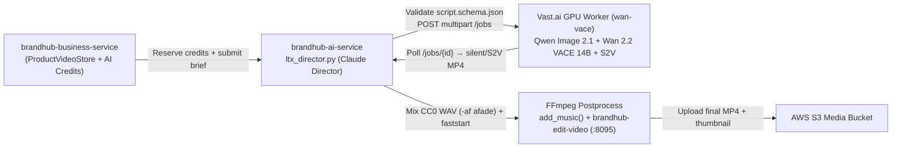

# AI Video Generation Architecture & Model Evaluation Report

> [<< Knowledge Base Home](../index.md) · [AI Models & Research](./README.md) · [AI Service Architecture](../architecture/ai-service-architecture.md)

This specification documents BrandHub's end-to-end AI video generation research and final production architecture powering **AI Video Generation (`FR 3.7.9`–`3.7.11`)** and **Product Video Studio (`FR 3.6.34`–`3.6.35`)**:
1. **Phase 1 Evaluation**: Commercial API benchmarking (`veo-3.1-flash`) across **30 standardized marketing prompt templates**.
2. **Phase 2 Production Architecture**: Self-hosted **Wan 2.2 Fun VACE 14B + Qwen Image 2.1 + Wan 2.2 S2V 14B** on Vast.ai GPU workers (`gpu-workers/wan-vace/`), orchestrated by `brandhub-ai-service/app/services/ltx_director.py` and paired with FFmpeg server-side timeline rendering (`brandhub-edit-video`).

---

## 1. Phase 1 Commercial API Evaluation (`veo-3.1-flash`)

During AI Iteration 1 & 4, Google Veo (`veo-3.1-flash`) was evaluated as an API-first baseline for Text-to-Video and Image-to-Video generation:
- **Pricing Baseline**: `$0.40` per 5s clip at `1080p` (`$0.15` per 5s clip at `720p`).
- **API Constraints**: 4s / 6s / 8s single-call clip cap, `16:9` or `9:16` aspect ratios, `24 FPS`.

### Multi-Segment Chaining Cost Projection (API Baseline)

| Target Duration | API Chaining Strategy | 1080p Cost | 720p Cost | Estimated Render Latency |
| :--- | :--- | :--- | :--- | :--- |
| **5 seconds** | 1 API call | `$0.40` | `$0.15` | ~20s |
| **10 seconds** | 2 chained calls (1 stitch) | `$0.80` | `$0.30` | ~45s |
| **15 seconds** | 3 chained calls (2 stitches) | `$1.20` | `$0.45` | ~75s |
| **20 seconds** | 4 chained calls (3 stitches) | `$1.60` | `$0.60` | ~110s |

### Why Production Migrated Beyond Pure Veo Chaining
While last-frame feedback chaining solved basic continuity, commercial API calls suffered from three production blockers for Vietnamese e-commerce agencies:
1. **Packaging & Label Drift**: Pure text/single-frame I2V drifted brand logos and Vietnamese packaging typography across cuts.
2. **Strict Commercial Safety False Positives**: Benign skincare/fashion studio shots were intermittently rejected by opaque upstream safety filters.
3. **Unit Economics at 15–21s**: Multi-segment commercial TVCs cost `$1.20–$1.60` per render without deterministic start/end keyframe locking (`FLF2V`) or lip-synced Vietnamese speech (`S2V`).

---

## 2. Production Video Architecture: Wan 2.2 Fun VACE 14B + Qwen Image 2.1 + S2V

In production, `brandhub-ai-service` (`app/services/ltx_director.py`) acts as an **AI Director**, compiling user briefs and product/ambassador photos into a schema-validated JSON shooting script executed by the ComfyUI GPU worker (`gpu-workers/wan-vace/`).

### 2.1 Core Runtime Constants & Guardrails (`ltx_director.py` ↔ `build_vace_flow.py`)

| Parameter | Production Value | Enforcement Rule |
| :--- | :--- | :--- |
| **Frame Rate (`FPS`)** | `16 FPS` | Deterministic timeline grid shared between `ltx_director.py` and ComfyUI `WanVaceToVideo`. |
| **Segment Length (`DEFAULT_FRAMES`)** | `85 frames` (`5.31s`) | Every segment frame count MUST satisfy `4n + 1` (`check_script()` rejects invalid counts before touching GPU). |
| **Chained Seam (`OVERLAP`)** | `8 frames` (`0.5s`) | When `start = "prev"`, the last 8 frames of segment `i-1` condition the VACE control stream of segment `i`. |
| **Total Output Window** | `15.0s – 21.0s` | Validated via `MIN_SECONDS = 15`, `MAX_SECONDS = 21` prior to worker submission. |
| **Resolutions (`SIZES`)** | `9:16` (`576×1024`), `16:9` (`1024×576`) | Native vertical Reels/TikTok/Shorts and horizontal widescreen TVC profiles. |
| **Director Fallback** | Anthropic API → Claude CLI | Primary `generate_claude()` call with automatic fallback to `claude_cli()` (`VIDEO_DIRECTOR_MODEL`, stdin-isolated). |

### 2.2 Multi-Stage GPU Synthesis Pipeline (`gpu-workers/wan-vace/`)
1. **4-Angle Qwen Turnaround Sheet (`views`)**: Qwen Image 2.1 synthesizes consistent front/side/three-quarter/detail product reference sheets from `reference_image` (attachment 1) so packaging geometry never warps during camera orbit.
2. **Storyboard Panel Grids (`K0..K3` or `K0..K7`)**: Qwen Image Edit renders one or two `2×2` contact sheets (`storyboard_prompt` / `storyboard_prompts`). When a Virtual Ambassador or model photo is supplied (`character_image_base64` / `extra_images`), it is injected as **image 3** so every panel preserves exact facial identity.
3. **Wan 2.2 Fun VACE 14B Motion Synthesis**: Each segment runs either **First-Last-Frame-to-Video (`FLF2V`)** between storyboard panels (`start: K_a`, `end_panel: K_b`) or **seam-chained continuation** (`start: "prev"`) with `8`-frame latent overlap.
4. **Wan 2.2 S2V 14B Lip-Sync (`ugc` genre)**: For talking-head UGC scripts, TTS audio drives `WanSoundImageToVideo` for frame-accurate Vietnamese lip synchronization.
5. **Audio Mastering & Studio Timeline (`add_music` & `brandhub-edit-video`)**: `ltx_director.py` mixes looped CC0 background tracks (`app/resources/product-video/music/*.wav`, `0.5s` fade-in, `1.5s` fade-out, `aac 192k`, `+faststart`). Users can subsequently refine cuts, captions, and overlays in the Web Video Studio backed by `brandhub-edit-video` (`:8095`).

---

## 3. Prompt Engineering Rules & 30-Prompt Benchmark Summary

### 3.1 Five Production Prompt Rules (Applied in `DIRECTOR_PROMPT.md` & `prompt-rules-wan.md`)
1. **Linear Scene Ordering**: Structure every segment prompt strictly as *Environment/Stage → Hero Product/Subject → Single Physical Action → Camera Trajectory → Lighting & Material Texture*.
2. **Zero Meta-Instruction Noise**: Never use conversational filler (`"Please generate a video of..."`); open directly with framing and physical optics (`"Close-up 50mm studio shot of..."`).
3. **Physical Surface & Lighting Anchors**: Specify tangible lighting and surface cues (*softbox key light, specular glass highlight, matte anodized aluminum, natural window rim light*) while avoiding synthetic CGI buzzwords that cause plastic skin.
4. **Explicit Cinematographic Camera Verbs**: Parameterize camera motion with unambiguous verbs (*slow dolly in, locked-off tripod, gentle pan right, tabletop macro push*)—see [camera-movement-ai-prompts.md](./camera-movement-ai-prompts.md).
5. **One Core Action per 5-Second Beat**: Restrict each `85`-frame (`5.3s`) segment to a single physical action; never combine rapid subject locomotion with simultaneous zoom/orbit, which causes limb or label warping.

### 3.2 Benchmark Across 30 Standardized Marketing Prompts

All 30 standardized marketing video prompt templates were benchmarked for render latency, surface/motion fidelity (`1–5`), and per-segment cost during Phase 1 (`video_templates.py` baseline) prior to codifying the VACE storyboard presets:

| Template ID | Template Archetype | Avg Render Time (5s) | Visual Fidelity (`1–5`) | Baseline API Cost | Key Engineering Finding |
| :--- | :--- | :---: | :---: | :---: | :--- |
| `01` | **Product Intro — Static Hero** | `18s` | `4.8` | `$0.40` | Crispest packaging typography and specular material fidelity; adopted as `K0` opening anchor. |
| `02` | **Product Intro — Slow Pan** | `21s` | `4.5` | `$0.40` | Smooth horizontal parallax without edge warping when subject remains stationary. |
| `05` | **Lifestyle — Dynamic Zoom In** | `25s` | `4.2` | `$0.40` | Minor focus softening in final frames under unconstrained I2V; resolved in VACE via `end_panel` FLF2V lock. |
| `12` | **Unboxing — Locked Tabletop** | `19s` | `4.9` | `$0.40` | Natural hand-object interaction and realistic studio shadow falloff (`example_unbox_chained.json`). |
| `01–30` | **Full 30-Template Suite (Aggregate)** | `~20s` / beat | **`4.6` avg** | `$0.40` / beat | Static & single-axis camera moves (` dolly`, `pan`, `locked`) consistently outperform compound camera + subject motion. |

---

## 4. Operational Risks & Mitigations

| Risk / Failure Mode | Root Cause | Production Mitigation |
| :--- | :--- | :--- |
| **Subject / Label Warping on Compound Motion** | Simultaneous fast subject movement (`subject_walk`) + camera zoom degrades latent geometry in trailing frames. | Lock tripod camera when subject moves rapidly, or lock product stationary during camera orbit + supply 4-angle Qwen turnaround sheet. |
| **Malformed LLM Shooting Script** | LLM outputs invalid frame counts (not `4n+1`), out-of-range panel indices, or total duration outside `15–21s`. | `check_script()` validates `script.schema.json` + exact frame/panel math in `brandhub-ai-service` before allocating GPU worker time. |
| **GPU Cold-Start / Spot Interruption** | Ephemeral Vast.ai GPU worker offline or restarting. | Credit reservation in PostgreSQL (`ai_credit_reservations` + `product_video_attempts`) only captures credits upon verified output delivery; failed jobs release reserved credits automatically. |
