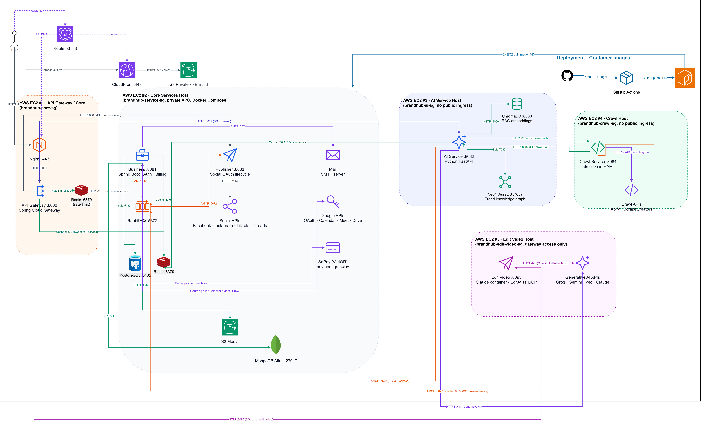

# System Architecture (`docs/architecture/`)

> Navigation: [← Knowledge Base Hub](../index.md) · [← ADR Index](../adr/README.md) · [API Contracts →](../api/README.md) · [Database Design →](../database/README.md) · [AWS Production Ops →](../operations/README.md)

Authoritative architectural specifications, microservice ownership boundaries, inter-service REST/RabbitMQ/STOMP contracts, sequence flows, Hybrid GraphRAG blueprints, and interactive topology visualizers for **BrandHub**.

---

## 1. End-to-End System Topology

- **Rendered High-Resolution Diagram**: `docs/architecture/system/system-architecture.png` (embedded above)
- **Editable Vector Source**: `docs/architecture/system/system-architecture.drawio` (open with `diagrams.net` or the VS Code Draw.io extension; historical V1 source is archived in [V1 Legacy Archive](../archive/v1-legacy/README.md))

---

## 2. Core Architecture Specifications (`.md`)

| Document | Scope & Code-Verified Highlights |
| :--- | :--- |
| [System Technical Overview](./technical-overview.md) | Master architectural synthesis across the **6 Canonical Roles** (`Guest`, `Owner`, `Manager`, `Creator`, `Client`, `Admin`), **141 FRs (`3.2.1`–`3.10.14`)**, 7-repo Polyrepo, 5-engine Polyglot Persistence (`97` PG tables + `52` Mongo collections + Redis + ChromaDB + Neo4j), RS256 + `AES-256-GCM` + S3 Envelope Security, and AWS `ap-southeast-1` + Vast.ai deployment |
| [Service Boundaries](./service-boundaries.md) | Strict database, domain, and runtime ownership rules across `brandhub-api-gateway` (`:8080`), `brandhub-business-service` (`:8081`), `brandhub-ai-service` (`:8082`), `brandhub-publisher-service` (`:8083`), `brandhub-crawl` (`:8084`), `brandhub-web`, and `brandhub-mobile-app` |
| [Local Run Architecture](./local-run-architecture.md) | Modular Docker Compose v2 `include:` graph (`docker/compose/dev/compose.yaml`, `dev-ai/compose.yaml`, 6 `shared/*.yaml` fragments), local `postgres:17-alpine` + `mongo:7.0` bootstrap, host hot-reload workflows, and Expo `:8090` mobile networking |
| [Sequence Diagrams (4 Core Flows)](./sequence-diagrams.md) | Mermaid sequence diagrams for Content Authoring & Atomic AI Credit Reservation, 3-Tier Approval Sequence (`Creator -> Manager -> Client`), Asynchronous RabbitMQ Social Publishing, and RS256 Token Rotation |
| [`business-service` ↔ `ai-service` REST Contract](./business-ai-rest-contract.md) | Internal `/api/v1/ai/*`, `/api/v2/ai/image/*`, and `/internal/ai/*` contracts, `X-Internal-Key` security, `ProductVideoProduction` durable coordinator & Vast.ai Wan 2.2 VACE orchestration, and double-entry AI credit settlement |
| [AI Service Internal Architecture](./ai-service-architecture.md) | FastAPI router/service layering (`15` routers), ChromaDB `384d` tenant isolation, Neo4j Trend Knowledge Graph, Groq/Gemini/Claude LLM routing, Qwen Image 2.1 + Wan 2.2 Fun VACE/S2V GPU workers, and `Edit_Video` server auto-editing |
| [Brand Knowledge Base RAG Pipeline Design](./brand-rag-pipeline-design.md) | Dual Hybrid GraphRAG (ChromaDB `384d` HNSW + Neo4j APOC Entity Resolution), `500`-char / `50`-overlap chunking, S3 URI conventions, and hallucination checks |
| [Current AI Content Generation Flow](./ai-content-flow.md) | Code-verified comparison of quick `Generate with AI` vs. 3-variant Brand Hybrid GraphRAG caption generation (`HOOK_DRIVEN`, `STORYTELLING`, `DIRECT_CTA`) with Neo4j trend evidence, PhoBERT emotion signals, and Humanizer |

---

## 3. Interactive Architecture Visualizers (`.html`)

All standalone visualizers open directly inside the VitePress HTML Viewer:

| Interactive Diagram | What It Visualizes |
| :--- | :--- |
| [System Architecture & Auth Role-Check Flow](/view?file=architecture/architecture.html) | Client Layer (`brandhub-web`, `brandhub-mobile-app`), `brandhub-api-gateway` WebFlux filter chain, backend microservices, polyglot stores, **4 social APIs (Facebook, Instagram, TikTok, Threads)**, and 2-tier RBAC evaluation |
| [Database Ownership & Cross-DB Reference Map](/view?file=architecture/db-ownership-diagram.html) | Per-service ownership across `97` PostgreSQL tables, `52` MongoDB collections, ChromaDB, Neo4j, Redis, and S3, plus soft-UUID join and transactional outbox patterns |
| [Polyrepo Structure & Codebase Map](/view?file=architecture/polyrepo-structure.html) | Interactive directory tree and tech-stack metadata across all 7 `BrandHubOrganization` repositories |
| [RabbitMQ Publisher Contract](/view?file=architecture/rabbitmq-publisher-contract.html) | Queue/exchange topology (`publisher.job.exchange`, `publisher.retry.exchange` `1m`/`5m`/`15m` TTL delay queues, `publisher.job.dlq`) and `PublishJobMessage` JSON contracts |
| [Social Platforms API Specifications](/view?file=architecture/social-platforms-api-specs.html) | Container lifecycles, OAuth scopes, rate limits, and retry classification for **Facebook Graph v19.0**, **Instagram Graph v19.0**, **TikTok Content Posting v2**, and **Threads Publishing API** |
