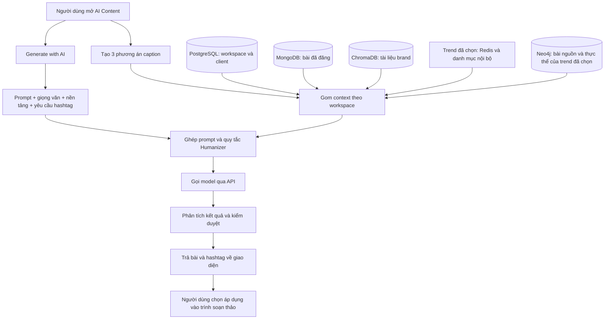

# Báo cáo luồng tạo content hiện tại

Ngày đối chiếu: 03/11/2026. Phạm vi: code local và các tên provider/model trong `.env` của AI Service. Đã đọc kiểm chứng Neo4j thật; chưa gọi AI sinh caption thật, kiểm kê toàn bộ database hoặc xác nhận tiến trình đang chạy đã nạp cấu hình mới.

## 1. Kết luận

Hiện có hai nhánh tạo văn bản riêng trong cùng giao diện. Nhánh Generate with AI chỉ dùng thông tin form và một phần nội dung đang soạn. Nhánh tạo ba caption tự gom thêm dữ liệu brand/client, bài đã đăng, tài liệu RAG và trend được chọn. Với trend sự kiện của pipeline, nhánh ba caption đã bổ sung các thực thể được nhắc đến và bài nguồn từ Neo4j. Humanizer đã được đưa vào prompt của cả hai nhánh.

Sơ đồ thể hiện nguồn có trong code; không khẳng định tất cả các nguồn hiện có dữ liệu. Quyền truy cập và credit được xử lý tại Business Service trước khi gọi AI.

## 2. Nhánh Generate with AI

1. `editor/index.tsx` chuyển tối đa 180 ký tự đầu của caption đang soạn làm `topic` cho panel.
2. `AIGeneratePanel` gửi prompt người dùng nhập, topic, giọng văn, nền tảng và số hashtag yêu cầu. Khi tạo lại, gửi thêm phản hồi và caption trước.
3. `aiGenerationService.generatePost` nối các phần trên thành một trường `topic`, gọi `POST /api/v1/ai/content/generate` qua gateway và Business Service.
4. Business Service xác thực người dùng/workspace, giữ credit, chống xử lý trùng khi dùng cùng khóa idempotency, rồi chuyển payload sang AI Service. Nó bổ sung `client_id` và `workspace_id` nhưng nhánh này không dùng các ID đó để truy vấn brand hoặc RAG.
5. AI Service ghép system prompt, tone, hướng dẫn nền tảng và Humanizer rồi gọi LLM. Nó trích hashtag từ văn bản bằng biểu thức chính quy và chạy kiểm duyệt nội dung.
6. Web nhận caption, hashtag, trạng thái kiểm duyệt. Hashtag được cắt theo số lượng người dùng yêu cầu. Người dùng bấm áp dụng để cập nhật editor; việc tạo content không tự đăng bài.

**Dữ liệu chưa được lấy trong nhánh này:** hồ sơ workspace/client, bài cũ trong MongoDB, tài liệu ChromaDB, trend-fit, ảnh sản phẩm. Một lần gọi sinh văn bản bình thường cho ra một bài, không phải ba phương án. Không có bước PhoBERT hoặc kiểm tra số liệu của `caption_service` trên nhánh này.

## 3. Nhánh tạo ba phương án caption

Web gọi `POST /api/v1/workspaces/{workspaceId}/ai/captions`. Request chứa chủ đề, tone, nền tảng, độ dài, ngôn ngữ, mục tiêu bài; có thể có `taskId`, `trendId` và kỹ thuật bắt trend.

| Nguồn | Dữ liệu code đang lấy | Điều kiện / giới hạn |
| --- | --- | --- |
| Form người dùng | Chủ đề, mục tiêu, giọng văn, nền tảng, độ dài, VI/EN | Luôn dùng |
| PostgreSQL `workspaces` | Tên, ngành, tagline, mô tả | Theo workspace hiện tại |
| PostgreSQL `workspace_members` + `client_profiles` | Công ty, ngành, tagline, mô tả của tối đa ba thành viên CLIENT đang hoạt động | Chưa chọn riêng một client/sản phẩm cho lần viết |
| PostgreSQL `tasks` | Tiêu đề task | Chỉ khi có `taskId`; chưa lấy toàn bộ brief hoặc content request liên kết |
| MongoDB `posts` | Tối đa ba bài `PUBLISHED` gần nhất của workspace | Mỗi bài tối đa 600 ký tự; dùng làm mẫu giọng, không làm nguồn bịa dữ kiện |
| ChromaDB `brandhub_rag` | Tối đa ba đoạn tài liệu liên quan đến chủ đề | Lọc metadata `clientId = workspaceId`; mỗi đoạn tối đa 800 ký tự; lỗi/không có thì tiếp tục với danh sách rỗng |
| Trend đã chọn | Trend card: sự kiện/moment, keywords, ví dụ, cách áp dụng | Chỉ khi người dùng chọn; tra cứu lại bằng ID tại AI Service |
| Neo4j | Bài nguồn và người/địa điểm/tổ chức/sản phẩm/sự kiện được nhắc trong các bài đó | Chỉ với trend pipeline đã được tra cứu hợp lệ; tối đa 3 nguồn, 12 lượt nhắc, 3.000 ký tự |
| Brand profile | Tên, ngành, mô tả; `voice_level=1`, `emoji=few` | Business chỉ gửi profile này khi có `trendId`; giọng vẫn là mặc định |

RAG dùng embedding `intfloat/multilingual-e5-small` để tìm đoạn tài liệu gần với chủ đề. Nó truy vấn kho đã nhập trước đó, không tự tìm thông tin sản phẩm trên Internet.

Nguồn trend gồm:

- Lịch dịp/lễ tại `app/data/moments_vn.json`.
- Format/meme đã nhập tại `app/data/trend_formats.json`.
- Kết quả pipeline AI-05 đã công bố trong Redis snapshot/live cache. Bấm tạo caption không tự chạy lại crawler hoặc T1–T7.

Trend-fit lọc theo luật, dùng LLM chấm độ phù hợp và lưu cache theo brand/ngày. Khi sinh caption, AI lấy trend card được chọn để đưa vào prompt.

Neo4j bổ sung dữ liệu ở bước viết caption, không làm lại toàn bộ bảng xếp hạng trend. Query chỉ đọc đúng ID trend qua quan hệ `CrawledPost - BELONGS_TO -> Trend` và `CrawledPost - MENTIONS -> Entity`, kèm URL bài nguồn. Các node có `brand_id` của client khác bị loại. Các quan hệ suy diễn như `PROMOTED` không được đưa vào làm bằng chứng.

Context graph giúp hiểu ai/cái gì/ở đâu được thảo luận; việc một thương hiệu được nhắc không chứng minh có tài trợ, đại diện hay quan hệ với sản phẩm đang viết. URL được giữ làm xuất xứ trong prompt, không tự mở website lấy thêm dữ liệu. Neo4j hiện không lưu nguyên văn bài trong đường ingestion này; phần trích đoạn nội dung vẫn đến từ trend card Redis.

Query có timeout 2 giây, toàn bộ bước graph có deadline 3 giây. Nếu Neo4j lỗi/không có bằng chứng thì tiếp tục với context cũ; không bịa dữ liệu thay thế. Context graph được giữ riêng khỏi nguồn đối chiếu số liệu sản phẩm và không thêm lời gọi LLM.

## 4. Từ dữ liệu đến kết quả

1. Business gom context, kiểm tra quyền và giữ credit; gửi request nội bộ tới `/api/v1/ai/content/captions/generate`.
2. AI bổ sung RAG, trend card và bằng chứng Neo4j nếu có, ghép chủ đề, dữ kiện, mẫu giọng, mục tiêu, style của nền tảng và Humanizer.
3. Trong một lần sinh thành công, LLM trả JSON gồm đúng ba loại: `HOOK_DRIVEN`, `STORYTELLING`, `DIRECT_CTA`. Humanizer yêu cầu model tự rà câu sáo rỗng và giữ dữ kiện ngay trong request đó, chỉ trả kết quả cuối.
4. AI kiểm tra JSON/schema, tách hashtag, tính số ký tự và gắn tín hiệu: số liệu không xuất hiện trong nguồn, có dùng keyword trend không, emoji, lộ prompt, chữ ngoại ngữ bất thường, từ nhạy cảm và độ dài. PhoBERT emotion v12 bổ sung phân bố cảm xúc nếu model tải được; thiếu model thì tín hiệu cảm xúc rỗng.
5. API kiểm duyệt từng caption qua dịch vụ text moderation, trả `PASSED`, `WARNING`, `BLOCKED` hoặc `NOT_CHECKED` cùng lý do.
6. Business lưu request, ba kết quả, context và credit vào PostgreSQL `ai_caption_generations`; trả `generationId`, captions, context đã dùng và số credit về web. Hệ thống credit còn lưu output thực thi để có thể phát lại kết quả đã có.
7. Popup hiển thị ba bài. Khi chọn chèn/thay thế, web cập nhật nội dung editor và gửi lựa chọn về backend; `chosen_type`, `chosen_action`, `final_text`, `chosen_at` được ghi vào lịch sử. Lưu lựa chọn không tự train lại model.
8. Sửa một bài hoặc chuyển nền tảng là request mới, có thể tính credit theo cấu hình hiện tại. Hai thao tác này cũng có Humanizer.

Kiểm tra số liệu hiện là đối chiếu chữ số trong nguồn, không phải xác minh toàn bộ nội dung bằng nguồn độc lập. Nhiều kiểm tra chỉ gắn cảnh báo; không nên hiểu mọi bài trả về đều đã được xác nhận đúng sự thật.

## 5. Provider/model theo cấu hình local

| Nhánh | Cách chọn hiện tại |
| --- | --- |
| Generate with AI | Frontend không gửi provider; schema AI mặc định `groq`, model `.env` là `openai/gpt-oss-120b` |
| Ba caption thông thường | Theo `LLM_PROVIDER`; `.env` hiện đặt `gemini`, model `gemini-3.5-flash-lite` |
| Caption có trend-fit / brand profile | Theo `TREND_FIT_LLM_PROVIDER`; `.env` hiện cũng là `gemini` |

Trong `llm_service`, Groq có thể chuyển sang Deploy khi gặp lỗi tạm thời/kết quả không đạt; đường provider thất bại có thể chuyển sang Claude nếu có key. Vì vậy một thao tác không phải lúc nào cũng tương đương đúng một request HTTP tới nhà cung cấp. Humanizer không thêm một lần gọi riêng. Kiểm duyệt và chấm trend là các lời gọi riêng với lời gọi sinh caption.

Đây là cấu hình trên đĩa, chưa phải bằng chứng provider/model nào vừa xử lý thành công một request thực tế.

## 6. Điểm còn thiếu cần lưu ý

1. Hai nút tạo content chưa dùng chung mức context: nhánh nhanh thiếu dữ liệu mà nhánh ba caption đã gom.
2. Voice profile còn dựng từ workspace với giá trị mặc định; chưa phải hồ sơ giọng thương hiệu hoàn chỉnh do khách hàng duyệt.
3. Form văn bản hiện không gửi ảnh sản phẩm. AI Service có hỗ trợ `image_urls` ở schema ba caption, nhưng UI/Business request đang dùng chưa nối trường này.
4. Context sản phẩm chưa có truy vấn catalog sản phẩm riêng. Tên, thành phần, lợi ích, giá và ưu đãi chỉ có nếu người dùng nhập hoặc tài liệu/context đã chứa.
5. Business đang có fallback trend ghi cứng như “Thời trang bền vững” khi upstream lỗi. Nhánh gợi ý hashtag riêng cũng có fallback hashtag về thời trang dưới một số lỗi 503. Các giá trị này có thể không liên quan sản phẩm và không phải kết quả trend pipeline thực tế.
6. Dataset train trên máy không được đọc trực tiếp mỗi lần bấm tạo content. Luồng đang suy luận qua API nhà cung cấp; PhoBERT chỉ tham gia kiểm tra cảm xúc. Humanizer là chỉ dẫn prompt, không phải model sinh văn bản mới.

## 7. Mã nguồn đối chiếu

- Web form: `brandhub-web/src/pages/editor/components/AIGeneratePanel.tsx`.
- Web request nhanh: `brandhub-web/src/services/aiGenerationService.ts`.
- Popup ba caption: `brandhub-web/src/components/ai/AiCaptionDialog.tsx`.
- Gom brand/client/bài cũ: `brandhub-business-service/src/main/java/com/brandhub/business/service/ai/CaptionContextService.java`.
- Sinh và lưu ba caption: `brandhub-business-service/src/main/java/com/brandhub/business/service/ai/AiCaptionService.java`.
- Credit/dispatch: `brandhub-business-service/src/main/java/com/brandhub/business/service/AiCreditGenerationService.java`.
- API AI: `brandhub-ai-service/app/api/v1/endpoints/content.py`.
- Prompt/RAG/tín hiệu: `brandhub-ai-service/app/services/caption_service.py`.
- Provider: `brandhub-ai-service/app/services/llm_service.py`.
- Humanizer: `brandhub-ai-service/app/utils/humanizer.py`.
- Context Neo4j: `brandhub-ai-service/app/services/trend_fit/graph_context.py`.

## 8. Kiểm chứng phần Neo4j

Ngày 03/11/2026: `EXPLAIN` query trên Neo4j thật thành công; đọc một trend có bằng chứng trả 3 bài nguồn, 5 lượt nhắc thực thể, context 692 ký tự. Không ghi database hoặc gọi AI sinh bài có phí. Bộ test caption, graph, API và trend-fit ban đầu đạt 93 test; kết quả kiểm tra giới hạn ký tự bổ sung được lưu tại `docs/feature/caption-neo4j-context/test.md`.
