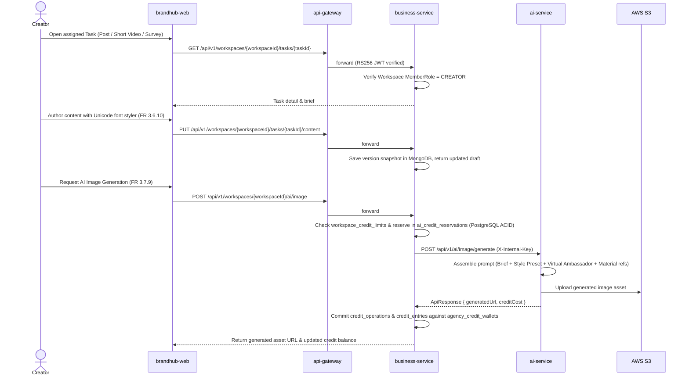
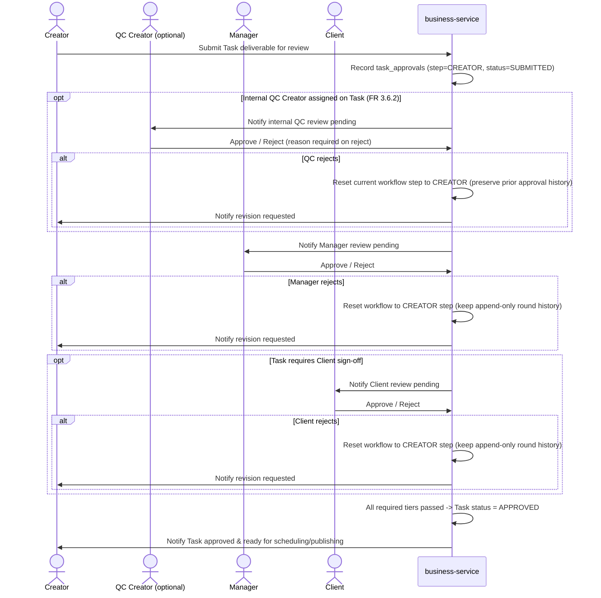
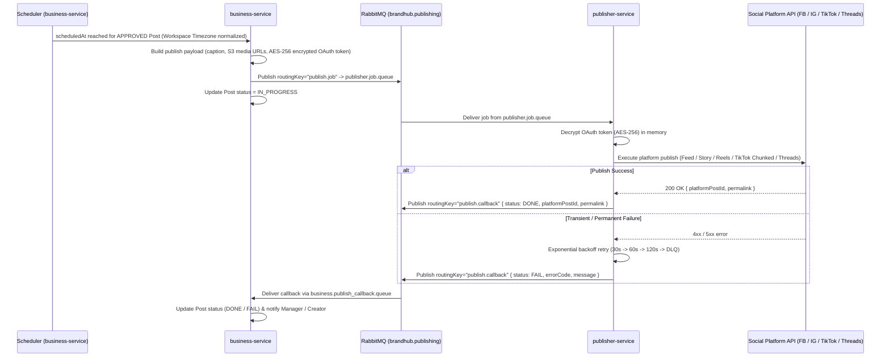
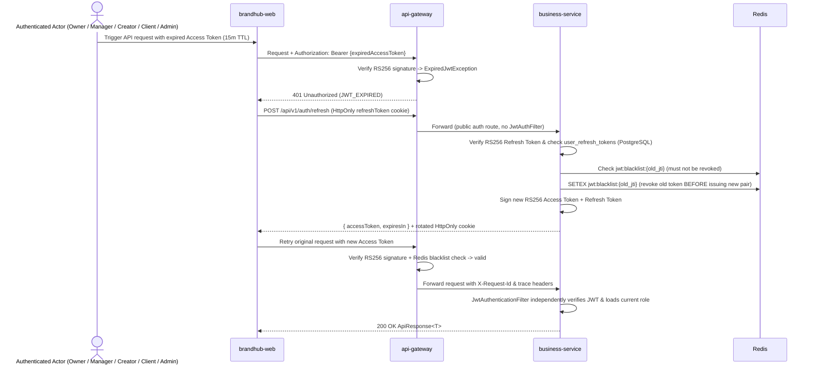

# Sequence Diagrams — 4 Core Flows

> Navigation: [← Knowledge Base Hub](../index.md) · [← Architecture Index](./README.md) · [Service Boundaries](./service-boundaries.md) · [RS256 JWT Flow](../api/rs256-jwt-flow.md)
>
> Sơ đồ trình tự chuẩn cho 4 luồng cốt lõi của hệ thống BrandHub theo mô hình `Agency → Workspace → Media Package → Media Campaign → Task → Post` và quy trình phê duyệt 3 tầng (`Creator -> Manager -> Client`).

---

## 1. Content Creation & Atomic AI Credit Reservation (`FR 3.6.10`, `FR 3.7.9`, `FR 3.9.4`)

---

## 2. Three-Tier Approval Sequence (`Creator -> Manager -> Client`, `FR 3.6.9`)

---

## 3. Asynchronous Auto-Publishing via RabbitMQ (`FR 3.8.6`–`FR 3.8.15`)

---

## 4. RS256 Access Token Refresh & Blacklist Rotation (`FR 3.2.2`, `FR 3.2.8`)

---

## Ghi chú kỹ thuật quan trọng

- **Đặt chỗ AI Credit nguyên tử (Atomic Credit Reservation):** `business-service` kiểm tra `workspace_credit_limits` và khóa tạm số dư trong `ai_credit_reservations` **trước** khi gọi `ai-service`; nếu tiến trình AI báo lỗi hoặc timeout, hệ thống tự động giải phóng/hoàn trả credit mà không làm thất thoát quỹ của `Owner` (`BR-48`, `BR-60`).
- **Quy tắc trả bài khi Reject (`FR 3.6.9`):** Bất kỳ cấp duyệt nào (`QC Creator`, `Manager`, hoặc `Client`) nhấn Reject kèm lý do bắt buộc đều đưa tiến trình về bước đầu tiên cho `Creator` chỉnh sửa, đồng thời giữ nguyên toàn bộ lịch sử nhận xét và các vòng duyệt trước trong `task_approvals` (xem [BA Content & Workflow](../ba/05-content-task-workflow.md)).
- **Giao tiếp xuất bản hai chiều qua RabbitMQ:** Cả chiều giao việc (`publisher.job.queue`) và chiều nhận kết quả (`business.publish_callback.queue`) đều đi qua RabbitMQ durable queues (xem [RabbitMQ Publisher Contract](/view?file=architecture/rabbitmq-publisher-contract.html)).
- **Chống Race Condition khi Refresh Token:** `jti` cũ bắt buộc được đưa vào Redis blacklist **trước** khi ký cặp token mới (xem [RS256 JWT Flow](../api/rs256-jwt-flow.md)).
