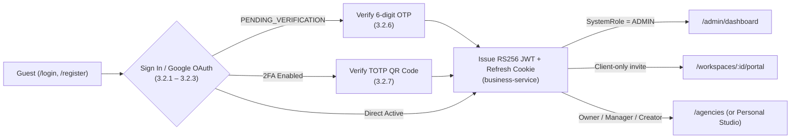

# 02 — Xác thực, Phân quyền & Hồ sơ Người dùng / Khách hàng (Authentication, Authorization & Profiles)

> Navigation: [← BA Overview & Hub](./README.md) · [← 01 - Organization Structure](./01-organization-structure.md) · [Tiếp: 03 - Agency & Workspace →](./03-agency-workspace.md)
>
> **Phạm vi FR chuẩn** (đồng bộ 100% với `Các FR của hệ thống  - Feature_Function Requirement.csv`):
> - **Mục `3.2 Authentication & Authorization`**: **9 FR (`3.2.1` – `3.2.9`)** | `UC-001` – `UC-009` | Đặc tả SRS: [01-authentication](../feature/srs/01-authentication/README.md)
> - **Mục `3.3 User & Client Profile`**: **4 FR (`3.3.1` – `3.3.4`)** | `UC-010` – `UC-013` | Đặc tả SRS: [02-profile](../feature/srs/02-profile/README.md)
> - Use Cases chi tiết: [use-cases/01-authentication-profile.md](./use-cases/01-authentication-profile.md)

---

## 1. Bảng Tổng hợp Yêu cầu Chức năng Chuẩn (`3.2` & `3.3` — 13 FRs)

| Mã FR | Mã UC | Tên Chức năng Chuẩn (141-FR Baseline) | Actors / Roles Chuẩn | Mô tả Nghiệp vụ Cốt lõi |
| :-: | :-: | :--- | :--- | :--- |
| **`3.2.1`** | `UC-001` | **Sign Up** | `Guest` | Đăng ký tài khoản mới bằng Họ tên, Email (chuẩn hóa chữ thường `BR-01`) và Mật khẩu (≥8 ký tự, ≥1 chữ số, băm bcrypt `BR-02`). Khởi tạo ở `PENDING_VERIFICATION`, sinh OTP 6 chữ số hiệu lực 10 phút (`BR-03`) chuyển sang `3.2.6`. |
| **`3.2.2`** | `UC-002` | **Sign In with Email** | `Guest`, `Owner`, `Manager`, `Creator`, `Client`, `Admin` | Đăng nhập trực tiếp bằng Email & Mật khẩu trên `/login` (không gửi lại OTP mỗi lần đăng nhập trừ khi tài khoản bật 2FA TOTP ở `3.2.7`). Kiểm tra trạng thái hoạt động (`BR-05`) và cấp cặp RS256 Access Token (15 phút) + Refresh Token (30 ngày). |
| **`3.2.3`** | `UC-003` | **Sign In with Google OAuth** | `Guest`, `Owner`, `Manager`, `Creator`, `Client`, `Admin` | Đăng nhập hoặc đăng ký nhanh 1 chạm qua Google OAuth 2.0 (`/login`, `/register`). Xác thực Google ID Token & cờ `email_verified`, tự động liên kết hoặc khởi tạo tài khoản `ACTIVE` (`BR-07`). |
| **`3.2.4`** | `UC-004` | **Reset Password** | `Guest`, `Owner`, `Manager`, `Creator`, `Client`, `Admin` | Khôi phục mật khẩu khi quên tại `/forgot-password`, `/reset-password` qua mã xác thực OTP 6 chữ số (hiệu lực 10 phút `BR-03`, tối đa 5 lần sai `BR-04`). Sau khi đặt mật khẩu mới hợp lệ (`BR-02`), thu hồi toàn bộ các phiên cũ (`BR-08`). |
| **`3.2.5`** | `UC-005` | **Change Password** | `Owner`, `Manager`, `Creator`, `Client`, `Admin` | Đổi mật khẩu chủ động tại `/profile/security` bằng cách xác nhận Mật khẩu hiện tại + Mật khẩu mới (khác mật khẩu cũ `BR-08`) và thu hồi Refresh Token trên các thiết bị khác. |
| **`3.2.6`** | `UC-006` | **OTP Verification** | `Guest`, `Owner`, `Manager`, `Creator`, `Client`, `Admin` | Xác thực mã OTP 6 chữ số gửi qua email trên `/verify-otp` phục vụ kích hoạt tài khoản mới (`3.2.1`) hoặc đặt lại mật khẩu (`3.2.4`). Dùng 1 lần trong 10 phút (`BR-03`); sai quá 5 lần sẽ khóa mã và yêu cầu `Resend OTP` (cooldown 60 giây `BR-04`). |
| **`3.2.7`** | `UC-007` | **Two-Factor Authentication (2FA, TOTP)** | `Owner`, `Manager`, `Creator`, `Client`, `Admin` | Thiết lập và xác thực bảo mật 2 lớp chuẩn RFC 6238 bằng ứng dụng Authenticator. Chỉ hiển thị mã QR và ô nhập mã TOTP 6 chữ số (chu kỳ 30 giây, lệch ±1 bước `BR-09`); **đã lược bỏ hiển thị Secret Key dạng văn bản và Backup Codes**. |
| **`3.2.8`** | `UC-008` | **Logout** | `Owner`, `Manager`, `Creator`, `Client`, `Admin` | Đăng xuất phiên hiện tại: đưa RS256 Access Token và Refresh Token vào danh sách thu hồi trên Redis (`jwt:blacklist:{jti}`), xóa trạng thái nhạy cảm nhưng lưu lại gợi ý phương thức đăng nhập/không gian gần nhất (`BR-05`). |
| **`3.2.9`** | `UC-009` | **Delete Account** | `Owner`, `Manager`, `Creator`, `Client`, `Admin` | Xóa mềm (`Soft Delete`) tài khoản cá nhân tại `/profile/security` kèm xác nhận mật khẩu. Kiểm tra không còn giữ quyền `Owner` duy nhất của Agency đang hoạt động hoặc giao dịch treo (`BR-10`), lưu vết xóa mềm 30 ngày (`BR-16`). |
| **`3.3.1`** | `UC-010` | **View User Profile** | `Owner`, `Manager`, `Creator`, `Client`, `Admin` | Xem hồ sơ cá nhân tại `/profile`: Avatar, Họ tên, Email (chỉ đọc `BR-11`), Số điện thoại, Chức danh/Vai trò, Múi giờ, Ngôn ngữ giao diện (`VI`/`EN`), Ngày tham gia và trạng thái 2FA. |
| **`3.3.2`** | `UC-011` | **Update User Profile** | `Owner`, `Manager`, `Creator`, `Client`, `Admin` | Cập nhật Họ tên, Số điện thoại, Giới thiệu, Ngôn ngữ/Múi giờ và tải ảnh Avatar (`JPG`/`PNG`/`WEBP` ≤ 5 MB lên S3 `BR-12`); khóa cố định Email định danh (`BR-11`). |
| **`3.3.3`** | `UC-012` | **View Client Profile** | `Owner`, `Manager`, `Client` | Xem hồ sơ thương hiệu độc lập của `Client` (`/client/profile`) có thể tái sử dụng xuyên suốt nhiều Agency và Workspace khác nhau mà không cần nhập lại (`BR-13`, `BR-14`). |
| **`3.3.4`** | `UC-013` | **Update Client Profile** | `Owner`, `Manager`, `Client` | Cập nhật Tên thương hiệu, Logo, Ngành hàng, Website, Mã số thuế, Địa chỉ, Số điện thoại và Tông giọng thương hiệu (`/client/profile`); khóa không cho sửa Email định danh (`BR-14`) và tự động đồng bộ sang mọi Workspace liên kết (`BR-13`). |

---

## 2. Đặc tả Chi tiết Nhóm `3.2 Authentication & Authorization`

### 2.1. Đăng ký & Xác thực OTP (`3.2.1 Sign Up` & `3.2.6 OTP Verification`)
- **Chuẩn hóa định danh (`BR-01`)**: Địa chỉ email luôn được chuẩn hóa về chữ thường (`lowercase`) trước khi kiểm tra trùng lặp và lưu trữ.
- **Chính sách mật khẩu (`BR-02`)**: Tối thiểu 8 ký tự, chứa ít nhất 1 chữ số và băm một chiều bằng `BCrypt`.
- **Cơ chế OTP (`BR-03`, `BR-04`)**: Mã 6 chữ số có TTL 10 phút trên Redis; nếu nhập sai liên tiếp quá 5 lần thì vô hiệu hóa mã hiện hành và bắt buộc bấm `Resend OTP` (chờ cooldown 60 giây).

### 2.2. Đăng nhập Đa phương thức & 2FA (`3.2.2`, `3.2.3`, `3.2.7`)
- **Email/Password (`3.2.2 Sign In with Email`)** và **Google OAuth 2.0 (`3.2.3 Sign In with Google OAuth`)** dùng chung cơ chế phát hành cặp khóa bất đối xứng **RS256 JWT** (`Access Token` 15 phút + `Refresh Token` 30 ngày trong HttpOnly cookie — xem [RS256 JWT Flow](../api/rs256-jwt-flow.md)).
- **2FA TOTP (`3.2.7`)**: Thiết kế tối giản bề mặt tấn công — chỉ quét QR bằng Google/Microsoft Authenticator và xác nhận mã 6 số, không phơi bày chuỗi khóa bí mật thô hay mã dự phòng tĩnh.

### 2.3. Khôi phục / Đổi mật khẩu, Đăng xuất & Xóa mềm tài khoản (`3.2.4`, `3.2.5`, `3.2.8`, `3.2.9`)
- Khi hoàn tất `3.2.4 Reset Password` hoặc `3.2.5 Change Password`, hệ thống lập tức thu hồi các phiên đăng nhập cũ để bảo vệ tài khoản (`BR-08`).
- Khi thực hiện `3.2.9 Delete Account`, hệ thống kiểm tra ràng buộc `BR-10` (không còn là `Owner` duy nhất của Agency đang hoạt động hoặc còn giao dịch thanh toán treo), chuyển tài khoản sang `DELETED` (giữ thời gian ân hạn khôi phục 30 ngày `BR-16`) và thu hồi toàn bộ token trên Redis.

---

## 3. Đặc tả Chi tiết Nhóm `3.3 User & Client Profile`

### 3.1. Hồ sơ Cá nhân (`3.3.1 View User Profile` & `3.3.2 Update User Profile`)
- Lưu trữ thông tin định danh cá nhân, ảnh đại diện S3 (`≤ 5 MB`) và ngôn ngữ làm việc (`vi` / `en`) quyết định ngôn ngữ giao diện cũng như ngôn ngữ các email thông báo gửi tới người dùng. Trường Email đăng nhập luôn chỉ-đọc (`BR-11`).

### 3.2. Hồ sơ Thương hiệu Khách hàng Tái sử dụng (`3.3.3 View Client Profile` & `3.3.4 Update Client Profile`)
- Tách bảng `client_profiles` độc lập khỏi `users` (xem [Database Strategy V2](../database/schema/database-strategy.md)): một tài khoản `Client` duy trì một hồ sơ thương hiệu thống nhất (Logo, Tên thương hiệu, Mã số thuế, Ngành hàng, Tông giọng) tái sử dụng xuyên nhiều Agency/Workspace (`BR-13`), với địa chỉ email định danh cố định không thay đổi (`BR-14`).
- Logo và tên thương hiệu trong `Client Profile` đồng thời được dùng khi đóng dấu Watermark (`3.6.18`), xuất bản đề xuất/báo cáo PDF và làm tên hiển thị người gửi bản tin Newsletter.

---

## 4. Danh mục Quy tắc Nghiệp vụ Áp dụng (`BR-01` – `BR-14`, `BR-16`)

| Mã BR | Tên Quy tắc | Quy định Ràng buộc Cụ thể | FR Áp dụng |
| :-: | :--- | :--- | :--- |
| `BR-01` | **Chuẩn hóa & Duy nhất Email** | Email đăng ký luôn được cắt khoảng trắng và chuyển về chữ thường (`lowercase`); mỗi địa chỉ email chỉ gắn với tối đa 01 tài khoản `users` duy nhất. | `3.2.1`, `3.2.2`, `3.10.7` |
| `BR-02` | **Độ mạnh Mật khẩu & Băm** | Mật khẩu bắt buộc dài tối thiểu 8 ký tự, chứa ít nhất 1 chữ số và lưu trữ dưới dạng băm một chiều `BCrypt` (cost factor ≥ 10). | `3.2.1`, `3.2.4`, `3.2.5` |
| `BR-03` | **Thời hạn Mã OTP** | Mã OTP gồm 6 chữ số ngẫu nhiên, chỉ sử dụng đúng 01 lần trong thời hạn hiệu lực tối đa **10 phút** kể từ thời điểm cấp phát. | `3.2.1`, `3.2.4`, `3.2.6` |
| `BR-04` | **Chống Brute-force & Cooldown OTP** | Nhập sai OTP liên tiếp quá **5 lần** sẽ hủy hiệu lực mã hiện tại; yêu cầu gửi lại (`Resend OTP`) phải chờ tối thiểu **60 giây**. | `3.2.4`, `3.2.6` |
| `BR-05` | **Trạng thái Tài khoản Đăng nhập** | Chỉ tài khoản ở trạng thái `ACTIVE` mới được cấp phiên làm việc; tài khoản `PENDING_VERIFICATION` chuyển sang xác thực OTP, còn `SUSPENDED`/`BANNED`/`INACTIVE` bị từ chối ngay tại bước xác thực. | `3.2.2`, `3.2.3`, `3.2.8` |
| `BR-06` | **Cặp Khóa RS256 & Tách Quyền Gateway** | `brandhub-business-service` giữ khóa riêng tư RSA để ký `Access Token` (`15 phút`) + `Refresh Token` (`30 ngày`); `brandhub-api-gateway` chỉ giữ khóa công khai để xác minh chữ ký và đối chiếu danh sách thu hồi `jwt:blacklist:{jti}` trên Redis. | `3.2.2`, `3.2.3`, `3.2.8` |
| `BR-07` | **Liên kết Tự động Google OAuth** | Khi đăng nhập Google OAuth với `email_verified = true`, nếu email đã tồn tại ở trạng thái hợp lệ thì tự động liên kết bản ghi `user_oauth_providers`; nếu chưa có thì khởi tạo tài khoản `ACTIVE`. | `3.2.3` |
| `BR-08` | **Thu hồi Phiên khi Đổi Mật khẩu** | Mật khẩu mới không được trùng mật khẩu hiện hành; ngay khi đổi hoặc đặt lại mật khẩu thành công, toàn bộ `user_refresh_tokens` cũ của tài khoản bị thu hồi. | `3.2.4`, `3.2.5` |
| `BR-09` | **Chuẩn TOTP RFC 6238** | Mã bảo mật 2 lớp TOTP 6 chữ số có chu kỳ xoay vòng 30 giây (cho phép độ lệch đồng hồ `±1` bước); không hiển thị chuỗi khóa gốc dạng văn bản hay mã dự phòng tĩnh. | `3.2.7` |
| `BR-10` | **Điều kiện Tiên quyết Xóa Tài khoản** | Không cho phép xóa tài khoản nếu người dùng vẫn đang là `Owner` duy nhất của một `Agency` hoạt động có thành viên/dữ liệu chung hoặc còn giao dịch thanh toán treo `PENDING`. | `3.2.9` |
| `BR-11` | **Khóa Cố định Email Cá nhân** | Trường `users.email` là định danh gốc chỉ-đọc trên màn hình hồ sơ cá nhân và trang quản trị. | `3.3.1`, `3.3.2`, `3.10.8` |
| `BR-12` | **Giới hạn Tệp Ảnh Đại diện & Đính kèm** | Ảnh Avatar / Logo tải lên S3 chỉ chấp nhận định dạng ảnh hợp lệ (`JPG`, `PNG`, `WEBP`) với dung lượng tối đa `5 MB`. | `3.3.2`, `3.3.4`, `3.4.5` |
| `BR-13` | **Tái sử dụng Hồ sơ `Client` Đa Agency** | Một bản ghi `client_profiles` độc lập có thể liên kết đồng thời vào nhiều `Workspace` thuộc nhiều `Agency` khác nhau; cập nhật hồ sơ thương hiệu tự động phản ánh trên toàn bộ không gian liên kết. | `3.3.3`, `3.3.4` |
| `BR-14` | **Bất biến Email Hồ sơ Thương hiệu** | Địa chỉ email định danh trên `client_profiles` được khóa cố định sau khi khởi tạo để bảo toàn liên kết mời khách hàng xuyên hệ thống. | `3.3.3`, `3.3.4` |
| `BR-16` | **Ân hạn Xóa Mềm 30 Ngày** | Tài khoản cá nhân xóa mềm (`3.2.9`) được bảo lưu trạng thái 30 ngày trước khi hết hạn khôi phục. | `3.2.9`, `3.4.6`, `3.4.17` |

---

## 5. Sơ đồ Luồng Xác thực & Định tuyến Sau Đăng nhập

---

## 6. Ánh xạ Thực thể Cơ sở Dữ liệu & Dịch vụ Thực thi

- **PostgreSQL (`brandhub-business-service`)**: `users`, `user_oauth_providers`, `user_refresh_tokens`, `user_system_roles`, `account_activation_tokens`, `client_profiles`, `audit_logs`.
- **Redis (`brandhub-api-gateway` & `brandhub-business-service`)**: `jwt:blacklist:{jti}` (`TTL ≤ 15m`), `oauth:state:{state}` (`TTL 10m`), bộ nhớ đệm OTP & bộ đếm giới hạn sai `BR-04`.
