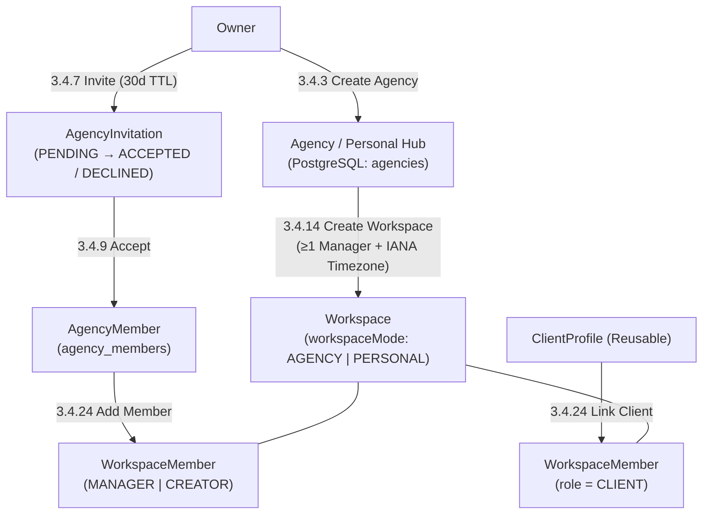

# 03 — Công ty, Không gian làm việc & Mẫu cấu hình (Agency & Workspace)

> Navigation: [← BA Overview & Hub](./README.md) · [← 02 - Authentication & Profile](./02-authentication-profile.md) · [Tiếp: 04 - Media Package & Campaign →](./04-media-package-campaign.md)
>
> **Phạm vi FR chuẩn** (đồng bộ 100% với `Các FR của hệ thống  - Feature_Function Requirement.csv`):
> - **Mục `3.4 Agency & Workspace`**: **26 FR (`3.4.1` – `3.4.26`)** | `UC-014` – `UC-039`
> - Use Cases chi tiết: [use-cases/02-agency-workspace.md](./use-cases/02-agency-workspace.md) · Đặc tả SRS: [03-agency-workspace](../feature/srs/03-agency-workspace/README.md)

---

## 1. Bảng Tổng hợp 26 Yêu cầu Chức năng Chuẩn (`3.4.1` – `3.4.26`)

| Mã FR | Mã UC | Tên Chức năng Chuẩn (141-FR Baseline) | Actors / Roles Chuẩn | Mô tả Nghiệp vụ Cốt lõi |
| :-: | :-: | :--- | :--- | :--- |
| **`3.4.1`** | `UC-014` | **List Agency** | `Owner`, `Manager`, `Creator`, `Client`, `Admin` | Xem danh sách toàn bộ các Agency mà người dùng đang sở hữu hoặc đang tham gia trên `/agencies`; hỗ trợ tìm kiếm và lọc `Owned` / `Joined` (`BR-15`, `BR-16`). |
| **`3.4.2`** | `UC-015` | **View Agency Dashboard** | `Owner` | Xem bảng điều khiển KPI tổng quan toàn công ty (`/agency/:id/dashboard`): tổng số Workspace hoạt động, thành viên, tiến độ Media Campaigns và mức tiêu thụ gói cước / AI Credit (`BR-15`, `BR-20`). |
| **`3.4.3`** | `UC-016` | **Create Agency** | `Owner`, `Manager`, `Creator` | Khởi tạo một Agency mới trên `/agencies/new` (hoặc tự động khởi tạo `Personal Studio` 1 chạm); kiểm tra giới hạn gói cước (`BR-58`) và gắn cứng `owner_id` với người tạo duy nhất (`BR-15`). |
| **`3.4.4`** | `UC-017` | **View Agency Profile** | `Owner`, `Manager`, `Creator`, `Client` | Xem trang hồ sơ giới thiệu năng lực công ty (`/agency/:id/profile`) gồm Tên, Logo, Ảnh bìa, Lĩnh vực chuyên môn, Website, Liên hệ và các gói dịch vụ mẫu để `Client` tham khảo. |
| **`3.4.5`** | `UC-018` | **Update Agency Profile** | `Owner` | Cập nhật thông tin hồ sơ công ty (`/agency/:id/settings`): Tên Agency, Mô tả, Website, Địa chỉ, Liên hệ và Logo/Banner mới (`BR-12`, `BR-15`). |
| **`3.4.6`** | `UC-019` | **Remove Agency** | `Owner` | Xóa mềm công ty (`Remove Agency`) kèm hộp thoại xác nhận tên Agency; chuyển sang `INACTIVE`/`DELETED_PENDING`, tạm khóa truy cập Workspace trực thuộc nhưng bảo lưu dữ liệu để khôi phục trong 30 ngày (`BR-16`). |
| **`3.4.7`** | `UC-020` | **Invite Agency Member** | `Owner` | Mời thành viên mới gia nhập Agency qua Email và thông báo hệ thống (`/agency/:id/members`, hỗ trợ chọn ngôn ngữ email `vi`/`en` và xem trước mẫu email); lời mời hết hạn sau 30 ngày (`BR-17`). |
| **`3.4.8`** | `UC-021` | **View Agency Invitation Status** | `Owner`, `Manager`, `Creator`, `Client` | Theo dõi danh sách và trạng thái các lời mời gia nhập Agency (`PENDING`, `ACCEPTED`, `DECLINED`, `EXPIRED`) kèm đếm ngược 30 ngày; `Owner` có thể gửi lại (`Resend`) hoặc thu hồi lời mời `PENDING` (`BR-17`, `BR-18`). |
| **`3.4.9`** | `UC-022` | **Accept Agency Invitation** | `Owner`, `Manager`, `Creator`, `Client` | Chấp nhận lời mời gia nhập Agency từ thông báo ứng dụng hoặc liên kết email (`/invitations/:token`) khi còn hạn 30 ngày (`BR-17`, `BR-18`). |
| **`3.4.10`** | `UC-023` | **Decline Agency Invitation** | `Owner`, `Manager`, `Creator`, `Client` | Từ chối lời mời tham gia Agency (`/invitations/:token`), chuyển trạng thái lời mời sang `DECLINED` và thông báo phản hồi cho `Owner` (`BR-17`, `BR-18`). |
| **`3.4.11`** | `UC-024` | **Remove Agency Member** | `Owner` | Xóa thành viên khỏi Agency (`/agency/:id/members`): thu hồi quyền truy cập vào Agency và các Workspace trực thuộc, nhưng **bảo toàn nguyên vẹn mọi tài nguyên/bài viết/tư liệu** mà người đó đã đóng góp (`BR-19`, `BR-21`). |
| **`3.4.12`** | `UC-025` | **List Workspace** | `Owner`, `Manager`, `Creator`, `Client` | Xem danh sách các Workspace (`/agency/:id/workspaces`): `Owner` thấy toàn bộ Workspace của Agency; `Manager`, `Creator`, `Client` chỉ thấy các Workspace mình được gán tham gia (`BR-20`). |
| **`3.4.13`** | `UC-026` | **View Workspace Dashboard** | `Owner`, `Manager`, `Creator`, `Client` | Xem bảng điều khiển tổng quan của từng Workspace (`/workspaces/:id/dashboard`): thống kê công việc theo trạng thái, lịch đăng bài sắp tới, tiến độ chiến dịch và mức dùng AI Credit (hiển thị `Personal Quick Launchpad` ở chế độ `PERSONAL`). |
| **`3.4.14`** | `UC-027` | **Create Workspace** | `Owner` | Tạo mới Workspace trực thuộc Agency (`/agency/:id/workspaces/new`): bắt buộc gán ít nhất 01 `Manager` (`BR-21`), cấu hình Tên, Mô tả, Múi giờ chuẩn IANA (`Timezone Configuration`, `BR-22`), chế độ `AGENCY`/`PERSONAL` và gói truyền thông ban đầu. |
| **`3.4.15`** | `UC-028` | **View Workspace Profile** | `Owner`, `Manager`, `Creator`, `Client` | Xem thông tin cấu hình chi tiết của Workspace (`/workspaces/:id/settings`) gồm Tên, Mô tả nhãn hàng, `Client` liên kết, Trạng thái và Múi giờ chuẩn IANA (`BR-20`, `BR-22`). |
| **`3.4.16`** | `UC-029` | **Update Workspace Profile** | `Owner`, `Manager` | Cập nhật Tên, Mô tả, Ảnh đại diện, Múi giờ chuẩn (`Timezone Configuration`, `BR-22`) và chuyển đổi chế độ `workspaceMode` (`PERSONAL ↔ AGENCY`) của Workspace. |
| **`3.4.17`** | `UC-030` | **Delete Workspace** | `Owner` | Xóa mềm Workspace (`/workspaces/:id/settings`): chỉ `Owner` được phép thực hiện, chuyển dữ liệu sang `INACTIVE` và cho phép khôi phục hoàn toàn trong vòng 30 ngày (`BR-15`, `BR-16`). |
| **`3.4.18`** | `UC-031` | **Leave Workspace** | `Owner`, `Manager`, `Creator`, `Client` | Rời khỏi một Workspace cụ thể mà vẫn giữ nguyên tư cách thành viên của Agency chủ quản (`BR-23`); nếu là `Manager` duy nhất đang hoạt động thì bắt buộc bổ nhiệm `Manager` thay thế trước khi rời (`BR-21`). |
| **`3.4.19`** | `UC-032` | **Save Workspace Template** | `Owner` | Lưu cấu hình chuẩn của một Workspace hiện hành (múi giờ, danh mục công việc mẫu, bộ hashtag, mẫu email, quy trình duyệt) thành Mẫu triển khai để tái sử dụng (`BR-24`). |
| **`3.4.20`** | `UC-033` | **View Workspace Templates** | `Owner` | Xem danh sách và chi tiết các mẫu cấu hình Workspace mặc định của hệ thống và các mẫu riêng do Agency đã lưu (`/agency/:id/workspace-templates`, `BR-24`). |
| **`3.4.21`** | `UC-034` | **Apply Workspace Template** | `Owner` | Áp dụng một mẫu cấu hình Workspace đã lưu vào Workspace mới hoặc hiện hành mà không làm ảnh hưởng dữ liệu lịch sử (`BR-22`, `BR-24`). |
| **`3.4.22`** | `UC-035` | **Delete Workspace Template** | `Owner` | Xóa mẫu cấu hình Workspace do Agency tự tạo khỏi thư viện mẫu; các Workspace đã áp dụng mẫu đó trước đây không bị ảnh hưởng (`BR-24`). |
| **`3.4.23`** | `UC-036` | **View Workspace Members** | `Owner`, `Manager`, `Creator`, `Client` | Xem danh sách các thành viên đang tham gia trong Workspace (`/workspaces/:id/members`) kèm vai trò (`Manager`, `Creator`, `Client`), ngày tham gia và trạng thái hoạt động (`BR-20`, `BR-21`). |
| **`3.4.24`** | `UC-037` | **Add Workspace Member** | `Owner`, `Manager` | Thêm thành viên thuộc Agency (hoặc tài khoản `Client` đối tác) vào Workspace và gán vai trò cụ thể (`MANAGER`, `CREATOR` hoặc `CLIENT`, `BR-20`). |
| **`3.4.25`** | `UC-038` | **Update Workspace Member Role** | `Owner`, `Manager` | Cập nhật vai trò của thành viên trong Workspace (ví dụ giữa `CREATOR` và `MANAGER`), đảm bảo luôn duy trì ít nhất 01 `Manager` đang hoạt động (`BR-21`). |
| **`3.4.26`** | `UC-039` | **Remove Workspace Member** | `Owner`, `Manager` | Xóa thành viên khỏi Workspace (`/workspaces/:id/members`): người bị xóa mất quyền truy cập Workspace đó nhưng tài nguyên đã đóng góp được giữ nguyên và họ vẫn thuộc Agency (`BR-19`, `BR-20`, `BR-21`). |

---

## 2. Quy tắc Nghiệp vụ Cốt lõi của `Agency` & `Workspace`

1. **Một `Owner` duy nhất cho mỗi `Agency` (`BR-15`)**: Quyền sở hữu gắn cố định qua `agencies.owner_id`. Khi người dùng cá nhân sử dụng chế độ `Personal Studio`, hệ thống tự động khởi tạo một `Personal Hub Agency` ngầm mà người đó làm `Owner`.
2. **Bảo toàn tài sản chung & Xóa mềm 30 ngày (`BR-16`, `BR-19`)**:
   - Xóa Agency (`3.4.6`) và xóa Workspace (`3.4.17`) đều là xóa mềm bảo lưu 30 ngày trước khi hết hạn lưu trữ.
   - Khi thành viên rời hoặc bị gỡ khỏi Agency/Workspace (`3.4.11`, `3.4.18`, `3.4.26`), toàn bộ bài viết, tư liệu và lịch sử công việc do họ tạo vẫn thuộc quyền sở hữu của Agency/Workspace.
3. **Ràng buộc `Manager` tối thiểu & Đồng bộ Múi giờ (`BR-21`, `BR-22`)**:
   - Mỗi Workspace đang hoạt động bắt buộc luôn có ít nhất 01 `Manager` (`ACTIVE`).
   - Trường `Timezone Configuration` theo chuẩn IANA (`Asia/Ho_Chi_Minh`, `America/New_York`...) tự động chuẩn hóa mọi mốc hạn chót công việc (`3.6.5`) và lịch xuất bản bài đăng (`3.8.6`) theo khu vực chiến dịch.
4. **Chuyển đổi linh hoạt `PERSONAL ↔ AGENCY` (`3.4.16 Update Workspace Profile`)**:
   - Cho phép nâng cấp không gian `PERSONAL` lên `AGENCY` bất kỳ lúc nào mà giữ nguyên 100% dữ liệu; chiều thu gọn từ `AGENCY` về `PERSONAL` chỉ mở khi Workspace không có `Client` đang hoạt động.

---

## 3. Bảng Tham chiếu Quy tắc Nghiệp vụ (`BR-15` – `BR-24`, `BR-58`)

| Mã BR | Tên Quy tắc | Quy định Ràng buộc Cụ thể | FR Áp dụng |
| :-: | :--- | :--- | :--- |
| `BR-15` | **Chủ sở hữu Duy nhất cấp Agency** | Mỗi `Agency` có đúng 01 `Owner` duy nhất (`agencies.owner_id`); chỉ `Owner` được sửa hồ sơ công ty, xóa mềm công ty/Workspace, quản lý mẫu Workspace và thanh toán gói cước. | `3.4.1`–`3.4.6`, `3.4.17`, `3.4.19`–`3.4.22` |
| `BR-16` | **Bảo lưu Xóa Mềm 30 Ngày** | Xóa `Agency` (`3.4.6`) hoặc `Workspace` (`3.4.17`) chuyển trạng thái sang `INACTIVE` / `DELETED_PENDING`, khóa tạo tác vụ mới nhưng cho phép khôi phục nguyên trạng trong vòng **30 ngày**. | `3.4.6`, `3.4.17` |
| `BR-17` | **Thời hạn Lời mời 30 Ngày** | Lời mời gia nhập `Agency` (`agency_invitations`) sử dụng token một lần và tự động hết hạn (`EXPIRED`) sau **30 ngày** nếu người nhận chưa phản hồi. | `3.4.7`–`3.4.10` |
| `BR-18` | **Ràng buộc Định danh Người nhận Lời mời** | Chỉ tài khoản có email khớp với email lời mời và lời mời đang ở trạng thái `PENDING` mới được thực hiện `Accept` (`3.4.9`) hoặc `Decline` (`3.4.10`). | `3.4.8`–`3.4.10` |
| `BR-19` | **Bảo toàn Tài sản Sáng tạo khi Rời Nhóm** | Khi xóa thành viên khỏi `Agency` (`3.4.11`), rời `Workspace` (`3.4.18`) hoặc xóa thành viên khỏi `Workspace` (`3.4.26`), mọi bài đăng, công việc, bình luận và tư liệu người đó đã tạo vẫn thuộc quyền sở hữu của `Agency`/`Workspace`. | `3.4.11`, `3.4.18`, `3.4.26` |
| `BR-20` | **Cô lập Đa Thuê bao (`workspaceId` Isolation)** | Mọi truy vấn dữ liệu cấp `Workspace` chỉ trả về bản ghi của `Workspace` mà người dùng có tư cách thành viên hợp lệ (hoặc là `Owner` của `Agency` chủ quản). | `3.4.12`–`3.4.16`, `3.4.23`–`3.4.26` |
| `BR-21` | **Bắt buộc Tối thiểu 01 `Manager` Hoạt động** | Mọi `Workspace` đang hoạt động bắt buộc duy trì ít nhất **01 `Manager` (`ACTIVE`)**; chặn thao tác tự rời nhóm, hạ vai trò hoặc xóa thành viên nếu đó là `Manager` cuối cùng. | `3.4.11`, `3.4.14`, `3.4.18`, `3.4.25`, `3.4.26` |
| `BR-22` | **Chuẩn hóa Múi giờ IANA theo Workspace** | Cấu hình múi giờ (`workspaces.timezone`, ví dụ `Asia/Ho_Chi_Minh`) là mốc quy chiếu duy nhất cho hạn chót công việc, lịch xuất bản bài đăng và bản tin email trong Workspace. | `3.4.14`–`3.4.16`, `3.4.21` |
| `BR-23` | **Tách biệt Tư cách Thành viên Agency và Workspace** | Thành viên bấm `Leave Workspace` (`3.4.18`) chỉ rút khỏi không gian làm việc đó, vẫn giữ nguyên tư cách thành viên trong `agency_members` và các `Workspace` khác. | `3.4.18` |
| `BR-24` | **Tính Độc lập của Mẫu Cấu hình (`WorkspaceTemplate`)** | Lưu, áp dụng hoặc xóa `WorkspaceTemplate` hoạt động theo cơ chế sao chép cấu hình (`copy-on-apply`), tuyệt đối không ghi đè ngược dữ liệu lịch sử của các `Workspace` đã áp dụng trước đó. | `3.4.19`–`3.4.22` |
| `BR-58` | **Giới hạn Định mức theo Gói Cước** | Số lượng `Workspace` hoạt động tối đa, số lượng thành viên và dung lượng kho lưu trữ chịu sự kiểm soát trực tiếp bởi hạn mức gói đăng ký hiện hành của `Owner`. | `3.4.3`, `3.4.7`, `3.4.14`, `3.9.1` |

---

## 4. Sơ đồ Phân tầng Tổ chức & Luồng Gia nhập Thành viên

---

## 5. Ánh xạ Cơ sở Dữ liệu & Kiểm soát Truy cập

- **PostgreSQL (`brandhub-business-service`)**: `agencies`, `agency_members`, `agency_invitations`, `workspaces`, `workspace_members`, `workspace_invitations`, `workspace_templates`, `client_profiles` (xem chi tiết tại [Database Strategy V2](../database/schema/database-strategy.md)).
- **Kiểm tra phân quyền ngữ cảnh**: Vai trò vận hành (`Manager`, `Creator`, `Client`) được tra cứu theo cặp `(workspace_id, user_id)` trên mỗi yêu cầu API, trong khi `Owner` được suy ra trực tiếp từ `agencies.owner_id` (xem [10 - Roles & Permissions Matrix](./10-roles-permissions-matrix.md)).
