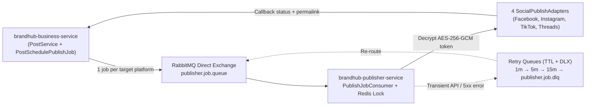

# 07 — Kết nối Mạng xã hội, Lên lịch & Xuất bản Đa Nền tảng (Publishing & Social)

> Navigation: [← BA Overview & Hub](./README.md) · [← 06 - AI Features](./06-ai-features.md) · [Tiếp: 08 - Subscription & Billing →](./08-subscription-billing.md)
>
> **Phạm vi FR chuẩn**: **Mục `3.8 Publishing & Social` — 15 FR (`3.8.1` – `3.8.15`)** | `UC-107` – `UC-121` · Use Cases chi tiết: [use-cases/06-publishing-social.md](./use-cases/06-publishing-social.md) · Đặc tả SRS: [07-publishing-social](../feature/srs/07-publishing-social/README.md).
> Tuân thủ nghiêm ngặt quy tắc **4 nền tảng mạng xã hội chuẩn: Facebook, Instagram, TikTok, và Threads** (không có Zalo OA, không có YouTube theo `AGENTS.md`).
> *(Lưu ý: Nhóm Danh bạ Đối tác truyền thông bên thứ ba đã được chuẩn hóa sang mục `3.7.15`–`3.7.19` trong [06-ai-features.md](./06-ai-features.md)).*

---

## 1. Bảng Tổng hợp 15 Yêu cầu Chức năng Chuẩn (`3.8.1` – `3.8.15`)

| Mã FR | Mã UC | Tên Chức năng Chuẩn (141-FR Baseline) | Actors / Roles Chuẩn | Mô tả Nghiệp vụ Cốt lõi |
| :-: | :-: | :--- | :--- | :--- |
| **`3.8.1`** | `UC-107` | **Connect Social Account** | `Owner`, `Manager`, `Client` | Kết nối tài khoản mạng xã hội chính thức (Facebook Page, Instagram Business, TikTok Creator/Business, Threads) vào Workspace qua OAuth 2.0, kiểm tra giới hạn kênh theo gói và mã hóa AES-256 token (`BR-20`, `BR-53`). |
| **`3.8.2`** | `UC-108` | **Disconnect Account** | `Owner`, `Manager`, `Client` | Ngắt kết nối một tài khoản mạng xã hội khỏi Workspace; thu hồi khóa OAuth đã lưu, dừng các lịch đăng tự động đang chờ và giữ nguyên lịch sử bài đã đăng (`BR-20`, `BR-53`). |
| **`3.8.3`** | `UC-109` | **View Dashboard Post** | `Owner`, `Manager`, `Creator`, `Client` | Xem bảng điều khiển tổng hợp các bài đã xuất bản thành công trên 4 mạng xã hội của Workspace cùng biểu đồ phân bổ và hiệu suất tương tác (`BR-20`, `BR-57`). |
| **`3.8.4`** | `UC-110` | **View Posted Detail** | `Owner`, `Manager`, `Creator`, `Client` | Xem chi tiết một bài đăng đã xuất bản kèm đường dẫn trực tiếp (`permalink`) và số liệu tương tác chi tiết (`Reactions`, `Comments`, `Shares`, `Views`, `BR-20`, `BR-57`). |
| **`3.8.5`** | `UC-111` | **Preview Post** | `Owner`, `Manager`, `Creator`, `Client` | Xem trước giao diện hiển thị (`Mockup Preview` trên Desktop & Mobile) của Facebook Feed/Story/Reels, Instagram Post/Reels/Story, TikTok Video và Threads Post kèm kiểm tra giới hạn ký tự và tỷ lệ khung hình (`BR-55`). |
| **`3.8.6`** | `UC-112` | **Schedule Platform Post** | `Owner`, `Manager`, `Creator` | Lên lịch xuất bản tự động bài viết đã đạt `APPROVED` (`BR-54`) vào ngày giờ cụ thể (chuẩn hóa theo Timezone của Workspace `BR-22`, cách hiện tại tối thiểu 5 phút `BR-56`). |
| **`3.8.7`** | `UC-113` | **Track Post Status** | `Owner`, `Manager`, `Creator`, `Client` | Theo dõi trạng thái tiến trình xuất bản thời gian thực (`PENDING`, `IN_PROGRESS`, `DONE` / `PUBLISHED`, `FAIL`) kèm nhật ký phản hồi API, tự động retry tối đa 3 lần và nút `Retry` thủ công (`BR-20`, `BR-56`). |
| **`3.8.8`** | `UC-114` | **Publish Facebook Post** | `Owner`, `Manager`, `Creator` | Xuất bản bài viết tiêu chuẩn (văn bản, bộ ảnh hoặc video) lên Facebook Page qua Meta Graph API (`BR-54`–`BR-56`). |
| **`3.8.9`** | `UC-115` | **Publish Facebook Story** | `Owner`, `Manager`, `Creator` | Xuất bản tin ngắn 24 giờ (ảnh hoặc video dọc `9:16`) lên Facebook Page Story qua Meta Graph API (`BR-54`–`BR-56`). |
| **`3.8.10`** | `UC-116` | **Publish Facebook Reels** | `Owner`, `Manager`, `Creator` | Xuất bản video ngắn dọc (`9:16`, thời lượng 3–90 giây) lên Facebook Page thông qua Meta Reels Publishing API 2 pha (`BR-54`–`BR-56`). |
| **`3.8.11`** | `UC-117` | **Publish Instagram Post** | `Owner`, `Manager`, `Creator` | Xuất bản bài đăng ảnh đơn hoặc bộ ảnh xoay vòng (Carousel) kèm caption và hashtag lên tài khoản Instagram Business qua Instagram Graph API (`BR-54`–`BR-57`). |
| **`3.8.12`** | `UC-118` | **Publish Instagram Reels** | `Owner`, `Manager`, `Creator` | Xuất bản video ngắn dọc lên Instagram Reels kèm ảnh bìa (`cover frame`) và caption qua Instagram Graph API (`BR-54`–`BR-56`). |
| **`3.8.13`** | `UC-119` | **Publish Instagram Story** | `Owner`, `Manager`, `Creator` | Xuất bản hình ảnh hoặc video ngắn 24 giờ tỷ lệ `9:16` lên Instagram Business Story qua Instagram Graph API (`BR-54`–`BR-56`). |
| **`3.8.14`** | `UC-120` | **Publish TikTok Video** | `Owner`, `Manager`, `Creator` | Xuất bản video ngắn lên tài khoản TikTok thông qua TikTok Content Posting API v2 (chunked upload, tùy chọn quyền riêng tư và cho phép Duet/Stitch/Comment, `BR-54`–`BR-56`). |
| **`3.8.15`** | `UC-121` | **Publish Threads Post** | `Owner`, `Manager`, `Creator` | Xuất bản bài viết văn bản (≤ 500 ký tự) kèm hình ảnh hoặc video lên nền tảng Threads qua Threads Publishing API (`BR-54`–`BR-56`). |

---

## 2. Đặc tả Nghiệp vụ Kết nối Tài khoản Mạng xã hội (`3.8.1` – `3.8.2`)

### 2.1. Quyền Kết nối trong Chế độ `AGENCY` vs. `PERSONAL`
- **Trong Chế độ `AGENCY` (`workspaceMode = "AGENCY"`)**:
  - Cả **`Client`** (tại `Client Portal` hoặc trang kết nối) và **`Manager`** (cùng `Owner`) đều có quyền thực hiện OAuth kết nối tài khoản MXH của thương hiệu vào Workspace.
- **Trong Chế độ `PERSONAL` (`workspaceMode = "PERSONAL"`)**:
  - Chủ không gian (**`Owner` / `Manager`**) kết nối trực tiếp các kênh Facebook, Instagram, TikTok, Threads cá nhân của mình tại `/workspaces/:id/social-accounts` (hoặc bấm từ **Bệ phóng Sáng tạo Cá nhân — Personal Quick Launchpad** trên Dashboard) mà không cần thông qua bất kỳ tài khoản `Client` nào.

### 2.2. Quản lý Vòng đời Token OAuth
- Mọi `accessToken` và `refreshToken` của 4 nền tảng được mã hóa an toàn trước khi lưu trữ và được quản lý bởi `brandhub-publisher-service` / `brandhub-business-service`.
- Khi token sắp hết hạn, dịch vụ tự động gia hạn ngầm (`Token Refresh`); nếu người dùng đổi mật khẩu MXH hoặc thu hồi quyền từ phía nền tảng khiến token hết hiệu lực (`EXPIRED`), hệ thống hiển thị cảnh báo trạng thái cần kết nối lại (`Reconnect`).

---

## 3. Quy trình Lên lịch, Phê duyệt & Xuất bản Đa Nền tảng (`3.8.5` – `3.8.15`)

### 3.1. Điều kiện Tiên quyết Để Xuất bản (`Publishing Gate`)
Để đảm bảo không bao giờ đăng nhầm nội dung chưa được phê duyệt lên mạng xã hội:
1. **Quyền cấu hình kênh & lịch đăng (`POST.CHANNELS` / `VIDEO.CHANNELS`)**:
   - Người giữ vai trò `POST_PUBLISHING` (với Task `POST`), `VIDEO_PUBLISH` (với Task `SHORT_VIDEO`), Điều phối viên (`assigneeId`), hoặc `Manager` / `Owner` có thể chọn kênh xuất bản và đặt giờ đăng dự kiến (`scheduledAt`) bất cứ lúc nào khi phần còn mở.
   - Riêng công việc loại `SHORT_VIDEO` chỉ cho phép chọn các kênh hỗ trợ định dạng video ngắn: **TikTok (`3.8.14`), Instagram Reels (`3.8.12`), Facebook Reels (`3.8.10`)**.
2. **Điều kiện mở khóa Xuất bản thật (`Publish Now` & `PostSchedulePublishJob`)**:
   - Lệnh xuất bản thật sang `brandhub-publisher-service` (qua hàng đợi RabbitMQ `PublishJobMessage`) **chỉ được kích hoạt khi Công việc cha đã hoàn tất phê duyệt**:
     - `task.status == TaskStatus.FINISHED` **VÀ** `task.lastSubmission.outcome == ApprovalOutcome.APPROVED`.
   - **Ở chế độ `AGENCY`**: Đạt được sau khi `Manager` duyệt nội bộ và `Client` duyệt đủ các phần sản phẩm đầu ra (`CLIENT_APPROVED`).
   - **Ở chế độ `PERSONAL`**: Đạt được **ngay lập tức chỉ với 1 cú nhấp chuột** khi chủ không gian bấm nút **"Hoàn tất & Duyệt ngay (`Self-Approve`)"** (`POST /api/v1/workspaces/{id}/tasks/{taskId}/self-approve`).

### 3.2. Cơ chế Hủy lịch Tự động Khi Nội dung Bị Trả lại
- Nếu một bài viết đã được đặt lịch (`status = SCHEDULED`), nhưng trước giờ đăng mà `Client` hoặc `Manager` bấm **Trả lại (`Return`)** một phần nội dung để yêu cầu chỉnh sửa:
  - Hệ thống tự động đưa Task cha về `IN_PROGRESS` và gọi `PostService.cancelTaskSchedule(workspaceId, taskId)` để chuyển bài viết về `DRAFT`, xóa `scheduledAt`.
  - Nhờ đó, `PostSchedulePublishJob` (quét định kỳ mỗi 30 giây) sẽ tự động bỏ qua bài viết đó cho đến khi nội dung được sửa, duyệt lại và đặt lịch mới.

### 3.3. Quy chuẩn Kỹ thuật Theo Từng Định dạng Xuất bản (`3.8.8` – `3.8.15`)

| Mã FR | Định dạng Xuất bản | Nền tảng | Yêu cầu Nội dung & Media Đầu vào |
| :-: | :--- | :---: | :--- |
| **`3.8.8`** | **Publish Facebook Post** | Facebook Page | Văn bản (`caption` ≤ 63.206 ký tự), kèm tùy chọn 1–10 ảnh (JPG/PNG/WebP) hoặc 1 video. |
| **`3.8.9`** | **Publish Facebook Story** | Facebook Page | Bắt buộc 1 ảnh hoặc 1 video ngắn dọc (`9:16`) hiển thị trong 24 giờ. |
| **`3.8.10`** | **Publish Facebook Reels** | Facebook Page | Bắt buộc 1 video dọc (`9:16` khuyến nghị, thời lượng 3s–90s, MP4/MOV) + mô tả ngắn. |
| **`3.8.11`** | **Publish Instagram Post** | Instagram Business | Bắt buộc ít nhất 1 ảnh hoặc album Carousel (tối đa 10 media) + `caption` (≤ 2.200 ký tự, tối đa 30 hashtag). |
| **`3.8.12`** | **Publish Instagram Reels** | Instagram Business | Bắt buộc 1 video dọc (MP4/MOV, tối đa 15 phút, khuyến nghị ≤ 90s) + `caption` + ảnh bìa tùy chọn. |
| **`3.8.13`** | **Publish Instagram Story** | Instagram Business | Bắt buộc 1 ảnh hoặc 1 video ngắn dọc (`9:16`) hiển thị trong 24 giờ. |
| **`3.8.14`** | **TikTok Video** | TikTok | Bắt buộc 1 video (MP4/WebM/MOV, 3s–10 phút) + tiêu đề/caption (≤ 2.200 ký tự). |
| **`3.8.15`** | **Threads Post** | Threads | Văn bản (≤ 500 ký tự mỗi bài) và/hoặc ảnh/video đính kèm. |

---

## 4. Bảng Tham chiếu Quy tắc Nghiệp vụ (`BR-53` – `BR-57`)

| Mã BR | Tên Quy tắc | Quy định Ràng buộc Cụ thể | FR Áp dụng |
| :-: | :--- | :--- | :--- |
| `BR-53` | **Mã hóa `AES-256-GCM` & Giới hạn Kênh OAuth** | Chỉ hỗ trợ đúng **4 nền tảng chuẩn (`FACEBOOK`, `INSTAGRAM`, `TIKTOK`, `THREADS`)**; toàn bộ OAuth token lưu trong `social_accounts` được mã hóa `AES-256-GCM` (`CryptoUtils`), tự động làm mới trước hạn 7 ngày (`TokenRefreshScheduler`) và hủy lịch đăng chờ khi ngắt kết nối kênh. | `3.8.1`, `3.8.2` |
| `BR-54` | **Cổng Chặn Phê duyệt Trước Xuất bản (`Approval Gate`)** | Tuyệt đối không cho phép đặt lịch kích hoạt hoặc xuất bản bài viết chưa đạt trạng thái `APPROVED` (qua đủ chuỗi `Creator -> Manager -> Client` ở chế độ `AGENCY`, hoặc `Self-Approve` ở chế độ `PERSONAL`). | `3.8.6`, `3.8.8`–`3.8.15` |
| `BR-55` | **Kiểm tra Tương thích Định dạng Trước Xuất bản** | Kiểm tra nghiêm ngặt giới hạn ký tự, số lượng tệp, định dạng video/ảnh, tỷ lệ khung hình (`9:16` cho Story/Reels/TikTok) và chặn tệp gắn nhãn `RAW` ngay từ màn hình `Preview Post` (`3.8.5`). | `3.8.5`, `3.8.8`–`3.8.15` |
| `BR-56` | **Đặt lịch Tương lai, Khóa Chống Trùng & Thử lại Bậc thang** | Giờ hẹn đăng (`scheduledAt`) phải lớn hơn thời điểm hiện tại ít nhất **5 phút** (theo múi giờ IANA của Workspace); tiến trình tiêu thụ RabbitMQ khóa theo cặp `processingPostIds:{postId}:{platform}` (`TTL 30m`) và tự động thử lại qua 3 hàng đợi trễ `1m → 5m → 15m` trước khi chuyển vào `publisher.job.dlq`. | `3.8.6`–`3.8.15` |
| `BR-57` | **Bảo toàn Nhật ký & Số liệu Bài Đã Đăng** | Các bản ghi `posts` đã xuất bản và nhật ký `publish_logs` được lưu trữ bền vững kèm `permalink` gốc kể cả sau khi tài khoản mạng xã hội bị ngắt kết nối khỏi Workspace. | `3.8.2`–`3.8.4`, `3.8.7` |

---

## 5. Sơ đồ Điều phối Xuất bản Bất đồng bộ (`business-service` ↔ `RabbitMQ` ↔ `publisher-service`)

(Xem chi tiết quyết định kiến trúc tại [ADR-003 RabbitMQ Async Publishing](../adr/adr-003-rabbitmq.md)).
