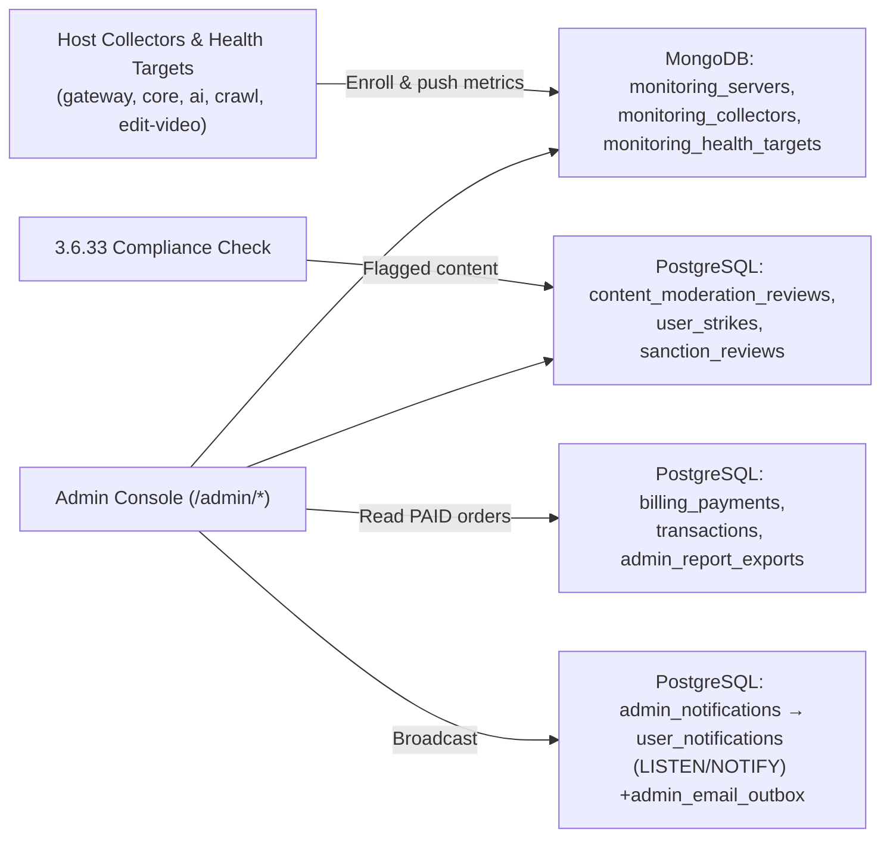

# 09 — Các Chức năng Quản trị Hệ thống Nền tảng (Admin Functions)

> Navigation: [← BA Overview & Hub](./README.md) · [← 08 - Subscription & Billing](./08-subscription-billing.md) · [Tiếp: 10 - Roles & Permissions Matrix →](./10-roles-permissions-matrix.md)
>
> **Phạm vi FR chuẩn** (đồng bộ 100% với `Các FR của hệ thống  - Feature_Function Requirement.csv`):
> - **Mục `3.10 Admin Functions`**: **14 FR (`3.10.1` – `3.10.14`)** | `UC-128` – `UC-141` (cùng `3.7.13 Crawl Schedule Config` thuộc quyền `Admin`)
> - Use Cases chi tiết: [use-cases/08-admin-functions.md](./use-cases/08-admin-functions.md) · Đặc tả SRS: [09-admin-functions](../feature/srs/09-admin-functions/README.md)

---

## 1. Bảng Tổng hợp 14 Yêu cầu Chức năng Chuẩn (`3.10.1` – `3.10.14`)

| Mã FR | Mã UC | Tên Chức năng Chuẩn (141-FR Baseline) | Actors / Roles Chuẩn | Mô tả Nghiệp vụ Cốt lõi |
| :-: | :-: | :--- | :--- | :--- |
| **`3.10.1`** | `UC-128` | **Push Notification** | `Admin` | Tạo và phát thông báo toàn hệ thống (`/admin/notifications`), hỗ trợ phân nhóm đối tượng nhận (Tất cả người dùng, chỉ `Owner`, theo gói đăng ký hoặc theo vai trò) qua WebSocket, FCM Mobile và Email (`BR-62`, `BR-65`). |
| **`3.10.2`** | `UC-129` | **Platform Statistics Overview** | `Admin` | Xem bảng điều khiển thống kê tổng quan toàn nền tảng (`/admin/dashboard`): tổng người dùng, số Agency & Workspace đang hoạt động, tổng bài xuất bản trên 4 mạng xã hội, lưu lượng gọi AI và tổng doanh thu (`BR-61`, `BR-62`). |
| **`3.10.3`** | `UC-130` | **System Health Monitoring** | `Admin` | Giám sát sức khỏe và tài nguyên thời gian thực của toàn bộ cụm Microservices (`/admin/health`): trạng thái `UP`/`DOWN`/`DEGRADED`, `%CPU`, `%RAM`, độ trễ API, hàng đợi RabbitMQ và kết nối PostgreSQL, MongoDB, Redis, ChromaDB, Neo4j (`BR-62`, `BR-65`). |
| **`3.10.4`** | `UC-131` | **Content Moderation Queue** | `Admin` | Xem và xử lý hàng đợi kiểm duyệt các nội dung bị bộ lọc an toàn (`3.6.33`) gắn cờ nghi ngờ vi phạm chính sách (`/admin/moderation`): phê duyệt cho phép lưu hành (`Approve`/`Dismiss`) hoặc xác nhận vi phạm để gỡ bỏ (`Confirm Violation`, `BR-42`, `BR-63`, `BR-65`). |
| **`3.10.5`** | `UC-132` | **Update User Violation Status** | `Admin` | Cập nhật trạng thái xử lý vi phạm của tài khoản (`/admin/users/:userId/status`) giữa `ACTIVE`, `WARNED`, `SUSPENDED` và `BANNED` (kèm thu hồi toàn bộ phiên đăng nhập trên Redis và ghi bắt buộc lý do vào `audit_logs`, `BR-63`, `BR-65`). |
| **`3.10.6`** | `UC-133` | **View User** | `Admin` | Xem, tìm kiếm và lọc danh sách toàn bộ tài khoản người dùng trên hệ thống (`/admin/users`) theo Họ tên, Email, Vai trò, Trạng thái tài khoản và xem chi tiết các Agency/Workspace họ tham gia (`BR-62`). |
| **`3.10.7`** | `UC-134` | **Create User** | `Admin` | Tạo mới tài khoản người dùng trực tiếp từ cổng quản trị (`/admin/users/new`): kiểm tra email duy nhất (`BR-01`), băm mật khẩu hoặc gửi email kích hoạt, gán vai trò hệ thống và ghi nhận vào `audit_logs` (`BR-62`, `BR-65`). |
| **`3.10.8`** | `UC-135` | **Update User** | `Admin` | Chỉnh sửa thông tin hồ sơ hành chính và phân quyền cấp hệ thống của người dùng (`/admin/users/:userId/edit`), ngăn chặn việc tự hạ quyền hoặc khóa tài khoản `Admin` cuối cùng đang hoạt động (`BR-11`, `BR-62`, `BR-65`). |
| **`3.10.9`** | `UC-136` | **Deactivate User** | `Admin` | Tạm khóa / vô hiệu hóa tài khoản người dùng (`/admin/users/:userId`): chuyển sang `INACTIVE`/`DEACTIVATED`, lập tức thu hồi mọi JWT token trên Redis (`BR-63`), chặn đăng nhập mới (`BR-05`) nhưng bảo toàn dữ liệu lịch sử và ghi `audit_logs` (`BR-65`). |
| **`3.10.10`** | `UC-137` | **View AI Credit Price List** | `Owner`, `Admin` | Xem bảng cấu hình đơn giá tiêu hao AI Credit hiện hành của toàn hệ thống (`/admin/credit-prices`) cho đầy đủ các tác vụ AI kèm trạng thái kích hoạt và lịch sử cập nhật giá (`BR-48`, `BR-62`, `BR-64`). |
| **`3.10.11`** | `UC-138` | **Update AI Credit Price** | `Admin` | Cập nhật trực tiếp đơn giá tiêu hao AI Credit (số nguyên dương hợp lệ) cho từng tác vụ AI; áp dụng cho các yêu cầu kế tiếp mà không làm thay đổi số credit đã khóa của các tiến trình AI đang chạy dở (`BR-48`, `BR-64`, `BR-65`). |
| **`3.10.12`** | `UC-139` | **Import AI Credit Price CSV** | `Admin` | Tải lên, xem trước (`Preview`) và nhập hàng loạt bảng đơn giá AI Credit từ tệp CSV (`feature_code, model_tier, credit_cost, description`) theo giao dịch nguyên tử `all-or-nothing` (`BR-64`, `BR-65`). |
| **`3.10.13`** | `UC-140` | **View Revenue Dashboard** | `Admin` | Xem bảng điều khiển phân tích doanh thu thực thu từ các giao dịch **SePay (VietQR)** đã thanh toán (`PAID`) theo Ngày/Tuần/Tháng/Quý, tách bạch cơ cấu giữa Gói đăng ký (`Subscription Plans`) và Gói nạp thêm AI Credit (`Top-up Packs`, `BR-59`, `BR-61`, `BR-62`). |
| **`3.10.14`** | `UC-141` | **Export Report File PDF** | `Admin` | Kết xuất và tải xuống tệp báo cáo quản trị định dạng **PDF** (`/admin/reports/export`) cho Báo cáo Doanh thu & Giao dịch SePay, Báo cáo Tăng trưởng Người dùng & Agency, và Báo cáo Tiêu thụ AI Credit (`BR-61`, `BR-62`, `BR-65`). |

---

## 2. Đặc tả Chi tiết Các Nhóm Nghiệp vụ Cổng Quản trị (`Admin Portal`)

1. **Truyền thông Hệ thống, Thống kê & Giám sát Sức khỏe (`3.10.1` – `3.10.3`)**:
   - Cung cấp bức tranh vận hành tập trung theo thời gian thực trên cả 5 máy chủ sản xuất (`gateway`, `core`, `ai`, `crawl`, `edit-video`) và các kho dữ liệu (`PostgreSQL`, `MongoDB`, `Redis`, `ChromaDB`, `Neo4j`, `RabbitMQ`).
2. **Kiểm duyệt An toàn Cộng đồng & Quản lý Vòng đời Tài khoản (`3.10.4` – `3.10.9`)**:
   - Mọi thao tác nhạy cảm của `Admin` (`Update User Violation Status`, `Create User`, `Update User`, `Deactivate User`) đều bắt buộc ghi nhận vào bảng bất biến `audit_logs` (`BR-65`) và đồng bộ thu hồi phiên tức thì trên Redis (`jwt:blacklist:{jti}`) khi đình chỉ hoặc khóa tài khoản.
   - Bảo vệ an toàn quản trị: không cho phép khóa hoặc hạ quyền tài khoản `Admin` cuối cùng đang hoạt động trên nền tảng.
3. **Định giá AI Credit, Đối soát Doanh thu SePay & Kết xuất Báo cáo (`3.10.10` – `3.10.14`)**:
   - Bảng giá AI Credit (`ai_credit_operation_prices`) hiển thị minh bạch cho cả `Admin` và `Owner` (`3.10.10`), hỗ trợ cập nhật lẻ (`3.10.11`) hoặc nhập lô CSV nguyên tử (`3.10.12`).
   - Doanh thu tại `/admin/revenue` (`3.10.13`) chỉ tổng hợp từ các đơn hàng **SePay (VietQR)** đã xác nhận `PAID` và cho phép xuất chứng từ tổng hợp ra tệp PDF chuẩn (`3.10.14`).

---

## 3. Bảng Tham chiếu Quy tắc Nghiệp vụ Cổng Quản trị (`BR-62` – `BR-65`)

| Mã BR | Tên Quy tắc | Quy định Ràng buộc Cụ thể | FR Áp dụng |
| :-: | :--- | :--- | :--- |
| `BR-62` | **Cô lập Phân quyền Cấp Hệ thống (`SystemRole = ADMIN`)** | Toàn bộ các route `/admin/*` và nhóm API quản trị nền tảng (`3.10.1`–`3.10.9`, `3.10.11`–`3.10.14`, `3.7.13`) chỉ chấp nhận tài khoản mang `user_system_roles = ADMIN` đang `ACTIVE` (riêng `3.10.10 View AI Credit Price List` mở quyền đọc minh bạch cho cả `Owner`). | `3.10.1`–`3.10.14` |
| `BR-63` | **Cưỡng chế Thu hồi Phiên & Bảo vệ `Admin` Cuối cùng** | Khi `Admin` chuyển trạng thái tài khoản sang `SUSPENDED`, `BANNED` (`3.10.5`) hoặc `INACTIVE` (`3.10.9`), hệ thống lập tức thu hồi toàn bộ `user_refresh_tokens` và ghi khóa thu hồi `jwt:blacklist:{jti}` trên Redis; đồng thời chặn tuyệt đối thao tác tự khóa hoặc hạ quyền tài khoản `Admin` hoạt động cuối cùng. | `3.10.4`, `3.10.5`, `3.10.8`, `3.10.9` |
| `BR-64` | **Cập nhật Nguyên tử Bảng Đơn giá AI Credit (`All-or-Nothing CSV`)** | Đơn giá AI Credit phải là số nguyên không âm hợp lệ; nhập bảng giá qua CSV (`3.10.12`) kiểm tra toàn bộ dòng trước khi ghi giao dịch nguyên tử vào `ai_credit_operation_prices` (lưu lịch sử biến động giá và không hồi tố lên các `ai_credit_reservations` đang chạy). | `3.10.10`–`3.10.12` |
| `BR-65` | **Nhật ký Kiểm toán Bất biến (`Immutable Audit Trail`)** | Mọi hành động nhạy cảm của `Admin` (phát thông báo diện rộng, duyệt/gỡ nội dung vi phạm, gán gậy cảnh cáo `user_strikes`, xét khiếu nại `sanction_reviews`, tạo/sửa/vô hiệu hóa tài khoản, đổi giá credit, xuất báo cáo PDF) bắt buộc lưu bản ghi bất biến vào `audit_logs` kèm `actor_id`, `ip_address`, lý do và dữ liệu trước/sau. | `3.10.1`, `3.10.3`–`3.10.9`, `3.10.11`, `3.10.12`, `3.10.14` |

---

## 4. Kiến trúc Giám sát Sức khỏe Đa Máy chủ, Kiểm duyệt & Kết xuất Báo cáo

---

## 5. Ánh xạ Thực thể Cơ sở Dữ liệu Của Phân hệ `Admin`

- **PostgreSQL (`brandhub-business-service`)**: `audit_logs`, `user_strikes`, `sanction_reviews`, `admin_account_operations`, `admin_email_outbox`, `admin_notifications`, `admin_report_exports`, `content_moderation_reviews`, `user_notifications`, `ai_credit_operation_prices`, `billing_plan_change_log`.
- **MongoDB (`brandhub-business-service`)**: `monitoring_servers`, `monitoring_collectors`, `monitoring_enrollments`, `monitoring_health_targets`, `report_jobs`.

---

## 6. Cơ chế Xử lý Vi phạm Cộng đồng (`Strikes`) & Danh mục Báo cáo PDF Quản trị

### 6.1. Thang Chế tài Tài khoản & Hàng đợi Kiểm duyệt (`3.10.4` – `3.10.5`)
- **Hàng đợi Kiểm duyệt (`Content Moderation Queue` — `3.10.4`)**: Tiếp nhận các bài viết/hình ảnh bị bộ lọc an toàn (`3.6.33`) gắn cờ. `Admin` đối chiếu ngữ cảnh thương hiệu để chọn **Bỏ cờ cho phép đăng (`Dismiss / Approve`)** hoặc **Xác nhận vi phạm (`Confirm Violation`)**.
- ** leo thang Chế tài (`user_strikes` & `sanction_reviews` — `3.10.5`)**:
  - `WARNED`: Ghi gậy cảnh cáo kèm thông báo nhắc nhở, tài khoản vẫn hoạt động.
  - `SUSPENDED`: Tạm khóa đăng nhập có thời hạn, thu hồi ngay mọi JWT/Refresh Token đang mở trên Redis.
  - `BANNED`: Khóa vĩnh viễn quyền truy cập hệ thống đối với vi phạm nghiêm trọng hoặc tái phạm nhiều lần; lưu hồ sơ khiếu nại tại `sanction_reviews`.

### 6.2. Ba Loại Báo cáo PDF Kết xuất Chuẩn (`3.10.14 Export Report File PDF`)
1. **Báo cáo Doanh thu & Giao dịch SePay (`SEPAY_REVENUE_REPORT`)**: Tổng hợp doanh thu thực thu (`PAID`) theo chu kỳ chọn lọc, phân rã theo 6 gói đăng ký (`STUDIO_*`, `BASIC`, `PLUS`, `ENTERPRISE`) và các gói nạp lẻ AI Credit.
2. **Báo cáo Tăng trưởng Người dùng & Tổ chức (`PLATFORM_GROWTH_REPORT`)**: Thống kê người dùng mới, tỷ lệ kích hoạt Agency/Personal Studio, số lượng Workspace hoạt động và khối lượng bài xuất bản trên 4 nền tảng (**Facebook, Instagram, TikTok, Threads**).
3. **Báo cáo Tiêu thụ & Hiệu suất AI (`AI_CONSUMPTION_REPORT`)**: Phân tích tổng lượng AI Credit đã quyết toán theo 4 nhóm tác vụ tính phí (`CONTENT_GENERATE`, `AMBASSADOR_GENERATE`, `COMMERCIAL_IMAGE`, `VIDEO_GENERATE`) và tỷ lệ thành công của cụm worker.
