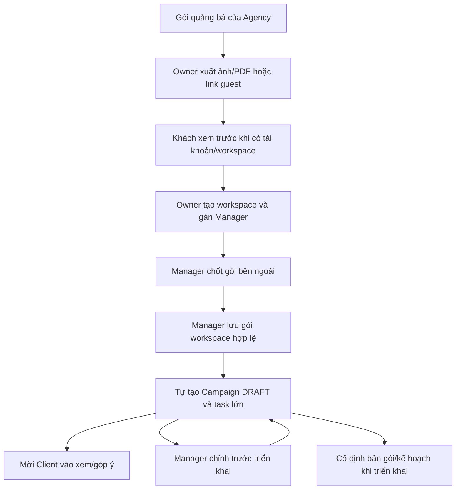
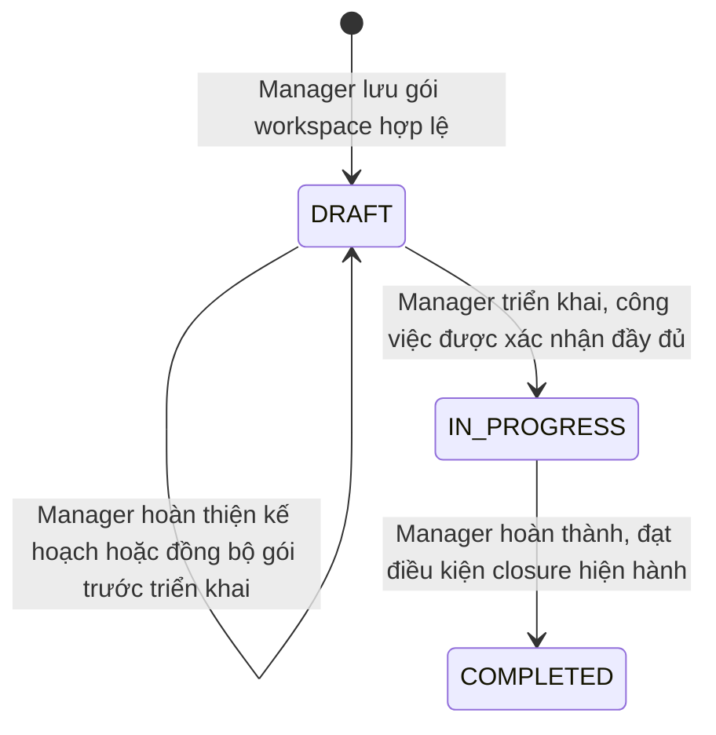

# 12 — State Machines (sơ đồ trạng thái chi tiết)

> **Ưu tiên BA 2026-10-18 cho Task:** mục 4 hiện hành và [FR 3.6.9 v3](../feature/content-task-workflow/3-6-9-approval-sequence-creator-manager-client/spec.md) thay quy tắc QC/trạng thái trung gian của các ghi chú cũ. Một bản POST qua /editor, khóa nội dung khi review; reject/withdraw hợp lệ về IN_PROGRESS, gửi lại lượt mới; FINISHED không tự publish. Giai đoạn 1 là tài liệu, chưa có implementation Approval.

> **BA mới đã chốt 2026-10-15:** Task chỉ còn TODO / IN_PROGRESS / IN_REVIEW / CANCELLED / FINISHED. Giao việc là metadata, không còn bước DETAIL_IDENTIFIED/ASSIGNED. Phải có mô tả + deadline hợp lệ trước giao; Creator được giao bấm bắt đầu mới IN_PROGRESS; sau đó Manager khóa sửa/giao lại. IN_REVIEW giữ QC → Manager → Client khi được cấu hình; reject về IN_PROGRESS, duyệt lại từ QC nếu có. Approval do thành viên khác triển khai. Autosave on-blur và action list chỉ assignment/deadline/start. Ghi chú mới này thay thế vòng đời Task lịch sử bên dưới; xem [spec mới](../feature/content-task-workflow/task-five-state-inline-edit/spec.md).

> [<< Về Overview](00-overview.md)
> Mục đích: mô tả chi tiết TỪNG cạnh chuyển trạng thái (transition) — điều kiện, ai được phép bấm — cho các entity có vòng đời phức tạp. Bổ sung cho mô tả bằng lời ở các file 04, 05, 07.

## 1. Content Request

> **Quyết định mới nhất 2026-10-14 thay thế các ghi chú lịch sử về xử lý Request sau hoàn thành bên dưới:** Task được chấp nhận gắn Campaign hiện tại và giữ Request nguồn; mọi Task chưa COMPLETED/CANCELLED và Request IN_PROGRESS chặn Manager hoàn thành Campaign. Sau hoàn thành thành công, PENDING tự hủy bằng durable queue; không tạo/sửa/tiếp nhận mới. Hủy Task là thao tác riêng có lựa chọn, lý do chung và xác nhận. Xem [Campaign closure](../feature/media-package-campaign/campaign-closure/spec.md).

```
        create (CLIENT)
              │
              ▼
         [PENDING] ──────update (CLIENT, chỉ khi PENDING)────────────┐
              │                                                        │
   set in_progress (MANAGER)                                          │
              │                                                        ▼
              ▼                                                  (vẫn PENDING)
      [IN_PROGRESS]
        │           │
 accept(MANAGER)  deny(MANAGER)
        │           │
        ▼           ▼
   [ACCEPTED]    [DENIED]
        │
        ▼
  tự động sinh 1 Task mới (xem mục 3)

  PENDING ──cancel (CLIENT tạo Request)──► CANCELLED (terminal)
```

| Từ | Đến | Ai bấm | Điều kiện |
|---|---|---|---|
| (mới) | PENDING | CLIENT | Create Content Request |
| PENDING | PENDING (update nội dung) | CLIENT | Chỉ khi đang PENDING |
| PENDING | CANCELLED | CLIENT tạo Request | Hủy mềm; chỉ khi PENDING |
| PENDING | IN_PROGRESS | MANAGER thuộc Workspace | Bấm “Tiếp nhận yêu cầu”; xem trang không chuyển trạng thái; lưu người/thời điểm |
| IN_PROGRESS | ACCEPTED | MANAGER | → tự sinh Task mới |
| IN_PROGRESS | DENIED | MANAGER | Kết thúc, không sinh Task |
| ACCEPTED/DENIED/CANCELLED | * | KHÔNG AI | Trạng thái cuối, không mở lại |

Xác nhận người dùng 2026-10-13: IN_PROGRESS hiển thị “Đang xem xét”, không phải Task đang thực hiện. Client chỉ sửa title/description/type/dueDate và hủy trong PENDING. Chỉ tạo mới khi Campaign IN_PROGRESS, deployment SUCCEEDED; không tạo khi COMPLETED. Request đã có tiếp tục xử lý sau hoàn thành, không tự hủy. Các thay đổi BA chung cần lead/team review theo team guide.

## 2. Media Package — hành trình Manager quản lý

BA chốt 2026-11-05, theo [spec mới](../feature/media-package-campaign/guest-sharing-manager-led/spec.md). Sơ đồ này thay flow đàm phán/duyệt Package hai phía của đặc tả cũ.



- Manager chọn gói mẫu Agency để tùy chỉnh hoặc tạo mới. Client không chọn, đàm phán hoặc duyệt Package trong hệ thống.
- Link guest luôn đọc bản gói Agency mới nhất đã lưu. Gói workspace giữ nội dung riêng, không tự đổi theo danh mục.
- Lưu lại/retry dùng cùng Campaign/task. Trước triển khai được chỉnh và đồng bộ an toàn, giữ thông tin công việc đã nhập.
- Gói/phạm vi kế hoạch được cố định khi triển khai và khóa sau triển khai. Trạng thái dữ liệu cũ như CLIENT_REQUESTED_CHANGE, AGENCY_COUNTERED và APPROVED cần mapping trong plan, không tự xóa hoặc tạo approval giả.

## 3. Media Campaign — Client xem/góp ý, Manager triển khai



- Client đã tham gia workspace xem/comment góp ý cả DRAFT. Góp ý không chuyển trạng thái, không tạo approval hoặc điều kiện chờ Client đồng ý.
- Bỏ bước APPROVED và gate Agency/Client duyệt cùng phiên bản trong flow mới.
- Deployment có thể có trạng thái tiến trình riêng. Khi triển khai phải cố định bản gói/kế hoạch, ngăn sửa đồng thời và cho retry cùng bản khi lỗi/gián đoạn, giữ định danh công việc đã có.
- Chuyển IN_PROGRESS sau khi xác nhận đủ công việc theo gói. Task đã được tạo từ lúc lưu gói, được giữ thông tin khi triển khai.
- Chỉ bắt đầu thực hiện Task khi Campaign IN_PROGRESS theo contract Task. Duyệt kết quả Task/bài đăng vẫn theo module riêng.
- Một workspace có một Campaign. Hoàn thành tiếp tục yêu cầu các Task/Request đạt điều kiện tại [Campaign closure](../feature/media-package-campaign/campaign-closure/spec.md) và [package-driven task](../feature/package-driven-campaign-tasks/spec.md).
- Campaign Addendum và sửa gói sau triển khai không được mở thêm trong đợt đổi hành trình này. Trạng thái và approval cũ giữ làm dữ liệu lịch sử, cách chuyển đổi chờ kế hoạch kỹ thuật.

## 4. Task — Approval Sequence (hiện hành 2026-10-18) — task cũ, không có subtask theo vai trò

> **Phạm vi từ 2026-11-10:** chỉ áp dụng cho task không có subtask theo vai trò. Task thuộc 1 trong 9 loại ở [05-content-task-workflow.md](05-content-task-workflow.md) mục 3 dùng state machine theo phần ở mục 4a bên dưới.

Nguồn: [spec FR3.6.9 v3](../feature/content-task-workflow/3-6-9-approval-sequence-creator-manager-client/spec.md). Thay toàn bộ sơ đồ QC/ASSIGNED/skip-approval cũ cho luồng mới; không tự chuyển đổi/xóa dữ liệu legacy.

| Trước | Action hợp lệ | Sau |
|---|---|---|
| TODO | Assignee Creator bắt đầu; description + dueDate hợp lệ | IN_PROGRESS, ghi firstStartedAt/By |
| IN_PROGRESS | Assignee lưu bài POST hợp lệ và submit | IN_REVIEW / MANAGER |
| IN_REVIEW / MANAGER | Manager approve, không cần Client | FINISHED |
| IN_REVIEW / MANAGER | Manager approve, cần Client | IN_REVIEW / CLIENT |
| IN_REVIEW / CLIENT | Một Client active bất kỳ approve | FINISHED |
| IN_REVIEW / MANAGER hoặc CLIENT | Đúng người duyệt reject có lý do | IN_PROGRESS |
| IN_REVIEW / MANAGER, chưa decision | Assignee Creator withdraw | IN_PROGRESS |
| Task chưa kết thúc | Flow cancel được cấp quyền hiện có | CANCELLED |

- Không có QC; chỉ năm trạng thái. reviewStep chỉ có MANAGER/CLIENT lúc IN_REVIEW, null ngoài review.
- Lượt đầu 1, mỗi submit lại thành công sau reject/withdraw tăng lượt; decision cũ append-only nhưng không hiệu lực cho lượt mới. Chỉ APPROVE/REJECT tạo decision, tối đa hai/lượt.
- Withdraw không được sau Manager decision; race với decision chỉ một bên thắng. Client đầu tiên quyết định hợp lệ kết thúc bước Client; người khác dùng màn hình cũ bị conflict.
- Thiếu Client active khi được yêu cầu thì chặn submit, báo Manager bổ sung. Hết Client khi đã chờ thì giữ bước/Manager approval, không tự skip. Thay Manager thì Manager active hiện tại được duyệt.
- POST dùng /editor và một Post hiện tại; khóa sửa khi review, reject/withdraw hợp lệ mới sửa lại. Chưa quản lý snapshot/khôi phục nội dung lượt trước; lịch sử là decision, không phải bản nội dung.
- First-start evidence giữ nguyên qua reject/withdraw; Manager vẫn khóa sửa brief/deadline/giao lại. Task FINISHED/CANCELLED không reopen; bình luận vẫn theo FR3.6.3.
- Cancel phải xóa bước chờ/đóng metadata, không xóa decision. Không duyệt sau hủy/hoàn thành Campaign; giữ điều kiện Campaign closure hiện có.
- FINISHED không tự enqueue Publish. Xuất bản là action/module riêng; Admin moderation không thay decision Task.
- Đây là contract đích của giai đoạn 1, chưa phải implementation đã chạy. Legacy QC/thiếu reviewStep/round chỉ đọc và inventory riêng, không tự backfill.

## 4a. Task — Duyệt từng phần (section-level, hiện hành 2026-11-10)

Nguồn: [spec.md §5](../feature/subtask-role-workspaces/spec.md). Áp dụng cho task thuộc 9 loại ở [05-content-task-workflow.md](05-content-task-workflow.md) mục 3 có subtask gán theo danh mục vai trò.

| Trước | Action hợp lệ | Sau |
|---|---|---|
| DRAFT | Chủ phần/điều phối/Manager nộp phần | SUBMITTED |
| SUBMITTED | Manager hoặc supervisor của subtask approve | INTERNAL_APPROVED |
| SUBMITTED | Manager hoặc supervisor trả lại kèm ghi chú | RETURNED |
| INTERNAL_APPROVED, phần O, task requiresClientApproval=true | Client approve | CLIENT_APPROVED |
| INTERNAL_APPROVED hoặc CLIENT_APPROVED, phần O | Client trả lại kèm ghi chú | RETURNED |
| RETURNED | Chủ phần sửa lại rồi nộp | SUBMITTED |
| INTERNAL_APPROVED / CLIENT_APPROVED | Manager mở lại (trước khi task cha nộp) | RETURNED |
| INTERNAL_APPROVED / CLIENT_APPROVED | Điều phối/Manager sửa nội dung phần | SUBMITTED (cần duyệt lại) |

- Phần internal (I) dừng ở `INTERNAL_APPROVED` — trạng thái cuối, Client không tham gia.
- Phần output (O) cần `CLIENT_APPROVED` nếu `requiresClientApproval=true`; nếu `false` thì `INTERNAL_APPROVED` là cuối.
- Subtask có vai trò tự động `FINISHED` khi mọi phần nó sở hữu đạt trạng thái cuối. Nộp task cha chặn nếu còn phần chưa `INTERNAL_APPROVED` (`TASK_SECTIONS_UNAPPROVED`); khi mọi phần O đã `CLIENT_APPROVED`, task cha coi như đã duyệt — thay thế bước `reviewStep=CLIENT` của mục 4.
- Mỗi lần nộp phần lưu snapshot (không xoá), xem/so sánh được; khôi phục bản cũ chép vào bản nháp hiện tại, phần phải nộp và duyệt lại.
- Task cũ (trước 2026-11-10, không có subtask vai trò) coi mọi phần ở DRAFT, chủ = điều phối; task đang IN_REVIEW trước khi deploy giữ nguyên luồng mục 4.

## 5. Task loại Livestream — trạng thái riêng

```
[PRE_LIVE] ──(bắt đầu buổi live)──► [LIVE] ──(kết thúc buổi live)──► [POST_LIVE] ──► [DONE]
    │                                  │
    └──────────(hủy buổi live)─────────┴──────────────────────────────────────► [CANCEL]
```

- `PRE_LIVE`: chuẩn bị (idea, script, setup, quay chuẩn bị — xem checklist ở [05-content-task-workflow.md](05-content-task-workflow.md) mục 3).
- `LIVE`: đang phát trực tiếp.
- `POST_LIVE`: xử lý sau live (retouch, cắt clip highlight để chạy hook).
- `DONE`/`CANCEL`: 2 trạng thái kết thúc — Cancel có thể xảy ra ở bất kỳ giai đoạn PRE_LIVE hoặc LIVE.
- State này lồng bên trong Task chính (Task cha vẫn đi qua Approval Sequence ở mục 4 sau khi Livestream state đạt DONE).

## 6. Third-party Collaborator — trạng thái hợp tác

```
[CONTACTED] ──► [NEGOTIATING] ──► [CONFIRMED] ──► [LIVE_ON_AIR]
```

- Cập nhật hoàn toàn thủ công bởi Manager/Creator — không có transition tự động, không có API bên thứ 3 kích hoạt chuyển trạng thái (khác hẳn Task/Post publish tự động qua API).
- Có thể revert lùi trạng thái (ví dụ từ NEGOTIATING quay lại CONTACTED nếu đàm phán đổ vỡ) — không phải chuỗi 1 chiều cứng nhắc như Task Approval Sequence.

## 7. Post — trạng thái Publish (sau khi Task hoàn thành)

```
[FINISHED Task] --thao tác xuất bản riêng--> [PENDING publish] ──► [IN_PROGRESS] ──► [DONE] hoặc [FAIL]
```

- Tương ứng FR 3.8.8 View Status Tracking: "Pending, In Progress, Done, Fail".
- BA 2026-10-18: cạnh xuất bản trên là thao tác riêng của module publishing, không phải side-effect tự động của Task approval. Không đổi queue/callback hoặc cơ chế retry của module đó.
- **[CONFIRMED 2026-09-17]** `FAIL` **có retry tự động, theo config** — số lần retry và backoff không hardcode, đọc từ setting (kế thừa tiền lệ retry 3 lần exponential backoff ở hệ thống cũ làm giá trị mặc định, nhưng phải config được để chỉnh khi cần mà không cần deploy lại code publisher-service).
