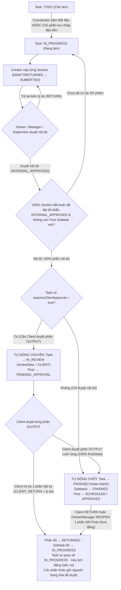

# 13 — Quản Trị Trạng Thái Công Việc, Phân Quyền Đa Tầng & Quy Trình Phê Duyệt Hợp Nhất (Task Status & Multi-Role Approval Governance)

> Navigation: [← BA Index](./README.md) · [← 10 - Roles & Permissions Matrix](./10-roles-permissions-matrix.md) · [← 12 - State Machines](./12-state-machines.md) · [FR 3.6.9 Spec →](../feature/srs/05-content-task-workflow/3-6-9-approval-sequence-creator-manager-client/spec.md) · [Module Subtask & Section Spec →](../feature/modules/04-task-chat-vault/task-subtask-and-inline-workflow/spec.md)
>
> Tài liệu này là **Đặc tả Nghiệp vụ Chuẩn (Authoritative BA Specification — v4.0)** giải quyết triệt để mối quan hệ giữa **6 Vai trò Hệ thống Chuẩn (`Guest`, `Owner`, `Manager`, `Creator`, `Client`, `Admin`)**, **4 Vai trò Tham gia Trực tiếp trên Công việc (`Coordinator/Assignee`, `Task Supervisor`, `Subtask/Section Owner`, `Subtask Supervisor`)**, cơ chế **Tự động Đồng bộ Trạng thái (`Section → Subtask → Task → Post`)**, và các **Rào chắn Chống Nhảy Cóc Quy trình (`Anti-Bypass Invariants`)** trên toàn bộ **8 Loại Công việc (`TaskType`)**.

---

## 1. Bối cảnh & Các Vấn đề Nghiệp vụ Cần Khắc phục Triệt để

Qua kiểm toán đối chiếu thực tế vận hành (`TASK-B2A7` và toàn bộ luồng `brandhub-business-service` ↔ `brandhub-web`), hệ thống cần đóng kín **10 khoảng trống nghiệp vụ**:

1. **Chặn lỗ hổng `Creator` tự chuyển thẳng trạng thái sang `Hoàn thành` (`FINISHED`)**: Không cho phép dùng API đổi trạng thái thô (`PATCH /tasks/{taskId}/status`), kéo thả bảng Kanban hay Thanh thao tác hàng loạt (`Bulk Action Bar`) để bỏ qua kiểm duyệt `TaskSection`, `Subtask` và lượt duyệt của `Manager` / `Client`.
2. **Tự động chuyển trạng thái Task cha (`Đang làm` → `Chờ duyệt` → `Hoàn thành`) khi làm theo từng phần (`TaskSection`)**: Khắc phục triệt để lỗi duyệt xong 100% các phần (`INTERNAL_APPROVED` / `CLIENT_APPROVED`) và toàn bộ `Subtask` đã hoàn thành nhưng Task cha vẫn bị kẹt ở `IN_PROGRESS` (`Đang làm`).
3. **Đồng bộ đầy đủ quyền của `Owner` ngang/cao hơn `Manager`**: Khắc phục việc `Owner` bị chặn nhầm ở `SectionPolicy` (sửa/duyệt/trả lại/mở lại phần), `TaskWorkflowService.start` (bắt đầu việc), `TaskPlatformPolicy` (chọn nền tảng xuất bản), và `CampaignSubtaskService` (quản lý công việc con độc lập).
4. **Chuẩn hóa vai trò "Người giám sát" (`task.supervisorId` & `subtask.supervisorOverrideId`)**:
   - Đảm bảo `task.supervisorId` (Người giám sát của Task cha) được kế thừa xuyên suốt xuống mọi `Subtask` và `TaskSection` khi công việc con không khai báo `supervisorOverrideId` riêng.
   - **Cấm tuyệt đối `Creator` tự làm Người giám sát của chính mình (`Anti-Self-Supervision`)**: Khi `Creator` tạo mới công việc, `supervisorId` mặc định phải gán về `Manager`/`Owner` mặc định của Workspace (`defaultManager`), không bao giờ gán bằng chính ID của `Creator` (tránh kích hoạt nhầm `skipsAgencyReview` bỏ qua bước duyệt nội bộ).
5. **Thống nhất quy tắc duyệt hỗ trợ của `Owner` & `Manager`**: Dù Task đã chỉ định một `Người giám sát` cụ thể (có thể là `Manager` hoặc `Creator` cấp cao phụ trách QC), mọi `Owner` và `Manager` đang hoạt động (khác người trực tiếp thực hiện khi người đó là `Creator`) vẫn có quyền phê duyệt hỗ trợ/thay thế để luồng sản xuất không bị tắc nghẽn khi Người giám sát vắng mặt.
6. **Gỡ kẹt trạng thái `TODO` cho `Creator` làm Công việc con**: Khi Task cha đang ở `TODO` (đã đủ Brief & Chiến dịch hợp lệ) mà nhân sự giữ `Subtask` bắt đầu lưu nội dung phần (`Brief`, `Caption`, `Media`...) hoặc bấm vào không gian làm việc, hệ thống tự động mở phiên `TODO → IN_PROGRESS` thay vì khóa cứng bắt chờ `task.assigneeId` bấm nút riêng.
7. **Thu hồi nút `Hoàn tất & Tự duyệt` (`Self-Approve`) khỏi chế độ `AGENCY`**: Nút `Self-Approve` chỉ dành riêng cho chế độ Cá nhân (`workspaceMode = "PERSONAL"`). Trong chế độ `AGENCY` (kể cả khi `requiresClientApproval = false`), hệ thống tắt hoàn toàn `Self-Approve` để ngăn việc bấm nhầm làm ép đóng các `Subtask` và `Section` chưa hoàn thiện nội dung.
8. **Mở quyền `Mở lại` (`REOPEN`) phần nội dung trên Task `FINISHED` chưa xuất bản**: Cho phép `Owner` và `Manager` bấm `REOPEN` phần nội dung ngay cả khi Task vừa chuyển `FINISHED` (miễn bài đăng chưa `PUBLISHING` / `PUBLISHED`), tự động đưa Task về `IN_PROGRESS` và hủy lịch đăng giống cơ chế `Client Return`.
9. **Kiểm soát chặt quyền Xuất bản (`Publish`) & Sửa Đối tác (`Partners`)**: Chỉ `Owner`, `Manager` và nhân sự được phân công vào Task / vai trò xuất bản (`POST_PUBLISHING`, `VIDEO_PUBLISH`, `EMAIL_SEND`, hoặc `task.assigneeId`) mới được thực thi; chặn `Creator` không tham gia Task.
10. **Chuẩn hóa hiển thị Trạng thái (`TaskStatusControl`), Hàng đợi Duyệt (`/task-approvals`) & Đồng bộ Tức thì**:
    - Ẩn mũi tên sổ xuống (`⌄`) trên nhãn trạng thái khi đã `FINISHED` / `CANCELLED` hoặc không có thao tác hợp lệ; hiển thị rõ tiến độ phần bên cạnh trạng thái.
    - Mở rộng `/task-approvals` hiển thị đủ **8 loại `TaskType`** (không giới hạn riêng `POST`).
    - Đồng bộ tức thì thay đổi trạng thái từ Panel chi tiết / Editor ra bảng Danh sách, Kanban, Lịch và Gantt.

---

## 2. Kiến trúc Phân quyền 2 Lớp (Workspace Role × Task Participant Role)

Quyền thực thi trên một Công việc (`TaskDocument`) luôn được tính bằng giao thoa giữa **Vai trò cấp Workspace** và **Vai trò tham gia trực tiếp trên Công việc**:

### 2.1. Định nghĩa 4 Vai trò Tham gia Trực tiếp trên Công việc

| Vai trò trên Task | Trường Dữ liệu Nguồn | Ai có thể đảm nhận | Trách nhiệm Nghiệp vụ Chính |
| :--- | :--- | :--- | :--- |
| **1. Người thực hiện chính / Điều phối viên (`Coordinator`)** | `task.assigneeId` | `Owner`, `Manager`, `Creator` | Chịu trách nhiệm tổng thể tiến độ đầu việc; bắt đầu Task (`start`), soạn/nộp toàn bài (nếu Task không chia Subtask vai trò) hoặc hoàn thiện các phần chưa có chủ sở hữu riêng (`unowned sections`), quản lý đối tác liên kết (`partnerIds`). |
| **2. Người giám sát Task cha (`Task Supervisor`)** | `task.supervisorId` | `Owner`, `Manager`, hoặc `Creator` cấp cao (**khác** `task.assigneeId` nếu `assignee` là `Creator`) | Chịu trách nhiệm kiểm duyệt chất lượng nội bộ cho toàn bộ Task và mặc định làm người duyệt nội bộ cho các `Subtask` / `TaskSection` chưa gán người giám sát riêng. |
| **3. Người thực hiện Công việc con / Chủ phần (`Section Writer / Owner`)** | `subtask.assigneeId` (gắn `subtask.subtaskRole`) | `Owner`, `Manager`, `Creator` | Trực tiếp biên soạn, lưu nháp, khôi phục lịch sử phiên bản và bấm `Nộp duyệt phần` (`SUBMIT`) cho các `TaskSection` thuộc `subtaskRole` mình đảm nhận. |
| **4. Người giám sát Công việc con (`Subtask Supervisor`)** | `subtask.supervisorOverrideId` (fallback về `task.supervisorId`, rồi `defaultManager`) | `Owner`, `Manager`, hoặc `Creator` cấp cao (**khác** `subtask.assigneeId`) | Kiểm duyệt nội bộ (`APPROVE` / `RETURN`) riêng cho các `TaskSection` thuộc `Subtask` được phân công giám sát. |

### 2.2. Quy tắc Bất biến Chống Tự Giám Sát (`BR-34a — Anti-Self-Supervision`)

1. **Cấm `Creator` tự giám sát chính mình**:
   - Nếu `task.assigneeId` là thành viên mang vai trò `Creator`, trường `task.supervisorId` **không bao giờ được trùng với `task.assigneeId`**.
   - Khi `Creator` khởi tạo Task mới (`createTask` hoặc `createStandaloneTask`) mà không chọn `supervisorId` (hoặc truyền chính ID của mình), Backend tự động gán `task.supervisorId = defaultManager(workspaceId)` (lấy `Manager` hoặc `Owner` đang hoạt động của Workspace).
   - Khi cập nhật `PATCH /tasks/{taskId}/field` với `field = "supervisorId"` (hoặc cập nhật `subtask.supervisorOverrideId`), nếu người nhận việc (`assigneeId`) là `Creator` và `supervisorId == assigneeId` → từ chối với mã lỗi `400 VALIDATION_ERROR` (`INVALID_TASK_SUPERVISOR`).
2. **Điều kiện duy nhất được bỏ qua bước duyệt nội bộ (`skipsAgencyReview`)**:
   - Chỉ khi người thực hiện chính (`task.assigneeId`) có vai trò **`Owner` hoặc `Manager`** VÀ `task.supervisorId` trùng với `task.assigneeId` (hoặc đang ở chế độ `PERSONAL`), hệ thống mới cho phép bỏ qua bước chờ `MANAGER` duyệt để chuyển thẳng sang bước `CLIENT` (nếu `requiresClientApproval = true`) hoặc `FINISHED` (nếu `requiresClientApproval = false`).

### 2.3. Ma trận Quyền Chi tiết theo Từng Vai trò và Hành động (Chế độ `AGENCY`)

| Hành động Nghiệp vụ | `Owner` | `Manager` | `Task Supervisor` (`Creator` giám sát, `≠ assignee`) | `Coordinator` (`Creator` là `task.assigneeId`) | `Section Owner` (`Creator` là `subtask.assigneeId`) | `Creator` khác (ngoài Task) | `Client` |
| :--- | :-: | :-: | :-: | :-: | :-: | :-: | :-: |
| Xem Task & các phần `OUTPUT` | ✔ | ✔ | ✔ | ✔ | ✔ | ✔ (Chỉ đọc) | ✔ (Chỉ phần `OUTPUT` đã duyệt nội bộ) |
| Xem các phần nội bộ `INTERNAL` & Lịch sử phiên bản (`Versions`) | ✔ | ✔ | ✔ | ✔ | ✔ | **✖** | **✖ (Ẩn tuyệt đối)** |
| Sửa Brief, Hạn chót, Giao người thực hiện, Gán Người giám sát (`TODO`) | ✔ | ✔ | ✖ | ✖ | ✖ | ✖ | ✖ |
| Chọn / Đổi Nền tảng xuất bản (`targetPlatforms`: FB, IG, TikTok, Threads) | ✔ | ✔ | ✖ | ✖ | ✖ | ✖ | ✖ |
| Thêm / Sửa / Sắp xếp Công việc con (`Subtasks` — cả Campaign & Standalone) | ✔ | ✔ | ✖ | ✖ | ✖ | ✖ | ✖ |
| Gắn / Gỡ Đối tác (`partnerIds`) trên Task đang mở | ✔ | ✔ | ✔ | ✔ | ✔ | **✖** | ✖ |
| Bấm `Bắt đầu làm` (`TODO → IN_PROGRESS`) | ✔ | ✔ | ✖ | ✔ | ✔ *(Tự mở khi bắt đầu lưu phần)* | ✖ | ✖ |
| Sửa & Lưu nháp phần nội dung (`Section` / `Post`) khi Task đang mở | ✔ (Mọi phần) | ✔ (Mọi phần) | ✖ *(Trừ phần mình sở hữu)* | ✔ (Mọi phần đang mở) | ✔ (Phần mình sở hữu ở `DRAFT`/`RETURNED`) | ✖ | ✖ |
| Bấm `Nộp duyệt phần` (`Section SUBMIT`) | ✔ | ✔ | ✖ | ✔ | ✔ (Phần mình sở hữu) | ✖ | ✖ |
| **Duyệt nội bộ / Trả lại phần (`Section APPROVE / RETURN`)** | **✔** | **✔** | **✔** *(Phần mình giám sát, không sở hữu)* | **✖** | **✖** | ✖ | ✖ |
| **Mở lại phần đã duyệt (`Section REOPEN` — kể cả Task `FINISHED` chưa đăng)** | **✔** | **✔** | ✖ | ✖ | ✖ | ✖ | ✖ *(Client dùng `RETURN`)* |
| **Duyệt / Trả lại cấp Khách hàng (`CLIENT_APPROVE / CLIENT_RETURN`)** | ✖ | ✖ | ✖ | ✖ | ✖ | ✖ | **✔** *(Khi `requiresClientApproval = true`)* |
| Gửi duyệt / Thu hồi Task đơn không chia Subtask (`Task SUBMIT / WITHDRAW`) | ✔ *(Nếu là `assignee`)* | ✔ *(Nếu là `assignee`)* | ✖ | ✔ | ✖ | ✖ | ✖ |
| Duyệt / Từ chối Task đơn ở bước `MANAGER` (`Task APPROVE / REJECT`) | **✔** *(Khác `Creator` nộp)* | **✔** *(Khác `Creator` nộp)* | **✔** | **✖** | ✖ | ✖ | ✖ |
| Duyệt / Từ chối Task đơn ở bước `CLIENT` (`Task APPROVE / REJECT`) | ✖ | ✖ | ✖ | ✖ | ✖ | ✖ | **✔** |
| Dùng nút tắt `Hoàn tất & Tự duyệt` (`Self-Approve`) | **✖** *(Chỉ mở ở `PERSONAL`)* | **✖** *(Chỉ mở ở `PERSONAL`)* | ✖ | ✖ | ✖ | ✖ | ✖ |
| Đổi trạng thái sang `Hủy` (`CANCELLED`) | ✔ | ✔ | ✖ | **✖** | **✖** | ✖ | ✖ |
| Đổi thẳng trạng thái sang `FINISHED` / `IN_REVIEW` qua Kanban / Bulk / `PATCH /status` | **✖ (Bị chặn)** | **✖ (Bị chặn)** | **✖** | **✖** | **✖** | **✖** | **✖** |
| Lên lịch lại (`Reschedule`) sau khi duyệt | ✔ | ✔ | ✖ | ✖ | ✔ *(Vai trò `*_PUBLISH`)* | ✖ | ✖ |
| Bấm `Đăng ngay` (`Publish Post`) khi Task đã `FINISHED` (`APPROVED`) | ✔ | ✔ | ✖ | ✔ *(Task đơn không chia vai trò)* | ✔ *(Vai trò `POST_PUBLISHING` / `VIDEO_PUBLISH`)* | **✖** | ✖ |

> **Chế độ `PERSONAL` (`workspaceMode = "PERSONAL"`)**: Chủ không gian (`Owner` / `Manager`) nắm toàn quyền biên soạn, chọn kênh, xuất file và được mở nút **`Hoàn tất & Tự duyệt` (`Self-Approve` 1 chạm)** để chốt nhanh công việc cá nhân sang `FINISHED` (vẫn kiểm tra bài đăng `POST` / `SHORT_VIDEO` phải có nội dung trước khi xuất bản).

---

## 3. Quy Trình Đồng Bộ Trạng Thái Tự Động (`Section → Subtask → Task → Post`)

Hệ thống vận hành theo **2 mô hình công việc** nhưng hội tụ về **cùng một tập 5 trạng thái chuẩn của Task cha** (`TODO`, `IN_PROGRESS`, `IN_REVIEW`, `FINISHED`, `CANCELLED`):

### 3.1. Mô hình 1 — Công việc Có Phân rã Phần & Vai trò (`roleTask = true`, áp dụng cho cả 8 `TaskType`)

Khi Task có ít nhất một `Subtask` gắn `subtaskRole` đang hoạt động (`status != "CANCELLED"`):

**Các quy tắc tính toán chính xác khi tự động chốt (`Auto-Settle Rules`)**:
1. **Xác định các phần không có chủ sở hữu riêng (`Unowned Sections`)**:
   - Nếu một `TaskSection` không có `Subtask` nào đang hoạt động giữ vai trò sở hữu (ví dụ `Manager` xóa bớt 1 `Subtask` phụ):
     - Với phần gắn nội dung `PostDocument` (`POST.CAPTION`, `VIDEO.CAPTION`): chỉ được coi là hợp lệ để tự động đóng khi nội dung bắt buộc (như `caption`) không rỗng.
     - Khi tất cả các phần có chủ sở hữu đã được duyệt nội bộ (`INTERNAL_APPROVED` / `CLIENT_APPROVED`) và phần không chủ sở hữu đã thỏa điều kiện nội dung, hệ thống tự động đóng dấu `INTERNAL_APPROVED` cho phần không chủ sở hữu (và bật `clientPendingSince` nếu là phần `OUTPUT` cần `Client` duyệt).
2. **Trường hợp `Client` duyệt song song sớm**:
   - Ngay khi một phần `OUTPUT` đạt `INTERNAL_APPROVED` trên Task có `requiresClientApproval = true`, phần đó hiển thị ngay cho `Client` duyệt mà không bắt chờ các phần khác xong hết.
   - Nếu `Client` đã duyệt xong các phần `OUTPUT` (`CLIENT_APPROVED`) trước, và sau đó `Manager` bấm duyệt nốt phần `INTERNAL` cuối cùng (như `POST.BRIEF` hoặc `VIDEO.SHOOT`) → tại đúng thời điểm phần cuối cùng đạt `finalState = true`, hệ thống **tự động chốt Task cha sang `FINISHED` ngay lập tức**!

### 3.2. Mô hình 2 — Công việc Đơn Không Chia Subtask Vai trò (`roleTask = false`)

1. `TODO` → `Coordinator` (`task.assigneeId`) bấm `Bắt đầu làm` → `IN_PROGRESS`.
2. `IN_PROGRESS` → `Coordinator` hoàn thiện nội dung (với `POST`/`SHORT_VIDEO` bắt buộc `caption` không trống) và bấm `Gửi duyệt` (`POST /submit`):
   - Nếu `skipsAgencyReview == true` (tức `Owner` hoặc `Manager` tự thực hiện và tự giám sát):
     - Không cần `Client` → chuyển thẳng `FINISHED` (`Post` → `SCHEDULED` / `APPROVED`).
     - Cần `Client` → chuyển `IN_REVIEW` (`reviewStep = "CLIENT"`).
   - Nếu `skipsAgencyReview == false` (do `Creator` thực hiện hoặc có Người giám sát khác):
     - Chuyển `IN_REVIEW` (`reviewStep = "MANAGER"`).
3. `IN_REVIEW (MANAGER)` → `Owner` / `Manager` / `Task Supervisor` quyết định:
   - `Approve`: Nếu không cần `Client` → `FINISHED`; nếu cần `Client` → `IN_REVIEW (CLIENT)`.
   - `Reject` (bắt buộc nhập lý do) → quay về `IN_PROGRESS` (`reviewStep = null`), lần gửi lại kế tiếp tăng `approvalRound + 1`.
   - Trước khi có quyết định ở bước `MANAGER`, `Coordinator` được quyền `Thu hồi` (`Withdraw`) về `IN_PROGRESS`.
4. `IN_REVIEW (CLIENT)` → Một `Client` đang hoạt động bất kỳ trong Workspace quyết định:
   - `Approve` → `FINISHED` (`Post` → `SCHEDULED` / `APPROVED`).
   - `Reject` (bắt buộc nhập lý do) → quay về `IN_PROGRESS`, giữ nguyên toàn bộ lịch sử `task_approvals` của vòng cũ.

---

## 4. Rào chắn Chống Nhảy Cóc (`PATCH /status`, Kanban & Bulk Action)

Để bịt kín mọi đường vòng (backdoor) trên giao diện và API:

| Thao tác đầu vào trên `PATCH /tasks/{taskId}/status` | Quy tắc Kiểm tra Bắt buộc tại Backend (`TaskServiceImpl.updateStatus`) | Hành vi tương ứng trên Kanban & Bulk Action |
| :--- | :--- | :--- |
| Chuyển sang **`FINISHED`** | **TỪ CHỐI (`409 TASK_WORKFLOW_REQUIRED`)** đối với mọi Task thuộc quy trình phê duyệt (`TaskApprovalPolicy.supported`), bất kể người gọi là `Creator`, `Manager` hay `Owner`. Trạng thái `FINISHED` chỉ được thiết lập thông qua `TaskApprovalService` / `SectionService` khi đã qua phê duyệt hợp lệ! | Không cho thả thẻ trực tiếp vào cột `Hoàn thành` (hiện thông báo hướng dẫn mở Task/Editor để hoàn tất phê duyệt); ẩn lựa chọn `Hoàn thành` trong menu Đổi trạng thái hàng loạt (`TaskBulkActionBar`). |
| Chuyển sang **`IN_REVIEW`** | **TỪ CHỐI (`409 TASK_WORKFLOW_REQUIRED`)**. Muốn gửi duyệt phải gọi `POST /tasks/{id}/submit` hoặc `POST /sections/{key}/submit` để hệ thống kiểm tra `caption`, `subtasks`, `revision` và kích hoạt thông báo người duyệt. | Cột `Chờ duyệt` trên Kanban không nhận kéo-thả thủ công từ cột nháp; ẩn lựa chọn `Chờ duyệt` trong `TaskBulkActionBar`. |
| Chuyển sang **`CANCELLED`** | Chỉ cho phép **`Owner` hoặc `Manager`** (chặn `Creator` với `403 FORBIDDEN`). Khi hủy phải ghi nhận `Cancellation`, xóa `reviewStep`, và hủy lịch đăng bài nếu có. | `Creator` không thể kéo thẻ sang `Đã hủy` và không thấy tùy chọn `Đã hủy` trong Bulk Action. |
| Chuyển **`TODO → IN_PROGRESS`** | Cho phép `Owner`, `Manager`, hoặc `Creator` được phân công (`task.assigneeId`) khi Task đã có đủ Brief/Hạn chót và Chiến dịch cho phép bắt đầu (tương đương `start`). Từ chối nếu Task đang `FINISHED` hoặc `CANCELLED` (`409 TASK_WORKFLOW_LOCKED`). | Kéo thẻ từ `Cần làm` sang `Đang làm` hoạt động hợp lệ cho người được giao. |
| Chuyển **`IN_PROGRESS → TODO`** | Chỉ cho phép `Owner` / `Manager` khi Task **chưa từng bắt đầu thực tế** (`firstStartedAt == null`) và chưa có phần nội dung nào được nộp (`SUBMITTED` / `APPROVED`). | Tránh làm hỏng lịch sử `firstStartedAt` của các Task đang sản xuất. |

---

## 5. Quy chuẩn Hiển thị UI/UX Trạng thái & Đồng bộ Dữ liệu

1. **Thanh Trạng thái ở Header Task Detail (`TaskStatusControl`)**:
   - **Trạng thái tĩnh khi không có hành động chuyển đổi**: Khi Task đã `FINISHED` (`Hoàn thành`), `CANCELLED` (`Đã hủy`), hoặc vai trò hiện tại không có hành động hợp lệ nào trong menu → hiển thị **Badge trạng thái tĩnh** (không render `DropdownMenuTrigger`, không hiện icon mũi tên `⌄`, không mở menu trống *"Không có thao tác chuyển trạng thái"*).
   - **Hiển thị rõ Ngữ cảnh & Tiến độ Duyệt ngay trên Header**:
     - Khi `IN_PROGRESS` trên Task chia phần: hiển thị kèm tiến độ phần đã duyệt (ví dụ: `3/5 phần đã duyệt` hoặc `Chờ duyệt nội bộ 1 phần`).
     - Khi `IN_REVIEW`: hiển thị rõ bước đang chờ (`Chờ Quản lý duyệt` hoặc `Chờ Khách hàng duyệt`).
     - Khi `FINISHED`: hiển thị rõ kết quả đầu ra (`Đã duyệt · Lên lịch đăng` hoặc `Đã hoàn tất phê duyệt`).
2. **Trang Hàng đợi Phê duyệt (`/workspaces/:id/task-approvals`)**:
   - Tải đầy đủ tất cả **8 loại `TaskType`** (`POST`, `SHORT_VIDEO`, `SURVEY`, `EVENT_PLAN`, `PRESS_RECOMMENDATION`, `KOL_BOOKING`, `WORKSHOP`, `EMAIL_NEWSLETTER`), có bộ lọc theo `TaskType` và `Trạng thái` (`IN_REVIEW`, `IN_PROGRESS` có phần đang `SUBMITTED`, `FINISHED`).
3. **Đồng bộ Tức thì với Danh sách Công việc Bên ngoài (`List`, `Kanban`, `Calendar`, `Gantt`)**:
   - Mọi thao tác nộp phần, duyệt phần, trả lại phần, mở lại phần, gửi duyệt Task, duyệt/từ chối Task trên `TaskDetailPanel` hoặc `Editor` đều phát tín hiệu cập nhật (`onUpdated` + invalidate React Query keys `["tasks"]`, `["task-workflow"]`, `["task-review"]`, `["task-sections"]`, `["campaign-subtasks"]`) để dòng/thẻ bên ngoài đổi màu và nhãn trạng thái ngay lập tức.
