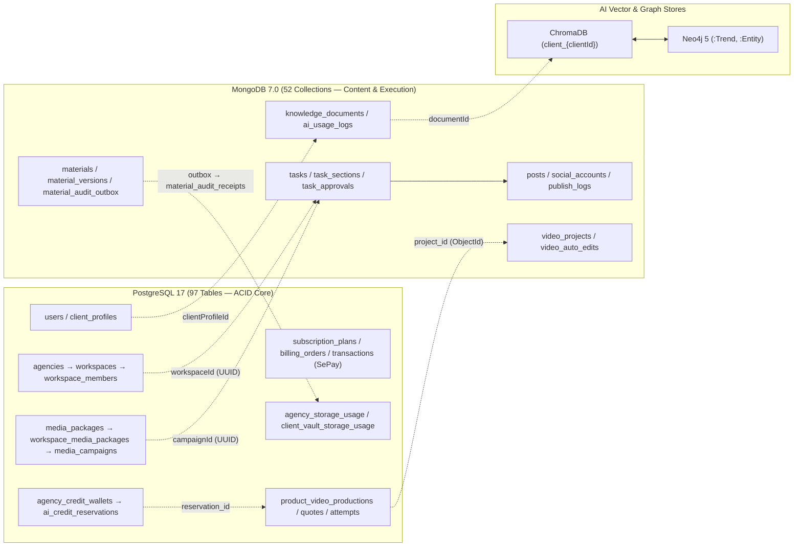

# Database Architecture & Polyglot Storage Hub

> Navigation: [← Knowledge Base Hub](../index.md) · [← API Contracts](../api/README.md) · [System Architecture](../architecture/README.md) · [ADR-002 Database Split](../adr/adr-002-database-split.md) · [Business Analysis →](../ba/README.md)

Central knowledge hub for BrandHub's **5-engine polyglot persistence architecture**. Each entity or workload belongs to a single authoritative storage engine—zero cross-engine duplication, strict tenant isolation on `workspaceId` / `agency_id`, and dual-track schema governance across `database/init/` and `database/migrations/`.

---

## 1. Five-Engine Persistence Matrix

| Engine | Production Runtime | Authoritative Scope | Service Ownership | Physical Schema / Init Source |
| :--- | :--- | :--- | :--- | :--- |
| **PostgreSQL 17** | `postgres:17` (`:5432` on `core` EC2 / RDS) | **97 tables** (`31` JPA `@Entity` + `66` SQL/JDBC): Identity, Agency/Workspace/Client org hierarchy, Media Packages & Campaigns, 6-plan Studio/Agency Billing (**SePay VietQR**, upgrade-only), AI Credit Wallets & Reservations, Product Video Productions, S3/Client Vault Storage Quotas & Google Drive Sync, Mail Batches/Deliveries, Moderation, `user_notifications` (`LISTEN/NOTIFY`), immutable `audit_logs` | `brandhub-business-service` (exclusive R/W) | `database/init/init-postgres-v2.sql` + `25` SQL migrations in `database/migrations/postgres/` |
| **MongoDB 7.0** | `mongo:7.0` / MongoDB Atlas (`:27017`) | **52 collections** (`31` `@Document` + `21` `MongoTemplate`/schema-managed): Tasks (`8` types), Task Approvals & Multi-Role Sections, Content Requests, Surveys & Responses, Social Accounts (`4` platforms) & Posts, Publish Logs, Workspace Chat & Agora Calls, Material Repository & Watermarks, Video Studio & Auto-Edit, Mail Templates, Infrastructure Monitoring, Knowledge Document metadata | `brandhub-business-service`, `brandhub-ai-service` (`knowledge_documents`, `ai_usage_logs`), `brandhub-publisher-service` (`publish_logs`) | `database/init/init-mongo.js` + `8` JS migrations in `database/migrations/mongodb/` |
| **Redis 7** | `redis:7-alpine` (`:6379`) | Ephemeral coordination & cache only (never primary data): RS256 JWT revocation (`jwt:blacklist:{jti}`), API Gateway sliding-window rate limits (`ratelimit:gateway:{userId}:{minute}`), OAuth PKCE/state (`oauth:state:{state}`), Vietnam trend rankings (`trends:vn:{date}:{category}`), and publisher per-platform deduplication locks (`processingPostIds:{postId}:{platform}`) | All 4 backend services (strictly partitioned by key prefix) | Stateless in-memory with mandatory per-key TTL |
| **ChromaDB** | `chromadb/chroma:latest` (`:8001` -> `:8000`) | **384-dim HNSW vector store** (`paraphrase-multilingual-MiniLM-L12-v2` / `all-MiniLM-L6-v2`): per-client brand knowledge collections (`client_{clientId}`) and social trend text chunks with metadata filtering | `brandhub-ai-service` (exclusive) | Persisted Docker volume `chroma_data` |
| **Neo4j 5 Community** | `neo4j:5-community` (`:7474` HTTP / `:7687` Bolt) | **Property Knowledge Graph** (with APOC + GDS): Trend Virality Centrality (`:User`, `:Trend`, `:Community`) and Brand/Trend GraphRAG 1–2 hop entity traversal (`:KOL`, `:Dish`, `:Location`, `:Brand`) | `brandhub-ai-service` (exclusive) | `database/migrations/neo4j/2026-10-20-trend-graph-v2.cypher` |

---

## 2. Canonical Design Specifications

### 2.1 Relational & Document Schema (`schema/`)
Consolidates the PostgreSQL + MongoDB domain boundary, entity-level catalog, and visual ERDs:

| Document / Asset | Code | Summary |
| :--- | :--- | :--- |
| [Database Strategy V2 & V3 Extensions](./schema/database-strategy.md) | `DA-E06-01` | Architectural rules splitting transactional PostgreSQL vs. flexible MongoDB, hard ACID rules (two-party package approval, SePay ledger, `workspaceId` tenant filter), V3 Studio/Agency billing, `product_video_*` orchestration, and S3/Client Vault envelope encryption (`RepositoryEnvelopeCrypto`). |
| [ERD Entity Descriptions (97 PG + 52 Mongo)](./schema/erd-entity-descriptions.md) | `DA-D12-03` | Complete 149-entity dictionary (`#1`–`#97` PostgreSQL tables across 11 domain groups + `#1`–`#52` MongoDB collections across 9 domain groups) synced directly against Java `@Entity`/`@Document`/SQL stores. |
| [Interactive Schema Diagram](/view?file=database/schema/brandhub-schema-diagram.html) | Visual | Interactive browser-renderable ERD (`docs/database/schema/brandhub-schema-diagram.html`), backed by source definitions in `docs/database/schema/brandhub-dbml.dbml` and `docs/database/schema/brandhub-erd.puml`. |

### 2.2 Redis Coordination & Multi-Tenant Access Contracts (`redis-cache/`)
Mandatory runtime contracts preventing cross-workspace data leaks, token replay, and duplicate social publishing:

| Document | Code | Summary |
| :--- | :--- | :--- |
| [Redis Key Patterns](./redis-cache/redis-key-patterns.md) | `DA-E06-06` | Namespace templates, value shapes, exact TTLs, and reader/writer ownership across `jwt:blacklist:*`, `ratelimit:gateway:*`, `oauth:state:*`, `trends:vn:*`, and `processingPostIds:*`. |
| [Multi-Tenant Database Access Rules](./redis-cache/database-access-rules.md) | `DA-E06-08` | Non-negotiable query isolation rules enforcing `workspaceId` scoping on every MongoDB read/write, PostgreSQL-first workspace resolution for Agency-wide queries, and soft-reference join patterns. |

### 2.3 AI Vector & GraphRAG Storage (`ai-vector/`)
Hybrid vector + knowledge-graph persistence powering Brand RAG (`FR 3.7.1`–`3.7.4`) and Vietnam Trend Intelligence (`FR 3.7.15`–`3.7.19`):

| Document | Code | Summary |
| :--- | :--- | :--- |
| [ChromaDB Collection Design](./ai-vector/chromadb-collection-design.md) | `DA-AI02-07` | Per-`clientId` HNSW collection isolation, chunk ID determinism, metadata filter schema (`documentId`, `sourceType`, `trendName`), and deletion/re-indexing semantics. |
| [Hybrid DB Schema (ChromaDB + Neo4j)](./ai-vector/hybrid-db-schema.md) | `DA-AI04-99-05` | Dual-write linkage between 384-d ChromaDB text chunks and Neo4j NER entities (`:KOL`, `:Dish`, `:Location`, `:Trend`) plus background entity resolution. |
| [Redis & Neo4j Concurrent Upsert Flow](./ai-vector/redis-neo4j-upsert-flow.md) | `DA-AI04-99-06` | Atomic pipeline stage (`T8_PersistStep`) syncing ranked Vietnam trends into Redis ZSETs (`6h` TTL) and Neo4j `MERGE` Cypher statements without losing historical `createdAt` metadata. |

---

## 3. Cross-Engine Data Lineage & Soft-Reference Contract

Because PostgreSQL and MongoDB serve distinct consistency profiles, cross-engine links are maintained via **immutable UUID/ObjectId string soft references** validated in `brandhub-business-service`:

---

## 4. Operational Scripts & Dual-Track Migration Governance

All executable SQL, Mongosh, and Cypher files live outside `docs/` at the repository root under `database/` (see operational manual `database/README.md` and `database/migrations/README.md`):

1. **Fresh Bootstrap (`database/init/`)**:
   - `database/init/init-postgres-v2.sql` — creates all **97 PostgreSQL tables**, constraints, triggers (`notify_user_notification()` on `user_notifications`), and seeds the 6 canonical Studio/Agency plans.
   - `database/init/init-mongo.js` — creates all **52 MongoDB collections** and compound/TTL/partial unique indexes.
2. **Incremental Upgrades (`database/migrations/`)**:
   - Every schema change MUST ship both an idempotent migration script under `database/migrations/{postgres,mongodb,neo4j}/YYYY-MM-DD-<slug>.*` AND the matching baseline update in `database/init/` (see [Team Workflow Guide — §6](../guides/team-workflow-guide.md#6-quy-định-cập-nhật--migrate-database)).
   - PostgreSQL migrations record applied filenames in `brandhub_schema_migrations`; MongoDB backfill scripts default to dry-run mode unless the script's explicit `globalThis.*_APPLY = true` flag is set.
3. **Encrypted Repository Keys & Backups**:
   - Folder/file encryption metadata in `materials` and `material_folders` uses `RepositoryEnvelopeCrypto` (`ALG_AES_256_GCM_HKDF_SHA512_COMMIT_KEY`, see `scripts/repository-encryption/README.md`).
   - Production backups on the `core` EC2 host are automated by `prod/hosts/core/db-backup/` (`pg_dump -Fc` + `mongodump --archive --gzip` to S3).
