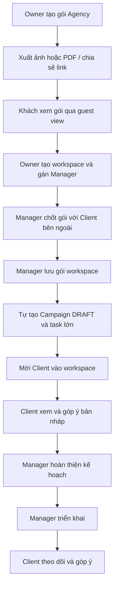

# Media Package sharing và hành trình triển khai do Manager quản lý

Ngày chốt BA 2026-11-05. Trạng thái: đã cập nhật BA, có plan/task/test và triển khai mã nguồn ngày 2026-11-06; chưa rollout database hoặc production. Tài liệu này ghi yêu cầu đích, không xác nhận code hiện tại đã đáp ứng.

Cập nhật 2026-11-06: cho phép chia sẻ cả Custom Package trong workspace để Manager trao đổi với Client trước khi mời vào hệ thống. Các cơ chế bảo mật nâng cao sẽ bàn với team sau; chưa yêu cầu OTP, mật khẩu hoặc xác minh email ở đợt này.

## 1. Mục tiêu và phạm vi thay thế

Owner quảng bá các gói dịch vụ của Agency trước khi Client tham gia workspace. Manager ghi nhận gói đã thống nhất bên ngoài, chuẩn bị chiến dịch và chủ động triển khai. Client vào hệ thống để theo dõi, trao đổi và góp ý.

Spec này ưu tiên hơn mô tả cũ về Client chọn gói trong workspace, đàm phán/duyệt Package hai phía, yêu cầu Client tồn tại khi tạo workspace, duyệt Campaign hai phía và các gate dựa vào những lượt duyệt này.

Một workspace tiếp tục có một Campaign. Quy trình duyệt kết quả Task/bài đăng, xuất bản, Content Request và điều kiện hoàn thành Campaign giữ theo spec riêng của từng module.

## 2. Quyết định người dùng đã chốt

| Nội dung | Quyết định |
|---|---|
| Share gói Agency | Hệ thống xuất nội dung gói thành ảnh, PDF hoặc link guest để xem |
| Share Custom Package workspace | Manager phụ trách và Owner có quyền quản lý được xuất ảnh/PDF hoặc link guest |
| Nội dung link guest | Luôn đọc bản mới nhất đã lưu của chính gói Agency hoặc gói workspace được chia sẻ |
| Gói trong workspace | Manager chọn gói mẫu của Agency rồi tùy chỉnh hoặc tạo gói mới |
| Đàm phán và chốt thương mại | Manager làm với Client bên ngoài hệ thống |
| Khi lưu gói workspace hợp lệ | Tự tạo Campaign DRAFT và các task lớn theo gói |
| Client xem Campaign | Được xem và góp ý cả khi Campaign còn DRAFT |
| Sửa gói workspace | Được sửa trước triển khai, đồng bộ kế hoạch/task và giữ thông tin đã nhập |
| Sau triển khai | Khóa gói workspace và phạm vi kế hoạch đã triển khai |
| Duyệt Campaign | Bỏ bước duyệt Campaign của Client và gate hai phía |

## 3. Hành trình người dùng

1. Agency Owner tạo và quản lý Media Package trong danh mục Agency.
2. Owner xuất ảnh/PDF hoặc chia sẻ link để quảng bá và gửi cho khách hàng.
3. Khách xem gói qua link guest mà chưa cần tài khoản hoặc membership workspace.
4. Owner tạo workspace và gán Manager. Giai đoạn này được phép chưa có Client.
5. Manager trao đổi, chốt phạm vi và điều khoản với Client bên ngoài hệ thống.
6. Manager tạo gói trong workspace từ gói mẫu hoặc nhập mới theo thỏa thuận.
7. Lưu gói hợp lệ tự tạo một Campaign DRAFT cùng các task lớn theo sản lượng đã chốt. Các lần lưu sau cập nhật cùng gói/Campaign.
   Manager có thể chia sẻ gói workspace đã lưu qua link hoặc xuất ảnh/PDF để tiếp tục trao đổi bên ngoài; việc chia sẻ không xác nhận Client đồng ý và không triển khai Campaign.
8. Manager mời Client vào workspace làm việc. Client xem gói đã ghi nhận, Campaign và góp ý.
9. Manager hoàn thiện thông tin Campaign/task, xử lý góp ý nếu cần, rồi bấm triển khai khi đủ điều kiện.
10. Client theo dõi tiến độ và tiếp tục bình luận. Các thao tác duyệt kết quả Task/bài đăng vẫn theo quyền riêng được cấu hình.

## 4. Tách gói quảng bá và gói thực hiện

### 4.1. Gói trong danh mục Agency

- Owner quản lý gói dùng để giới thiệu dịch vụ. Gói có thể tồn tại trước workspace.
- Nội dung giới thiệu gồm Agency, tên gói, phạm vi, các dịch vụ/hạng mục, số lượng và đơn vị, mô tả, tiêu chí bàn giao, ngân sách và thời lượng khi được cung cấp.
- Ngân sách và thời lượng tiếp tục tùy chọn. Không có giá trị thì hiển thị thông tin cần trao đổi thay vì suy thành số 0 hoặc một cam kết mặc định.
- Gói quảng bá là cơ sở trao đổi. Việc khách mở link hoặc nhận file không tạo workspace, chọn gói, xác nhận mua, sinh Campaign/task hoặc ghi nhận Client đã đồng ý.

### 4.2. Gói trong workspace

- Manager của đúng workspace ghi nhận nội dung đã thống nhất với Client bên ngoài.
- Khi lấy từ gói Agency, workspace có nội dung riêng và thông tin nguồn để đối chiếu. Sửa gói quảng bá về sau không tự sửa gói workspace hoặc task đã sinh.
- Gói nhập mới vẫn thuộc workspace/Agency tương ứng. Nó không tự trở thành gói quảng bá trong danh mục Owner.
- Manager phụ trách hoặc Owner có quyền quản lý được chủ động chia sẻ riêng gói workspace đã lưu. Việc này không đưa gói vào danh mục công khai của Agency.
- Giữ các dịch vụ, đơn vị, tổng sản lượng cả gói và quy tắc tách task hiện hành. Lưu các trường bắt buộc theo hợp đồng gói hiện có.
- Tên dịch vụ và nội dung acceptance criteria không mở rộng phạm vi thực hiện của module phụ trách.

## 5. Guest view và chia sẻ

### 5.1. Link guest

- Guest đọc gói Agency được Owner chia sẻ hoặc Custom Package workspace được Manager phụ trách/Owner có quyền quản lý chia sẻ, không cần đăng nhập hoặc membership.
- Link hợp lệ luôn hiển thị nội dung mới nhất đã lưu của đúng gói được chia sẻ. Link gói workspace đọc thỏa thuận workspace, không quay về nội dung gói mẫu Agency. Bản nhập dở chưa lưu không xuất hiện trên link.
- Tải lại trang sau khi người quản lý sửa gói phải thấy bản mới, kể cả khi có cache. Không yêu cầu cập nhật trực tiếp vào tab guest đang mở trong đợt này.
- Chia sẻ chỉ cho xem nội dung gói, không cấp quyền truy cập workspace, Campaign hoặc Task. Gói workspace không tự được liệt kê trong catalog Agency hay trang tìm kiếm công khai.
- Chỉ trả nội dung gói cần gửi khách, bao gồm phạm vi và điều khoản của gói được chia sẻ. Không trả Client Profile, membership nội bộ, lịch sử đàm phán, bình luận, approval hoặc tài nguyên nội bộ ngoài nội dung gói.
- Nhận diện link và kiểm tra khả dụng phải được thực hiện phía server. Guest view không dựa vào việc ẩn nút trên Web để giới hạn quyền.
- Guest view có trạng thái tải, không tìm thấy và không còn khả dụng. Trạng thái lỗi không được làm lộ dữ liệu nội bộ.

### 5.2. Ảnh và PDF

- Hệ thống xuất từ nội dung gói Agency hoặc Custom Package workspace đã lưu tại thời điểm yêu cầu, giữ đúng ngân sách, thời lượng, hạng mục, số lượng, đơn vị, mô tả và tiêu chí của gói đó.
- Owner hoặc Manager có quyền tương ứng nhận file để tải về/gửi bên ngoài. Ảnh/PDF đã tải là bản tại thời điểm xuất, không tự đổi khi gói được chỉnh sau đó.
- File có tên Agency, tên gói và ngày xuất để người nhận phân biệt bản cũ với link đang hiển thị bản mới nhất.
- Gói dài phải xuất đủ nội dung, hỗ trợ phân trang hoặc nhiều ảnh khi cần. Không cắt hạng mục chỉ để vừa một trang.
- Tiếng Việt có dấu, xuống dòng, số lượng, tiền tệ và đơn vị phải đọc được. Lỗi xuất file có thể thử lại và không tạo file thành công giả.
- Thiết kế mẫu xuất, định dạng ảnh cụ thể và cơ chế lưu file sẽ chốt khi lập plan. Spec này không chọn thêm dịch vụ, quota hoặc cơ chế tính phí.

## 6. Workspace và gói do Manager quản lý

- Owner tạo workspace và gán Manager trước khi mời Client. Không bắt buộc có Client, lượt chọn gói của Client hoặc approval của Client để chuẩn bị workspace.
- Manager có quyền tạo/cập nhật gói của workspace mình quản lý và mời Client theo quyền mời hiện hành.
- Client đã tham gia xem gói thực hiện trong workspace ở chế độ đọc. Luồng mới không yêu cầu Client chọn gói, gửi đề xuất sửa điều khoản hoặc bấm duyệt gói.
- Không hiển thị reminder, checklist hay redirect yêu cầu Client hoàn thành các bước đã bỏ.
- Workspace chưa có gói hướng dẫn Manager thiết lập gói. Trạng thái trống của Client chỉ giải thích tiến độ chuẩn bị và cho phép liên hệ/trao đổi theo quyền hiện hành.
- Quyền truy cập các phần việc khác vẫn theo membership và điều kiện nghiệp vụ của module đó. Không mở quyền nội bộ chỉ vì bỏ gate duyệt Package.

## 7. Tự tạo Campaign và task khi lưu gói

- Chỉ thao tác lưu gói workspace hợp lệ mới kích hoạt việc tạo/cập nhật Campaign và task. Guest mở link, xuất file, xem workspace hoặc bình luận không kích hoạt tác vụ này.
- Lần lưu đầu tạo đúng một Campaign DRAFT và đủ task lớn theo các dịch vụ/sản lượng của gói. Task mang nguồn gói/Campaign và định danh ổn định theo quy tắc hiện hành.
- Task bắt đầu ở TODO. Người thực hiện và giám sát mặc định là Manager theo spec package-driven hiện hành.
- Các lần lưu tiếp theo, gửi lại request hoặc hai thao tác đồng thời phải giữ quan hệ một Campaign/workspace và không sinh task trùng.
- Cho phép lưu gói rồi hoàn thiện thêm strategy, timeline hoặc brief/deadline task trong Campaign DRAFT. Những thông tin còn thiếu phải được chỉ ra khi kiểm tra điều kiện triển khai.
- Campaign DRAFT và task đã tạo là công việc chuẩn bị. Thành viên chỉ bắt đầu thực hiện sau khi Campaign IN_PROGRESS theo điều kiện hiện hành.
- Nếu việc sinh/đồng bộ Campaign/task bị lỗi một phần, hiển thị trạng thái cần hoàn tất và cho Manager thử lại. Chưa được triển khai khi kế hoạch và task còn không khớp gói. Kế hoạch kỹ thuật phải xử lý retry/concurrency và bảo toàn định danh.

### 7.1. Điều chỉnh trước triển khai

- Manager được sửa gói workspace trước triển khai. Thay đổi gói phải đồng bộ phần kế hoạch và task liên quan trước khi cho triển khai.
- Hạng mục không đổi giữ định danh và thông tin đã nhập như người phụ trách, người giám sát, mô tả, deadline, subtask và bình luận.
- Thêm sản lượng tạo thêm task theo cùng quy tắc. Giảm/xóa/đổi loại hạng mục phải hiển thị tác động và bảo toàn thông tin, lịch sử đã nhập. Không tự xóa công việc có dữ liệu liên quan để làm số lượng khớp gói.
- Trường hợp cần quyết định task nào được giữ khi giảm sản lượng, Manager phải xác nhận danh sách chịu tác động. Nếu chưa thể đồng bộ an toàn thì chặn lưu với nguyên nhân cụ thể.
- Lưu và triển khai đồng thời phải kiểm tra phiên bản/trạng thái phía server để tránh triển khai kế hoạch khác bản gói đang có hiệu lực.

### 7.2. Khóa khi triển khai

- Manager chủ động bấm triển khai sau khi đủ thông tin Campaign/task và các điều kiện triển khai hiện hành.
- Không yêu cầu chữ ký, timestamp duyệt, version approval hoặc hành động xác nhận của Client/Agency cho Campaign.
- Khi bắt đầu triển khai, cố định bản gói/kế hoạch dùng cho lượt triển khai và ngăn lưu thay đổi đồng thời vào bản đó. Deployment lỗi cho phép thử lại cùng bản đã cố định.
- Campaign chuyển IN_PROGRESS sau khi hệ thống xác nhận đủ task theo bản triển khai. Đã IN_PROGRESS thì gói workspace và phạm vi kế hoạch được khóa.
- Phát sinh mới tiếp tục đi qua Content Request và các quy trình bổ sung hiện hành. Spec này không bổ sung cơ chế mở khóa gói sau triển khai.

## 8. Campaign và góp ý của Client

- Client đã tham gia đúng workspace đọc được Campaign DRAFT, IN_PROGRESS và COMPLETED theo quyền xem hiện hành.
- Client được gửi góp ý cả khi Campaign còn DRAFT. Bình luận được lưu cùng người gửi, thời điểm và ngữ cảnh/phiên bản Campaign được xem nếu hệ thống đang quản lý phiên bản.
- Góp ý là trao đổi. Gửi bình luận không sửa kế hoạch, không chuyển trạng thái, không đóng vai trò duyệt và không tạo thêm điều kiện cần Client đồng ý để triển khai.
- Manager đọc góp ý và quyết định điều chỉnh kế hoạch trong phạm vi trạng thái cho phép. Không có bước bắt buộc Client xác nhận đã hài lòng.
- Quyền sửa/xóa bình luận, nếu có, theo contract comment hiện hành. Quyền tiếp tục góp ý sau COMPLETED theo contract feedback hiện hành và không mở lại Campaign.
- Manager là người vận hành triển khai và hoàn thành Campaign. Client không có nút duyệt/từ chối Campaign, sửa kế hoạch hoặc triển khai.
- Vòng đời nghiệp vụ đích là DRAFT → IN_PROGRESS → COMPLETED. APPROVED không còn là một bước bắt buộc trong flow mới. Trạng thái tiến trình deployment được theo dõi riêng khi cần.
- Các điều kiện hoàn thành Campaign và Content Request chưa xử lý tiếp tục theo spec closure hiện hành.

## 9. Ma trận quyền trong phạm vi thay đổi

| Hành động | Guest | Owner | Manager đúng workspace | Client đã tham gia |
|---|---|---|---|---|
| Xem gói Agency qua link được chia sẻ | Có | Có | Có qua link | Có qua link |
| Quản lý danh mục và xuất/chia sẻ gói Agency | Không | Có | Không cấp thêm ở đợt này | Không |
| Xuất/chia sẻ Custom Package workspace | Không | Khi có quyền quản lý hiệu lực | Có | Không |
| Tạo workspace, gán Manager | Không | Có | Theo quyền tổ chức hiện hành | Không |
| Ghi nhận/sửa gói workspace trước triển khai | Không | Khi có quyền quản lý hiệu lực | Có | Chỉ xem |
| Mời Client vào workspace | Không | Theo quyền hiện hành | Theo quyền hiện hành | Không |
| Xem/góp ý Campaign DRAFT | Không | Theo quyền workspace hiện hành | Có | Có |
| Triển khai/hoàn thành Campaign | Không | Khi có quyền quản lý hiệu lực | Có khi đủ điều kiện | Không |
| Duyệt kết quả Task/bài đăng | Không | Theo module Task | Theo module Task | Theo cấu hình Task |

## 10. Tiêu chí nghiệm thu nghiệp vụ

- AC-01 Owner tạo gói Agency mà chưa có workspace và xuất được ảnh, PDF hoặc link. Manager phụ trách/Owner có quyền quản lý cũng chia sẻ được Custom Package workspace đã lưu qua ba hình thức này.
- AC-02 Guest chưa đăng nhập mở được gói đã chia sẻ và không đọc được dữ liệu workspace bằng link đó.
- AC-03 Người quản lý sửa/lưu gói Agency hoặc workspace, guest tải lại cùng link thấy đúng bản mới của gói đó. File đã tải trước đó vẫn là bản tại ngày xuất. Sửa mẫu Agency không thay nội dung link gói workspace.
- AC-04 Owner tạo workspace và gán Manager khi chưa có Client. Không phát sinh bước bắt Client chọn hoặc duyệt gói.
- AC-05 Manager chọn mẫu rồi tùy chỉnh hoặc tạo mới, lưu gói hợp lệ sinh đúng một Campaign DRAFT cùng task theo gói.
- AC-06 Lưu lặp, lỗi một phần và lưu đồng thời không sinh Campaign/task trùng. Giao diện phản ánh đúng trạng thái cần thử lại.
- AC-07 Manager sửa gói trước triển khai, dữ liệu hạng mục không đổi được giữ và phần thay đổi được đồng bộ có kiểm soát.
- AC-08 Client được mời sau đó xem gói đã chốt, xem/góp ý Campaign DRAFT. Bình luận không tạo approval hoặc chặn triển khai.
- AC-09 Manager triển khai đủ điều kiện mà không có lượt duyệt Campaign/Package của Client. Lượt triển khai cố định bản dùng để tạo công việc.
- AC-10 Sau triển khai không sửa gói/phạm vi kế hoạch đã cố định. Module Task, nội dung và Content Request dùng các quy tắc riêng.
- AC-11 Tải, lỗi, trống, link không khả dụng, xuất file thất bại, thiếu quyền và phiên bản xung đột có thông báo và hành động hợp lệ.
- AC-12 UI dùng key vi/en song song cho `mediaPackage.share.*`, `mediaPackage.guest.*`, `mediaPackage.workspace.*` và `campaign.feedback.*`. Dùng theme hiện hành, hỗ trợ light/dark, bàn phím và mobile. Nhãn cụ thể sẽ chốt trong plan UI.

## 11. Ranh giới triển khai và dữ liệu cũ

Mã nguồn, contract và migration được triển khai theo plan/task/test cùng thư mục. Cần review và chạy migration trước khi dùng flow mới trên môi trường ứng dụng. Các tài liệu cũ mô tả flow duyệt Package/Campaign chỉ dùng để đối chiếu lịch sử.

Không suy ra hay tạo giả lượt duyệt Client khi nâng cấp dữ liệu. Approval và lịch sử đàm phán cũ được bảo toàn để truy vết. Cách diễn giải APPROVED cũ, bỏ gate trên endpoint cũ, chuyển dữ liệu và tương thích Web/mobile cần preflight và kế hoạch riêng.

Các điểm cần chốt ở bước plan gồm hợp đồng link public và vòng đời phát hành/thu hồi, giới hạn/cache guest view, mẫu xuất ảnh/PDF, API ghi nhận gói workspace, đồng bộ an toàn khi giảm sản lượng, cùng cách phối hợp ghi PostgreSQL/MongoDB. Không tự bổ sung checkout/thanh toán, e-sign, guest comment hoặc quyền duyệt Campaign vào flow này.

## 12. Nâng cấp format xuất gói 2026-11-06

- Bản xuất ảnh/PDF là proposal của chính gói đã lưu, không phải báo cáo tiến độ Campaign. Không thêm KPI, cam kết, dòng ký/duyệt hoặc phí chưa có trong dữ liệu.
- A4: nhận diện Agency/tên gói, tổng ngân sách và thời lượng, phạm vi công việc, bảng hạng mục - sản lượng - số lượt sửa, chi tiết yêu cầu và tiêu chí bàn giao. Phần không có dữ liệu được bỏ hoặc thể hiện chưa thống nhất, không suy thành 0.
- Phân cấp heading/body, tiền tệ có dấu phân nhóm, không lộ enum kỹ thuật; nhãn vi/en theo ngôn ngữ Web. Nội dung người dùng giữ nguyên.
- PDF có text layer tiếng Việt để chọn/copy; PNG dùng cùng layout, không cắt nội dung. Ngắt trang không để tiêu đề lẻ hoặc cắt mất dòng; header/footer và số trang nhất quán.
- Nội dung dài phải giữ đủ chữ, không thêm trang trắng cuối. Một hạng mục có thể tiếp tục sang trang sau với ngữ cảnh rõ.

### Điều chỉnh nhãn export theo review

Bỏ dòng “Đề xuất gói truyền thông”, cột Lượt sửa, hai chú thích dưới Ngân sách/Thời lượng và dòng sản lượng toàn gói. Dùng “Ngân sách”, “Số lượng”, “Mô tả thực hiện”, “Mục tiêu đạt được”. Dòng mô tả dịch vụ dùng số lượng tự nhiên, ví dụ “12 bài đăng mạng xã hội”, “1 sự kiện”, “2 buổi livestream”, “1 danh sách đề xuất báo điện tử”, “2 buổi workshop”. Cập nhật tương ứng en; chỉ thay phần trình bày export, không xóa revisionLimit trong dữ liệu. Kiểm tra lại PDF/PNG sau thay đổi.

### Báo điện tử — làm rõ cách hiển thị cho Client

Báo điện tử là bài báo Agency cung cấp cho Client; danh sách đề xuất đối tác là hỗ trợ nội bộ cho Agency. Bản xem gói/card/guest/export hiển thị “Bài báo điện tử”, đơn vị “bài”, câu “N bài báo điện tử”. Không đổi enum, dữ liệu cũ, Task workflow hoặc chức năng đề xuất đối tác trong lượt sửa hiển thị này.

### Xuất ảnh trang đầu theo xác nhận

Xuất ảnh tải trực tiếp đúng một file JPG của trang đầu; không ZIP, không ảnh dài, không xuất các trang chi tiết. PDF vẫn đủ các trang và link vẫn xem chi tiết.

### Bản xem theo format proposal

Bản xem chi tiết Agency/Workspace/guest dùng cùng thứ tự proposal tải về: tên gói → ngân sách/thời lượng → bảng #/Hạng mục-Dịch vụ/Số lượng → phạm vi (nếu có) → chi tiết từng hạng mục với mô tả thực hiện và mục tiêu đạt được. Bỏ cột lượt sửa, tooltip hướng dẫn/accordion trong bản đọc này. Không tạo phân trang A4 hoặc vùng scroll riêng trên web. Responsive, vi/en, dark/light theo theme hiện hành; dữ liệu thiếu hiển thị trao đổi thêm, không giả định bằng 0. Giữ nút back/share/edit và quyền.

### Workspace package — overview gọn và share menu

Trang Workspace media-package chia hai cột desktop: card gói đang dùng gọn bên trái, catalog các gói khác tự hiển thị bên phải (không cần bấm chọn mẫu để mở catalog). Mobile xếp một cột. Bấm card hoặc Enter mở chi tiết proposal full width trong trang, có Back. Share chỉ còn icon mở menu link/PDF/JPG và thu hồi riêng. Bỏ banner LEGACY/Gói hiện có và nút xem Campaign; vẫn báo pending/processing/failed/locked có ý nghĩa, giữ retry. Client xem catalog theo quyền API hiện có, không có quyền chọn/sửa/share. Manager chỉ chọn/sửa trước khóa, không đổi flow save/preparation.

### Sketch được duyệt — detail trái, list phải

Thay bố cục overview theo sketch đã được duyệt: chi tiết proposal bên trái (~72%), danh sách card một cột bên phải (~28%), gói đang sử dụng ghim đầu. Mặc định xem gói đang sử dụng; click card đổi nội dung trái ngay, không chuyển trang hoặc cần Back. Phân biệt badge đang sử dụng với highlight đang xem. Desktop mỗi pane cuộn độc lập, toolbar chi tiết và tìm kiếm luôn tiếp cận được; mobile danh sách ở trên chi tiết để chọn dễ, một scroll tự nhiên. Giữ share icon/menu và điều kiện chọn/sửa/khóa.

Chi tiết responsive: trên mobile trang cuộn tự nhiên để xem toàn bộ proposal; danh sách phía trên giới hạn chiều cao 24rem và tự cuộn để không đẩy chi tiết xuống quá xa. Card compact chỉ hiển thị tên, giá/thời lượng và badge. Sketch mới thay thế overview bên trái/catalog bên phải trước đó.

### Sketch compact được duyệt — mô tả ngắn và bảng mở chi tiết

Bản xem gói thu gọn theo sketch mới: tên gói 18px; ngân sách và thời lượng text 14px trên dòng thông tin; bỏ wordmark BrandHub và fact cards lớn. scopeDescription hiển thị nhãn “Mô tả gói”, mặc định tối đa 2 dòng, chỉ có Xem thêm khi nội dung thực sự tràn. Bảng #/Hạng mục/Số lượng/Chi tiết; hàng bình thường khoảng 44px, bấm Xem mở mô tả thực hiện/mục tiêu ngay dưới hàng đó, không lặp section Chi tiết bàn giao. Khi mở, các text dài cũng có Xem thêm/Thu gọn riêng. Không cố nhồi gói quá nhiều hạng mục vào viewport; chỉ cuộn khi số lượng/nội dung yêu cầu. Workspace giữ detail trái/list phải, current đầu, share/sửa ở đầu. vi/en, theme và keyboard/aria-expanded. Không đổi field/DB hoặc PDF/JPG.

### UI v3 đã duyệt — cam nhạt, xám/trắng và nội dung theo không gian

UI chốt theo sketch v3: header gói nền muted có viền cam trái, action sửa/chọn màu cam và share icon nền xám; header bảng cam nhạt, các hàng trắng; phần mở nền xám, hai ô mô tả/mục tiêu trắng. Bỏ tên hạng mục bị lặp trong phần mở, nếu tên dài thì hiện đủ ngay hàng chính khi mở. Khi mở chi tiết, nội dung đầy đủ nếu còn vừa vùng detail; chỉ rút gọn 2 dòng/Xem thêm khi full row làm tràn viewport. Người dùng luôn có thể mở thêm để đọc đủ. Đánh giá lại khi mở hàng, đổi nội dung/ngôn ngữ hoặc resize; mở thêm thủ công có thể tạo scroll. Giữ font 18/14 và layout hiện hành.

### Số lượng đầu hàng và tự mở hạng mục khi có chỗ

Bỏ STT, chuyển Số lượng sang cột đầu, sau đó Hạng mục/Chi tiết. Tự mở các hạng mục có mô tả/mục tiêu theo thứ tự nếu tổng chiều cao còn vừa pane; hạng mục dài không vừa vẫn thu gọn, không ngăn hạng mục ngắn phía sau tự mở. Click cả hàng dịch vụ để mở/thu gọn; giữ nút native cho keyboard/screen reader, không double-toggle khi bấm nút. Quyết định mở/đóng thủ công được giữ trong gói; đổi gói reset. Không thay đổi API/DB hoặc trạng thái nghiệp vụ.

### PDF và JPG theo sketch duyệt 06/11/2026

PDF giữ A4: trang tổng quan gồm tên/mô tả/ngân sách/thời lượng/bảng số lượng trước tên; chi tiết bắt đầu trang riêng, bố cục dọc và tự nối trang. Không STT hoặc hướng dẫn cuối trang tổng quan. JPG là một ảnh ghép các trang cạnh nhau, không chỉ trang đầu, không ZIP. Dùng cam nhạt/xám/trắng; không đổi DB/quyền/share contract.

### Chọn ngôn ngữ khi xuất file

Người dùng chọn Tiếng Việt hoặc English lúc xuất PDF/JPG, độc lập ngôn ngữ website. Nội dung tự nhập giữ nguyên; nhãn/đơn vị/định dạng số dùng language vi/en có sẵn. Không dịch tự động, không gọi AI hoặc sửa DB.

### Ngôn ngữ trang guest

Trang guest /packages/share/:token có bộ chọn Tiếng Việt/English không cần đăng nhập, luôn hiển thị ở loading/error/success. Chuyển nhãn/đơn vị/số tiền; giữ nguyên nội dung nhập. Nhớ lựa chọn bằng cơ chế i18n có sẵn.

### Form nhập liệu theo sketch đã duyệt

Form tạo/sửa gói theo sketch: thông tin gói trên, 4 dịch vụ cố định tick chọn không trùng, danh sách trái và editor phải. Gợi ý tên, mô tả, mục tiêu theo loại, checkbox thêm/bỏ đoạn gợi ý không ghi đè text riêng. Budget quick 10/25/50 triệu; duration 2/4/6/8 tuần; không option Trao đổi thêm, vẫn optional/null. Giữ ID dịch vụ có sẵn và draft khi bỏ tick/chọn lại trong phiên; không thay BA ảnh hưởng Task/gói đã triển khai. Dữ liệu legacy ngoài 4 loại không tự xóa.

### Sửa thanh Lưu đè nội dung

Thanh Hủy/Lưu nằm ở vùng riêng dưới form, không sticky đè lên ô nhập. Header và actions giữ trong khung form; chỉ vùng thông tin/hạng mục cuộn.

### Thu gọn vùng tiêu đề và thao tác lưu

Tăng không gian nhập: gộp Lưu vào toolbar tiêu đề, quay lại dạng icon có accessible label, bỏ footer/trạng thái dài và giảm padding khung. Toolbar luôn hiển thị, nội dung cuộn riêng. Không thay save/discard/validation.

### Thu nhỏ toolbar lần hai

Thu nhỏ toolbar thêm: desktop nút36px, mobile giữ44px; tiêu đề14px; padding khung8px, khoảng cách4px và đường phân cách4px.

### Sửa 400 impact do đơn vị Báo điện tử

Báo điện tử dùng đơn vị bài ở gói mới. Backend nhận cả bài và danh sách đề xuất của gói cũ, chỉ tương thích riêng PRESS_RECOMMENDATION; không nới chuẩn unit các loại khác, không chuyển/xóa dữ liệu cũ.

### Không tự đóng các dịch vụ khác khi bấm Xem

Tự mở theo không gian chỉ trước thao tác toggle đầu tiên. Khi người dùng mở/đóng một hạng mục, không được thay đổi các mục khác; thiếu chỗ cho cuộn. Đổi gói reset tự mở như cũ.

### Micro-interaction chọn và xem gói (sketch được duyệt 2026-11-06)
Giữ layout chi tiết trái/danh sách phải. Card Đang xem phản hồi bằng màu/viền cam; Đang sử dụng vẫn badge xanh và không đổi khi preview. Chuyển chi tiết 160ms, chevron và nội dung mở nhẹ; các hàng độc lập. ArrowUp/Down/Home/End khi focus card chọn preview, không ghi dữ liệu. Tôn trọng prefers-reduced-motion; token light/dark hiện có. Tái sử dụng toàn bộ key vi/en; không thêm text hoặc nút bật/tắt hiệu ứng vào sản phẩm. Không đổi API, quyền, DB hoặc xuất PDF/JPG.

### Xác nhận giảm hạng mục/số lượng trước triển khai (2026-11-06)
Tăng số lượng/thêm hạng mục tự bổ sung Task. Giảm số lượng một phần trước triển khai hiển thị Task chịu tác động khi Lưu; Manager chọn đủ Task cần bỏ rồi xác nhận. Bỏ toàn bộ hạng mục chỉ hiển thị tên hạng mục để xác nhận, tự bao gồm toàn bộ Task liên quan. Hủy dialog giữ form, không ghi. Server kiểm tra lại termsVersion, trạng thái triển khai và danh sách xác nhận. Task không còn trong kế hoạch được CANCELLED với lý do DUPLICATE_OR_REPLACED, metadata packageRemoved, giữ ID/liên kết/nội dung/bình luận/lịch sử. Không tái sử dụng Task bị loại; thêm lại tạo định danh mới. Giữ Task/công việc cũ được chọn, không reset dữ liệu. Worker retry idempotent; chỉ READY khi Task active khớp kế hoạch mới. Không xóa DB hoặc nới quyền sau triển khai. Dùng dialog xác nhận ngắn, vi/en key song song `mediaPackage.impact.*`, token sáng/tối.

### Phân biệt bỏ hạng mục và giảm số lượng
Bỏ toàn bộ hạng mục: chỉ xác nhận tên hạng mục bị loại khỏi kế hoạch, không checkbox từng Task. Giảm số lượng: cho chọn đủ Task cần bỏ. Thay đổi hỗn hợp trình bày hai phần trong một dialog; xác nhận một lần, server vẫn kiểm tra đầy đủ IDs. Giữ bảo toàn dữ liệu/khóa sau triển khai. Text dùng key mediaPackage.impact mới song song vi/en và token theme hiện có.
