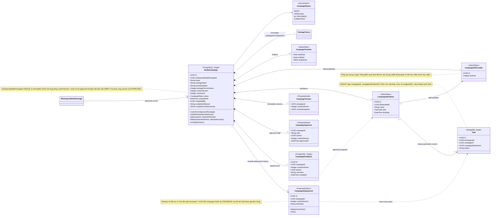
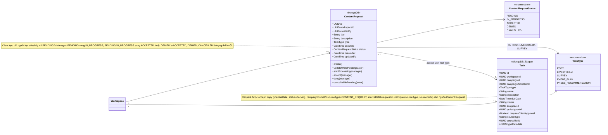

# Class diagram — FR 3.5 Media Package & Campaign

Sơ đồ lớp miền nghiệp vụ cho FR 3.5.1–3.5.10, theo baseline và quyết định ngày
2026-10-08. Các phương thức biểu diễn hành vi nghiệp vụ, không khẳng định tên
method đã tồn tại trong code. Các lớp `ValueObject` biểu diễn dữ liệu nhúng;
không phải bảng riêng. Quan hệ tới MongoDB là tham chiếu logic, không phải SQL FK.

Nguồn: [baseline](README.md), [Package offering](offering-models/spec.md),
[Campaign contract](phase-1-design/plan.md) và spec/plan của từng FR trong thư mục này.
Campaign version, feedback, deployment và Task Mongo bên dưới là thiết kế mục tiêu;
giai đoạn 1 mới hoàn thành thiết kế, chưa đồng nghĩa đã triển khai.

## 1. Tổng quan FR 3.5

```mermaid
classDiagram
direction LR
class Agency
class Workspace
class MediaPackage
class WorkspaceMediaPackage
class MediaCampaign
class CampaignWorkItem
class ContentRequest
class Task

Agency "1" --> "0..*" Workspace : quản lý
Agency "0..1" --> "0..*" MediaPackage : sở hữu catalogue
Workspace "1" --> "0..1" WorkspaceMediaPackage : chọn và thương lượng
MediaPackage "1" <-- "0..*" WorkspaceMediaPackage : packageId
WorkspaceMediaPackage "1" --> "0..1" MediaCampaign : nguồn đã APPROVED
MediaCampaign "1" *-- "0..*" CampaignWorkItem : workItems
CampaignWorkItem "0..1" --> "0..1" Task : sinh khi deploy
Workspace "1" --> "0..*" ContentRequest : yêu cầu độc lập
ContentRequest "0..1" --> "0..1" Task : sinh khi ACCEPTED
Workspace "1" --> "0..*" Task : chứa

note for MediaPackage "Global template: isTemplate=true, agencyId=null.\nAgency package: isTemplate=false, agencyId bắt buộc."
note for MediaCampaign "Tối đa một Campaign/Workspace, kể cả COMPLETED.\nKhông dùng mô hình nhiều Campaign theo tháng của prototype cũ."
note for Task "Task từ Campaign hoặc Content Request có nguồn loại trừ nhau.\nTask từ Content Request có campaignId=null."
```

## 2. Package catalogue, thương lượng và duyệt — FR 3.5.1–3.5.4

```mermaid
classDiagram
direction LR
class MediaPackage {
  <<PostgreSQL>>
  +UUID id
  +UUID agencyId
  +Boolean isTemplate
  +UUID sourceTemplateId
  +String name
  +String type
  +Boolean isAvailableToWorkspaces
  +create()
  +cloneFrom(source)
  +setAvailability(available)
}
class PackageTerms {
  <<ValueObject>>
  +Integer durationWeeks
  +Decimal budgetAmount
  +String scopeDescription
  +String quantityBasis
  +String offeringModel
  +Integer maxChanges
}
class PackageDeliverable {
  <<ValueObject>>
  +UUID id
  +ServiceType serviceType
  +String name
  +Integer quantity
  +String unit
  +String description
  +String acceptanceCriteria
}
class ServiceType {
  <<enumeration>>
  SOCIAL_POST
  EVENT_PLANNING
  LIVESTREAM_PREPARATION
  PRESS_RECOMMENDATION
  WORKSHOP_SUPPORT
}
class WorkspaceMediaPackage {
  <<PostgreSQL>>
  +UUID id
  +UUID workspaceId
  +UUID packageId
  +String status
  +Integer termsVersion
  +Integer clientProposalCount
  +select(package)
  +replaceBeforeNegotiation(package)
  +requestChange(terms, expectedVersion)
  +counterOffer(terms, expectedVersion)
  +approve(actor, expectedVersion)
}
class PackageNegotiationEvent {
  <<PostgreSQL>>
  +UUID id
  +UUID workspaceMediaPackageId
  +Integer termsVersion
  +UUID actorId
  +String action
  +String note
  +DateTime createdAt
}
class PackageApproval {
  <<LogicalValueObject>>
  +String side
  +UUID actorId
  +Integer termsVersion
  +DateTime approvedAt
}

MediaPackage "1" *-- "1" PackageTerms : catalogue terms
MediaPackage "0..*" --> "0..1" MediaPackage : sourceTemplateId
WorkspaceMediaPackage "0..*" --> "1" MediaPackage : packageId
WorkspaceMediaPackage "1" *-- "1" PackageTerms : finalTerms snapshot
PackageTerms "1" *-- "0..*" PackageDeliverable : deliverables
PackageDeliverable --> ServiceType
WorkspaceMediaPackage "1" *-- "0..*" PackageNegotiationEvent : append-only history
PackageNegotiationEvent "1" *-- "1" PackageTerms : terms snapshot
WorkspaceMediaPackage "1" *-- "0..2" PackageApproval : Agency và Client

note for PackageTerms "quantityBasis=TOTAL cho gói mới.\nofferingModel giữ để đọc legacy, không quyết định luồng Campaign mới.\nKhông tự chuyển đổi snapshot RETAINER đã chốt."
note for WorkspaceMediaPackage "workspaceId UNIQUE. Chỉ chọn gói khả dụng của cùng Agency.\nĐổi terms tăng termsVersion và vô hiệu cả hai approval.\nAPPROVED khi hai phía duyệt cùng phiên bản hiện tại."
note for PackageApproval "Nhóm dữ liệu duyệt logic trên agreement; không đề xuất bảng mới."
note for PackageNegotiationEvent "action: REQUEST_CHANGE hoặc COUNTER_OFFER.\nLưu terms trước và sau thay đổi để so sánh; lịch sử bất biến."
```

`maxChanges` giới hạn số đề xuất hợp lệ của Client cho toàn gói; counter-offer của
Agency không tiêu hao hạn mức. Client không được đổi offering model, service type,
unit hoặc maxChanges. Snapshot tách biệt catalogue nên sửa catalogue không sửa agreement.

## 3. Campaign, phiên bản và triển khai — FR 3.5.5–3.5.6

Khi đã duyệt đủ hai phía, nội dung Campaign bất biến. Feedback không tăng
`contentVersion`; `rowVersion` phục vụ optimistic locking, tách khỏi phiên bản nội dung.
Manager có thể complete khi còn Task chưa hoàn thành nhưng phải ghi lý do; lưu thống kê
tại thời điểm complete và giữ nguyên workflow của các Task con.

## 4. Content Request và Task — FR 3.5.7–3.5.10

Accept thành công phải bảo đảm đúng một Task, kể cả gọi lặp hoặc đồng thời. Cancel
lưu trạng thái `CANCELLED` thay vì xóa cứng theo baseline V2 (thay thế mô tả xóa ở BA cũ).
Hai loại Task mới `EVENT_PLAN` và `PRESS_RECOMMENDATION` thuộc thiết kế Campaign/E51;
không tự mở rộng loại được chọn trong Content Request.

## 5. Đối chiếu yêu cầu

| FR | Lớp/hành vi chính |
|---|---|
| 3.5.1 Create Media Package | MediaPackage, PackageTerms, PackageDeliverable; create/clone/availability và selection |
| 3.5.2 View Media Package | Đọc catalogue và WorkspaceMediaPackage với snapshot hiện tại |
| 3.5.3 Request Media Package | requestChange/counterOffer, PackageNegotiationEvent |
| 3.5.4 Approve Media Package | PackageApproval gắn termsVersion |
| 3.5.5 Create Media Campaign | MediaCampaign, timeline, deliverablePlan, workItems |
| 3.5.6 Approve Media Campaign | CampaignVersion/Approval/Feedback/Deployment và complete |
| 3.5.7 Create Content Request | ContentRequest.create, trạng thái PENDING |
| 3.5.8 Track Request Status | Đọc trạng thái; Manager xử lý; accept tạo Task một lần |
| 3.5.9 Update Request | updateWhilePending, kiểm tra người tạo và trạng thái atomically |
| 3.5.10 Cancel Request | cancelWhilePending, giữ audit với CANCELLED |

Mọi hành vi phải kiểm tra Agency/Workspace và vai trò hiện tại. Sơ đồ lược bỏ
controller, DTO, repository và các module ngoài FR 3.5 để tập trung mô hình nghiệp vụ.
Các chuyên biệt E51 (editor, event plan, press recommendation, livestream, survey)
không được triển khai hoặc mô tả đầy đủ trong tài liệu này.
