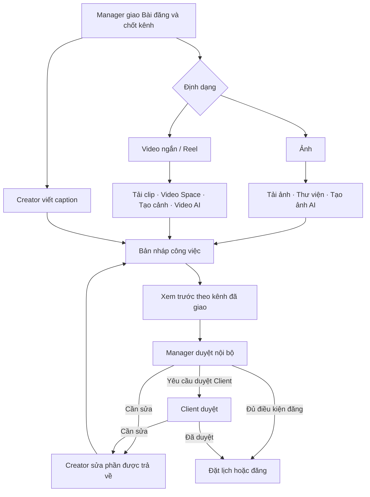
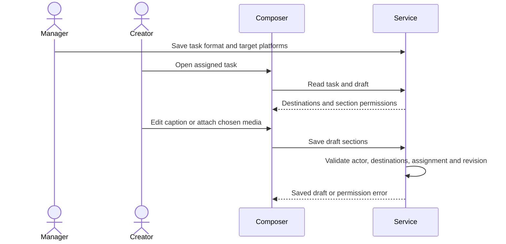

# Agency social-post workflow

## Specification

- Manager assigns **Bài đăng** and selects **Ảnh** or **Video ngắn / Reel**, destination platforms, assignee and deadline. Preserve task types `POST` and `SHORT_VIDEO` and their existing records, routes, section keys and approval history. Existing specialized work including KOL keeps its own entry points.
- `Owner` and `Manager` select and change destination platforms (`Facebook`, `Instagram`, `TikTok`, `Threads`) for Agency tasks. `Creator` can read them, switch the preview channel among assigned platforms, and suggest changes in task comments. The service enforces this rule independently of section editing, publishing permission, assignment and scheduling. Omitted platforms on an ordinary save retain stored destinations. Preserve Personal Studio's existing behavior.
- `Owner`, `Manager`, or the designated `Task Supervisor` / `Subtask Supervisor` (`supervisorOverrideId ?? task.supervisorId`, strictly distinct from a `Creator` assignee) reviews internally (`INTERNAL_APPROVED`). `Client` reviews `OUTPUT` sections when `requiresClientApproval = true` (`CLIENT_APPROVED`). Once 100% of required sections reach their final approved state, the parent Task automatically settles to `FINISHED` (and linked `Post` transitions to `SCHEDULED` or `APPROVED`). `Self-Approve` is disabled in `AGENCY` mode and reserved exclusively for `PERSONAL` mode. An authorized publisher (`Owner`, `Manager`, `Coordinator` on non-role tasks, or the holder of `POST_PUBLISHING` / `VIDEO_PUBLISH`) schedules or publishes on the destinations selected by `Owner`/`Manager`.
- The shared composer displays **Brief → Sản xuất → Caption & xem trước → Duyệt & đăng**. Navigation can revisit steps and preserves local edits. Each step shows its existing permissions and review states. A missing required part or unapproved output is addressed by the existing submission and publishing rules.
- Image production supports upload, library selection and AI image generation. Reel production supports completed footage, Video Space, scene generation and AI video presets, including Ambassador and product footage. Existing tools and their authorization stay authoritative. A selected output attaches only to the originating task draft. Generation alone never schedules or publishes.
- Use optional role subtasks. Manager may assign one Creator to the entire task or assign focused responsibilities to multiple Creators with their own deadlines. The image workflow supports research, caption, production, editing and publishing responsibilities. Reel supports script, filming or sourcing, editing or generation, independently assigned caption and publishing. A Reel with a legacy publishing subtask retains its caption ownership until a caption assignee is added. The caption can progress in parallel with media. Returning one section retains sibling sections and their histories.
- Manager reviews internally. Client reviews when the task requires it. An authorized publisher schedules or publishes on the destinations selected by Manager.

## Process diagram

## Permission and save diagram

## Implementation plan

1. Compose the task-format selector from the existing social types in Web and keep existing create payloads.
2. Apply the Manager policy in the business service and show assigned destinations in the composer.
3. Display the four steps in the shared editor and reuse section controls, preview, publishing and current deep links.
4. Connect existing image/video tools to the task draft using the scoped media handoff. Verify each supported tool and existing saved work independently.

## Verification

- Manager creates each format with destinations. A Creator may save authorized draft fields but cannot change the destinations. Existing Agency tasks load with their saved destinations and existing Personal Studio flows keep their publish controls.
- Image and Reel tasks open the expected steps and show the right production tools. Tab navigation retains the draft and a task-section link opens the matching step.
- Caption editing can proceed independently of media. Returning media retains the caption and its review history.
- Verify the selected image or Reel returns to the originating draft. Retry or a stale tool result must not target another task.
- Verify in Vietnamese and English at mobile and desktop widths. Run the focused business service policy and Web editor checks.

Local verification covered Web task creation and editor navigation, image selection and order, and task-scoped AI and Video Space attachment with mocked service responses. Business service suites covered destination authorization, role-subtask status and MongoDB section behavior. Mobile compatibility checks covered reading assigned destinations and saving drafts. Production deployment and live provider runs are pending.
