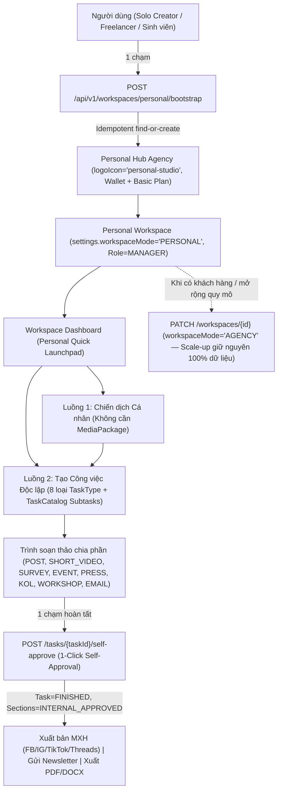

# Plan — Kế hoạch Kỹ thuật Triển khai Chế độ Không gian Cá nhân (Hybrid Personal Studio + Solo Workspace Mode)

> Bước ② theo `docs/rule/feature-workflow.md`. Dựa trên `spec.md` (AC1–AC18).
> Kiến trúc mục tiêu: **Hybrid (Auto-Provisioned Shadow Personal Hub `Agency` + Workspace-Level Mode `workspaceMode: "PERSONAL" | "AGENCY"`)**.

---

## 0. Quyết định Kiến trúc & Bảo toàn Dữ liệu (Zero-Breaking Schema Strategy)

### 0.1. Lưu trữ `workspaceMode` và `isPersonalHub` ở đâu để tương thích ngược 100%?

| Tiêu chí | Phương án A: Lưu trong JSONB `workspaces.settings` + định danh `Agency.logoIcon` (Đã chọn) | Phương án B: Thêm cột SQL `NOT NULL` mới vào bảng `agencies` và `workspaces` |
| :--- | :--- | :--- |
| **Ảnh hưởng Migration DB** | **Không bắt buộc chạy DDL mới**: cột `workspaces.settings` (`jsonb NOT NULL DEFAULT '{}'`) và `agencies.logo_icon` đã tồn tại sẵn trong PostgreSQL từ migration gốc. | Phải chạy `ALTER TABLE` trên mọi môi trường trước khi khởi động service; dễ gây lỗi nếu môi trường dev/staging chưa kịp chạy SQL. |
| **Tương thích ngược (AC2)** | Mọi bản ghi `workspaces` cũ có `settings = "{}"` tự động fallback về `WorkspaceMode.AGENCY`. | Phải backfill toàn bộ bảng. |
| **Khả năng mở rộng** | Lưu được cả `{"workspaceMode": "PERSONAL", "isPersonalDefault": true, "defaultCampaignId": "..."}` trong cùng JSONB. | Mỗi cờ mới lại phải thêm cột SQL. |

- **Cấu trúc JSONB `workspaces.settings` chuẩn**:
  ```json
  {
    "workspaceMode": "PERSONAL",
    "isPersonalDefault": true,
    "defaultPersonalCampaignId": "c1a2b3d4-..."
  }
  ```
- **Quy ước nhận diện `Personal Hub Agency`**:
  - Bản ghi `Agency` cá nhân do hệ thống tự khởi tạo có `ownerId = currentUser.id` và `logoIcon = "personal-studio"`.
  - Nhờ là một bản ghi `Agency` chuẩn trong bảng `agencies`, nó tự động thừa hưởng đầy đủ:
    1. Ví AI Credit (`agency_credit_wallets`) và lịch sử giao dịch (`credit_transactions`).
    2. Gói cước mặc định (`Basic` trong `user_subscriptions` / `subscriptions`) và thanh toán nâng cấp qua SePay / PayOS.
    3. Bộ đếm hạn mức gửi Email Newsletter theo tháng (`newsletter_usage`).

---

## 1. Thiết kế Backend (`brandhub-business-service`)

### 1.1. Enum `WorkspaceMode` & Helper xử lý JSONB `WorkspaceSettingsHelper`
- **Mới** `src/main/java/com/brandhub/business/model/enums/WorkspaceMode.java`:
  ```java
  package com.brandhub.business.model.enums;

  public enum WorkspaceMode {
      AGENCY,
      PERSONAL;

      public boolean isPersonal() {
          return this == PERSONAL;
      }
  }
  ```
- **Mới** `src/main/java/com/brandhub/business/service/impl/WorkspaceSettingsHelper.java`:
  - Sử dụng `ObjectMapper` để đọc/ghi không phá hủy (`non-destructive merge`) trên chuỗi JSON `Workspace.getSettings()`:
    - `WorkspaceMode extractMode(String settingsJson)`: trả về `WorkspaceMode.PERSONAL` nếu trường `"workspaceMode"` bằng `"PERSONAL"` (không phân biệt hoa thường); mọi trường hợp khác (`null`, `""`, `"{}"`, JSON lỗi) đều trả về `WorkspaceMode.AGENCY`.
    - `boolean isPersonalDefault(String settingsJson)`: trả về `true` nếu `"isPersonalDefault": true`.
    - `String writeMode(String existingSettingsJson, WorkspaceMode mode, Boolean isPersonalDefault)`: giữ nguyên các khóa khác trong `settings`, cập nhật `"workspaceMode"` và `"isPersonalDefault"`.
- **Cập nhật DTO**:
  - `dto/workspace/CreateWorkspaceRequest.java`:
    - Thêm `private WorkspaceMode workspaceMode;` (nullable, mặc định `AGENCY`).
    - Chuyển `@NotNull` trên `managerId` thành kiểm tra có điều kiện trong `WorkspaceServiceImpl`: nếu `workspaceMode == PERSONAL` (hoặc người gọi là `Owner`) mà `managerId == null`, tự động gán `managerId = currentUserId`.
  - `dto/workspace/UpdateWorkspaceRequest.java`:
    - Thêm `private WorkspaceMode workspaceMode;` (nullable: nếu truyền khác `null` thì thực hiện chuyển đổi chế độ kèm kiểm tra AC5).
  - `dto/workspace/PersonalBootstrapRequest.java` (Mới):
    - Trường tùy chọn `String name;`, `String brandName;`.
  - `dto/workspace/WorkspaceResponse.java`:
    - Thêm `private WorkspaceMode workspaceMode;` và `private Boolean isPersonalDefault;`.
    - Cập nhật hàm `fromEntity(Workspace workspace, ...)` để luôn điền `workspaceMode` từ `WorkspaceSettingsHelper.extractMode(workspace.getSettings())`.

### 1.2. Dịch vụ Khởi tạo 1 chạm `bootstrapPersonalWorkspace` & Chuyển đổi Chế độ
- Trong `WorkspaceService.java` & `WorkspaceServiceImpl.java`:
  1. **`WorkspaceResponse bootstrapPersonalWorkspace(UUID currentUserId, PersonalBootstrapRequest request)` (`@Transactional`)**:
     - **Bước 1 (Kiểm tra Workspace `PERSONAL` hiện có)**:
       - Truy vấn tất cả `Agency` của `currentUserId` (`agencyRepository.findByOwnerIdAndDeletedAtIsNull(currentUserId)`).
       - Tìm trong các `Workspace` đang `ACTIVE` của các `Agency` đó xem đã có `Workspace` nào có `WorkspaceSettingsHelper.extractMode(w.getSettings()) == WorkspaceMode.PERSONAL` chưa (ưu tiên bản ghi có `isPersonalDefault == true`).
       - Nếu tìm thấy → trả về ngay `WorkspaceResponse` của Workspace đó (Idempotent — AC1).
     - **Bước 2 (Tìm hoặc tạo `Personal Hub Agency`)**:
       - Tìm `Agency` của `currentUserId` có `logoIcon == "personal-studio"` và `status == ACTIVE`.
       - Nếu chưa có:
         - Đọc thông tin `User` (`userRepository.findById(currentUserId)`).
         - Tạo bản ghi `Agency` mới: `name = "Personal Studio — " + displayName`, `logoIcon = "personal-studio"`, `category = "Personal / Creator"`, `companySize = "1-10"`, `ownerId = currentUserId`, `status = ACTIVE`.
         - Lưu `Agency`, tạo `AgencyMember` (`ACTIVE`) cho `currentUserId`, và gọi dịch vụ khởi tạo ví AI Credit / gói `Basic` mặc định.
     - **Bước 3 (Tạo `Workspace` cá nhân mặc định)**:
       - Tạo `Workspace` mới thuộc `Personal Hub Agency` với `settings = WorkspaceSettingsHelper.writeMode("{}", WorkspaceMode.PERSONAL, true)`, `timezoneConfig = "Asia/Ho_Chi_Minh"`, `status = ACTIVE`.
       - Tạo `WorkspaceMember` cho `currentUserId` với `workspaceRole = WorkspaceRole.MANAGER`, `status = ACTIVE`.
       - Trả về `WorkspaceResponse`.
  2. **Kiểm tra an toàn khi chuyển đổi `AGENCY → PERSONAL` trong `updateWorkspace` (AC4, AC5)**:
     - Khi `request.getWorkspaceMode() == WorkspaceMode.PERSONAL` và chế độ hiện tại là `AGENCY`:
       - Kiểm tra `workspaceMemberRepository.existsByWorkspaceIdAndWorkspaceRoleAndStatus(workspaceId, WorkspaceRole.CLIENT, WorkspaceMemberStatus.ACTIVE)`.
       - Nếu đang có `Client` hoạt động → ném `AppException(ErrorCode.WORKSPACE_MODE_SWITCH_BLOCKED_BY_ACTIVE_CLIENT)`.
       - Cập nhật `workspace.setSettings(WorkspaceSettingsHelper.writeMode(workspace.getSettings(), WorkspaceMode.PERSONAL, null))`.

### 1.3. Mở khóa Chiến dịch Cá nhân Không cần `MediaPackage` (`MediaCampaignService` & `CampaignPlanValidator`)
- **Tự động cấp Gói khung nội bộ khi tạo Chiến dịch trong Workspace `PERSONAL` (AC6)**:
  - Trong `MediaCampaignServiceImpl`:
    - Khi tạo hoặc lấy chiến dịch trong Workspace có `workspaceMode == PERSONAL`, nếu `workspace.getWorkspaceMediaPackageId() == null`, hệ thống tự động tạo ngầm một bản ghi `WorkspaceMediaPackage` nội bộ (`status = APPROVED`, `customName = "Personal Studio Unlimited Plan"`) và gắn vào `workspace` để mọi truy vấn JOIN SQL với `workspace_media_packages` hoạt động trơn tru mà người dùng không cần biết tới bước Gói dịch vụ.
- **Bỏ giới hạn trần số lượng hạng mục trong `CampaignPlanValidator`**:
  - Khi `WorkspaceSettingsHelper.extractMode(workspace.getSettings()) == WorkspaceMode.PERSONAL`, hàm kiểm tra `validateWorkItemsAgainstPackage` bỏ qua kiểm tra vượt số lượng hạng mục gói, cho phép người dùng thêm tự do bất kỳ hạng mục nào thuộc 8 loại `TaskType`.
- **Mặc định `requiresClientApproval = false` khi sinh Task trong `CampaignTaskStore.draftTask`**:
  - Nếu Workspace ở chế độ `PERSONAL`, mọi `TaskDocument` sinh ra từ chiến dịch có `requiresClientApproval = false` và nếu chưa chọn người thực hiện thì gán `assigneeId = currentUserId`.

### 1.4. Tạo Công việc Độc lập (`Standalone Task`) & Tự duyệt 1 chạm (`Self-Approve`)
- **Tạo Công việc Độc lập (`POST /api/v1/workspaces/{workspaceId}/tasks/standalone`)**:
  - Trong `TaskWorkflowController` / `TaskWorkflowService`:
    - Thêm `createStandaloneTask(UUID workspaceId, UUID actorId, CreateStandaloneTaskRequest req)`:
      1. Kiểm tra người gọi là thành viên hợp lệ của Workspace (`Owner`, `Manager`, hoặc `Creator`).
      2. Nếu `req.getCampaignId() == null`, tìm (hoặc tự động khởi tạo ngầm) một `MediaCampaign` mặc định của Workspace (`name = "Kế hoạch Công việc Cá nhân"`, `status = ACTIVE`) để gán `campaignId`, giúp Task tương thích 100% với bộ lọc chiến dịch và lịch trình.
      3. Khởi tạo `TaskDocument`:
         - `type = req.getType()` (đủ 8 loại: `POST`, `SHORT_VIDEO`, `SURVEY`, `EVENT_PLAN`, `PRESS_RECOMMENDATION`, `KOL_BOOKING`, `WORKSHOP`, `EMAIL_NEWSLETTER`).
         - `title = req.getTitle().trim()`, `description = req.getDescription()`.
         - `status = TaskStatus.TODO`, `priority = req.getPriority() != null ? req.getPriority() : TaskPriority.MEDIUM`.
         - `assigneeId = req.getAssigneeId() != null ? req.getAssigneeId() : actorId`.
         - `dueDate = req.getDueDate() != null ? req.getDueDate() : Instant.now().plus(7, ChronoUnit.DAYS)`.
         - `sourceType = "manual"`.
         - `requiresClientApproval = !isPersonalWorkspace && Boolean.TRUE.equals(req.getRequiresClientApproval())`.
      4. Nếu `Boolean.TRUE.equals(req.getInitRoleSubtasks())` (mặc định `true`), sinh danh sách `Subtask` theo `TaskCatalog.roles(req.getType())` và gán `assigneeId` cho người thực hiện để mở khóa toàn bộ các phần (`TaskSection`).
      5. Nếu `type` là `POST` hoặc `SHORT_VIDEO`, khởi tạo sẵn bản nháp `PostDocument` liên kết với `taskId` để mở trình soạn thảo ngay.
- **Tự duyệt & Hoàn tất 1 chạm (`POST /api/v1/workspaces/{workspaceId}/tasks/{taskId}/self-approve`)**:
  - Trong `TaskApprovalController` / `TaskApprovalService` & `SectionService`:
    - Thêm `selfApprove(UUID workspaceId, UUID taskId, UUID actorId, String note)`:
      1. Kiểm tra quyền: Người gọi phải là `Owner` hoặc `Manager` của Workspace (hoặc chủ không gian `PERSONAL`). Nếu không → `FORBIDDEN` (AC9).
      2. Kiểm tra điều kiện: Nếu Workspace là `AGENCY` và `task.getRequiresClientApproval() == true` → ném `TASK_SELF_APPROVE_NOT_ALLOWED` (AC9).
      3. Nếu Task đã `CANCELLED` → ném `TASK_INVALID_STATUS_TRANSITION`.
      4. Nếu Task đã `FINISHED` và `lastSubmission.outcome == APPROVED` → trả về ngay snapshot hiện tại (Idempotent).
      5. Gọi `sectionService.approveAllForSelfApprove(workspaceId, task, actorId, note)`:
         - Duyệt qua toàn bộ `TaskCatalog.sectionsOf(task.getType())`, upsert từng `TaskSectionDocument` sang `status = SectionStatus.INTERNAL_APPROVED`, tăng `revision`, ghi `TaskSectionEventDocument`.
      6. Cập nhật toàn bộ `Subtask` chưa hủy của Task sang `status = FINISHED`.
      7. Đóng `TaskDocument` sang `status = TaskStatus.FINISHED`, `reviewStep = null`, `lastSubmission = APPROVED` và ghi lịch sử vào `task_approvals`.
      8. Nếu Task là `POST` / `SHORT_VIDEO`, cập nhật `PostDocument` nháp sang `APPROVED` (sẵn sàng đăng ngay hoặc lên lịch).

---

## 2. Thiết kế Frontend (`brandhub-web`)

### 2.1. Types, Service & Hook `useWorkspaceMode`
- `src/types/workspace.ts`:
  - Thêm `export type WorkspaceMode = "AGENCY" | "PERSONAL";`.
  - Mở rộng `Workspace`, `CreateWorkspacePayload`, `UpdateWorkspacePayload` với `workspaceMode?: WorkspaceMode;` và `isPersonalDefault?: boolean;`.
- `src/services/workspaceService.ts`:
  - Thêm `bootstrapPersonal(payload?: { name?: string; brandName?: string })` gọi `POST /api/v1/workspaces/personal/bootstrap`.
- `src/services/taskWorkflowService.ts`:
  - Thêm `createStandaloneTask(workspaceId: string, payload: CreateStandaloneTaskPayload)` gọi `POST /api/v1/workspaces/${workspaceId}/tasks/standalone`.
  - Thêm `selfApproveTask(workspaceId: string, taskId: string, note?: string)` gọi `POST /api/v1/workspaces/${workspaceId}/tasks/${taskId}/self-approve`.
- **Mới** `src/hooks/useWorkspaceMode.ts`:
  - Nhận `workspaceId` (từ `useParams` hoặc truyền vào), đọc từ React Query cache `["workspace", workspaceId]`:
  - Trả về `{ workspaceMode, isPersonalMode: workspaceMode === "PERSONAL", workspace, isLoading }`.

### 2.2. Khởi tạo Personal Studio, Tạo Workspace & Chuyển đổi Chế độ
1. **Trang Agency & Workspace Hub (`src/pages/agency/index.tsx`, `WorkspaceCardItem.tsx`, `WorkspaceEmptyState.tsx`)**:
   - Thêm nút/thẻ nổi bật **"Không gian Cá nhân (Personal Studio)"** gọi `workspaceService.bootstrapPersonal()`:
     - Sau khi thành công: lưu `currentAgencyId = res.data.agencyId`, làm mới cache và điều hướng thẳng tới `/workspaces/${res.data.id}/dashboard`.
   - Trên mỗi `WorkspaceCardItem`, hiển thị badge phân biệt **`Cá nhân`** (`bg-brand-orange/10 text-brand-orange`) hoặc **`Agency`**.
2. **Trang Tạo Workspace (`src/pages/workspace/create.tsx`)**:
   - Thêm bộ chọn 2 thẻ trực quan ở đầu biểu mẫu:
     - **Thẻ 1: Cá nhân / Dự án độc lập (`PERSONAL`)** — Tự động ẩn dropdown bắt buộc chọn `Manager` (tự gán chính mình), rút gọn nhãn thành *"Tên dự án / Kênh cá nhân"*.
     - **Thẻ 2: Khách hàng Agency (`AGENCY`)** — Giữ nguyên biểu mẫu đầy đủ hiện tại.
3. **Trang Cài đặt Workspace (`src/pages/workspace/settings.tsx`)**:
   - Thêm khối **"Chế độ vận hành Không gian làm việc (Workspace Mode)"**:
     - Hiển thị chế độ hiện tại (`PERSONAL` hoặc `AGENCY`) kèm nút chuyển đổi qua lại.
     - Nếu chuyển `AGENCY → PERSONAL` bị lỗi `WORKSPACE_MODE_SWITCH_BLOCKED_BY_ACTIVE_CLIENT`, hiển thị thông báo rõ ràng bằng tiếng Việt / tiếng Anh.

### 2.3. Giao diện Thích ứng (Sidebar, Stepper, Quick Launchpad, Quick Create Task & Self-Approve)
1. **Thanh Tiến trình (`src/components/layout/sidebar/SidebarProgressSection.tsx`)**:
   - Đọc `isPersonalMode` từ `useWorkspaceMode(workspaceId)`:
     - Khi `isPersonalMode === true`: ẩn bước `1. Gói dịch vụ`; chỉ hiển thị 2 bước luôn mở khóa: `1. Kế hoạch & Chiến dịch` và `2. Công việc & Sáng tạo`.
2. **Menu Điều hướng (`src/components/layout/sidebar/sidebarNavConfig.ts` & `SidebarNavSections.tsx`)**:
   - Thêm cờ `hideInPersonalMode?: boolean` cho các mục `/clients`, `/client-profile`, `/portal`, `/requests` và lọc bỏ khi `isPersonalMode === true`.
3. **Bệ phóng Sáng tạo Cá nhân trên Dashboard (`src/pages/workspace/dashboard.tsx` & `PersonalQuickLaunchpad.tsx`)**:
   - Khi `isPersonalMode === true`: ẩn `PackageStatusBanner`, hiển thị `PersonalQuickLaunchpad` với 5 lối tắt tạo nhanh bài đăng, video ngắn, kế hoạch sự kiện/PR/workshop, khám phá xu hướng và kết nối MXH.
4. **Hộp thoại Tạo Công việc Nhanh (`src/pages/tasks/components/QuickCreateTaskDialog.tsx`)**:
   - Tích hợp tại thanh công cụ của `/workspaces/:id/tasks` và `PersonalQuickLaunchpad`.
   - Hỗ trợ chọn đủ **8 loại `TaskType`**, nhập tiêu đề, mô tả, hạn hoàn thành, mức độ ưu tiên, và chọn **"Tạo công việc"** hoặc **"Tạo & Mở trình soạn thảo"**.
5. **Nút Tự duyệt 1 chạm (`TaskWorkflowContent.tsx`, `TaskApprovalSection.tsx`, `TaskEditorControls.tsx`)**:
   - Khi `isPersonalMode === true` (hoặc `task.requiresClientApproval === false`) và người dùng là `Owner`/`Manager` (khi Task chưa `FINISHED`), hiển thị nút nổi bật **"Hoàn tất & Duyệt ngay (Self-Approve)"**.

### 2.4. Trình xem 3 chế độ Notion Peek (`src/components/ui/peek-mode.tsx` & `useTaskPanel.ts`)
- Chuẩn hóa `PeekModeSwitcher` (`Side Peek` | `Center Modal` | `Full Page`) trên toàn bộ danh sách công việc, subtask và bảng dữ liệu.
- Khắc phục triệt để lỗi giật animation khi mở `Side Peek` bằng `pendingUrlTaskIdRef` trong `useTaskPanel.ts` và bỏ class `transition ease-in-out` xung đột với keyframes `@starting-style` trên `SheetContent` / `DialogContent`.
- Bổ sung lớp nền làm mờ nhẹ (`bg-black/25 backdrop-blur-[2px]`) trên `SheetOverlay` và `DialogOverlay`.

---

## 3. Thiết kế Mobile (`brandhub-mobile-app`)

- Cập nhật `src/types/workspace.ts` thêm `workspaceMode?: 'AGENCY' | 'PERSONAL'`.
- Trên màn hình danh sách Workspace và chi tiết Task (`TaskDetailScreen.tsx`), hiển thị badge **`Cá nhân` / `Personal`** khi `workspaceMode === 'PERSONAL'` và hỗ trợ nút duyệt hoàn tất nhanh cho `Owner`/`Manager`.

---

## 4. Luồng Dữ liệu Tổng thể (End-to-End Data Flow)



---

## 5. Thứ tự Triển khai & Kiểm chứng (Build Order)

1. **Bước 1 (Backend Foundation)**: `WorkspaceMode`, `WorkspaceSettingsHelper`, DTOs, `ErrorCode`, `bootstrapPersonalWorkspace`, và logic chuyển đổi `PERSONAL ↔ AGENCY` kèm Unit Tests.
2. **Bước 2 (Backend Campaign, Standalone Task & Self-Approval)**: Mở khóa `MediaCampaign` ở chế độ `PERSONAL`, API `POST /tasks/standalone`, API `POST /tasks/{taskId}/self-approve`, đồng bộ `SectionService` & `TaskApprovalService`, kèm Integration Tests.
3. **Bước 3 (Frontend Core & Bootstrap Flow)**: Types, `workspaceService.bootstrapPersonal`, `useWorkspaceMode`, nút `Personal Studio` tại `/agency`, form tạo/cài đặt Workspace.
4. **Bước 4 (Frontend Adaptive UI, Quick Launchpad, Quick Create Task & Self-Approve)**: `SidebarProgressSection`, `sidebarNavConfig`, `PersonalQuickLaunchpad`, `QuickCreateTaskDialog`, nút `Self-Approve`, và kiểm tra 3 chế độ `PeekMode`.
5. **Bước 5 (i18n, Theme, Mobile & Full Verification)**: Đồng bộ khóa `vi`/`en`, kiểm tra Light/Dark Mode & Responsive, chạy toàn bộ test suite (`mvn test`, `npm run type-check`, `npm test -- --run`, `npx vite build`).

---

## 6. Quản trị Rủi ro (Risk Mitigation)

| Rủi ro | Mức độ | Biện pháp giảm thiểu |
| :--- | :---: | :--- |
| Dữ liệu Workspace cũ trong DB có `settings` rỗng hoặc khác cấu trúc gây lỗi khi đọc `workspaceMode` | Cao | `WorkspaceSettingsHelper.extractMode` bọc `try/catch` toàn diện và luôn mặc định trả về `WorkspaceMode.AGENCY`. |
| Người dùng bấm đúp vào nút "Không gian Cá nhân" tạo ra 2 Personal Studio trùng nhau | Trung bình | Xử lý trong `@Transactional` kèm tìm kiếm theo `ownerId` + `workspaceMode == PERSONAL` trước khi tạo mới. |
| Các truy vấn thống kê hoặc lịch trình yêu cầu Task phải có `campaignId` hoặc `workspaceMediaPackageId` | Cao | Tự động khởi tạo ngầm (lazy-init) gói khung nội bộ và chiến dịch cá nhân mặc định khi tạo Task độc lập hoặc Chiến dịch cá nhân. |
| Chuyển từ `AGENCY` sang `PERSONAL` làm ẩn giao diện của `Client` đang hoạt động | Trung bình | Chặn ở Backend với mã lỗi `WORKSPACE_MODE_SWITCH_BLOCKED_BY_ACTIVE_CLIENT` nếu phát hiện có `Client` đang `ACTIVE`. |
