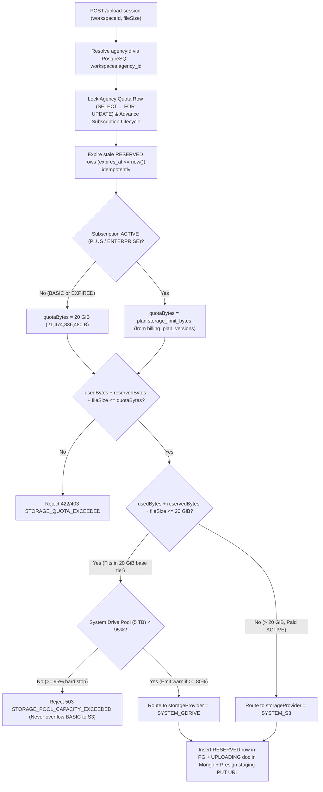

# FR 3.6.12 — Add Material Repository Specification

## Planning contract đã đồng bộ với BR01–BR25

Nguồn chuẩn: [Repository BR](../../../../../tuan-research/REPOSITORY_SPEC.md).
Một FR/một ticket; plan/task/test ở cùng thư mục. Các quyết định dưới đây làm rõ các ví
dụ nháp bên dưới, chưa phải implementation hoặc test result:

- Material.status chỉ UPLOADING/VALIDATING/READY/REJECTED/FAILED. Trash dùng deleted_at;
  purge_state riêng, không thêm DELETED/SCANNING/UPLOADED/PURGED vào upload enum.
- Provider chỉ SYSTEM_GDRIVE/SYSTEM_S3/USER_GDRIVE; USER_GDRIVE chưa enabled. Không default
  provider legacy bằng suy đoán; inventory allowlist bucket/key trước backfill.
- Legacy Mobile TASK chỉ video MP4/MOV ≤1 GiB trong phase này; không mở thêm ảnh/PDF TASK.
  LIBRARY ảnh20MiB/video200MiB/PDF25MiB, Office/TXT/CSV không được mở.
- Shared ACL và private-object reader được hoàn thành trong Add để các caller đang dùng
  url (watermark/editor/post) không fallback public khi provider chuyển private.
- Atomic quota ở PostgreSQL, binary validation bên ngoài transaction; không atomic xuyên
  PostgreSQL/Mongo/storage. READY chỉ sau canonical tồn tại và usage được commit bền vững.
- Staging có presigned PUT còn hiệu lực phải được tính overhead capacity cho tới cleanup
  sau expiry; không giải phóng physical reservation chỉ vì một lần DELETE staging thành công.
- Không cam kết Mobile zero-change cho session được cấp trước rollout: session chưa được
  ghi server-side phải hết hạn/tạo lại, không accept arbitrary legacy s3Key.
- Preview DTO của confirm có thể dùng signer được Add cung cấp; list/detail UI thuộc View.
- Dùng lỗi upload MIME/size hiện hữu HTTP400 nếu cùng nghĩa; quota thống nhất422,
  capacity503, concurrency409. Mã số mới trong ví dụ không coi là đã đăng ký ErrorCode.
- Gói hết hạn sau create không tự hủy reservation còn hợp lệ; confirm trong hạn commit
  phần đã giữ chỗ, không cấp thêm bytes. Session stale task/ACL bị revoke thì release.
- Ghi dữ liệu/accounting/adapters như plan; capability rclone G0 phải pass trước bật provider.

- **Feature ID:** FR 3.6.12
- **Feature Name:** Add Material Repository (`add-material-repository`)
- **Date:** 2026-10-24
- **Status:** Specification Ready (`spec.md` — Stage ① of `spec → plan → task → test`)
- **Scope:** `brandhub-api-gateway`, `brandhub-business-service`, `brandhub-infrastructure`, `brandhub-web` (with Mobile compatibility for `TASK` upload sessions)
- **Authoritative Business Rules:** `BR01`–`BR25` from `tuan-research/REPOSITORY_SPEC.md`

---

## 1. Problem Statement

Currently, adding files to BrandHub's Material Repository has severe functional, security, and quota-enforcement gaps across Web and Backend:

1. **Mock Frontend Upload in Library:** In `brandhub-web`, `MediaUploadButton.tsx` calls `mockContentLibraryService.uploadMedia(file)` instead of the real backend API, meaning files uploaded from the Library UI only exist in browser memory and vanish on reload.
2. **Fragmented & Incomplete Backend Upload Flows:**
   - `POST /api/v1/workspaces/{workspaceId}/materials` (`uploadMaterial`) only accepts images $\le 5\text{ MiB}$, reads the entire `byte[]` into JVM heap, forcibly converts non-WebP images to WebP via `S3FileStorageServiceImpl.uploadImage` (destroying original bytes and violating `BR10`), does not record `s3_key`, and only allows `MANAGER` and `CREATOR`.
   - `POST /upload-session` and `POST /upload-session/confirm` (`G2` Mobile creator upload) only allow `CREATOR`, require a `taskId` (`TASK` context), only accept `video/mp4` and `video/quicktime` up to $1\text{ GiB}$, issue a presigned `PUT` directly to the final key without a staging step, and persist client-supplied metadata at `confirm` without `HEAD` verification, magic-byte inspection, or session ownership binding.
3. **Missing Role, Audience, Purpose & Retouch Lineage Support:**
   - `CLIENT` users cannot upload Brand Reference documents (`purpose = BRAND_REFERENCE`) or client materials for their own `client_profile_id` (`BR05`, `BR06`, `BR09`).
   - Uploaders cannot specify `visibility` (`INTERNAL` vs `CLIENT` + `client_profile_id`), `purpose` (`MATERIAL` vs `BRAND_REFERENCE`), or `parent_material_id` + `type = RETOUCHED` when delivering a retouched version of another Creator's `RAW` asset (`BR04`, `BR08`, `BR10`).
4. **No Agency Storage Quota Reservation or Multi-Tier Provider Routing:**
   - There is no atomic PostgreSQL quota reservation per Agency (`BR17`–`BR22`), no routing between the $20\text{ GiB}$ free tier (`SYSTEM_GDRIVE`) and paid subscription storage (`SYSTEM_S3` — `BR23`), and no $80\% / 95\%$ capacity guard on the shared $5\text{ TB}$ system Google Drive pool (`BR24`).

---

## 2. Solution

Deliver **FR 3.6.12 — Add Material Repository** by unifying Library and Task uploads around the existing `Material` aggregate and `upload-session` / `upload-session/confirm` endpoints (plus a hardened transition path for `POST /` small multipart uploads):

1. **Unified `TASK` & `LIBRARY` Upload Session Pipeline with Full Mobile Backward Compatibility (`BR11`, `BR12`):**
   - Reuse `POST /api/v1/workspaces/{workspaceId}/materials/upload-session` and `POST /api/v1/workspaces/{workspaceId}/materials/upload-session/confirm`.
   - Preserve 100% backward compatibility for existing Mobile `TASK` requests: when `context` is omitted, default to `context = TASK`, require `taskId`, enforce active `CREATOR` task assignment (`requireAssignedActiveTask`) at both `create` and `confirm`, and retain the $1\text{ GiB}$ limit for `video/mp4` and `video/quicktime`.
   - Support `context = LIBRARY` for `MANAGER`, `CREATOR`, and `CLIENT` without requiring `taskId`, enforcing workspace ACL and the MVP Library allowlist: `JPEG/PNG/WebP <= 20 MiB`, `MP4/MOV <= 200 MiB`, and `PDF <= 25 MiB` (locking Office `DOC/DOCX/XLS/XLSX/PPT/PPTX`, `TXT/CSV`, and all other non-allowlisted formats).
2. **Audience, Client Profile, Purpose & Non-Destructive Retouch Lineage (`BR03`–`BR10`):**
   - Record `created_by`, `visibility` (`INTERNAL` | `CLIENT`), `client_profile_id`, `purpose` (`MATERIAL` | `BRAND_REFERENCE`), `type` (`RAW` | `RETOUCHED`), and optional `parent_material_id`.
   - Enforce that `CLIENT` uploads are always scoped to `visibility = CLIENT` and the caller's verified active `client_profile_id` in the workspace (`BR05`, `BR06`).
   - Support uploading a retouched asset as a **new** `Material` (`type = RETOUCHED`, `parent_material_id = rawMaterialId`, `created_by = retoucherId`) without overwriting or mutating the parent `RAW` record (`BR04`, `BR08`, `BR10`).
3. **Atomic Agency Quota Reservation, Multi-Tier Routing & System Drive Capacity Guard (`BR17`–`BR25`):**
   - Atomically reserve `requestedBytes` at `upload-session` creation in PostgreSQL (`usedBytes + reservedBytes + requestedBytes <= quotaBytes`) under an Agency-level lock.
   - Route files keeping `usedBytes + reservedBytes + requestedBytes <= 20 GiB` to `SYSTEM_GDRIVE` (subject to the $80\%$ warning / $95\%$ hard stop on the system Drive pool; never overflowing `BASIC` to AWS S3 per `BR24`).
   - Route files pushing total usage above $20\text{ GiB}$ entirely to `SYSTEM_S3` **only** when the Agency has an `ACTIVE` paid subscription (`PLUS` / `ENTERPRISE`) and total usage remains within `plan.storage_limit_bytes` from the catalog (`BR18`, `BR23`).
4. **Staging $\rightarrow$ Validation $\rightarrow$ Canonical Immutable Promotion (`BR10`, `BR13`, `BR19`, `BR22`):**
   - Browser/Mobile uploads bytes to a per-attempt private `staging_key`.
   - `confirm` verifies object existence and exact byte size via `HEAD`, inspects magic bytes / container header via bounded `Range: bytes=0-4095` reads, copies the verified object to an immutable private `canonical_key` (`repository/{workspaceId}/{materialId}/original`), commits the quota reservation in PostgreSQL, marks the material `READY`, and cleans up the staging object.
   - Failed, rejected, or expired sessions clean up staging objects and release quota reservations idempotently.

---

## 3. Authoritative Business Rules Applied (`BR01`–`BR25`)

| Rule ID | Business Rule Summary | Application to FR 3.6.12 (Add Material Repository) |
|---|---|---|
| **BR01** | Single-workspace scope | Every uploaded material belongs to exactly one `workspace_id` from the URL path. |
| **BR02** | `OWNER` permissions | `OWNER` cannot upload to a workspace unless holding an active `MANAGER` or `CREATOR` membership in that workspace. |
| **BR03** | `MANAGER` permissions | Can upload `IMAGE`, `VIDEO`, `PDF` in `LIBRARY` context with `visibility = INTERNAL` or `CLIENT` (for any active `client_profile_id` in the workspace), `purpose = MATERIAL` or `BRAND_REFERENCE`, and `type = RAW` or `RETOUCHED`. |
| **BR04** | `CREATOR` permissions | Can upload in `LIBRARY` context (same audience/purpose options as `MANAGER`) and in `TASK` context (when assigned to an active task). When retouching Creator A's `RAW` file, Creator B uploads a **new** material (`created_by = B`, `type = RETOUCHED`, `parent_material_id = rawId`). |
| **BR05–07** | `CLIENT` permissions & Audience rules | `CLIENT` can upload in `LIBRARY` context **only** for their own active `client_profile_id` in the workspace (`visibility = CLIENT`). Server rejects `visibility = INTERNAL` or another client's `client_profile_id` from a `CLIENT` actor. |
| **BR08** | Processing classification (`RAW` / `RETOUCHED`) | Uploader may set initial `type = RAW` (default) or `RETOUCHED` (for images/videos). `WATERMARKED` is rejected on upload because it is system-generated only (`FR 3.6.15`). |
| **BR09** | Brand reference purpose | Uploader can set `purpose = MATERIAL` (default) or `BRAND_REFERENCE`. Client reference uploads default to `purpose = BRAND_REFERENCE` + the client's verified `client_profile_id`. |
| **BR10** | Binary immutability & lineage | Uploaded original bytes are never converted to WebP or overwritten. Retouched versions create a new `MaterialDocument` linked via `parent_material_id`. |
| **BR11** | `TASK` vs `LIBRARY` context | `TASK` requires active `CREATOR` assignee and active task (`status` not in `FINISHED`, `CANCELLED`) at both `create` and `confirm`. `LIBRARY` does not require `taskId` and applies workspace repository ACL. |
| **BR12** | Allowed file types & size limits | `LIBRARY`: `image/jpeg`, `image/png`, `image/webp` $\le 20\text{ MiB}$; `video/mp4`, `video/quicktime` $\le 200\text{ MiB}$; `application/pdf` $\le 25\text{ MiB}$. `TASK` (Mobile): `video/mp4`, `video/quicktime` $\le 1\text{ GiB}$ (no new TASK image/PDF support in this phase). Office (`DOC/DOCX/XLS/XLSX/PPT/PPTX`), `TXT/CSV`, `SVG/HTML`, archives, and executables are rejected. |
| **BR17–18** | Free & Paid Quota | `BASIC` (or expired paid plan) has total quota $20\text{ GiB} = 21,474,836,480\text{ bytes}$ per Agency across all workspaces. Active paid plans (`PLUS` / `ENTERPRISE`) use `plan.storage_limit_bytes` directly from `billing_plan_versions` (not additive with $20\text{ GiB}$). |
| **BR19** | Quota calculation & atomic reservation | `usedBytes` (originals + derivatives + trash) + `reservedBytes` (in-flight uploads) + `requestedBytes` $\le$ `quotaBytes` checked atomically per Agency in PostgreSQL. Staging and canonical of the same material are never double-counted against customer quota. |
| **BR20–21** | Over-quota & subscription expiry | When `usedBytes + reservedBytes + requestedBytes > quotaBytes` (including after subscription expiry), block new upload sessions and multipart uploads with `403`/`422 STORAGE_QUOTA_EXCEEDED`. |
| **BR22** | Releasing reservations | Failed, rejected, or expired upload sessions release their `reservedBytes` idempotently and delete their staging objects. |
| **BR23** | Multi-tier provider routing | Each material is stored wholly on one provider: `SYSTEM_GDRIVE` when `usedBytes + reservedBytes + requestedBytes <= 20 GiB`; `SYSTEM_S3` when $> 20\text{ GiB}$ with an `ACTIVE` paid subscription and sufficient `quotaBytes`. |
| **BR24** | System Drive pool capacity ($80\% / 95\%$) | System Drive pool emits warning at $80\%$ capacity and blocks new `SYSTEM_GDRIVE` reservations at $95\%$ capacity (`503 STORAGE_POOL_CAPACITY_EXCEEDED`), accounting for reservations and physical staging overhead. Never overflows `BASIC` onto `SYSTEM_S3`. |
| **BR25** | `USER_GDRIVE` (Future) | Rejects `storageProvider = USER_GDRIVE` in MVP (`400 STORAGE_PROVIDER_UNSUPPORTED`); OAuth2 connector is deferred to `R14`. |

---

## 4. Current Codebase vs. Required Changes (Gap Analysis)

### 4.1 Backend (`brandhub-business-service`) & Database (`brandhub-infrastructure`)

| Component | Current State (Implemented) | Required Additions / Modifications for FR 3.6.12 |
|---|---|---|
| **Controller (`MaterialController`)** | `POST /` allows `MANAGER, CREATOR`; `POST /upload-session` and `POST /upload-session/confirm` only allow `CREATOR`. | Update `@RequireRole` on `/upload-session`, `/upload-session/confirm`, and `POST /` to `{MemberRole.MANAGER, MemberRole.CREATOR, MemberRole.CLIENT}`. Enforce context-specific role guards inside `MaterialServiceImpl` (`TASK` = assigned active `CREATOR` only; `LIBRARY` = `MANAGER`, `CREATOR`, `CLIENT`). |
| **Request / Response DTOs** | `CreateUploadSessionRequest` (`taskId` `@NotBlank`, `filename`, `contentType`, `fileSize`), `ConfirmUploadSessionRequest` (`s3Key`, `taskId` `@NotBlank`, `filename`, `contentType`, `fileSize`), `UploadSessionResponse` (`uploadUrl`, `s3Key`, `expiresAt`). | Make `taskId` conditionally required (required when `context` is null or `TASK`; nullable when `context == LIBRARY`). Add optional `context` (`TASK` \| `LIBRARY`), `visibility` (`INTERNAL` \| `CLIENT`), `clientProfileId`, `purpose` (`MATERIAL` \| `BRAND_REFERENCE`), `type` (`RAW` \| `RETOUCHED`), `parentMaterialId`, and `clientRequestId` to `CreateUploadSessionRequest`. Add `sessionId` and `materialId` to `UploadSessionResponse` (keeping `uploadUrl`, `s3Key`, `expiresAt` for Mobile). Allow `ConfirmUploadSessionRequest` to accept `sessionId` (new clients) or legacy `{ s3Key, taskId, filename, contentType, fileSize }` (Mobile adapter). |
| **Storage Service (`FileStorageService` / `S3FileStorageServiceImpl`)** | Single S3 client (`aws.s3.bucket`); `uploadMaterial` converts images to WebP and returns a public URL; no `headObject`, `getObjectRange`, or `copyObject` methods; no `StorageClientRouter`. | Introduce `StorageClientRouter` managing `SYSTEM_GDRIVE` (`rclone serve s3` endpoint) and `SYSTEM_S3` (AWS S3 Private endpoint). Add `headObject(provider, key)`, `readObjectRange(provider, key, startByte, endByte)`, `copyObjectConditional(provider, sourceKey, targetKey, expectedETag, contentType)`, and `deleteObject(provider, key)`. Keep `uploadImage` (WebP conversion) strictly for public avatars/banners/logos; Repository uploads preserve original bytes (`BR10`). |
| **File Content Validation (`ImageValidator`)** | Only checks `MultipartFile.getContentType().startsWith("image/")` and `size <= 5 MB`. | Add `MaterialContentValidator` that validates allowlisted MIME types and size limits per context (`LIBRARY` vs `TASK`) and inspects the first $4096\text{ bytes}$ + container header markers (`JPEG`, `PNG`, `WebP`, `PDF`, `MP4/MOV ftyp`) while rejecting `OLE2`/`OOXML` Office containers, `HTML`/`SVG`, scripts, and mismatched signatures. |
| **Quota & Capacity Service (`StorageQuotaService`)** | `billing_plan_versions` (`storage_limit_bytes`) and `agency_subscriptions` exist in PostgreSQL (`AgencyBillingService`), but no storage reservation table or quota service exists yet. | Add PostgreSQL table `agency_storage_reservations` (and agency usage tracking / reconciliation) + `StorageQuotaService` that locks the Agency row (`FOR UPDATE`), resolves `quotaBytes` from `agency_subscriptions` + `billing_plan_versions` (with `BASIC = 20 GiB = 21,474,836,480 bytes`), checks the $80\% / 95\%$ `SYSTEM_GDRIVE` pool threshold, selects `storageProvider` (`SYSTEM_GDRIVE` vs `SYSTEM_S3`), and transitions reservations (`RESERVED -> COMMITTED` or `RELEASED`/`EXPIRED`) idempotently. |
| **MongoDB `materials` Schema (`MaterialDocument`)** | Stores `id`, `workspace_id`, `name`, `original_name`, `type`, `mime_type`, `file_size`, `url`, `s3_key`, `parent_material_id`, `task_id`, `watermark_meta`, `created_by`, `created_at`, `updated_at`. | Add `status` (`UPLOADING`, `VALIDATING`, `READY`, `REJECTED`, `FAILED`), `storage_provider` (`SYSTEM_GDRIVE`, `SYSTEM_S3`, `USER_GDRIVE`), `staging_key`, `session_id`, `session_expires_at`, `client_request_id`, `upload_context` (`TASK`, `LIBRARY`), `media_kind` (`IMAGE`, `VIDEO`, `FILE`), `purpose` (`MATERIAL`, `BRAND_REFERENCE`), `visibility` (`INTERNAL`, `CLIENT`), `client_profile_id`, `normalized_name`, and `version`. |

### 4.2 Frontend (`brandhub-web`)

| Component | Current State (Implemented) | Required Additions / Modifications for FR 3.6.12 |
|---|---|---|
| **Library Upload Trigger & Modal (`MediaUploadButton.tsx`)** | Hidden `<input type="file" accept="image/*,video/*">` that calls `mockContentLibraryService.uploadMedia(file)` with a hardcoded `50MB` check. | Replace with `MaterialUploadDialog` / `MediaUploadButton` wired to `materialService.createUploadSession` $\rightarrow$ direct `PUT` to `uploadUrl` with progress bar $\rightarrow$ `materialService.confirmUploadSession`. Support `image/jpeg,image/png,image/webp,video/mp4,video/quicktime,application/pdf` with client-side pre-validation of `BR12` size limits ($20\text{ MiB}$ / $200\text{ MiB}$ / $25\text{ MiB}$). Provide form controls for `purpose` (`MATERIAL` \| `BRAND_REFERENCE`), `type` (`RAW` \| `RETOUCHED`), `visibility` (`INTERNAL` \| `CLIENT` + `clientProfileId` selector for `MANAGER`/`CREATOR`; auto-locked to own profile for `CLIENT`), and optional `parentMaterialId` when uploading a retouched derivative. |
| **Editor Dropzone (`MediaDropzone.tsx`)** | Calls `materialService.upload(workspaceId, file)` (`POST /` multipart) and reads `item.url`. | Keep `POST /` working for small images ($\le 5\text{ MiB}$) or route through the unified upload helper in `materialService`, returning the signed `previewUrl` / `MaterialItem` and invalidating the workspace repository query cache. |

---

## 5. User Stories

1. **As a Workspace Manager or Creator**, I want to upload original images (`JPEG`, `PNG`, `WebP` $\le 20\text{ MiB}$), videos (`MP4`, `MOV` $\le 200\text{ MiB}$), and documents (`PDF` $\le 25\text{ MiB}$) directly to the workspace Library without losing original quality or byte identity, so that the team has accurate source files for production.
2. **As a Workspace Manager or Creator**, I want to choose whether an uploaded material is `INTERNAL` (workspace staff only) or shared with a specific `CLIENT` profile in the workspace (`visibility = CLIENT` + `client_profile_id`), so that confidential drafts stay internal while client-relevant files are visible to the right client.
3. **As a Workspace Client**, I want to upload Brand Reference files (`purpose = BRAND_REFERENCE`, such as brand guidelines in PDF or reference photos/videos) or client materials tied automatically to my own Client Profile in the workspace, so that Creators and Managers can follow my brand standards.
4. **As a Workspace Creator (`Creator B`) retouching a `RAW` photo uploaded by `Creator A`**, I want to upload the edited photo as a new material with `type = RETOUCHED` and `parent_material_id` linked to `Creator A`'s `RAW` material (`created_by = Creator B`), so that the original `RAW` file remains intact (`BR10`) and I do not need edit permissions on `Creator A`'s record (`BR04`).
5. **As a Mobile Creator uploading a video for an assigned active Task**, I want my existing Mobile app upload flow (`POST /upload-session` and `POST /upload-session/confirm` with `taskId` and up to $1\text{ GiB}$ `MP4`/`MOV`) to continue working seamlessly while gaining staging validation and Agency quota protection, so that mobile field work is not disrupted.
6. **As a user attempting to upload a disallowed file format** (such as `.docx`, `.xlsx`, `.pptx`, `.txt`, `.csv`, `.svg`, `.exe`, or a file with a spoofed extension), I want the system to reject the file clearly at pre-check or magic-byte validation (`INVALID_UPLOAD_CONTENT_TYPE` / `MATERIAL_VALIDATION_REJECTED`), so that unsafe or unsupported files never enter the repository.
7. **As an Agency member uploading when our Agency is within its first $20\text{ GiB}$ of usage**, I want the system to reserve quota atomically and route the upload to `SYSTEM_GDRIVE` without charging AWS S3 storage, provided the shared system Drive pool is below $95\%$ capacity (`BR17`, `BR23`, `BR24`).
8. **As an Agency member uploading when `usedBytes + reservedBytes + fileSize > 20 GiB`**, I want the system to automatically route the entire new file to `SYSTEM_S3` if our Agency Owner has an `ACTIVE` paid subscription (`PLUS` / `ENTERPRISE`) with sufficient total `quotaBytes`, or reject the upload with a clear `STORAGE_QUOTA_EXCEEDED` message if we are on `BASIC`, expired, or over our plan limit (`BR18`, `BR20`, `BR21`, `BR23`).
9. **As a user experiencing a network drop or double-clicking during upload confirmation**, I want `clientRequestId` / `sessionId` idempotency to ensure that retrying `createUploadSession` or `confirmUploadSession` neither creates duplicate `Material` records nor deducts Agency storage quota twice (`BR19`, `BR22`).
10. **As a user whose upload fails, is rejected by validation, or is abandoned before confirmation**, I want the system to release the reserved storage quota and clean up the temporary staging object automatically, so that failed uploads do not permanently consume our Agency's storage quota (`BR22`).

---

## 6. Implementation Decisions

### 6.1 Upload Contexts & Permission Matrix (`BR01`–`BR11`)

| Actor Role in `workspaceId` | `context = LIBRARY` | `context = TASK` | Allowed `visibility` & `clientProfileId` on Upload | Allowed `purpose` & `type` on Upload |
|---|---|---|---|---|
| **`MANAGER` (active)** | Allowed | Forbidden (`403 TASK_UPLOAD_CREATOR_ONLY`) | `INTERNAL` (`clientProfileId = null`) or `CLIENT` (any active `clientProfileId` in `workspaceId`) | `purpose`: `MATERIAL` \| `BRAND_REFERENCE`<br>`type`: `RAW` \| `RETOUCHED` (`FILE` defaults to `RAW`) |
| **`CREATOR` (active)** | Allowed | Allowed **only** if `task.assigneeId == user.id` and `task.status` is active (`!FINISHED && !CANCELLED`) | `INTERNAL` or `CLIENT` (any active `clientProfileId` in `workspaceId`) | `purpose`: `MATERIAL` \| `BRAND_REFERENCE`<br>`type`: `RAW` \| `RETOUCHED` |
| **`CLIENT` (active)** | Allowed | Forbidden (`403 TASK_UPLOAD_CREATOR_ONLY`) | **Must** be `CLIENT` with a `clientProfileId` owned by the caller (`client_profiles.user_id == user.id`) and active in `workspaceId`. (`INTERNAL` is rejected with `403`). | `purpose`: `BRAND_REFERENCE` (default for Client) \| `MATERIAL`<br>`type`: `RAW` \| `RETOUCHED` |
| **`OWNER` without `MANAGER`/`CREATOR` membership** | Forbidden (`403`) | Forbidden (`403`) | N/A (`BR02`) | N/A |
| **`SystemRole.ADMIN`** | Allowed (with audit) | Allowed if testing/support | Same as `MANAGER` | Same as `MANAGER` |

### 6.2 Allowlist & File Size Limits by Context (`BR12`)

| Media Kind (`mediaKind`) | Verified MIME Type (`contentType`) | Allowed Extensions | Max Size (`context = LIBRARY`) | Max Size (`context = TASK`) | Magic Bytes / Container Signature Required |
|---|---|---|---|---|---|
| `IMAGE` | `image/jpeg` | `.jpg`, `.jpeg` | `20 MiB` (`20,971,520` B) | `20 MiB` (`20,971,520` B) | Starts with `FF D8 FF` |
| `IMAGE` | `image/png` | `.png` | `20 MiB` (`20,971,520` B) | `20 MiB` (`20,971,520` B) | Starts with `89 50 4E 47 0D 0A 1A 0A` |
| `IMAGE` | `image/webp` | `.webp` | `20 MiB` (`20,971,520` B) | `20 MiB` (`20,971,520` B) | Starts with `RIFF` (`52 49 46 46`) at `0..3` and `WEBP` (`57 45 42 50`) at `8..11` |
| `VIDEO` | `video/mp4` | `.mp4` | `200 MiB` (`209,715,200` B) | `1 GiB` (`1,073,741,824` B) | ISO BMFF `ftyp` box (`66 74 79 70`) at bytes `4..7` with MP4 brand (`isom`, `mp41`, `mp42`, `avc1`, `M4V `, `dash`) |
| `VIDEO` | `video/quicktime` | `.mov` | `200 MiB` (`209,715,200` B) | `1 GiB` (`1,073,741,824` B) | ISO BMFF `ftyp` box at bytes `4..7` with QuickTime brand (`qt  `) or valid `moov`/`mdat`/`wide` atom header |
| `FILE` | `application/pdf` | `.pdf` | `25 MiB` (`26,214,400` B) | `25 MiB` (`26,214,400` B) | Starts with `%PDF-` (`25 50 44 46 2D`) within first 1024 bytes; no active HTML/JS wrapper |

- **Explicitly Blocked in MVP (`BR12`):**
  - Microsoft Office / OpenDocument containers: `.doc`, `.docx`, `.xls`, `.xlsx`, `.ppt`, `.pptx` (any file starting with ZIP `50 4B 03 04` or OLE2 Compound File `D0 CF 11 E0 A1 B1 1A E1` is rejected with `400 OFFICE_FORMAT_LOCKED_IN_MVP` / `INVALID_UPLOAD_CONTENT_TYPE`).
  - Plain text / CSV / SVG / HTML / XML / scripts (`.txt`, `.csv`, `.svg`, `.html`, `.js`, `.sh`, `.bat`, `.exe`).

### 6.3 Retouch Lineage & Parent Validation (`BR04`, `BR08`, `BR10`)

When `parentMaterialId` is provided in `CreateUploadSessionRequest` (or multipart upload):
1. Query `{ _id: parentMaterialId, workspace_id: workspaceId, deleted_at: null }`. If absent or not `READY`, throw `404 PARENT_MATERIAL_NOT_FOUND` (or `409 MATERIAL_NOT_READY`).
2. Verify caller has **read** access to the parent material (`MANAGER`/`CREATOR` can read any workspace material; `CLIENT` can only reference a parent matching their `client_profile_id`). Note: Creator B does **not** need mutation permission on Creator A's parent `RAW` material (`BR04`).
3. Audience Inheritance Guard (`REPOSITORY_SPEC.md` §8 & §14):
   - If the parent material has `visibility = CLIENT` (bound to `parent.clientProfileId`), the derived retouched material **must** either inherit `visibility = CLIENT` with the same `parent.clientProfileId` or be restricted to `visibility = INTERNAL` (only a `MANAGER` may explicitly change the target client profile). A `CREATOR` cannot upload a derivative of Client A's material and assign it to Client B.
4. Set `type = RETOUCHED` (default when `parentMaterialId` is supplied on an upload), `parent_material_id = parent.id`, and `created_by = currentActorId`. The parent document's binary and metadata remain untouched (`BR10`).

### 6.4 Atomic Quota Reservation, Provider Routing & System Drive Pool Guard (`BR17`–`BR25`)



1. **PostgreSQL Quota Serialization:**
   - Every quota check and reservation executes inside a short PostgreSQL `@Transactional` method in `StorageQuotaService` before making external network calls.
   - Lock the Agency row (`SELECT id FROM agencies WHERE id = ? FOR UPDATE`).
   - Run `AgencySubscriptionLifecycle.advance(agencyId, now)` (reusing the existing lifecycle pattern in `AgencyBillingService`) so an expired paid subscription is immediately recognized as `EXPIRED` with `quotaBytes = 20 GiB` (`21,474,836,480` bytes — `BR21`).
   - Release any expired in-flight reservations (`status = 'RESERVED' AND expires_at <= now()`) for that Agency before evaluating available bytes.
2. **Whole-File Provider Routing (`BR23`):**
   - Let `projectedBytes = usedBytes + reservedBytes + requestedBytes`.
   - If `projectedBytes <= 21_474_836_480L` ($20\text{ GiB}$): select `storageProvider = SYSTEM_GDRIVE`.
   - If `projectedBytes > 21_474_836_480L`:
     - Because `projectedBytes <= quotaBytes` was already verified and `BASIC` has `quotaBytes = 20 GiB`, this branch is only reachable when the Agency has an `ACTIVE` paid subscription (`PLUS` / `ENTERPRISE`). Select `storageProvider = SYSTEM_S3`.
     - Even if the Agency previously had `19.9 GiB` on `SYSTEM_GDRIVE` and uploads a `200 MiB` video ($20.1\text{ GiB}$ total), the **entire** `200 MiB` video is stored on `SYSTEM_S3` (`BR23`).
3. **System Google Drive Pool Capacity Guard (`BR24`):**
   - Track global `SYSTEM_GDRIVE` physical pool usage (`poolUsedBytes + poolReservedBytes + stagingOverheadBytes`) against configured `systemDrivePoolCapacityBytes` (default $5\text{ TB} = 5 \times 1024^4 = 5,497,558,138,880\text{ bytes}$, configurable via `storage.system-gdrive.pool-capacity-bytes`).
   - At $\ge 80\%$ utilization: log `WARN` + emit operational metric/alert `storage_system_gdrive_pool_high_watermark`.
   - At $\ge 95\%$ utilization: reject any new reservation targeting `SYSTEM_GDRIVE` (and block new Agency Drive entitlements) with `503 STORAGE_POOL_CAPACITY_EXCEEDED`. Never silently route a `BASIC` Agency's upload to `SYSTEM_S3`.

### 6.5 Staging $\rightarrow$ Validation $\rightarrow$ Canonical Promotion & Rollout Gate (`BR10`, `BR13`, `BR19`, `BR22`)

1. **Why Staging is Mandatory:**
   - A presigned `PUT` URL remains valid until its TTL expires ($10\text{ minutes}$ for Library, $15\text{ minutes}$ for Mobile `TASK`). If the client uploaded directly to the canonical key, a malicious or buggy client could reuse the same presigned `PUT` URL *after* `confirm` to overwrite a `READY` material with a different payload.
   - Therefore, `uploadUrl` always points to `staging_key = "repository-staging/{workspaceId}/{materialId}/{sessionId}/object"`. No presigned `PUT` URL is ever generated for `canonical_key = "repository/{workspaceId}/{materialId}/original"`.
2. **Validation & Promotion Steps in `confirmUploadSession`:**
   - **Step A (Idempotency & State Claim):**
     - Locate `MaterialDocument` by `(workspace_id, session_id)` or legacy Mobile `(workspace_id, staging_key == request.s3Key, task_id)`.
     - Verify `created_by == actorUserId`. (A user cannot confirm another user's upload session).
     - If `status == READY`, return the existing `MaterialResponse` (`201 Created`) immediately.
     - If `status == REJECTED` or `FAILED` or `session_expires_at < now`, release reservation if still held and throw `409 UPLOAD_SESSION_EXPIRED` / `MATERIAL_VALIDATION_REJECTED`.
     - Atomically transition `status: UPLOADING -> VALIDATING` in MongoDB (`findAndModify`). If another concurrent confirm request is already `VALIDATING`, return `409 UPLOAD_CONFIRM_IN_PROGRESS`.
   - **Step B (`HEAD` & `Range` Content Verification):**
     - Call `headObject(storageProvider, stagingKey)`:
       - Verify object exists (if missing, revert status to `UPLOADING` so client can finish PUT or fail with `409 UPLOAD_OBJECT_NOT_FOUND`).
       - Verify `actualSize > 0` and `actualSize <= maxAllowedBytes(context, mediaKind)` and `actualSize <= reservedBytes`. (If `actualSize > reservedBytes` or exceeds `BR12` limit because client uploaded a larger file than declared in `createUploadSession`, delete `stagingKey`, release reservation, mark `REJECTED`, and throw `400 UPLOAD_FILE_TOO_LARGE`).
     - Call `readObjectRange(storageProvider, stagingKey, 0, 4095)` ($4\text{ KiB}$):
       - Run `MaterialContentValidator.verifyMagicBytes(headerBytes, declaredMimeType)`.
       - If signature mismatches `declaredMimeType` or matches a blocked container (`OLE2`, `OOXML`, `HTML`, `SVG`, script), delete `stagingKey`, release reservation, mark `REJECTED`, and throw `400 INVALID_UPLOAD_CONTENT_TYPE`.
   - **Step C (Immutable Canonical Promotion):**
     - Execute `copyObjectConditional(storageProvider, stagingKey, canonicalKey, headResult.eTag(), verifiedMimeType)`.
     - Verify destination `canonicalKey` (`eTag` / `contentLength == actualSize`). If the staging object changed mid-validation (`PreconditionFailed` / size mismatch), clean up only keys owned by this claimed attempt after confirming no committed canonical is referenced, release the uncommitted reservation, mark `REJECTED`, and throw `409 UPLOAD_CONCURRENCY_MODIFIED`.
   - **Step D (Quota Settlement & `READY` Finalization):**
     - Commit the PostgreSQL reservation (`StorageQuotaService.commitReservation(reservationId, actualSize)`), converting the exact declared/verified size from `reservedBytes` into `usedBytes`; upload size mismatch is rejected. Derivative output-bound settlement is a separate watermark-only rule.
     - Update `MaterialDocument`: `status = READY`, `s3_key = canonicalKey`, `file_size = actualSize`, `mime_type = verifiedMimeType`, `updated_at = now`.
     - Delete `stagingKey` (best-effort immediate delete + background orphan sweep for any leftover staging keys).
3. **`rclone serve s3` Technical Rollout Gate:**
   - Do **not** assume `rclone serve s3` behaves identically to AWS S3 across all S3 API operations.
   - Before enabling `SYSTEM_GDRIVE` in production/staging, `StorageClientRouter` includes a startup/readiness probe (and integration test gate) verifying:
     1. Presigned `PUT` and Presigned `GET` (`response-content-disposition: inline` & `attachment`).
     2. `HEAD Object` returning accurate `Content-Length` and `ETag`.
     3. `GET Object` with `Range: bytes=0-4095` returning `206 Partial Content`.
     4. Server-side `CopyObject` from `stagingKey` to `canonicalKey`: if `rclone` on the target version does not enforce `x-amz-copy-source-if-match` natively, the provider fails capability gate G0 until an equivalent atomic source-freeze mechanism is proven. An unguessable key, post-copy HEAD, or assumed single-use PUT is not a substitute for conditional copy.
     5. VFS SSD cache durability (`--vfs-cache-mode full`) and graceful `503 MATERIAL_STORAGE_UNAVAILABLE` mapping when Google Drive returns `403 rateLimitExceeded` / `429 Too Many Requests`.

---

## 7. Data Model & Database Migrations

### 7.1 PostgreSQL Schema Additions (`StorageQuotaService` Ledger)

Reuse agencies/workspaces/agency_subscriptions/billing_plan_versions. The authoritative
proposed expansion is plan.md P2: agency_storage_usage, agency_storage_reservations,
storage_usage_entries (append-only idempotent operation ledger), system_storage_pools.
Relations already equivalent must be extended, never duplicated. Reservations have
RESERVED/COMMITTED/RELEASED/EXPIRED; purge release is a ledger operation, not a new
reservation status. Track workspace_id on usage entries for usage breakdown. Lock order,
constraints, operation keys and saga checkpoints follow plan.md P2–P4.
BASIC storage_limit_bytes must be21474836480 after approved migration; paid values remain
from approved catalog, not illustrative examples. No production schema change has run.

### 7.2 MongoDB `materials` Collection Extensions (`MaterialDocument`)

In addition to the fields documented in `FR 3.6.11`, `MaterialDocument` stores the upload lifecycle fields:
- `session_id` (`String`, indexed unique sparse/partial): Server-generated UUID for the upload session.
- `staging_key` (`String`, nullable): Private staging key (`repository-staging/{workspaceId}/{materialId}/{sessionId}/object`), cleared/nullified after canonical promotion and staging deletion.
- `s3_key` (`String`): Canonical private key (`repository/{workspaceId}/{materialId}/original`), set when promoted to `READY`.
- `session_expires_at` (`Instant`): UTC expiration timestamp of the upload session ($10\text{ minutes}$ for `LIBRARY`, $15\text{ minutes}$ for `TASK`).
- `client_request_id` (`String`, nullable): Client-supplied idempotency key (`1..128` chars), unique per `(workspace_id, created_by, client_request_id)` via partial unique index.
- `upload_context` (`String`): `LIBRARY` \| `TASK`.
- `rejection_reason` (`String`, nullable): Diagnostic code when `status` transitions to `REJECTED` or `FAILED`.

---

## 8. API Contract

Base path: `/api/v1/workspaces/{workspaceId}/materials`  
Authentication: `Authorization: Bearer <accessToken>`

### 8.1 Create Upload Session — `POST /api/v1/workspaces/{workspaceId}/materials/upload-session`

- **Allowed Roles:** `MANAGER`, `CREATOR`, `CLIENT` (active member of `workspaceId`), `SystemRole.ADMIN`.
- **Request Body (`CreateUploadSessionRequest`):**
```json
{
  "context": "LIBRARY",
  "taskId": null,
  "filename": "brand-guideline-2026.pdf",
  "contentType": "application/pdf",
  "fileSize": 8388608,
  "type": "RAW",
  "purpose": "BRAND_REFERENCE",
  "visibility": "CLIENT",
  "clientProfileId": "770e8400-e29b-41d4-a716-446655440111",
  "parentMaterialId": null,
  "clientRequestId": "550e8400-e29b-41d4-a716-446655440999"
}
```
- **Backward Compatibility Rules for Request Body:**
  - If `context` is omitted or `null`:
    - If `taskId` is present and non-blank $\rightarrow$ inferred as `context = "TASK"` (Mobile legacy compatibility).
    - If `taskId` is null/blank $\rightarrow$ inferred as `context = "LIBRARY"`.
  - When `context == "TASK"`: `taskId` is required (`400 VALIDATION_ERROR` if missing); caller must be the assigned active `CREATOR` on `taskId`; `visibility` defaults to `INTERNAL`; `purpose` defaults to `MATERIAL`; `type` defaults to `RAW`.
  - When `context == "LIBRARY"`:
    - For `MANAGER` / `CREATOR`: `visibility` defaults to `INTERNAL`; if `visibility == "CLIENT"`, `clientProfileId` is required and must be an active client profile in `workspaceId`; `purpose` defaults to `MATERIAL`; `type` defaults to `RAW` (or `RETOUCHED` if `parentMaterialId` is set).
    - For `CLIENT`: `visibility` is forced/validated to `CLIENT`; `clientProfileId` is resolved to the caller's active `client_profile_id` in `workspaceId` (if the caller owns multiple profiles in `workspaceId`, `clientProfileId` must be specified and owned by the caller); `purpose` defaults to `BRAND_REFERENCE`.
- **Idempotency (`clientRequestId`):**
  - If an active `UPLOADING` or `READY` record already exists for `(workspaceId, actorUserId, clientRequestId)` with matching payload fingerprint (`filename`, `contentType`, `fileSize`, `context`, `taskId`, `visibility`, `clientProfileId`, `purpose`, `type`, `parentMaterialId`), return the existing `UploadSessionResponse` (`200 OK`) without creating a second reservation.
  - If the same `clientRequestId` is reused with a different payload fingerprint, return `409 UPLOAD_REQUEST_CONFLICT`.
- **Success Response (`200 OK`):**
```json
{
  "success": true,
  "data": {
    "sessionId": "b81f2c40-9012-4e5a-8c3d-112233445566",
    "materialId": "671a0f8b2c4e1a3b5d7f9012",
    "uploadUrl": "https://storage.example/repository-staging/550e.../671a.../b81f.../object?X-Amz-Expires=600&...",
    "s3Key": "repository-staging/550e8400-e29b-41d4-a716-446655440000/671a0f8b2c4e1a3b5d7f9012/b81f2c40-9012-4e5a-8c3d-112233445566/object",
    "storageProvider": "SYSTEM_GDRIVE",
    "expiresAt": "2026-10-24T10:45:00Z"
  },
  "error": null,
  "meta": null,
  "requestId": "a1b2c3d4-e5f6-4a7b-8c9d-0e1f2a3b4c5d",
  "version": "v1",
  "timestamp": "2026-10-24T10:35:00Z"
}
```
> **Note:** `uploadUrl`, `s3Key`, and `expiresAt` remain at the exact same JSON paths to preserve the Mobile response shape; pre-rollout sessions must expire/restart, and Mobile expiry handling must be verified before claiming compatibility. Browser and Mobile perform `HTTP PUT <uploadUrl>` with header `Content-Type: <contentType>` and raw file bytes as body (without sending BrandHub `Authorization` header to storage host).

### 8.2 Confirm Upload Session — `POST /api/v1/workspaces/{workspaceId}/materials/upload-session/confirm`

- **Allowed Roles:** `MANAGER`, `CREATOR`, `CLIENT` (active member of `workspaceId`, must match `created_by` of the session), `SystemRole.ADMIN`.
- **Request Body (`ConfirmUploadSessionRequest`):**
  - **Web / New Clients:**
    ```json
    {
      "sessionId": "b81f2c40-9012-4e5a-8c3d-112233445566"
    }
    ```
  - **Legacy Mobile Clients (Supported via Adapter):**
    ```json
    {
      "s3Key": "repository-staging/550e8400-e29b-41d4-a716-446655440000/671a0f8b2c4e1a3b5d7f9012/b81f2c40-9012-4e5a-8c3d-112233445566/object",
      "taskId": "66f1a2b3c4d5e6f7a8b9c0d1",
      "filename": "behind-the-scenes.mp4",
      "contentType": "video/mp4",
      "fileSize": 52428800
    }
    ```
- **Success Response (`201 Created`):**
  - Returns `ApiResponse<MaterialResponse>` with `status = "READY"`, verified `mimeType` and `fileSize`, `previewUrl` (inline signed URL, TTL $300\text{s}$), `rawWarning = (mediaKind == IMAGE && type == RAW)`, and `capabilities`.
  - Calling `confirm` again on an already-confirmed session returns `201 Created` with the same `MaterialResponse` (idempotent).

### 8.3 Multipart Upload (Small Files Transition Endpoint) — `POST /api/v1/workspaces/{workspaceId}/materials`

- **Allowed Roles:** `MANAGER`, `CREATOR`, `CLIENT` (active member of `workspaceId`).
- **Input:** `multipart/form-data` with `file` ($\le 5\text{ MiB}$ per Spring multipart limit) + optional form fields `type` (`RAW` \| `RETOUCHED`), `purpose` (`MATERIAL` \| `BRAND_REFERENCE`), `visibility` (`INTERNAL` \| `CLIENT`), `clientProfileId`, `parentMaterialId`, `clientRequestId`.
- **Behavior:** Executes the exact same permission check, `BR12` allowlist + magic-bytes check, atomic PostgreSQL quota reservation & commit (`StorageQuotaService`), and raw-byte `uploadObject` to `canonicalKey` on the routed `storageProvider` (`SYSTEM_GDRIVE` or `SYSTEM_S3`) **without** converting images to WebP. Returns `201 Created` with `ApiResponse<MaterialResponse>`.

---

## 9. Error Handling Contract

| Scenario | HTTP Status | ErrorCode | Client / UI Behavior |
|---|---|---|---|
| Unauthenticated / expired JWT | `401 Unauthorized` | `UNAUTHORIZED` / `TOKEN_EXPIRED` | Axios refreshes token once or redirects to `/login`. |
| Actor not an active member of `workspaceId`, or `OWNER` without `MANAGER`/`CREATOR` membership (`BR02`) | `403 Forbidden` | `WORKSPACE_ACCESS_DENIED` / `FORBIDDEN` | Reject before any DB write or quota reservation. |
| `MANAGER` or `CLIENT` attempts `context = TASK` | `403 Forbidden` | `FORBIDDEN` / `TASK_NOT_ASSIGNED` | Only assigned active `CREATOR` may upload to `TASK`. |
| `TASK` does not exist in `workspaceId`, is not assigned to caller, or has status `FINISHED`/`CANCELLED` (at `create` or `confirm`) | `404` / `403` / `409` | `TASK_NOT_FOUND_FOR_UPLOAD` / `TASK_NOT_ASSIGNED` / `TASK_NOT_ACTIVE` | If failed at `confirm`, release reservation and delete staging object. |
| `CLIENT` specifies `visibility = INTERNAL` or a `clientProfileId` they do not own in `workspaceId` (`BR05`, `BR06`) | `403 Forbidden` | `CLIENT_ACCESS_DENIED` / `CLIENT_PROFILE_NOT_OWNED` | Reject request; UI locks `CLIENT` upload to their own profile. |
| `MANAGER`/`CREATOR` sets `visibility = CLIENT` without a valid active `clientProfileId` in `workspaceId` | `400 Bad Request` | `VALIDATION_ERROR` | Inline field error requiring Client selection. |
| Uploader sets `type = WATERMARKED` on upload (`BR08`) | `400 Bad Request` | `VALIDATION_ERROR` | Reject; `WATERMARKED` is only created by Watermark Studio (`FR 3.6.15`). |
| `parentMaterialId` does not exist in `workspaceId`, is deleted, is not `READY`, or audience conflicts with parent (`BR04`, `BR10`) | `404` / `409` / `403` | `MATERIAL_NOT_FOUND` / `MATERIAL_NOT_READY` / `FORBIDDEN` | Show inline error on retouch upload dialog. |
| Disallowed MIME type, extension, or magic bytes (including `.doc/.docx/.xls/.xlsx/.ppt/.pptx`, `.txt`, `.csv`, `.svg`, `.html`) (`BR12`) | `400 Bad Request` | `INVALID_UPLOAD_CONTENT_TYPE` | If detected at `confirm`, delete staging object, release reservation, mark `REJECTED`, and show clear format error. |
| File size exceeds limit ($20\text{ MiB}$ image, $25\text{ MiB}$ PDF, $200\text{ MiB}$ Library video, $1\text{ GiB}$ Task video) (`BR12`) | `400 Bad Request` | `UPLOAD_FILE_TOO_LARGE` / `FILE_TOO_LARGE` | Reject at `createUploadSession` (or at `confirm` if actual `HEAD` size exceeds limit/reservation). |
| Requested `storageProvider = USER_GDRIVE` in MVP (`BR25`) | `400 Bad Request` | `STORAGE_PROVIDER_UNSUPPORTED` | Inform user that personal Google Drive connection is not yet enabled. |
| Agency `usedBytes + reservedBytes + fileSize > quotaBytes` (on `BASIC` $20\text{ GiB}$, expired subscription, or paid limit reached) (`BR17`–`BR21`) | `422 Unprocessable Entity` (or `403`) | `STORAGE_QUOTA_EXCEEDED` | Show quota exceeded alert with current usage (`usedBytes / quotaBytes`) and CTA for Owner to upgrade/renew or purge Trash. |
| System Google Drive pool utilization $\ge 95\%$ when routing to `SYSTEM_GDRIVE` (`BR24`) | `503 Service Unavailable` | `STORAGE_POOL_CAPACITY_EXCEEDED` | Show system capacity message; never overflow `BASIC` onto `SYSTEM_S3`. |
| Reusing `clientRequestId` with different upload parameters | `409 Conflict` | `UPLOAD_REQUEST_CONFLICT` | Prompt client to generate a new request ID for a new file. |
| `confirm` called for unknown/expired session, or session owned by another user | `404` / `409` | `UPLOAD_SESSION_NOT_FOUND` / `UPLOAD_SESSION_EXPIRED` | Instruct client/Mobile to create a fresh upload session. |
| `confirm` called before client finishes `PUT` to `stagingKey` (`HEAD` 404) | `409 Conflict` | `UPLOAD_OBJECT_NOT_FOUND` | Keep session in `UPLOADING` until expiry so client can complete `PUT` and retry `confirm`. |
| Concurrent `confirm` while another request is already `VALIDATING` the same session, or staging object modified mid-copy | `409 Conflict` | `UPLOAD_CONFIRM_IN_PROGRESS` / `UPLOAD_CONCURRENCY_MODIFIED` | Client waits or retries safely. |
| Storage provider (`SYSTEM_GDRIVE` / `SYSTEM_S3`) timeout, 5xx, or Drive 403/429 rate limit | `503 Service Unavailable` | `MATERIAL_STORAGE_UNAVAILABLE` | If `confirm` fails before promotion, release or keep session retryable before expiry; log internal detail without leaking credentials. |

---

## 10. UI/UX, UI States, i18n, Theme & Accessibility (`brandhub-web`)

### 10.1 Upload Flow UI in Content Library (`MediaUploadButton` / `MaterialUploadDialog`)

1. **Opening the Upload Flow:**
   - Clicking `Tải lên tư liệu` (`MediaUploadButton`) in `MediaTab` (or clicking `"Tải lên bản đã chỉnh sửa (Retouched)"` from a `RAW` material's detail panel) opens a structured upload panel/dialog using shared primitives (`Dialog`, `Button`, `Input`, `Select`, `Badge`).
   - If the workspace's `storageUsage.isQuotaExceeded === true`, the Upload button is disabled (or displays an inline quota lock banner explaining `BR20`/`BR21`).
2. **Metadata & Audience Selection Before Upload:**
   - **File Dropzone / Picker:** Accepts `image/jpeg,image/png,image/webp,video/mp4,video/quicktime,application/pdf`. Immediately validates file type and size against `BR12` ($20\text{ MiB}$ / $200\text{ MiB}$ / $25\text{ MiB}$) before calling the server.
   - **Purpose Selector (`purpose`):**
     - `Tư liệu sản xuất` (`MATERIAL`) vs. `Tài liệu tham khảo của Client` (`BRAND_REFERENCE`).
     - Defaults to `BRAND_REFERENCE` when current role is `CLIENT`, and `MATERIAL` when current role is `MANAGER` or `CREATOR`.
   - **Processing Type Selector (`type`):**
     - Shown for `IMAGE` and `VIDEO`: `Bản gốc chưa chỉnh sửa (RAW)` vs. `Bản đã chỉnh sửa (RETOUCHED)`.
     - Locked to `RETOUCHED` (with a visible parent link badge) when launched from `"Upload bản Retouched cho ảnh RAW này"`.
   - **Audience Selector (`visibility` & `clientProfileId`):**
     - For `MANAGER` and `CREATOR`: Choose `Nội bộ Workspace` (`INTERNAL`) or `Chia sẻ cho Client` (`CLIENT`). When `CLIENT` is selected, a required `Select` lists active Client Profiles in the workspace (`BR06`).
     - For `CLIENT`: Locked to `Chia sẻ cho Client` (`CLIENT`) with the caller's own Client Profile pre-selected (or a profile selector if the `CLIENT` user owns multiple active profiles in the workspace).
3. **3-Step Progress Execution:**
   - **Step 1 (` creatingSession`):** Calls `POST /upload-session` with a generated UUID `clientRequestId`.
   - **Step 2 (`uploadingBytes`):** Streams file via `PUT` to `uploadUrl` (`axios.put` / `XMLHttpRequest` without auth credentials) displaying a determinate progress bar (`0% – 100%`) and a `Hủy` (`AbortController`) button.
   - **Step 3 (`validatingAndConfirming`):** Calls `POST /upload-session/confirm` with `{ sessionId }`. Upon `201 Created`, invalidates TanStack Query keys `['materials', workspaceId]` and `['materials-storage-usage', workspaceId]`, prepends/refreshes the list, and shows `toast.success`.

### 10.2 Exhaustive UI States

| UI State | Trigger | User-Facing Representation |
|---|---|---|
| **1. Idle / Ready to Select** | Dialog open, no file chosen | Drag-and-drop zone with allowed formats and size limits (`Ảnh ≤ 20 MiB, Video ≤ 200 MiB, PDF ≤ 25 MiB`). |
| **2. Client-Side Validation Error** | User selects `.docx`, `.csv`, or a $35\text{ MiB}$ image | Inline error (`data-slot="input-error"`) below dropzone explaining `invalidType` or `sizeLimit`; Submit button disabled. |
| **3. Client Profile Required** | `MANAGER`/`CREATOR` selects `visibility = CLIENT` without picking a `clientProfileId` | Inline validation message (`repository.clientRequired`); Submit button disabled until a Client Profile is chosen. |
| **4. Uploading Progress (`UPLOADING`)** | `PUT` to `uploadUrl` in flight | Progress bar (`uploadProgress` $\%$), uploaded/total MiB, spinner, form inputs locked, Cancel button active. |
| **5. Server Validation (`VALIDATING`)** | `POST /upload-session/confirm` in flight | Indeterminate indicator with `t("repository.validating")` (`"Đang kiểm tra tệp và chốt lưu trữ..."`). |
| **6. Upload Success (`READY`)** | `confirm` returns `201 Created` | Success toast, dialog closes, focus returns to Upload trigger, new material card appears in grid. |
| **7. Quota Exceeded (`422`/`403`)** | Agency quota full or paid subscription expired over $20\text{ GiB}$ | Destructive/warning callout inside dialog (`t("repository.quotaExceededError")`) showing used vs. total GiB; no broken card added to grid. |
| **8. System Drive Pool Full (`503`)** | `STORAGE_POOL_CAPACITY_EXCEEDED` ($95\%$ pool cap) | Clear operational banner (`t("repository.poolCapacityError")`) explaining temporary free-pool capacity limit. |
| **9. Validation Rejected (`400`)** | Server magic-byte check rejects spoofed file at `confirm` | Error alert (`t("repository.uploadRejected")`) with reason; user can pick a valid file and retry. |
| **10. Network / Storage Error & Retry** | `PUT` or `confirm` fails due to transient network error | Preserves selected metadata and `sessionId` (if `PUT` succeeded and only `confirm` timed out, clicking `Thử lại` re-runs `confirm` without re-uploading bytes). |

### 10.3 Internationalization (i18n — Parallel `vi` & `en` Keys)

Add the following keys simultaneously to `src/i18n/locales/vi/library.json` and `src/i18n/locales/en/library.json` (in addition to shared keys from `FR 3.6.11`):

| Key (`repository.uploadModal.*` / `repository.*`) | Vietnamese (`vi`) | English (`en`) |
|---|---|---|
| `repository.upload` | `Tải lên tư liệu` | `Upload Material` |
| `repository.uploadRetouchedTitle` | `Tải lên bản đã chỉnh sửa (Retouched)` | `Upload Retouched Version` |
| `repository.uploadReferenceTitle` | `Tải lên tài liệu tham khảo (Brand Reference)` | `Upload Brand Reference` |
| `repository.dropzonePrompt` | `Kéo thả tệp vào đây hoặc nhấn để chọn tệp` | `Drag and drop a file here, or click to browse` |
| `repository.allowedFormatsHint` | `Hỗ trợ: JPEG, PNG, WebP (≤ 20 MiB), MP4, MOV (≤ 200 MiB), PDF (≤ 25 MiB)` | `Supported: JPEG, PNG, WebP (≤ 20 MiB), MP4, MOV (≤ 200 MiB), PDF (≤ 25 MiB)` |
| `repository.uploadProgress` | `Đang tải lên ({{percent}}%)...` | `Uploading ({{percent}}%)...` |
| `repository.validating` | `Đang xác thực chữ ký tệp và hoàn tất lưu trữ...` | `Verifying file signature and finalizing storage...` |
| `repository.uploadSuccess` | `Đã tải lên tư liệu "{{filename}}" thành công` | `Successfully uploaded "{{filename}}"` |
| `repository.uploadRejected` | `Tệp bị từ chối: định dạng nội dung thực tế không hợp lệ hoặc không nằm trong danh mục cho phép.` | `File rejected: actual file content signature is invalid or not in the allowed format list.` |
| `repository.uploadFailed` | `Tải tệp lên thất bại. Vui lòng thử lại.` | `Failed to upload file. Please try again.` |
| `repository.invalidType` | `Định dạng tệp không được hỗ trợ trong MVP (chỉ nhận JPEG, PNG, WebP, MP4, MOV, PDF).` | `Unsupported file format in MVP (only JPEG, PNG, WebP, MP4, MOV, and PDF are allowed).` |
| `repository.officeLockedError` | `Tệp Office (Word/Excel/PowerPoint) tạm khóa trong MVP để đảm bảo an toàn kiểm duyệt.` | `Office files (Word/Excel/PowerPoint) are locked in MVP pending container security validation.` |
| `repository.sizeLimitImage` | `Ảnh vượt quá giới hạn tối đa 20 MiB.` | `Image exceeds the maximum 20 MiB limit.` |
| `repository.sizeLimitVideo` | `Video thư viện vượt quá giới hạn tối đa 200 MiB.` | `Library video exceeds the maximum 200 MiB limit.` |
| `repository.sizeLimitPdf` | `Tài liệu PDF vượt quá giới hạn tối đa 25 MiB.` | `PDF document exceeds the maximum 25 MiB limit.` |
| `repository.clientRequired` | `Vui lòng chọn Client Profile khi chia sẻ tư liệu cho Client.` | `Please select a Client Profile when sharing with a Client.` |
| `repository.parentMaterialBadge` | `Bản gốc (RAW): {{name}}` | `Parent RAW material: {{name}}` |
| `repository.quotaExceededError` | `Dung lượng lưu trữ của Agency đã đầy ({{used}} / {{quota}}). Vui lòng liên hệ Agency Owner nâng cấp gói hoặc dọn dẹp Thùng rác.` | `Agency storage quota is full ({{used}} / {{quota}}). Please ask the Agency Owner to upgrade the subscription or purge Trash.` |
| `repository.poolCapacityError` | `Hệ thống lưu trữ miễn phí đang đạt ngưỡng bảo trì dung lượng. Vui lòng thử lại sau hoặc nâng cấp gói lưu trữ.` | `Shared free storage pool has reached its capacity threshold. Please try again later or upgrade your storage plan.` |
| `repository.retryConfirm` | `Xác nhận lại phiên tải lên` | `Retry upload confirmation` |
| `repository.cancelUpload` | `Hủy tải lên` | `Cancel upload` |

### 10.4 Light/Dark Theme, Responsive & Accessibility Requirements

- **Theme Tokens:** Use `bg-card`, `bg-muted`, `text-foreground`, `text-muted-foreground`, `border-border`, `bg-brand-orange`, `text-brand-orange`, `bg-brand-orange-soft` (`rule.md` §1). Progress bar uses `bg-brand-orange` on `bg-muted` track.
- **Icons:** Use `lucide-react` (`Upload`, `FileText`, `ImageIcon`, `Film`, `AlertTriangle`, `CheckCircle2`, `Loader2`, `X`) — no emojis (`rule.md` §4.6).
- **Responsive (`375px` / `768px` / `1440px`):** Upload form fields stack vertically on mobile (`375px`) and arrange in a 2-column grid on `sm:`/`md:` viewports without horizontal overflow.
- **Accessibility:** Every `<Input>` and `<Select>` has an associated `<label htmlFor="...">`; progress bar has `role="progressbar"` with `aria-valuenow`, `aria-valuemin={0}`, `aria-valuemax={100}`; error messages use `role="alert"` / `aria-live="polite"`.

---

## 11. Testing Decisions & Test Scenarios

### 11.1 Testing Seams & Prior Art

- **Backend Integration Seam (`MaterialController` + `MaterialService` + `StorageQuotaService` + PostgreSQL + MongoDB + Fake/Test S3 Provider):**
  - Test the complete 2-step upload lifecycle (`POST /upload-session` $\rightarrow$ `PUT` to fake/test storage $\rightarrow$ `POST /upload-session/confirm`) and concurrency/quota invariants against real PostgreSQL transactions (`SELECT ... FOR UPDATE`) and MongoDB.
- **Storage & `rclone` Capability Seam:**
  - Dedicated contract test suite verifying `headObject`, `readObjectRange(0, 4095)`, `copyObjectConditional`, and presigned `PUT`/`GET` against both `SYSTEM_S3` and `SYSTEM_GDRIVE` (`rclone serve s3`).
- **Frontend E2E Seam (`Playwright`):**
  - E2E tests in `tests/e2e/library/add-material-repository.spec.ts` verifying file selection, client-side `BR12` validation, role-specific audience controls (`MANAGER`/`CREATOR` vs `CLIENT`), retouch lineage upload, quota exceeded error handling, i18n parity, and Light/Dark mode.
- **Prior Art:** `MaterialServiceImplTest.java`, `AgencyBillingPostgresTest.java`, `CreditBalancePostgresTest.java`, `S3GeneratedMediaTest.java`.

### 11.2 Acceptance Criteria & Test Scenarios Matrix

| ID | Scenario | Input / Actor | Expected Outcome |
|---|---|---|---|
| **AC-A01** | `LIBRARY` upload of valid Image, Video & PDF (`BR12`) | `MANAGER` or `CREATOR` uploads a `15 MiB` JPEG, `150 MiB` MP4, and `20 MiB` PDF via `upload-session` $\rightarrow$ `PUT` $\rightarrow$ `confirm`. | Each session reserves quota, verifies magic bytes at `confirm`, copies staging $\rightarrow$ canonical without WebP conversion (SHA-256 byte identity preserved), commits `usedBytes`, deletes staging object, and returns `201 READY` with `previewUrl`. |
| **AC-A02** | Reject Office, `TXT`/`CSV`, and spoofed extensions (`BR12`) | User attempts to upload `report.docx`, `data.csv`, or renames `malware.docx` (ZIP `PK..` header) to `photo.png`. | `.docx` and `.csv` are rejected at `createUploadSession` (`400 INVALID_UPLOAD_CONTENT_TYPE`). Spoofed `photo.png` is caught at `confirm` by `Range bytes=0-4095` magic-byte check, marked `REJECTED`, staging deleted, and reservation released. |
| **AC-A03** | Enforce `LIBRARY` vs `TASK` size boundaries (`BR12`) | 1) `LIBRARY` upload of `201 MiB` MP4.<br>2) Mobile `TASK` upload of `800 MiB` MOV by assigned `CREATOR`.<br>3) Mobile `TASK` upload of `1.1 GiB` MOV. | 1) Rejected (`400 UPLOAD_FILE_TOO_LARGE`).<br>2) Succeeds (`200` / `201`).<br>3) Rejected (`400 UPLOAD_FILE_TOO_LARGE`). |
| **AC-A04** | Legacy Mobile `TASK` backward compatibility & task guards (`BR11`) | Mobile `CREATOR` sends `{ taskId, filename, contentType, fileSize }` (no `context`) to `/upload-session` and `{ s3Key, taskId, filename, contentType, fileSize }` to `/upload-session/confirm`. | Succeeds when task is in `workspaceId`, assigned to caller, and active. If task is `FINISHED`/`CANCELLED` before `confirm`, or caller is not the assignee, or caller is `MANAGER`/`CLIENT`, rejected with `403`/`409` and reservation is released. |
| **AC-A05** | `CLIENT` upload isolation & `BRAND_REFERENCE` (`BR05`–`BR07`, `BR09`) | `CLIENT` (owning `profileA`) uploads a PDF reference. Also attempts to upload with `visibility = INTERNAL` or `clientProfileId = profileB`. | Upload with `visibility = CLIENT` + `profileA` succeeds with `purpose = BRAND_REFERENCE` and `createdBy = clientUserId`. Attempts with `INTERNAL` or `profileB` are rejected with `403`. |
| **AC-A06** | `CREATOR` retouch upload creates new material with lineage (`BR04`, `BR08`, `BR10`) | Creator A uploads `RAW` image `mat-A` (`visibility = CLIENT`, `clientProfileId = profileA`). Creator B uploads retouched image with `parentMaterialId = mat-A`, `type = RETOUCHED`. | Creates new material `mat-B` (`createdBy = B`, `type = RETOUCHED`, `parentMaterialId = mat-A`, inheriting `visibility = CLIENT` & `profileA`). `mat-A` remains `RAW` and owned by Creator A. |
| **AC-A07** | Atomic quota reservation under concurrency (`BR17`–`BR19`) | Agency on `BASIC` ($20\text{ GiB}$ cap) has `usedBytes = 19.8 GiB`. Two concurrent requests each try to reserve a `150 MiB` video ($19.8 + 0.15 + 0.15 = 20.1\text{ GiB}$). | PostgreSQL `FOR UPDATE` lock serializes the two requests: the first succeeds (`reservedBytes = 150 MiB`), and the second fails immediately with `422 STORAGE_QUOTA_EXCEEDED`. |
| **AC-A08** | Multi-tier provider routing & non-additive paid quota (`BR18`, `BR23`) | Agency on `PLUS` (`quotaBytes = 100 GiB` total from catalog, NOT $120\text{ GiB}$) has `usedBytes = 19.9 GiB` on `SYSTEM_GDRIVE` and uploads a `200 MiB` video. | Entire `200 MiB` video is routed to `storageProvider = SYSTEM_S3`. Existing `19.9 GiB` files remain on `SYSTEM_GDRIVE`. |
| **AC-A09** | Subscription expiry blocks new uploads when over $20\text{ GiB}$ (`BR20`, `BR21`) | Agency on `PLUS` with `usedBytes = 35 GiB` expires (`status = EXPIRED`, quota returns to $20\text{ GiB}$). User calls `POST /upload-session`. | `AgencySubscriptionLifecycle.advance` updates status to `EXPIRED`; upload is rejected with `422 STORAGE_QUOTA_EXCEEDED`. Existing files remain readable. |
| **AC-A10** | System Drive pool $80\%$ warning & $95\%$ hard block (`BR24`) | 1) Pool at $82\%$ capacity.<br>2) Pool at $95\%$ capacity when a `BASIC` Agency (`usedBytes = 1 GiB`) requests an upload. | 1) Upload succeeds on `SYSTEM_GDRIVE` and emits high-watermark warning metric.<br>2) Upload is rejected with `503 STORAGE_POOL_CAPACITY_EXCEEDED` and **never** overflows to `SYSTEM_S3`. |
| **AC-A11** | Idempotent retry & expired session cleanup (`BR19`, `BR22`) | 1) `confirm` called twice for the same `sessionId`.<br>2) Session abandoned past `expiresAt` without `confirm`. | 1) Both calls return the same `201 MaterialResponse`; `usedBytes` is incremented exactly once.<br>2) Cleanup job deletes `stagingKey` and transitions reservation to `EXPIRED` (`reservedBytes` decremented once). |
| **AC-A12** | Reject unrecorded `s3Key` & `USER_GDRIVE` (`BR25`) | 1) Client calls `confirm` with an arbitrary `s3Key` not issued to that user's active session.<br>2) Client requests `storageProvider = USER_GDRIVE`. | 1) Rejected with `404 UPLOAD_SESSION_NOT_FOUND`.<br>2) Rejected with `400 STORAGE_PROVIDER_UNSUPPORTED`. |

---

## 12. Out of Scope

1. **View / Search / Filter / Paginate Material Repository (`FR 3.6.11`)**: Specified in `view-material-repository/spec.md`.
2. **Update Material Metadata & Audience (`FR 3.6.13`)**: Renaming, toggling `RAW ↔ RETOUCHED` on an existing material without uploading a new binary, and Manager changing `visibility`/`client_profile_id` after creation.
3. **Remove / Soft Delete, Trash Restore & 30-Day Purge (`FR 3.6.14`)**: Soft delete, restore, and reference-checked purge worker.
4. **Apply Watermark (`FR 3.6.15`)**: Watermark Studio image compositing (separate derivative flow).
5. **Download Material (`FR 3.6.16`)**: `POST /{id}/download` attachment link issuance (`TTL 120s`).
6. **User-Connected Google Drive OAuth2 (`USER_GDRIVE` — `R14`, `BR25`)**: OAuth2 `drive.file` / Shared Drive connector, Picker UI, and token encryption are deferred to Phase 2 (`R14`).
7. **Asynchronous Malware Scanner Worker / ClamAV Cluster**: Excluded from MVP per finalized `REPOSITORY_SPEC.md`.

---

## 13. Definition of Done (DoD)

1. `spec.md` (this document) is followed sequentially by `plan.md → task.md → test.md` under `brandhub-infrastructure/docs/feature/repository/add-material-repository/` before writing code.
2. PostgreSQL migration for `agency_storage_usage` and `agency_storage_reservations` (plus `BASIC = 20 GiB = 21,474,836,480 bytes` synchronization in `billing_plan_versions`) and MongoDB `materials` schema updates pass verification.
3. `StorageClientRouter` (`SYSTEM_GDRIVE` + `SYSTEM_S3`) passes the `rclone` capability verification gate (`PUT`, `GET`, `HEAD`, `Range`, conditional copy, cache durability, and rate-limit error mapping).
4. `POST /upload-session`, `POST /upload-session/confirm`, and `POST /` enforce `BR01`–`BR25`, preserve Mobile `TASK` compatibility ($1\text{ GiB}$ MOV/MP4 + active task assignee check), enforce Library `BR12` limits ($20\text{ MiB}$ / $200\text{ MiB}$ / $25\text{ MiB}$) + magic-byte checks, and preserve exact original bytes without WebP conversion.
5. Staging cleanup and expired reservation release run idempotently.
6. `brandhub-web` upload UI replaces `mockContentLibraryService.uploadMedia` with the real upload-session flow, supports `purpose`, `type`, `visibility`/`clientProfileId`, and `parentMaterialId`, has parallel `vi`/`en` keys, and passes Light/Dark, responsive (`375px`/`768px`/`1440px`), and keyboard accessibility checks.
7. All unit, integration, and E2E tests covering `AC-A01` through `AC-A12` pass.
