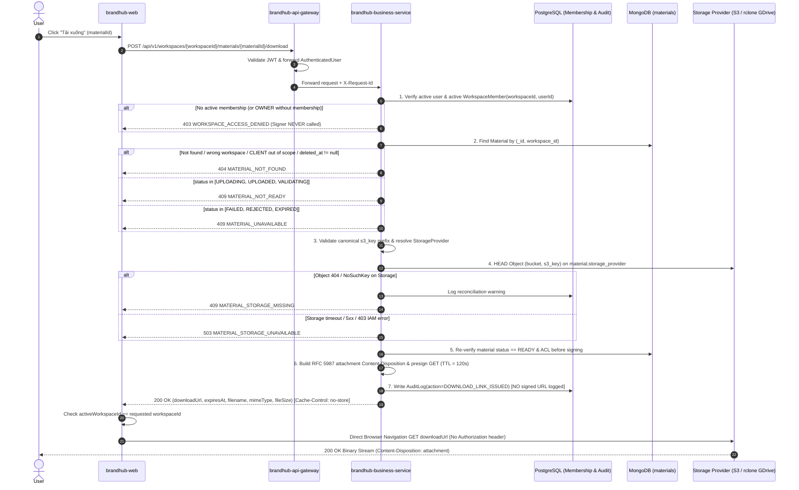

# Feature Specification: FR 3.6.16 — Download Material

## Planning contract đã đồng bộ với BR01–BR25

Nguồn chuẩn: [Repository BR](../../../../../tuan-research/REPOSITORY_SPEC.md).
Các ví dụ status/provider cũ trong mô tả phải theo contract dùng chung của Add:

- Provider SYSTEM_GDRIVE/SYSTEM_S3/USER_GDRIVE. Không default S3 cho legacy chưa inventory.
- Material status UPLOADING/VALIDATING/READY/REJECTED/FAILED, không status DELETED;
  deleted_at!=null →404, purge_state!=NONE không cấp URL. Chỉ READY active mới download.
- POST download trả ApiResponse với filename/mimeType/fileSize/downloadUrl/expiresAt,
  no-store, attachment UTF-8, TTL≤120s. Không nhận key/provider/URL từ browser.
- HEAD missing→409; IAM/timeout/throttling→503. Provider bị disable không fallback public.
- Audit cấp link phải được ghi bền trước trả URL; failure503 và không trả URL. Audit chỉ
  DOWNLOAD_LINK_ISSUED, không phải download completed; URL không lưu trong outbox/log/APM.
- Reauthorize theo workspace path và recheck mutation/version/revision sau HEAD, trước ký.
  Lease serialize lúc cấp link với revoke/delete; URL cũ có thể còn sống hết TTL BR14.
- Subscription filter không chặn read/download khi expiry/quota. OWNER billing-only không
  được tải file; user đổi workspace khi chờ phải abort/ignore response cũ.
- ErrorCode numeric ví dụ không thay thế catalog hiện hữu; không có kiểm chứng provider
  hoặc test pass chỉ từ nội dung spec. Bằng chứng nằm trong test.md sau implementation.

> **Feature Key**: `repository/download-material`  
> **Functional Requirement**: `FR 3.6.16 — Download Material`  
> **Source Baseline**: [`REPOSITORY_SPEC.md`](file:///D:/capstone/brandhub/tuan-research/REPOSITORY_SPEC.md) (`BR01`–`BR25`, Mục 10 `D01`–`D12`)  
> **Architecture References**: [`ADR-002`](file:///D:/capstone/brandhub/brandhub-infrastructure/docs/adr/ADR-002-database-split.md), [`database-strategy.md`](file:///D:/capstone/brandhub/brandhub-infrastructure/docs/database/schema-v2/database-strategy.md), [`DA-E06-08`](file:///D:/capstone/brandhub/brandhub-infrastructure/docs/database/redis-cache/DA-E06-08-database-access-rules.md), [`agency-subscription/spec.md`](file:///D:/capstone/brandhub/brandhub-infrastructure/docs/feature/agency-subscription/spec.md)  
> **Status**: Specification Ready (No Code / Migration Executed)

---

## 1. Context & Scope

### 1.1. Goal
Đặc tả chi tiết và đầy đủ cho duy nhất chức năng **FR 3.6.16 — Download Material**, cho phép người dùng có quyền trong Workspace tải xuống **đúng tệp nhị phân (binary) của một Material đã chọn** về thiết bị cá nhân để lưu trữ hoặc chỉnh sửa, thông qua cơ chế cấp **Presigned GET Attachment URL ngắn hạn (TTL tối đa 120 giây)** trực tiếp từ tầng lưu trữ của bản ghi đó (`SYSTEM_GDRIVE` / `S3`), đảm bảo:
- Kiểm tra chặt chẽ quyền truy cập thời gian thực (`Account` $\rightarrow$ `Workspace Membership` $\rightarrow$ `Role` $\rightarrow$ `Material Audience / Client Profile` $\rightarrow$ `Parent Material ACL`) tại thời điểm xin cấp link (`BR01`–`BR07`, `BR13`, `BR14`).
- Xác minh trạng thái tài liệu (`status == "READY"`, `deleted_at == null`) và kiểm tra sự tồn tại thực tế của object bằng lệnh `HEAD` trên đúng `storage_provider` của bản ghi trước khi ký link (`BR13`, `BR15`, `BR23`).
- Bảo toàn nguyên vẹn byte gốc của đúng bản ghi được chọn (không tự chuyển sang WebP, không tự trả bản `parent_material_id` khi tải bản `WATERMARKED` hoặc `RETOUCHED`, vẫn cho phép tải ảnh `RAW` dù có cảnh báo) (`BR08`, `BR10`, `BR13`).
- Trình duyệt tải trực tiếp từ Object Storage mà không đi qua bộ nhớ heap của `brandhub-business-service` hay `brandhub-api-gateway`, không đính kèm JWT của BrandHub tới Object Storage, không bị chặn khi Agency vượt quota hoặc hết hạn gói trả phí (`BR20`, `BR21`), và ghi nhận nhật ký kiểm toán đúng bản chất **`DOWNLOAD_LINK_ISSUED`** mà không bao giờ lưu hay ghi log chuỗi presigned URL (`D01`–`D12`).

### 1.2. Scope Boundary (Phạm vi)
- **Trong phạm vi (In-Scope — FR 3.6.16)**:
  - Endpoint cấp link tải xuống: `POST /api/v1/workspaces/{workspaceId}/materials/{materialId}/download`.
  - Xác thực và phân quyền RBAC/ABAC thời gian thực từ PostgreSQL (`workspace_members`, `client_profiles`) kết hợp metadata MongoDB (`materials`), hỗ trợ đầy đủ trường hợp một user thuộc nhiều workspace (`D03`).
  - Kiểm tra `HeadObject` trên đúng `storage_provider` (`SYSTEM_GDRIVE` / `S3`) của material thông qua mở rộng [`FileStorageService`](file:///D:/capstone/brandhub/brandhub-business-service/src/main/java/com/brandhub/business/service/FileStorageService.java) và [`S3FileStorageServiceImpl`](file:///D:/capstone/brandhub/brandhub-business-service/src/main/java/com/brandhub/business/service/impl/S3FileStorageServiceImpl.java), phân biệt rõ lỗi mất object (`409 MATERIAL_STORAGE_MISSING`) và lỗi kết nối/quyền storage (`503 MATERIAL_STORAGE_UNAVAILABLE`).
  - Ký Presigned `GET` URL với TTL **120 giây** (`BR14`), ép header phản hồi `Content-Disposition: attachment` chuẩn RFC 5987 / RFC 6266 (hỗ trợ tên tiếng Việt, khoảng trắng, emoji, chống CRLF/path/header injection), `Content-Type` thực và `Cache-Control: private, no-store, max-age=0`.
  - Ghi nhật ký kiểm toán `DOWNLOAD_LINK_ISSUED` vào PostgreSQL `audit_logs` (không lưu presigned URL, không tuyên bố đã tải xong).
  - Giao diện Web (`brandhub-web`): nút `"Tải xuống"` trên [`MediaTab.tsx`](file:///D:/capstone/brandhub/brandhub-web/src/pages/library/components/MediaTab.tsx) và [`MediaDetailPanel.tsx`](file:///D:/capstone/brandhub/brandhub-web/src/pages/library/components/MediaDetailPanel.tsx), xử lý loading/error/retry, hủy kích hoạt tải nếu người dùng chuyển đổi workspace trong lúc đang chờ cấp link (`D10`), và hiển thị thông báo `"Đã bắt đầu tải xuống"`.
- **Ngoài phạm vi (Out-of-Scope — chỉ liên kết như Dependency)**:
  - Xem danh sách/chi tiết material, bộ lọc và cấp `previewUrl` (`Content-Disposition: inline`, TTL 5 phút) (thuộc **FR 3.6.11 — View Material Repository**: [`view-material-repository/spec.md`](file:///D:/capstone/brandhub/brandhub-infrastructure/docs/feature/repository/view-material-repository/spec.md)).
  - Tải lên material mới, giữ chỗ quota và xác thực định dạng khi upload (thuộc **FR 3.6.12 — Add Material Repository**: [`add-material-repository/spec.md`](file:///D:/capstone/brandhub/brandhub-infrastructure/docs/feature/repository/add-material-repository/spec.md)).
  - Đổi tên hiển thị (`name`), phân loại (`RAW` $\leftrightarrow$ `RETOUCHED`), `purpose`, và đổi `visibility`/`client_profile_id` (thuộc **FR 3.6.13 — Update Material Repository**: [`update-material-repository/spec.md`](file:///D:/capstone/brandhub/brandhub-infrastructure/docs/feature/repository/update-material-repository/spec.md)).
  - Xóa mềm vào Thùng rác, khôi phục và xóa vĩnh viễn sau 30 ngày (thuộc **FR 3.6.14 — Remove Material Repository**: [`remove-material-repository/spec.md`](file:///D:/capstone/brandhub/brandhub-infrastructure/docs/feature/repository/remove-material-repository/spec.md)).
  - Tải nhiều file đóng gói ZIP bất đồng bộ (thuộc `R13` / `R16` — Should Have / Future).

---

## 2. Current Codebase Alignment (Đã có vs. Cần bổ sung)

Đối chiếu trực tiếp với mã nguồn hiện tại trong `brandhub-business-service` và `brandhub-web`:

| Thành phần | Hiện trạng trong Codebase | Phần cần bổ sung / điều chỉnh cho FR 3.6.16 |
| :--- | :--- | :--- |
| **Controller** ([`MaterialController.java`](file:///D:/capstone/brandhub/brandhub-business-service/src/main/java/com/brandhub/business/controller/MaterialController.java)) | Hiện chỉ có `GET /materials`, `GET /materials/{materialId}`, `POST /materials`, `POST /upload-session`, `POST /upload-session/confirm`, `POST /{materialId}/watermark`, `GET /brand-assets`. Chưa có endpoint download. | Bổ sung `@PostMapping("/{materialId}/download")` trả về `ResponseEntity<ApiResponse<DownloadMaterialResponse>>` kèm header `Cache-Control: no-store`. |
| **Storage Service** ([`FileStorageService.java`](file:///D:/capstone/brandhub/brandhub-business-service/src/main/java/com/brandhub/business/service/FileStorageService.java), [`S3FileStorageServiceImpl.java`](file:///D:/capstone/brandhub/brandhub-business-service/src/main/java/com/brandhub/business/service/impl/S3FileStorageServiceImpl.java)) | Đã có `createPresignedDownloadUrl(String s3Key)` (dòng 161–174) dùng cho `PostServiceImpl` / `PostPublishServiceImpl`, nhưng:<br>1. Không kiểm tra `HeadObject`.<br>2. Không gắn `responseContentDisposition = attachment` hay `filename*=UTF-8''...`.<br>3. Dùng chung `presignedUrlTtlSeconds` mà chưa tách TTL 120s cho download.<br>4. Hàm `uploadImage` (dòng 95–101) đang tự ép ảnh sang WebP (`ImmutableImage...WebpWriter`). | - **Giữ nguyên** `createPresignedDownloadUrl(String s3Key)` để không phá vỡ `PostServiceImpl` / `PostPublishServiceImpl`.<br>- **Bổ sung** `headObject(StorageProvider provider, String key)` và `createPresignedAttachmentDownloadUrl(StorageProvider provider, String key, String downloadFilename, String contentType, Duration ttl)` trên `FileStorageService` & `S3FileStorageServiceImpl` (định tuyến qua client S3 hoặc `rclone serve s3` theo `provider`).<br>- Đảm bảo luồng Repository không bao giờ tự động WebP hóa binary gốc (`BR10`, `D04`). |
| **Material Service** ([`MaterialService.java`](file:///D:/capstone/brandhub/brandhub-business-service/src/main/java/com/brandhub/business/service/MaterialService.java), [`MaterialServiceImpl.java`](file:///D:/capstone/brandhub/brandhub-business-service/src/main/java/com/brandhub/business/service/impl/MaterialServiceImpl.java)) | Chưa có hàm xử lý cấp link tải xuống theo ACL và trạng thái của Material. | Bổ sung `issueDownloadLink(UUID workspaceId, String materialId, AuthenticatedUser user, String requestId)` thực hiện đầy đủ 7 bước kiểm quyền, kiểm trạng thái, kiểm `HEAD` object, tạo header `Content-Disposition` RFC 5987, ký URL 120s và ghi AuditLog. |
| **Workspace Access & RBAC** ([`RequireRoleAspect.java`](file:///D:/capstone/brandhub/brandhub-business-service/src/main/java/com/brandhub/business/security/aspect/RequireRoleAspect.java), [`WorkspaceAccessService.java`](file:///D:/capstone/brandhub/brandhub-business-service/src/main/java/com/brandhub/business/service/WorkspaceAccessService.java)) | Đã có `WorkspaceMemberRepository` truy vấn membership đang hoạt động (`isActive = true`) theo `(workspaceId, userId)` trên PostgreSQL. | Đọc trực tiếp bản ghi `WorkspaceMember` đang `isActive = true` của `(workspaceId, currentUser.getId())` trong PostgreSQL tại thời điểm gọi `POST .../download` (không tin claim `workspaceId`/`role`/`clientProfileId` cũ trong JWT — `D03`). |
| **Audit Logging** ([`AuditLog.java`](file:///D:/capstone/brandhub/brandhub-business-service/src/main/java/com/brandhub/business/model/entity/AuditLog.java), [`AuditAction.java`](file:///D:/capstone/brandhub/brandhub-business-service/src/main/java/com/brandhub/business/model/enums/AuditAction.java)) | `AuditAction` hiện có: `LOGIN`, `LOGOUT`, `TOKEN_REFRESH`, `PASSWORD_RESET`, `CREATE`, `UPDATE`, `DELETE`, `ROLE_CHANGE`, `PERMISSION_CHANGE`, `VIEW`, `EXPORT`. | Bổ sung giá trị `DOWNLOAD_LINK_ISSUED` vào enum [`AuditAction.java`](file:///D:/capstone/brandhub/brandhub-business-service/src/main/java/com/brandhub/business/model/enums/AuditAction.java) (hoặc ghi `action = AuditAction.DOWNLOAD_LINK_ISSUED` với `resourceType = "MATERIAL"`), lưu đầy đủ `userId`, `workspaceId`, `resourceId`, `details` (không bao gồm `downloadUrl` — `D09`). |
| **Frontend Service & UI** ([`materialService.ts`](file:///D:/capstone/brandhub/brandhub-web/src/services/materialService.ts), [`MediaTab.tsx`](file:///D:/capstone/brandhub/brandhub-web/src/pages/library/components/MediaTab.tsx), [`MediaDetailPanel.tsx`](file:///D:/capstone/brandhub/brandhub-web/src/pages/library/components/MediaDetailPanel.tsx)) | Trong `MediaDetailPanel.tsx` hiện đang dùng thẻ `<a href={item.url} download={item.name}>` trỏ trực tiếp vào trường `url` tĩnh. | Thay thế hoàn toàn link tĩnh bằng hàm `requestMaterialDownload(workspaceId, materialId, signal)` gọi `POST /api/v1/workspaces/${workspaceId}/materials/${materialId}/download`, kiểm tra context `workspaceId` không đổi sau khi nhận response (`D10`), và kích hoạt trình duyệt tải trực tiếp từ `downloadUrl`. |

---

## 3. Business Rules Applied (Ánh xạ BR01–BR25 & D01–D12)

| Mã Rule | Quy tắc nghiệp vụ đã chốt | Áp dụng cụ thể trong FR 3.6.16 (Download Material) |
| :--- | :--- | :--- |
| **BR01** | Mỗi file thuộc một workspace; MVP không chia sẻ xuyên workspace. | Truy vấn material bắt buộc khớp đồng thời `_id == materialId` và `workspace_id == workspaceId`. Mọi lệch khớp trả `404 MATERIAL_NOT_FOUND` (`D02`). |
| **BR02** | `OWNER` không tự động truy cập nội dung kho nếu không có membership vận hành trong workspace. | User có role `OWNER` ở cấp Agency nhưng không có dòng `workspace_members` (`is_active = true`) trong `workspaceId` bị chặn `403 WORKSPACE_ACCESS_DENIED` và không được ký URL (`D02`). |
| **BR03, BR04** | `MANAGER` và `CREATOR` được xem và tải mọi file `READY` trong workspace. | Cả `MANAGER` và `CREATOR` đang active trong workspace đều được cấp link tải xuống cho cả file `INTERNAL` và `CLIENT` (bất kể ai là người tải lên — `D01`). |
| **BR05, BR06** | `CLIENT` chỉ xem/tải file được chia sẻ cho đúng client profile của mình (`visibility = CLIENT` và `client_profile_id = myProfileId`). | Khi actor trong workspace có role `CLIENT`, hệ thống đối chiếu `member.getClientProfileId()` với `material.getClientProfileId()`. Nếu `visibility != CLIENT` hoặc khác `client_profile_id`, trả `404 MATERIAL_NOT_FOUND` (ẩn sự tồn tại của file — `D01`, `D02`). |
| **BR08** | Ảnh `RAW` có cảnh báo nhưng **vẫn được tải xuống**. | Không chặn tải xuống khi `material.type == RAW`. Trả đúng byte gốc của file `RAW`. |
| **BR09** | `BRAND_REFERENCE` là mục đích sử dụng độc lập với loại file/trạng thái xử lý. | Tài liệu có `purpose == BRAND_REFERENCE` hay `MATERIAL` đều áp dụng cùng cơ chế kiểm quyền và tải xuống qua endpoint này. |
| **BR10** | Không ghi đè binary đã lưu; đổi tên (`name`) không làm thay đổi binary nhưng tên file khi tải xuống phản ánh `name` mới. | Header `Content-Disposition` trong presigned URL sử dụng tên hiển thị hiện tại (`material.name` đã sanitize kèm đuôi chuẩn theo `mime_type`), trong khi object được tải về là binary bất biến tại `s3_key` (`D04`, `D05`). |
| **BR13** | Chỉ file `READY`, chưa xóa và đủ quyền mới truy cập được. Không preview được vẫn có thể download nếu định dạng được phép. **Tải đúng material đã chọn, không tự trả bản parent.** | - Chỉ cấp link khi `status == "READY"` và `deleted_at == null` (`D06`).<br>- Khi người dùng chọn tải một bản `WATERMARKED` hoặc `RETOUCHED`, hệ thống ký link cho đúng `s3_key` của bản ghi đó; tuyệt đối không tự truy ngược về `parent_material_id` (`D11`). |
| **BR14** | Thu hồi quyền chặn cấp link mới ngay; chấp nhận link đã cấp có hiệu lực tối đa **120 giây** với download. | - TTL của presigned download URL cố định tối đa **120 giây**.<br>- Khi thu hồi membership, đổi `visibility`/`client_profile_id`, hoặc xóa mềm material, mọi yêu cầu `POST .../download` mới bị từ chối ngay lập tức (`403`/`404`). Các link đã phát trước đó tự hết hạn tối đa sau 120 giây; không dùng Redis để giả lập thu hồi presigned URL S3 (`D12`). |
| **BR15** | File đã xóa mềm trong Trash không được tải xuống. | Nếu `deleted_at != null` hoặc `purge_state != "NONE"`, endpoint download trả `404 MATERIAL_NOT_FOUND` (`D06`). Muốn tải lại phải Restore về `READY` trước (`FR 3.6.14`). |
| **BR20, BR21** | Khi chạm/vượt 100% quota hoặc khi gói trả phí hết hạn (`EXPIRED`): chặn upload mới nhưng **cho phép xem và tải xuống** các file hiện có theo ACL. | Endpoint `POST .../download` **không kiểm tra và không chặn** khi `used_bytes >= quota_limit_bytes` hoặc khi gói Subscription của Agency ở trạng thái `EXPIRED` / `PAST_DUE`. |
| **BR23** | Không tự chuyển file cũ giữa Drive và S3; file cũ vẫn đọc/tải theo `storage_provider` đã ghi trên bản ghi. | `StorageClientRouter` đọc trường `material.storage_provider` (`SYSTEM_GDRIVE` hoặc `S3`) trên chính bản ghi `MaterialDocument` để gọi `HEAD` và ký `GetObjectPresignRequest` trên đúng provider đó. |

---

## 4. Permission Matrix (Ma trận phân quyền Download)

Quyền được kiểm tra trực tiếp trên PostgreSQL (`workspace_members`, `users`) và MongoDB (`materials`) tại thời điểm xử lý request `POST /api/v1/workspaces/{workspaceId}/materials/{materialId}/download`:

| Vai trò của Actor | Trạng thái Membership trong `workspaceId` | `material.visibility == INTERNAL` | `material.visibility == CLIENT` (cùng `client_profile_id`) | `material.visibility == CLIENT` (khác `client_profile_id`) | Material thuộc Workspace khác / Đã xóa mềm (`DELETED`) |
| :--- | :--- | :--- | :--- | :--- | :--- |
| **`ADMIN`** *(System Admin)* | Theo policy quản trị hệ thống | ✅ Cho phép (`200 OK`) | ✅ Cho phép (`200 OK`) | ✅ Cho phép (`200 OK`) | ❌ `404 MATERIAL_NOT_FOUND` |
| **`OWNER`** *(Agency Owner)* | Không có dòng active trong `workspace_members` (`BR02`) | ❌ `403 WORKSPACE_ACCESS_DENIED` | ❌ `403 WORKSPACE_ACCESS_DENIED` | ❌ `403 WORKSPACE_ACCESS_DENIED` | ❌ `403 WORKSPACE_ACCESS_DENIED` |
| **`MANAGER`** | `is_active = true` | ✅ Cho phép (`200 OK`) | ✅ Cho phép (`200 OK`) | ✅ Cho phép (`200 OK`) | ❌ `404 MATERIAL_NOT_FOUND` |
| **`CREATOR`** | `is_active = true` | ✅ Cho phép (`200 OK`) | ✅ Cho phép (`200 OK`) | ✅ Cho phép (`200 OK`) | ❌ `404 MATERIAL_NOT_FOUND` |
| **`CLIENT`** | `is_active = true` & có `client_profile_id` | ❌ `404 MATERIAL_NOT_FOUND` | ✅ Cho phép (`200 OK`) *(nếu parent material cũng cho phép — `D11`)* | ❌ `404 MATERIAL_NOT_FOUND` | ❌ `404 MATERIAL_NOT_FOUND` |
| **Non-member / Inactive member** | Không tồn tại hoặc `is_active = false` | ❌ `403 WORKSPACE_ACCESS_DENIED` | ❌ `403 WORKSPACE_ACCESS_DENIED` | ❌ `403 WORKSPACE_ACCESS_DENIED` | ❌ `403 WORKSPACE_ACCESS_DENIED` |

> [!IMPORTANT]
> **Kiểm tra chuỗi quyền cho bản dẫn xuất (`Derivative ACL Guard` — `BR14`, `D11`)**:
> Nếu `material.parent_material_id != null` và người gọi là `CLIENT`: ngoài việc kiểm tra `material.visibility == CLIENT` và `material.client_profile_id == member.clientProfileId`, backend phải kiểm tra thêm bản ghi cha (`parent_material_id` trong cùng workspace): nếu bản ghi cha đã bị thu hồi quyền về `INTERNAL` hoặc đổi sang `client_profile_id` khác, hệ thống từ chối cấp link (`404 MATERIAL_NOT_FOUND`) ngay cả khi tác vụ cascade cập nhật bản dẫn xuất chưa hoàn tất.

---

## 5. API Contract

### 5.1. Issue Presigned Download Link
- **Method & Path**: `POST /api/v1/workspaces/{workspaceId}/materials/{materialId}/download`
- **Request Headers**:
  - `Authorization: Bearer <access_token>` (bắt buộc)
  - `X-Request-Id: <uuid>` (tùy chọn — dùng để đối chiếu trace & audit log)
- **Path Parameters**:
  - `workspaceId` (`UUID`, bắt buộc): ID của workspace đang thao tác.
  - `materialId` (`String`, bắt buộc): ID của `MaterialDocument` cần tải xuống.
- **Request Body**: Rỗng (không yêu cầu body hoặc chấp nhận `{}`).
- **Response Headers**:
  - `Cache-Control: no-store, no-cache, must-revalidate, private`
  - `Pragma: no-cache`

#### Response `200 OK`
```json
{
  "code": 1000,
  "message": "Success",
  "data": {
    "materialId": "665f1b2c8e9a1b2c3d4e5f70",
    "downloadUrl": "https://s3.ap-southeast-1.amazonaws.com/brandhub-media-private/workspaces/550e8400-e29b-41d4-a716-446655440000/materials/2026/10/665f1b2c8e9a1b2c3d4e5f70.png?X-Amz-Algorithm=AWS4-HMAC-SHA256&X-Amz-Date=20261024T105000Z&X-Amz-SignedHeaders=host&response-cache-control=private%2C%20no-store%2C%20max-age%3D0&response-content-disposition=attachment%3B%20filename%3D%22Bo_nhan_dien_thuong_hieu_2026.png%22%3B%20filename%2A%3DUTF-8%27%27B%25E1%25BB%2599_nh%25E1%25BA%25ADn_di%25E1%25BB%2587n_th%25C6%25B0%25C6%25A1ng_hi%25E1%25BB%2587u_2026.png&response-content-type=image%2Fpng&X-Amz-Expires=120&X-Amz-Credential=...&X-Amz-Signature=...",
    "expiresAt": "2026-10-24T10:52:00Z",
    "filename": "Bộ_nhận_diện_thương_hiệu_2026.png",
    "mimeType": "image/png",
    "fileSize": 8421376
  },
  "meta": {
    "requestId": "req-99887766-5544-3322-1100",
    "timestamp": "2026-10-24T10:50:00Z"
  }
}
```

#### Đặc tả các trường trong `DownloadMaterialResponse` (`data`)
| Field | Type | Nullable | Mô tả chi tiết |
| :--- | :--- | :--- | :--- |
| `materialId` | `String` | Không | ID của material vừa được cấp link tải xuống. |
| `downloadUrl` | `String` | Không | Presigned HTTP `GET` URL trỏ trực tiếp tới canonical object trên `storage_provider` (`S3` hoặc `SYSTEM_GDRIVE`), có TTL **120 giây** và ép `Content-Disposition: attachment`. |
| `expiresAt` | `Instant` (ISO-8601 UTC) | Không | Thời điểm hết hạn chính xác của `downloadUrl` (`now + 120s`, hoặc ngắn hơn nếu temporary IAM credential sắp hết hạn). |
| `filename` | `String` | Không | Tên file hiển thị đã được làm sạch (Unicode NFC) và đảm bảo đúng đuôi mở rộng theo `mimeType` thực tế (`BR10`, `D05`). |
| `mimeType` | `String` | Không | MIME type thực tế đã xác minh của file (`image/jpeg`, `image/png`, `image/webp`, `video/mp4`, `video/quicktime`, `application/pdf`). |
| `fileSize` | `Long` | Không | Kích thước thực tế của file tính bằng byte (đối chiếu từ metadata và `HeadObjectResponse.contentLength()`). |

---

## 6. Detailed Backend Processing Flow



### 6.1. Bước 1 — Xác thực Account & Membership thời gian thực (`BR01`–`BR05`, `D02`, `D03`)
1. Lấy `userId` từ `AuthenticatedUser` principal.
2. Truy vấn trực tiếp PostgreSQL (`workspaceMemberRepository.findByWorkspaceIdAndUserIdAndIsActiveTrue(workspaceId, userId)`):
   - **Không** dựa vào claim `workspaceId`, `role` hay `clientProfileId` được đóng gói từ lúc đăng nhập trong JWT, nhằm đảm bảo:
     - Một người dùng tham gia nhiều workspace tải được file ở workspace thứ hai ngay cả khi JWT ban đầu mang ngữ cảnh workspace thứ nhất (`D03`).
     - Nếu thành viên vừa bị vô hiệu hóa (`is_active = false`) hoặc bị đổi role/profile, quyền mới nhất có hiệu lực tức thì (`BR14`, `D03`).
   - Nếu không tìm thấy `WorkspaceMember` đang hoạt động (kể cả khi user có role `OWNER` của Agency — `BR02`), ném `BusinessException(ErrorCode.WORKSPACE_ACCESS_DENIED)` (`403`).

### 6.2. Bước 2 — Truy vấn Material, Kiểm tra ACL & Trạng thái (`BR05`, `BR06`, `BR13`, `BR15`, `D01`, `D02`, `D06`, `D11`)
1. Đọc `MaterialDocument` theo `_id = materialId` và `workspace_id = workspaceId.toString()`.
   - Nếu không tồn tại $\rightarrow$ ném `404 MATERIAL_NOT_FOUND`.
2. Kiểm tra quyền đọc theo Role:
   - Nếu `member.getRole() == MemberRole.CLIENT`:
     - Kiểm tra `material.getVisibility() == MaterialVisibility.CLIENT` và `Objects.equals(material.getClientProfileId(), member.getClientProfileId().toString())`. Nếu không thỏa $\rightarrow$ ném `404 MATERIAL_NOT_FOUND` (không lộ tên/key của file — `D02`).
     - Nếu `material.getParentMaterialId() != null`: đọc thêm `parent` trong cùng workspace; nếu `parent` không còn cho phép `clientProfileId` này $\rightarrow$ ném `404 MATERIAL_NOT_FOUND` (`BR14`, `D11`).
3. Kiểm tra trạng thái vòng đời (`status` & `deleted_at`):
   - Nếu `material.getDeletedAt() != null` hoặc `"DELETED".equals(material.getStatus())` hoặc `"PURGE_IN_PROGRESS".equals(material.getStatus())` hoặc `"PURGED".equals(material.getStatus())` $\rightarrow$ ném `404 MATERIAL_NOT_FOUND` (`BR13`, `BR15`, `D06`).
   - Nếu `status` thuộc `["UPLOADING", "UPLOADED", "VALIDATING"]` $\rightarrow$ ném `409 MATERIAL_NOT_READY` (`D06`).
   - Nếu `status` thuộc `["FAILED", "REJECTED", "EXPIRED"]` $\rightarrow$ ném `409 MATERIAL_UNAVAILABLE` (`D06`).
   - Chỉ khi `status == "READY"` mới đi tiếp.

### 6.3. Bước 3 — Kiểm tra tính hợp lệ của `s3_key` & Định tuyến `StorageProvider` (`BR23`)
1. Xác minh `material.getS3Key()` khác rỗng, không chứa `..` hay ký tự điều khiển, và nằm trong đúng namespace canonical của workspace (hoặc key legacy hợp lệ đã được migration gắn với `workspace_id` này; tuyệt đối không trỏ sang prefix `staging/` hoặc workspace khác).
2. Xác định `StorageProvider` từ `material.getStorageProvider()`:
   - Nếu bản ghi có `storage_provider = SYSTEM_GDRIVE` (hoặc `SYSTEM_GDRIVE`) $\rightarrow$ chọn client/presigner cấu hình cho cổng `rclone serve s3`.
   - Nếu bản ghi có `storage_provider = S3` (hoặc `SYSTEM_S3`, hoặc `null` trên bản ghi legacy trước migration) $\rightarrow$ chọn client/presigner cấu hình cho AWS S3 Private bucket.
   - Nếu bản ghi có `storage_provider = USER_GDRIVE` (chưa mở trong MVP theo `BR25`) $\rightarrow$ ném `503 MATERIAL_STORAGE_UNAVAILABLE`.

### 6.4. Bước 4 — Xác minh Object thực tế bằng `HEAD` (`HeadObjectRequest`) (`D06`)
Trước khi ký presigned URL, thực hiện lệnh `HEAD` (`HeadObjectRequest`) tới `storage_provider` của material với timeout ngắn (ví dụ `3000 ms`):
- **Trường hợp 1 (`200 OK`)**:
  - Ghi nhận `actualSize = headResponse.contentLength()` (nếu `material.getFileSize()` chưa có hoặc lệch nhỏ do backfill legacy, dùng `actualSize` thực tế).
- **Trường hợp 2 (`404 Not Found` / `NoSuchKeyException`)**:
  - Metadata trong MongoDB báo `READY` nhưng object vật lý trên S3/Drive không còn tồn tại.
  - Ghi log cảnh báo đối soát (`WARN: Storage object missing for READY materialId={} workspaceId={} provider={}`) để bộ phận vận hành/reconciliation xử lý.
  - Ném `409 MATERIAL_STORAGE_MISSING` (không trả presigned URL hỏng cho trình duyệt — `D06`).
- **Trường hợp 3 (Timeout, lỗi mạng, `5xx`, hoặc `403 AccessDenied` từ S3/rclone IAM)**:
  - Ghi log `ERROR` nội bộ (ẩn credentials/secret).
  - Ném `503 MATERIAL_STORAGE_UNAVAILABLE` (không đánh đồng với `404 MATERIAL_NOT_FOUND`).

### 6.5. Bước 5 — Chuẩn hóa `filename` & Tạo Header `Content-Disposition` an toàn (`BR10`, `D05`, `D07`)
Để đảm bảo tên file tiếng Việt, dấu cách, ký tự đặc biệt tải về đúng tên hiển thị (`material.name`) và chống hoàn toàn lỗi Header Injection / Path Traversal:
1. **Sanitize & Đảm bảo đuôi file chuẩn (`resolveSafeDownloadFilename`)**:
   - Lấy `rawName = material.getName() != null && !material.getName().isBlank() ? material.getName() : material.getOriginalName()`.
   - Chuẩn hóa Unicode dạng `NFC`.
   - Loại bỏ mọi ký tự điều khiển (`\u0000`–`\u001F`, `\u007F`, đặc biệt là `\r` và `\n`), thay thế `/`, `\`, `..` bằng dấu gạch dưới `_`.
   - Kiểm tra phần mở rộng (extension) ở cuối tên file so với `material.getMimeType()`:
     - `image/jpeg` $\rightarrow$ `.jpg` hoặc `.jpeg`
     - `image/png` $\rightarrow$ `.png`
     - `image/webp` $\rightarrow$ `.webp`
     - `video/mp4` $\rightarrow$ `.mp4`
     - `video/quicktime` $\rightarrow$ `.mov`
     - `application/pdf` $\rightarrow$ `.pdf`
     - Nếu tên file thiếu đuôi hoặc có đuôi không khớp `mimeType`, tự động gắn đuôi chuẩn tương ứng với `mimeType` (`BR10`).
2. **Tạo chuỗi `Content-Disposition` theo chuẩn RFC 6266 & RFC 5987**:
   - **ASCII Fallback (`filename="..."`)**: Chuyển bỏ dấu tiếng Việt (NFD $\rightarrow$ bỏ combining marks, `Đ/đ` $\rightarrow$ `D/d`), thay các ký tự ngoài tập `[A-Za-z0-9._ -]` bằng `_`, và escape mọi dấu `"` hoặc `\`.
   - **UTF-8 Extended (`filename*=UTF-8''...`)**: Mã hóa phần trăm (percent-encoding UTF-8 theo RFC 5987: giữ nguyên `A-Z`, `a-z`, `0-9`, `!`, `#`, `$`, `&`, `+`, `-`, `.`, `^`, `_`, `` ` ``, `|`, `~`; mã hóa khoảng trắng thành `%20` và mọi byte UTF-8 khác thành `%XX`).
   - Kết quả mẫu:
     ```http
     attachment; filename="Bo_nhan_dien_2026.png"; filename*=UTF-8''B%E1%BB%99_nh%E1%BA%ADn_di%E1%BB%87n_2026.png
     ```

### 6.6. Bước 6 — Ký Presigned `GET` URL (TTL 120 giây) (`BR14`, `D07`)
1. Kiểm tra lại trạng thái của `MaterialDocument` nếu bước `HEAD` mất hơn `500 ms` để đảm bảo tài liệu không bị xóa mềm hoặc thu hồi quyền trong lúc chờ I/O.
2. Khởi tạo `GetObjectRequest`:
   ```java
   GetObjectRequest getObjectRequest = GetObjectRequest.builder()
           .bucket(targetBucket)
           .key(material.getS3Key())
           .responseContentDisposition(contentDispositionHeader)
           .responseContentType(verifiedMimeType)
           .responseCacheControl("private, no-store, max-age=0")
           .build();
   ```
3. Khởi tạo `GetObjectPresignRequest` với `signatureDuration = Duration.ofSeconds(120)` (`BR14` — tối đa **120 giây**, không vượt quá thời hạn còn lại của IAM session credentials nếu dùng STS role).
4. Tính `Instant expiresAt = now.plusSeconds(120)`.

### 6.7. Bước 7 — Ghi Audit Log `DOWNLOAD_LINK_ISSUED` & Bảo mật Log (`D09`)
1. Lưu bản ghi [`AuditLog`](file:///D:/capstone/brandhub/brandhub-business-service/src/main/java/com/brandhub/business/model/entity/AuditLog.java) vào PostgreSQL `audit_logs`:
   - `userId`: `actorId`
   - `workspaceId`: `workspaceId`
   - `action`: `AuditAction.DOWNLOAD_LINK_ISSUED`
   - `resourceType`: `"MATERIAL"`
   - `resourceId`: `material.getId()`
   - `details` (JSONB):
     ```json
     {
       "event": "DOWNLOAD_LINK_ISSUED",
       "requestId": "req-99887766-5544-3322-1100",
       "filename": "Bộ_nhận_diện_2026.png",
       "mimeType": "image/png",
       "fileSize": 8421376,
       "materialType": "RETOUCHED",
       "purpose": "MATERIAL",
       "visibility": "CLIENT",
       "storageProvider": "S3",
       "expiresAt": "2026-10-24T10:52:00Z",
       "outcome": "ISSUED"
     }
     ```
2. **Quy tắc bảo mật bắt buộc (`D09`)**:
   - **Tuyệt đối không** lưu trường `downloadUrl` (hoặc query string chứa `X-Amz-Signature`, `X-Amz-Credential`, `X-Amz-Security-Token`) vào bảng `audit_logs`, MongoDB `materials`, Redis, hay application log (`log.info`/`log.debug`).
   - **Không** ghi nhận sự kiện là `"DOWNLOAD_COMPLETED"` vì trình duyệt tải trực tiếp từ Object Storage; hệ thống chỉ xác nhận đã cấp quyền và phát hành link tải xuống (`DOWNLOAD_LINK_ISSUED`).

---

## 7. Error Handling Contract

Các mã lỗi chuẩn hóa trả về từ `POST /api/v1/workspaces/{workspaceId}/materials/{materialId}/download`:

| Tình huống | HTTP Status | Error Code (`ErrorCode`) | Numeric Code | Thông điệp mặc định (VI / EN) & Hành vi UI |
| :--- | :--- | :--- | :--- | :--- |
| Thiếu hoặc hết hạn JWT | `401 Unauthorized` | `UNAUTHORIZED` | `1401` | `"Phiên đăng nhập đã hết hạn"` / `"Session expired"`. Axios interceptor thử refresh token 1 lần; nếu thất bại chuyển về trang đăng nhập. |
| Không có membership active trong workspace, hoặc `OWNER` chưa được gán quyền vận hành (`BR02`) | `403 Forbidden` | `WORKSPACE_ACCESS_DENIED` | `4003` | `"Bạn không có quyền truy cập không gian làm việc này"` / `"You do not have access to this workspace"`. Không gọi presigner. |
| Material không tồn tại, thuộc workspace khác (`BR01`), `CLIENT` không thuộc `client_profile_id` được chia sẻ (`BR05`), hoặc file đã bị xóa mềm (`DELETED` — `BR15`) | `404 Not Found` | `MATERIAL_NOT_FOUND` | `4604` | `"Không tìm thấy tài liệu hoặc tài liệu đã bị xóa"` / `"Material not found or has been deleted"`. Không tiết lộ tên file hay `s3_key`. |
| Material đang trong quá trình tải lên hoặc xác thực (`UPLOADING`, `UPLOADED`, `VALIDATING`) | `409 Conflict` | `MATERIAL_NOT_READY` | `4620` | `"Tài liệu đang được xử lý, vui lòng thử lại sau giây lát"` / `"Material is still being processed, please try again shortly"`. |
| Material bị từ chối xác thực, hỏng hoặc hết hạn phiên tải lên (`FAILED`, `REJECTED`, `EXPIRED`) | `409 Conflict` | `MATERIAL_UNAVAILABLE` | `4621` | `"Tài liệu không khả dụng để tải xuống"` / `"Material is unavailable for download"`. |
| Metadata MongoDB là `READY` nhưng lệnh `HEAD` trên storage báo `404 NoSuchKey` | `409 Conflict` | `MATERIAL_STORAGE_MISSING` | `4622` | `"Tệp gốc trên kho lưu trữ không còn tồn tại. Hệ thống đã ghi nhận để kiểm tra"` / `"Source file is missing from storage"`. Ghi log reconciliation. |
| Storage provider (`S3` / `rclone serve s3`) timeout, trả `5xx`, hoặc lỗi cấu hình IAM | `503 Service Unavailable` | `MATERIAL_STORAGE_UNAVAILABLE` | `5601` | `"Kho lưu trữ đang tạm thời gián đoạn, vui lòng thử lại"` / `"Storage service is temporarily unavailable, please retry"`. Không leak thông tin nội bộ của provider. |
| Gửi quá nhiều yêu cầu cấp link vượt ngưỡng Rate Limit của Gateway | `429 Too Many Requests` | `TOO_MANY_REQUESTS` | `4429` | `"Bạn đang thao tác quá nhanh, vui lòng đợi vài giây"` / `"Too many requests, please wait a moment"`. Không tự động retry vòng lặp vô hạn. |
| Presigned URL hết hạn sau 120 giây khi trình duyệt bắt đầu kết nối | *(Từ S3/rclone)* `403 AccessDenied` (Request has expired) | *(Xử lý trên UI)* | — | Người dùng chỉ cần bấm lại nút `"Tải xuống"` trên giao diện để xin cấp URL mới (`120s`). |

---

## 8. Frontend Specification (`brandhub-web`)

### 8.1. Tích hợp API Service ([`materialService.ts`](file:///D:/capstone/brandhub/brandhub-web/src/services/materialService.ts))
Bổ sung kiểu dữ liệu và hàm gọi API trong `src/services/materialService.ts`:

```typescript
export interface DownloadMaterialResponse {
  materialId: string;
  downloadUrl: string;
  expiresAt: string;
  filename: string;
  mimeType: string;
  fileSize: number;
}

export async function requestMaterialDownloadUrl(
  workspaceId: string,
  materialId: string,
  signal?: AbortSignal
): Promise<DownloadMaterialResponse> {
  const response = await apiClient.post<ApiResponse<DownloadMaterialResponse>>(
    `/api/v1/workspaces/${workspaceId}/materials/${materialId}/download`,
    {},
    { signal }
  );
  return response.data.data;
}
```

### 8.2. Cơ chế Kích hoạt Tải xuống Trực tiếp & Chống Lệch Ngữ cảnh Workspace (`D08`, `D09`, `D10`)
1. **Không tải qua `fetch`/`axios` Blob (`D08`)**:
   - Tuyệt đối không dùng `axios.get(downloadUrl, { responseType: 'blob' })` hay `fetch(downloadUrl)` đọc toàn bộ nội dung file vào RAM của trình duyệt (đặc biệt nguy hiểm với video 200 MiB hoặc 1 GiB) và tránh gửi nhầm header `Authorization` của BrandHub sang S3 gây lỗi CORS/Signature.
   - Sử dụng phần tử `<a href={downloadUrl} rel="noopener noreferrer" style="display:none">` gắn tạm vào `document.body`, gọi `.click()`, và gỡ ngay khỏi DOM sau `100 ms`. Vì `downloadUrl` đã được ký kèm `response-content-disposition=attachment; filename=...; filename*=UTF-8''...`, chính Object Storage sẽ ép trình duyệt mở hộp thoại lưu file với đúng tên tiếng Việt mà không phụ thuộc vào thuộc tính `download` cross-origin của HTML.
2. **Bảo vệ khi Chuyển đổi Workspace (`Workspace Switch Guard` — `D10`)**:
   - Lưu `requestedWorkspaceId = currentWorkspaceId` và gắn `AbortController` vào hook/handler tải xuống.
   - Khi `useEffect` phát hiện `currentWorkspaceId` thay đổi hoặc component unmount, gọi `abortController.abort()`.
   - Ngay khi `requestMaterialDownloadUrl` trả kết quả về, kiểm tra thêm `if (signal.aborted || getActiveWorkspaceId() !== requestedWorkspaceId) return;` để đảm bảo không bao giờ kích hoạt tải file của workspace cũ sau khi người dùng đã chuyển sang workspace khác (`D10`).
3. **Chống Double-Click & Lưu trữ URL (`D08`, `D09`)**:
   - Trong khi request `POST .../download` của một `materialId` đang bay (`isDownloading[materialId] === true`), disable nút `"Tải xuống"` của item đó để chống bấm đúp.
   - Chỉ giữ `downloadUrl` trong biến cục bộ ngắn hạn để kích hoạt trình duyệt tải ngay; **không** lưu `downloadUrl` vào Redux/Zustand store lâu dài, `localStorage`, `sessionStorage`, hay gửi lên công cụ analytics/logging (`D09`).

### 8.3. UI States trên [`MediaTab.tsx`](file:///D:/capstone/brandhub/brandhub-web/src/pages/library/components/MediaTab.tsx) & [`MediaDetailPanel.tsx`](file:///D:/capstone/brandhub/brandhub-web/src/pages/library/components/MediaDetailPanel.tsx)
- **Trạng thái Mặc định (`Ready`)**:
  - Nút `"Tải xuống"` hiển thị trên thanh hành động nhanh của từng Card trong [`MediaTab.tsx`](file:///D:/capstone/brandhub/brandhub-web/src/pages/library/components/MediaTab.tsx) và trong [`MediaDetailPanel.tsx`](file:///D:/capstone/brandhub/brandhub-web/src/pages/library/components/MediaDetailPanel.tsx) cho mọi file có `status === 'READY'`.
  - Đối với ảnh `RAW` (`type === 'RAW'`): vẫn hiển thị badge cảnh báo `"RAW — Chưa qua chỉnh sửa"` (`BR08`), nhưng nút `"Tải xuống"` vẫn bật và cho phép tải bình thường.
  - Đối với Agency đang chạm/vượt 100% quota hoặc gói trả phí đã `EXPIRED` (`BR20`, `BR21`): nút `"Tải xuống"` vẫn **bật (enabled)** hoàn toàn.
- **Trạng thái Đang xin cấp link (`Preparing Download`)**:
  - Nút `"Tải xuống"` của tài liệu đó chuyển sang trạng thái `disabled`, hiển thị icon spinner và nhãn `"Đang chuẩn bị tải..."` (`aria-busy="true"`).
- **Trạng thái Thành công (`Download Started`)**:
  - Khôi phục nút về trạng thái bình thường và hiển thị Toast thông báo: `"Đã bắt đầu tải xuống \"{{name}}\""` (tuyệt đối không hiển thị `"Đã tải xuống thành công"` vì trình duyệt mới bắt đầu luồng lưu file — Mục 10 `Main flow` bước 7).
- **Trạng thái Lỗi (`Error States`)**:
  - Hiển thị Toast lỗi tối thiểu **5 giây** với thông điệp rõ ràng theo mã lỗi (`MATERIAL_NOT_READY`, `MATERIAL_STORAGE_MISSING`, `MATERIAL_STORAGE_UNAVAILABLE`, `MATERIAL_NOT_FOUND`, `WORKSPACE_ACCESS_DENIED`) và cho phép người dùng bấm thử lại (`Retry`).

---

## 9. i18n, Theme & Accessibility Requirements

### 9.1. Đa ngôn ngữ (`vi` / `en`)
Bổ sung/đồng bộ các khóa dịch trong [`src/i18n/locales/vi/library.json`](file:///D:/capstone/brandhub/brandhub-web/src/i18n/locales/vi/library.json) và [`src/i18n/locales/en/library.json`](file:///D:/capstone/brandhub/brandhub-web/src/i18n/locales/en/library.json) (khớp với bảng khóa đề xuất tại Mục 12 của [`REPOSITORY_SPEC.md`](file:///D:/capstone/brandhub/tuan-research/REPOSITORY_SPEC.md)):

| i18n Key | Tiếng Việt (`vi`) | Tiếng Anh (`en`) |
| :--- | :--- | :--- |
| `repository.download` | `"Tải xuống"` | `"Download"` |
| `repository.preparingDownload` | `"Đang chuẩn bị tải..."` | `"Preparing download..."` |
| `repository.downloadStarted` | `"Đã bắt đầu tải xuống \"{{name}}\""` | `"Download started for \"{{name}}\""` |
| `repository.downloadFailed` | `"Không thể tạo liên kết tải xuống. Vui lòng thử lại."` | `"Could not generate download link. Please try again."` |
| `repository.linkExpired` | `"Liên kết tải xuống đã hết hạn (120 giây). Vui lòng bấm Tải xuống lại."` | `"Download link has expired (120s). Please click Download again."` |
| `repository.storageMissing` | `"Không tìm thấy tệp gốc trên kho lưu trữ. Hệ thống đã ghi nhận để kiểm tra."` | `"Source file was not found in storage. This issue has been logged."` |
| `repository.storageUnavailable` | `"Kho lưu trữ đang tạm thời gián đoạn. Vui lòng thử lại sau."` | `"Storage service is temporarily unavailable. Please try again later."` |
| `repository.materialNotReady` | `"Tài liệu đang được xử lý, chưa sẵn sàng tải xuống."` | `"Material is still being processed and is not ready for download."` |
| `repository.unavailable` | `"Tài liệu này không khả dụng để tải xuống."` | `"This material is unavailable for download."` |
| `repository.forbidden` | `"Bạn không có quyền tải xuống tài liệu này."` | `"You do not have permission to download this material."` |
| `repository.switchWorkspaceCancelled` | `"Đã hủy tải xuống do bạn vừa chuyển đổi không gian làm việc."` | `"Download cancelled because you switched workspaces."` |
| `repository.downloadAriaLabel` | `"Tải xuống tài liệu {{name}}"` | `"Download material {{name}}"` |

### 9.2. Theme & Responsive Layout
- Nút `"Tải xuống"` trên Card và trong [`MediaDetailPanel.tsx`](file:///D:/capstone/brandhub/brandhub-web/src/pages/library/components/MediaDetailPanel.tsx) sử dụng đúng hệ thống semantic color tokens của ứng dụng (`bg-primary`, `text-primary-foreground`, `hover:bg-primary/90` cho hành động chính ở Detail Panel; icon button với `bg-surface/80` trên Card), hiển thị đồng nhất trên cả **Light Mode** và **Dark Orange Mode**.
- Đảm bảo hiển thị không tràn chữ khi chuyển đổi `vi` $\leftrightarrow$ `en` ở cả 3 mốc màn hình chuẩn: `375px` (Mobile), `768px` (Tablet), và `1440px` (Desktop).

### 9.3. Accessibility (a11y)
- Nút `"Tải xuống"` phải là thẻ `<button type="button">` (không dùng thẻ `<div>` hoặc `<a>` rỗng), hỗ trợ điều hướng bằng phím `Tab` và kích hoạt bằng `Enter` / `Space`.
- Có thuộc tính `aria-label={t('repository.downloadAriaLabel', { name: item.name })}` và `aria-busy={isDownloading}` khi đang chờ phản hồi từ server (`D10`).
- Toast thông báo trạng thái bắt đầu tải xuống và thông báo lỗi sử dụng vùng `role="status"` / `aria-live="polite"` (hoặc `role="alert"` cho lỗi).

---

## 10. Acceptance Criteria (Tiêu chí nghiệm thu — Ánh xạ D01–D12 & BR01–BR25)

1. **AC-D01 (Phân quyền Role & Client Profile — `BR03`–`BR06`, `D01`)**:
   - `MANAGER` và `CREATOR` có membership active trong workspace tải được mọi tài liệu `READY` trong workspace đó.
   - `CLIENT` chỉ nhận được presigned download URL cho tài liệu `READY` có `visibility == CLIENT` và `client_profile_id` khớp với profile của mình trong workspace.
2. **AC-D02 (Chặn truy cập trái phép & Cô lập Workspace — `BR01`, `BR02`, `D02`)**:
   - Thay đổi `workspaceId` hoặc `materialId` trên URL sang tài liệu của workspace khác, tài liệu của `client_profile_id` khác trong cùng workspace, user không phải thành viên, hoặc `OWNER` không có membership vận hành trong workspace đều bị từ chối (`403` hoặc `404`) và **không bao giờ gọi tới `S3Presigner`**.
3. **AC-D03 (Hỗ trợ đa Workspace & Quyền thời gian thực — `BR14`, `D03`)**:
   - Một user thuộc nhiều workspace tải được tài liệu ở workspace thứ 2 dù claim ban đầu trong JWT trỏ tới workspace thứ 1.
   - Nếu membership của user vừa chuyển sang `is_active = false` hoặc đổi role/profile trong PostgreSQL, yêu cầu xin link tải mới bị chặn ngay lập tức.
4. **AC-D04 (Bảo toàn Byte Identity & Không tự chuyển sang WebP — `BR08`, `BR10`, `D04`)**:
   - Tải xuống tài liệu mới (JPEG, PNG, WebP, MP4, MOV, PDF, kể cả ảnh `RAW`) trả về đúng kích thước (`fileSize`), đúng `mimeType` và chuỗi byte khớp 100% (SHA-256) với tệp đã upload; không bị biến đổi sang WebP.
5. **AC-D05 (Tên file Unicode / Tiếng Việt & Chống Header Injection — `BR10`, `D05`)**:
   - Tài liệu đã đổi tên hiển thị (`FR 3.6.13`) chứa chữ cái tiếng Việt có dấu, khoảng trắng, emoji hoặc dấu nháy được tải về với đúng tên hiển thị và đuôi mở rộng chuẩn theo `mimeType`.
   - Mọi chuỗi chứa CRLF (`\r\n`), dấu gạch chéo (`/`, `\`) hoặc `..` đều bị loại bỏ, không thể gây lỗi Header Injection hay Path Traversal trên `Content-Disposition`.
6. **AC-D06 (Chặn tải file chưa READY, đã xóa hoặc mất Object — `BR13`, `BR15`, `D06`)**:
   - Tài liệu đã xóa mềm (`DELETED` $\rightarrow$ `404`), đang xử lý (`UPLOADING`/`UPLOADED`/`VALIDATING` $\rightarrow$ `409 MATERIAL_NOT_READY`), bị từ chối (`FAILED`/`REJECTED` $\rightarrow$ `409 MATERIAL_UNAVAILABLE`) hoặc mất object thực tế khi kiểm tra `HEAD` (`409 MATERIAL_STORAGE_MISSING`) đều không được cấp presigned URL.
7. **AC-D07 (Presigned Attachment, Private Storage & TTL 120s — `BR14`, `D07`)**:
   - URL trả về từ `POST .../download` có thời hạn tối đa **120 giây**, ép `Content-Disposition: attachment` (tách biệt với `inline` của preview), và hoạt động trên đúng `storage_provider` (`SYSTEM_GDRIVE` / `S3`) của bản ghi đó (`BR23`). Truy cập `GET` không có chữ ký vào object bị từ chối (`403`).
8. **AC-D08 (Tải trực tiếp từ Storage & Không đi qua Heap Backend — `D08`)**:
   - Trình duyệt tải trực tiếp từ Object Storage bằng presigned URL mà không truyền byte qua `brandhub-business-service` hay `brandhub-api-gateway`, không gửi kèm header `Authorization` của BrandHub sang storage, và chặn bấm đúp (double-click) khi đang xin link.
9. **AC-D09 (Audit `DOWNLOAD_LINK_ISSUED` & Không rò rỉ Signed URL — `D09`)**:
   - Mỗi lần cấp link thành công ghi 1 bản ghi `AuditLog` với sự kiện `DOWNLOAD_LINK_ISSUED` (không ghi `"download completed"`).
   - Chuỗi `downloadUrl` (chứa chữ ký) không bao giờ xuất hiện trong PostgreSQL, MongoDB, `localStorage`, hay log ứng dụng.
10. **AC-D10 (UI States, Accessibility & Hủy khi chuyển Workspace — `D10`)**:
    - Giao diện có đầy đủ trạng thái loading/error/forbidden, hỗ trợ bàn phím và `aria-label`. Nếu người dùng chuyển sang workspace khác khi request `POST .../download` đang chờ xử lý, response cũ bị hủy/bỏ qua và không kích hoạt tải file.
11. **AC-D11 (Tải đúng bản dẫn xuất — `BR13`, `D11`)**:
    - Tải một tài liệu `WATERMARKED` hoặc `RETOUCHED` trả về đúng binary của bản dẫn xuất đó và kiểm tra đúng ACL của bản dẫn xuất (cùng ràng buộc parent), tuyệt đối không tự động trả về bản gốc (`parent_material_id`).
12. **AC-D12 (Thu hồi quyền & Độc lập Quota/Subscription — `BR14`, `BR20`, `BR21`, `D12`)**:
    - Thu hồi quyền hoặc xóa mềm chặn ngay việc cấp link mới; link đã cấp trước đó chỉ còn hiệu lực tối đa đến hết TTL 120 giây.
    - Khi Agency chạm/vượt 100% quota hoặc gói trả phí đã `EXPIRED`, người dùng hợp lệ vẫn tải xuống được tài liệu bình thường.

---

## 11. Test Scenarios (Kịch bản kiểm thử)

### 11.1. Unit & Service Tests (`brandhub-business-service`)
| ID | Kịch bản kiểm thử | Kết quả kỳ vọng |
| :--- | :--- | :--- |
| **UT-01** | `MANAGER` và `CREATOR` gọi `issueDownloadLink` cho tài liệu `INTERNAL` và `CLIENT` đang `READY` (`D01`). | Trả về `DownloadMaterialResponse` với `downloadUrl` có TTL 120s, `expiresAt = now + 120s`, `Content-Disposition: attachment`, ghi `AuditLog(DOWNLOAD_LINK_ISSUED)`. |
| **UT-02** | `CLIENT` gọi `issueDownloadLink` cho: (a) file `CLIENT` đúng `client_profile_id` của mình; (b) file `CLIENT` của profile khác; (c) file `INTERNAL` (`D01`, `D02`). | (a) Thành công `200 OK`; (b) và (c) ném `404 MATERIAL_NOT_FOUND`, xác nhận `s3Presigner.presignGetObject()` **không** được gọi (`verifyNoInteractions`). |
| **UT-03** | `OWNER` của Agency nhưng không có bản ghi `workspace_members` trong `workspaceId` gọi `issueDownloadLink` (`BR02`, `D02`). | Ném `403 WORKSPACE_ACCESS_DENIED`, `s3Presigner` không được gọi. |
| **UT-04** | User thuộc 2 workspace (`WS_A`, `WS_B`); JWT ban đầu chứa claim `workspaceId = WS_A`, gọi `POST /api/v1/workspaces/{WS_B}/materials/{id}/download` (`D03`). | Service đọc membership của `WS_B` từ PostgreSQL và cấp link thành công (`200 OK`). |
| **UT-05** | Kiểm tra `resolveSafeDownloadFilename` và `buildContentDispositionHeader` với tên file `"Bản thiết kế mùa hè 2026"\r\nInjected-Header: true.png"` và `mimeType = "image/png"` (`D05`). | Loại bỏ `\r\n`, escape dấu `"`, giữ nguyên tên tiếng Việt trong `filename*=UTF-8''...`, không sinh dòng header thứ hai. |
| **UT-06** | Gọi `issueDownloadLink` trên tài liệu đang ở trạng thái: (a) soft-deleted (`deleted_at != null`); (b) `UPLOADING` / `VALIDATING`; (c) `FAILED` (`D06`). | (a) Ném `404 MATERIAL_NOT_FOUND`; (b) Ném `409 MATERIAL_NOT_READY`; (c) Ném `409 MATERIAL_UNAVAILABLE`. |
| **UT-07** | Lệnh `HEAD` trên `storage_provider` trả về: (a) `NoSuchKeyException` (`404`); (b) `S3Exception` (`503` / `403` IAM) hoặc `TimeoutException` (`D06`). | (a) Ném `409 MATERIAL_STORAGE_MISSING`; (b) Ném `503 MATERIAL_STORAGE_UNAVAILABLE`; cả hai trường hợp đều không ký URL. |
| **UT-08** | Gọi `issueDownloadLink` cho tài liệu `WATERMARKED` (hoặc `RETOUCHED`) có `parent_material_id != null` (`BR13`, `D11`). | Ký presigned URL trên đúng `s3_key` của bản ghi `WATERMARKED`/`RETOUCHED` được chọn, không dùng `s3_key` của bản ghi cha. |
| **UT-09** | Gọi `issueDownloadLink` cho tài liệu có `storage_provider = "SYSTEM_GDRIVE"` khi Agency đã nâng cấp lên gói trả phí (`S3`) hoặc khi gói trả phí đã `EXPIRED` và vượt 100% quota (`BR20`, `BR21`, `BR23`). | Định tuyến `HEAD` và presign đúng về `SYSTEM_GDRIVE`, không chặn bởi quota/subscription, trả `200 OK`. |
| **UT-10** | Kiểm tra nội dung `AuditLog` và log đầu ra sau khi cấp link (`D09`). | Bản ghi `AuditLog` có `event = "DOWNLOAD_LINK_ISSUED"`, không chứa chuỗi `downloadUrl` hay `X-Amz-Signature`. |

### 11.2. Storage & API Integration Tests
| ID | Kịch bản kiểm thử | Kết quả kỳ vọng |
| :--- | :--- | :--- |
| **IT-01** | Upload một ảnh PNG và một video MP4 qua `FR 3.6.12`, sau đó gọi `POST .../download` và thực hiện HTTP `GET` trực tiếp vào `downloadUrl` trả về (`D04`, `D07`). | Response từ storage có `Content-Disposition: attachment`, `Content-Type` khớp file gốc, và mã băm SHA-256 của byte tải về khớp 100% với byte đã upload (không bị chuyển thành WebP). |
| **IT-02** | Thực hiện HTTP `GET` không chữ ký (unsigned URL) vào cùng object key trên bucket private (`D07`). | Storage từ chối với `403 Forbidden`. |
| **IT-03** | Thu hồi quyền chia sẻ của `CLIENT` (`FR 3.6.13` đổi `visibility` sang `INTERNAL`) hoặc xóa mềm tài liệu (`FR 3.6.14`), sau đó `CLIENT` gọi lại `POST .../download` (`BR14`, `D12`). | Yêu cầu `POST .../download` mới bị từ chối ngay lập tức với `404 MATERIAL_NOT_FOUND`. |

### 11.3. Frontend Component & E2E Tests (`brandhub-web`)
| ID | Kịch bản kiểm thử | Kết quả kỳ vọng |
| :--- | :--- | :--- |
| **FE-01** | Bấm nút `"Tải xuống"` trên [`MediaTab.tsx`](file:///D:/capstone/brandhub/brandhub-web/src/pages/library/components/MediaTab.tsx) và [`MediaDetailPanel.tsx`](file:///D:/capstone/brandhub/brandhub-web/src/pages/library/components/MediaDetailPanel.tsx) (`D08`, `D10`). | Nút chuyển sang trạng thái loading (`disabled`, `aria-busy="true"`), gọi `POST .../download`, kích hoạt trình duyệt tải trực tiếp từ `downloadUrl` và hiện toast `"Đã bắt đầu tải xuống..."`. |
| **FE-02** | Đổi workspace trên thanh điều hướng ngay khi request `POST .../download` đang chờ phản hồi (`D10`). | Request bị abort hoặc kết quả trả về bị bỏ qua; không kích hoạt tải file của workspace cũ; hiện thông báo hủy do chuyển workspace. |
| **FE-03** | Server trả lỗi `409 MATERIAL_STORAGE_MISSING` hoặc `503 MATERIAL_STORAGE_UNAVAILABLE`. | Hiển thị toast lỗi ≥ 5 giây bằng đúng ngôn ngữ hiện tại (`vi`/`en`), mở lại nút `"Tải xuống"` để người dùng có thể thử lại. |

---

## 12. Definition of Done (DoD)

- [ ] Endpoint `POST /api/v1/workspaces/{workspaceId}/materials/{materialId}/download` được bổ sung vào [`MaterialController.java`](file:///D:/capstone/brandhub/brandhub-business-service/src/main/java/com/brandhub/business/controller/MaterialController.java) với header `Cache-Control: no-store`.
- [ ] Kiểm tra đầy đủ quyền truy cập thời gian thực từ PostgreSQL (`workspace_members`, `client_profiles`) và MongoDB (`materials`) theo đúng `BR01`–`BR06`, `BR13`, `BR14`, hỗ trợ user thuộc nhiều workspace (`D01`–`D03`, `D11`).
- [ ] Thực hiện lệnh `HEAD` xác minh object tồn tại trên đúng `storage_provider` (`SYSTEM_GDRIVE` / `S3`) của bản ghi trước khi ký URL; xử lý tách biệt `409 MATERIAL_NOT_READY`, `409 MATERIAL_UNAVAILABLE`, `409 MATERIAL_STORAGE_MISSING` và `503 MATERIAL_STORAGE_UNAVAILABLE` (`BR23`, `D06`).
- [ ] Presigned `GET` URL có TTL tối đa **120 giây**, ép `Content-Disposition: attachment` chuẩn RFC 5987 (hỗ trợ tiếng Việt, chống header/path injection), trả đúng binary của bản ghi được chọn mà không WebP hóa và không trả nhầm bản gốc khi tải bản dẫn xuất (`BR08`, `BR10`, `BR13`, `BR14`, `D04`, `D05`, `D07`, `D11`).
- [ ] Không chặn tải xuống khi Agency chạm/vượt 100% quota hoặc khi gói trả phí đã `EXPIRED` (`BR20`, `BR21`).
- [ ] Ghi `AuditLog` với sự kiện `DOWNLOAD_LINK_ISSUED` (không tuyên bố đã tải hoàn tất) và tuyệt đối không lưu/log chuỗi `downloadUrl` ở bất kỳ đâu (`D09`).
- [ ] Giao diện `brandhub-web` ([`materialService.ts`](file:///D:/capstone/brandhub/brandhub-web/src/services/materialService.ts), [`MediaTab.tsx`](file:///D:/capstone/brandhub/brandhub-web/src/pages/library/components/MediaTab.tsx), [`MediaDetailPanel.tsx`](file:///D:/capstone/brandhub/brandhub-web/src/pages/library/components/MediaDetailPanel.tsx)) kích hoạt trình duyệt tải trực tiếp từ storage, hủy tải nếu chuyển workspace giữa chừng (`D08`, `D10`), hoàn thiện i18n (`vi`/`en`), Light/Dark theme và Accessibility.
- [ ] Toàn bộ Unit Tests, Integration Tests và Frontend Tests tương ứng với `D01`–`D12` vượt qua 100%.
