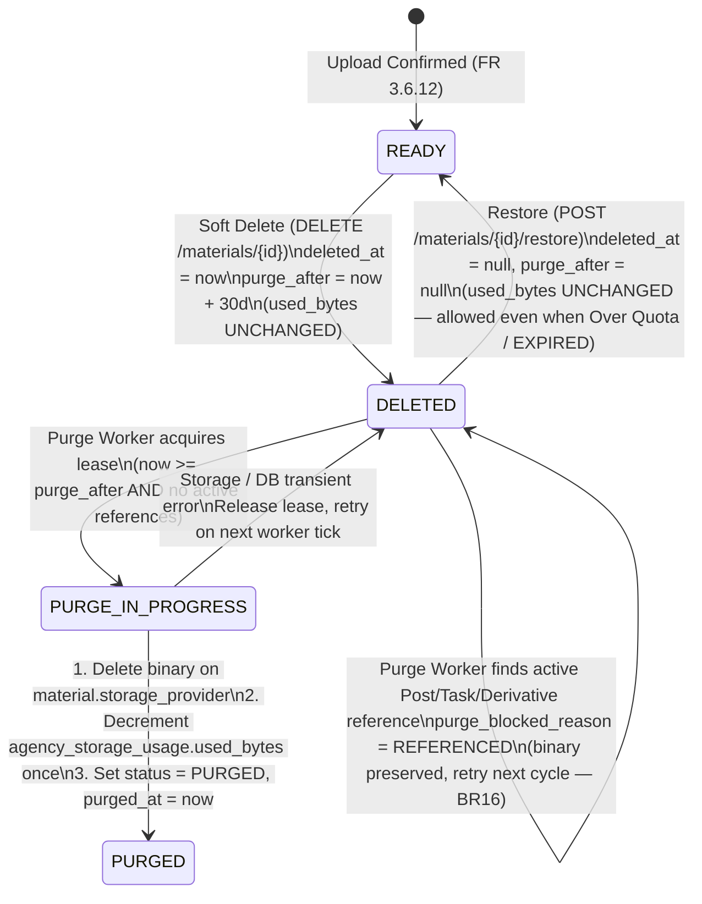
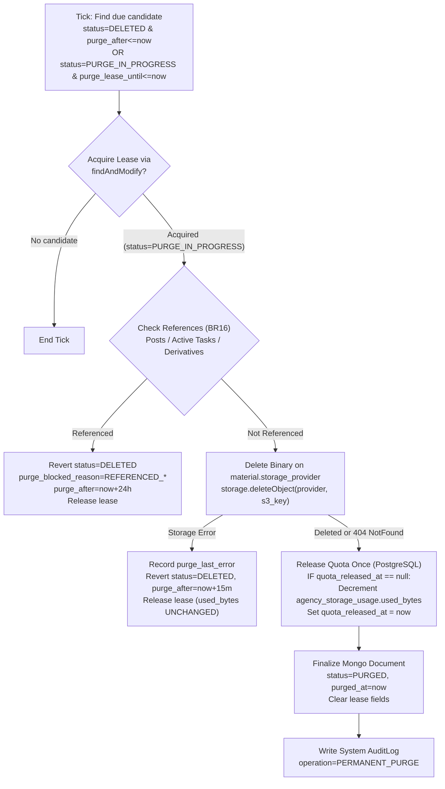

# Feature Specification: FR 3.6.14 — Remove Material Repository

> **Feature Key**: `repository/remove-material-repository`
> **Functional Requirement**: `FR 3.6.14 — Remove Material Repository`
> **Source Baseline**: [`REPOSITORY_SPEC.md`](file:///D:/capstone/brandhub/tuan-research/REPOSITORY_SPEC.md) (`BR01`–`BR25`)
> **Architecture References**: [`ADR-002`](file:///D:/capstone/brandhub/brandhub-infrastructure/docs/adr/ADR-002-database-split.md), [`database-strategy.md`](file:///D:/capstone/brandhub/brandhub-infrastructure/docs/database/schema-v2/database-strategy.md), [`DA-E06-08`](file:///D:/capstone/brandhub/brandhub-infrastructure/docs/database/redis-cache/DA-E06-08-database-access-rules.md), [`mongo-atlas-migrations.md`](file:///D:/capstone/brandhub/brandhub-infrastructure/docs/database/mongo-atlas-migrations.md), [`agency-subscription/spec.md`](file:///D:/capstone/brandhub/brandhub-infrastructure/docs/feature/agency-subscription/spec.md)
> **Status**: Specification Ready (No Code / Migration Executed)

---

## 1. Context & Scope

### 1.1. Goal
Đặc tả chi tiết và đầy đủ cho duy nhất chức năng **FR 3.6.14 — Remove Material Repository**, bao gồm:
1. **Xóa mềm (Soft Delete / Chuyển vào Thùng rác — Trash)** với thời gian lưu giữ **30 ngày** (`deleted_at`, `deleted_by`, `purge_after = deleted_at + 30 days`) (`BR15`).
2. **Khôi phục từ Thùng rác (Restore)** trong thời hạn lưu giữ 30 ngày mà **không** tăng thêm `used_bytes`, cho phép thực hiện ngay cả khi Agency chạm/vượt 100% quota hoặc gói trả phí đã `EXPIRED` (`BR15`, `BR19`, `BR20`, `BR21`).
3. **Danh sách Thùng rác (Trash View)** tái sử dụng truy vấn danh sách có phân trang nhưng lọc riêng các bản ghi đã xóa mềm trong phạm vi quyền của vai trò (`BR03`–`BR05`, `BR15`).
4. **Xóa vĩnh viễn có điều kiện (Conditional Permanent Purge Worker)** sau 30 ngày: kiểm tra tham chiếu từ `posts`, `tasks`, và các bản dẫn xuất (`parent_material_id`), xóa binary trên đúng `storage_provider` (`RCLONE_GDRIVE` / `S3`) của bản ghi trước khi đánh dấu `PURGED`, và chỉ giảm `used_bytes` một lần duy nhất khi xóa binary thành công (`BR15`, `BR16`, `BR19`, `BR23`).

### 1.2. Scope Boundary (Phạm vi)
- **Trong phạm vi (In-Scope — FR 3.6.14)**:
  - API xóa mềm material: `DELETE /api/v1/workspaces/{workspaceId}/materials/{materialId}` (`BR03`–`BR05`, `BR14`, `BR15`, `BR16`).
  - API khôi phục material từ Trash: `POST /api/v1/workspaces/{workspaceId}/materials/{materialId}/restore` (`BR03`–`BR05`, `BR15`, `BR19`, `BR20`, `BR21`).
  - Tham số lọc chế độ Thùng rác (`deleted=true` hoặc tab Trash) kết hợp với phân quyền RBAC/ABAC: `MANAGER` thấy mọi file đã xóa mềm trong workspace; `CREATOR` và `CLIENT` chỉ thấy, xóa và khôi phục file do chính mình tạo (`created_by == actorId`) và vẫn thỏa ACL (`BR03`, `BR04`, `BR05`, `BR15`).
  - Hạch toán dung lượng khi xóa mềm, khôi phục và purge vĩnh viễn trên bảng PostgreSQL `agency_storage_usage`:
    - File trong Trash vẫn tính vào `used_bytes`; xóa mềm **không** giảm `used_bytes` (`BR19`).
    - Restore chỉ gỡ cờ `deleted_at`/`deleted_by`/`purge_after`, **không** cộng thêm `used_bytes` (`BR19`, `BR20`, `BR21`).
    - Chỉ giảm `used_bytes` khi worker purge xóa thành công binary trên `storage_provider` của chính material đó (`BR15`, `BR19`, `BR23`).
  - Cơ chế bảo vệ tham chiếu khi xóa mềm và khi purge (`BR16`):
    - Xóa mềm khỏi Library **không** được xóa binary hoặc làm hỏng nội dung `Post`, `Task`, hoặc bản dẫn xuất (`RETOUCHED`/`WATERMARKED`) đã tham chiếu tới file.
    - Worker purge kiểm tra tham chiếu trên MongoDB `posts` (`media.s3_key`), `tasks` (qua `materials.task_id` gắn với task chưa hủy hoặc tham chiếu đính kèm), và `materials` (`parent_material_id`); nếu còn tham chiếu hoạt động thì **hoãn purge** (`PURGE_BLOCKED_REFERENCED`) và giữ nguyên binary.
  - Quy tắc bất biến khi xóa/purge (`BR15`, `BR23`):
    - **Tuyệt đối không** dùng MongoDB TTL Index tự động xóa document trên `deleted_at` hoặc `purge_after` trước khi xóa binary trên Object Storage và giảm `used_bytes`.
    - **Không** tự chuyển đổi `storage_provider` của các file còn lại hoặc file khôi phục từ Trash.
  - Concurrency control, idempotency, lease-based background worker (`MaterialTrashPurgeWorker`) và đối soát định kỳ (`StorageUsageReconciliationJob`).
  - Giao diện Web (`brandhub-web`) cho nút Xóa (Soft Delete Modal xác nhận), chế độ xem Thùng rác (Trash Filter/View), đếm ngược số ngày còn lại trước khi xóa vĩnh viễn, và nút Khôi phục (Restore).
- **Ngoài phạm vi (Out-of-Scope — chỉ liên kết như Dependency)**:
  - Hiển thị danh sách/chi tiết material hoạt động (`deleted_at == null`), bộ lọc `type`/`purpose`/`q` và cấp `previewUrl` (thuộc **FR 3.6.11 — View Material Repository**: [`view-material-repository/spec.md`](file:///D:/capstone/brandhub/brandhub-infrastructure/docs/feature/repository/view-material-repository/spec.md)).
  - Tải lên material mới, giữ chỗ `reserved_bytes` và chốt canonical object (thuộc **FR 3.6.12 — Add Material Repository**: [`add-material-repository/spec.md`](file:///D:/capstone/brandhub/brandhub-infrastructure/docs/feature/repository/add-material-repository/spec.md)).
  - Đổi tên hiển thị, đổi `type` (`RAW` $\leftrightarrow$ `RETOUCHED`), `purpose`, `visibility` / `client_profile_id` (thuộc **FR 3.6.13 — Update Material Repository**: [`update-material-repository/spec.md`](file:///D:/capstone/brandhub/brandhub-infrastructure/docs/feature/repository/update-material-repository/spec.md)).
  - Cấp presigned download URL cho bản gốc hoặc bản watermark (thuộc **FR 3.6.16 — Download Material**).

---

## 2. Current Codebase Alignment (Đã có vs. Cần bổ sung)

Đối chiếu trực tiếp với mã nguồn hiện tại trong `brandhub-business-service` và `brandhub-web`:

| Thành phần | Hiện trạng trong Codebase | Phần cần bổ sung / điều chỉnh cho FR 3.6.14 |
| :--- | :--- | :--- |
| **MongoDB Document** ([`MaterialDocument.java`](file:///D:/capstone/brandhub/brandhub-business-service/src/main/java/com/brandhub/business/document/MaterialDocument.java)) | Đã có collection `materials` với `id`, `workspaceId`, `taskId`, `name`, `s3Key`, `fileSize`, `mimeType`, `type`, `status`, `createdBy`, `createdAt`, `updatedAt`. Chưa có trường soft delete, optimistic locking và trạng thái purge. | Tái sử dụng các trường mở rộng của `MaterialDocument` (`deletedAt`, `deletedBy`, `purgeAfter`, `version`, `storageProvider`, `visibility`, `clientProfileId`, `parentMaterialId`) và bổ sung trường quản lý lease/purge (`purgeLeaseOwner`, `purgeLeaseUntil`, `purgeLastError`, `purgedAt`, `quotaReleasedAt`) để đảm bảo idempotency khi purge binary và hoàn trả quota (`BR15`, `BR16`, `BR19`). |
| **MongoDB Repository** ([`MaterialMongoRepository.java`](file:///D:/capstone/brandhub/brandhub-business-service/src/main/java/com/brandhub/business/repository/mongo/MaterialMongoRepository.java)) | Chỉ có `findByWorkspaceIdOrderByCreatedAtDesc` và `findByIdAndWorkspaceId`. | Bổ sung truy vấn có lọc `deleted_at != null` cho chế độ Trash (kèm RBAC/ABAC: `MANAGER` xem toàn workspace, `CREATOR`/`CLIENT` chỉ xem `created_by == actorId`), và atomic `MongoTemplate.findAndModify` cho Soft Delete, Restore và Purge Lease. |
| **Object Storage Service** ([`FileStorageService.java`](file:///D:/capstone/brandhub/brandhub-business-service/src/main/java/com/brandhub/business/service/FileStorageService.java), [`S3FileStorageServiceImpl.java`](file:///D:/capstone/brandhub/brandhub-business-service/src/main/java/com/brandhub/business/service/impl/S3FileStorageServiceImpl.java)) | Đã có `deleteObject(String s3Key)` gọi `S3Client.deleteObject` (idempotent khi key không còn tồn tại trên S3/rclone). | Bổ sung overloading/router `deleteObject(StorageProvider provider, String s3Key)` định tuyến đúng S3 client hoặc `rclone serve s3` client theo `material.getStorageProvider()` (`BR23`). |
| **Post & Task Reference Models** ([`PostDocument.java`](file:///D:/capstone/brandhub/brandhub-business-service/src/main/java/com/brandhub/business/document/PostDocument.java), [`TaskDocument.java`](file:///D:/capstone/brandhub/brandhub-business-service/src/main/java/com/brandhub/business/document/TaskDocument.java)) | `PostDocument` (collection `posts`) lưu danh sách `media` với trường `@Field("s3_key") String s3Key`. `TaskDocument` (collection `tasks`) lưu trạng thái task (`status`, `inputReferences`). `MaterialDocument` lưu `task_id` và `parent_material_id`. | Bổ sung `MaterialReferenceChecker` kiểm tra 3 nguồn tham chiếu trước khi purge vĩnh viễn (`BR16`): (1) `posts` có `workspace_id` và `media.s3_key == material.s3_key`; (2) `tasks` được liên kết qua `material.task_id` có `status != "CANCELLED"` hoặc `inputReferences.url` chứa `materialId`/`s3_key`; (3) `materials` dẫn xuất (`parent_material_id == material.id`) chưa bị `PURGED`. |
| **Background Cleanup Pattern** ([`TaskCommentUploadCleanup.java`](file:///D:/capstone/brandhub/brandhub-business-service/src/main/java/com/brandhub/business/service/impl/TaskCommentUploadCleanup.java)) | Đã có mẫu worker `@Scheduled` dùng `MongoTemplate.findAndModify` với `leaseOwner` và `leaseUntil` để tránh nhiều instance xử lý trùng cùng một bản ghi. | Áp dụng cùng mẫu lease-based `@Scheduled` để xây dựng `MaterialTrashPurgeWorker` cho các bản ghi `status = "DELETED"` có `purge_after <= now`, kèm hoàn trả `used_bytes` an toàn vào PostgreSQL `agency_storage_usage`. |
| **PostgreSQL Quota Accounting** (`agency_storage_usage`) | Được thiết kế tại `FR 3.6.12` ([`add-material-repository/spec.md`](file:///D:/capstone/brandhub/brandhub-infrastructure/docs/feature/repository/add-material-repository/spec.md)) với `used_bytes` và `reserved_bytes` cấp Agency. | Tái sử dụng `AgencyStorageQuotaService`:<br>- **Soft Delete**: giữ nguyên `used_bytes` (`BR19`).<br>- **Restore**: giữ nguyên `used_bytes`, không chặn khi vượt quota / `EXPIRED` (`BR20`, `BR21`).<br>- **Purge Worker**: gọi `releaseUsedBytesOnPurge(agencyId, fileSize)` nguyên tử `GREATEST(0, used_bytes - :fileSize)` chỉ sau khi xóa binary thành công và gán `quota_released_at` để chống trừ trùng (`BR19`). |
| **Audit Logging** ([`AuditLog.java`](file:///D:/capstone/brandhub/brandhub-business-service/src/main/java/com/brandhub/business/model/entity/AuditLog.java), [`AuditAction.java`](file:///D:/capstone/brandhub/brandhub-business-service/src/main/java/com/brandhub/business/model/enums/AuditAction.java)) | Đã có `AuditAction.DELETE`, `AuditAction.UPDATE` và entity `AuditLog` (`audit_logs` trong PostgreSQL). | Ghi `AuditLog` cho các thao tác: `DELETE` (Soft Delete vào Trash), `UPDATE` (Restore từ Trash với `details.operation = "RESTORE"`), và `DELETE` (System Purge sau 30 ngày với `details.operation = "PERMANENT_PURGE"`). |
| **Controller & Service** ([`MaterialController.java`](file:///D:/capstone/brandhub/brandhub-business-service/src/main/java/com/brandhub/business/controller/MaterialController.java), [`MaterialServiceImpl.java`](file:///D:/capstone/brandhub/brandhub-business-service/src/main/java/com/brandhub/business/service/impl/MaterialServiceImpl.java)) | Chỉ có `POST /upload-session`, `POST /upload-session/confirm`, `GET /materials`, `GET /materials/{id}/download-url`. Chưa có endpoint xóa mềm hay khôi phục. | Bổ sung:<br>- `DELETE /api/v1/workspaces/{workspaceId}/materials/{materialId}`<br>- `POST /api/v1/workspaces/{workspaceId}/materials/{materialId}/restore`<br>- Hỗ trợ `deleted=true` trên `GET /api/v1/workspaces/{workspaceId}/materials` để hiển thị danh sách Trash. |
| **Frontend Service & UI** ([`materialService.ts`](file:///D:/capstone/brandhub/brandhub-web/src/services/materialService.ts), [`MediaTab.tsx`](file:///D:/capstone/brandhub/brandhub-web/src/pages/library/components/MediaTab.tsx), [`MediaDetailPanel.tsx`](file:///D:/capstone/brandhub/brandhub-web/src/pages/library/components/MediaDetailPanel.tsx)) | `materialService.ts` chưa có `deleteMaterial()` hoặc `restoreMaterial()`. `MediaDetailPanel.tsx` chưa có nút Xóa / Khôi phục. `MediaTab.tsx` chưa có bộ lọc Thùng rác (Trash). | Bổ sung `deleteMaterial`, `restoreMaterial` trong `materialService.ts`; thêm nút xem Thùng rác trên `MediaTab.tsx`; thêm nút Xóa kèm Modal xác nhận (cảnh báo giữ 30 ngày và vẫn tính dung lượng cho tới khi xóa vĩnh viễn) và nút Khôi phục trong chế độ Trash. |

---

## 3. Business Rules Applied (Ánh xạ BR01–BR25)

| Mã BR | Quy tắc nghiệp vụ đã chốt | Áp dụng cụ thể trong FR 3.6.14 (Remove Material Repository) |
| :--- | :--- | :--- |
| **BR01** | Mỗi file thuộc đúng một workspace; MVP không chia sẻ xuyên workspace. | Mọi lệnh Soft Delete, Restore và truy vấn Trash đều bắt buộc lọc cứng theo `workspace_id` của đường dẫn URL (`404 MATERIAL_NOT_FOUND` nếu khác workspace). |
| **BR02** | `OWNER` không tự động truy cập nội dung kho nếu không có membership vận hành trong workspace. | `OWNER` không có dòng `workspace_members` hợp lệ trong workspace bị từ chối `403 WORKSPACE_ACCESS_DENIED` khi gọi Soft Delete, Restore hoặc xem Trash. |
| **BR03** | `MANAGER`: xóa và khôi phục mọi file trong workspace mình quản lý. | `MANAGER` được xóa mềm mọi file `READY` trong workspace, xem toàn bộ danh sách Trash của workspace và khôi phục bất kỳ file nào đang ở trạng thái `DELETED` trong hạn 30 ngày. |
| **BR04** | `CREATOR`: chỉ sửa/xóa/khôi phục file mình tạo. | `CREATOR` chỉ được xóa mềm và khôi phục file có `created_by == actorId` trong workspace. Khi mở chế độ Trash, `CREATOR` chỉ nhìn thấy các file đã xóa mềm do chính mình tạo. Nỗ lực xóa/restore file của người khác bị chặn `403 MATERIAL_MUTATION_FORBIDDEN`. |
| **BR05** | `CLIENT`: chỉ xem/tải file được chia sẻ cho đúng client profile của mình; chỉ sửa/xóa/khôi phục file mình tạo. | `CLIENT` chỉ được xóa mềm và khôi phục file có `created_by == actorId` **và** vẫn thỏa quyền truy cập (`visibility == CLIENT` và `client_profile_id == actorClientProfileId`). Nếu `MANAGER` đã thu hồi chia sẻ (`BR14`) trước hoặc sau khi xóa, `CLIENT` không nhìn thấy và không khôi phục được file (`404 MATERIAL_NOT_FOUND`). |
| **BR13** | Chỉ file `READY`, chưa xóa và đủ quyền mới truy cập được preview/download. | Ngay khi Soft Delete thành công (`deleted_at != null`, `status = "DELETED"`), material bị loại khỏi danh sách Library mặc định (`FR 3.6.11`), bị chặn cập nhật metadata (`FR 3.6.13` trả `404`), và bị chặn cấp presigned preview/download URL mới (`FR 3.6.16` trả `404`). |
| **BR14** | Thu hồi quyền chặn cấp link mới ngay; link đã cấp có hiệu lực tối đa 120s (download) / 5 phút (preview). | Khi Soft Delete chuyển trạng thái sang `DELETED`, hệ thống dừng cấp presigned URL mới ngay lập tức; các URL ngắn hạn đã cấp trước đó tự hết hạn tối đa sau 120 giây (download) hoặc 5 phút (preview). |
| **BR15** | Xóa mềm, giữ 30 ngày (`purge_after = deleted_at + 30 days`). Có thể khôi phục trong thời gian này; sau đó đủ điều kiện xóa vĩnh viễn. | Soft Delete gán `status = "DELETED"`, `deleted_at = now`, `deleted_by = actorId`, `purge_after = now + 30 days`. Trong 30 ngày (hoặc trước khi worker purge bắt đầu xóa binary), người có quyền được gọi Restore để đưa file về `status = "READY"`, `deleted_at = null`, `deleted_by = null`, `purge_after = null`. |
| **BR16** | Không purge file còn được `Post`/`Task`/`Derivative` tham chiếu. Xóa khỏi Library không được làm hỏng nội dung đã sử dụng file. | 1. **Khi Soft Delete**: File ẩn khỏi Library nhưng binary trên S3/Drive vẫn giữ nguyên; `Post` đã lên lịch/xuất bản, `Task` đang xử lý, hoặc bản `RETOUCHED`/`WATERMARKED` dẫn xuất vẫn hoạt động bình thường.<br>2. **Khi Purge sau 30 ngày**: Worker kiểm tra tham chiếu từ `posts`, `tasks`, và `materials` (`parent_material_id`). Nếu còn bất kỳ tham chiếu hợp lệ nào, worker **không** xóa binary, giữ trạng thái `DELETED`, ghi nhận `purge_blocked_reason` và gia hạn kiểm tra lại ở chu kỳ sau. |
| **BR17, BR18** | Dung lượng tính ở cấp Agency (`BASIC` 20 GiB miễn phí; trả phí lấy theo catalog gói). | Mọi thay đổi dung lượng khi purge đều cập nhật vào bảng `agency_storage_usage` theo `agency_id` của workspace. |
| **BR19** | Tính original, watermark/derivative và trash vào `used_bytes`. Chỉ giảm usage khi purge vĩnh viễn thành công. | - **Soft Delete**: `used_bytes` giữ nguyên (không giảm).<br>- **Restore**: `used_bytes` giữ nguyên (không cộng thêm 2 lần).<br>- **Purge**: Chỉ trừ `used_bytes` đúng bằng `file_size` sau khi `storage.deleteObject(storageProvider, s3Key)` thành công. |
| **BR20, BR21** | Khi chạm/vượt 100% quota hoặc khi gói trả phí hết hạn (`EXPIRED`): chặn upload mới nhưng **cho phép xóa, purge và khôi phục từ thùng rác**. | Cả 3 thao tác **Soft Delete**, **Restore từ Trash**, và **Purge vĩnh viễn** đều **được phép thực hiện bình thường** khi `used_bytes + reserved_bytes >= quota_limit_bytes` hoặc khi gói thuê bao của Agency đang ở trạng thái `EXPIRED` / `GRACE_PERIOD`. |
| **BR23** | Không tự chuyển file cũ giữa Drive và S3; file cũ vẫn đọc/tải/xóa theo `storage_provider` đã ghi trên bản ghi. | Khi worker purge xóa binary của một material, hệ thống đọc `material.storage_provider` (`RCLONE_GDRIVE` hoặc `S3`) trên chính document đó để gọi đúng storage backend. Khi Restore từ Trash, giữ nguyên `storage_provider` và `s3_key` ban đầu. |

---

## 4. Permission & Lifecycle State Matrix

### 4.1. Ma trận phân quyền Soft Delete, Trash View & Restore (`BR02`–`BR05`, `BR14`, `BR15`)

| Vai trò trong Workspace | Xem danh sách Trash (`GET /materials?deleted=true`) | Xóa mềm (`DELETE /materials/{id}`) | Khôi phục (`POST /materials/{id}/restore`) | Điều kiện ABAC bổ sung |
| :--- | :--- | :--- | :--- | :--- |
| **`OWNER`** *(không có membership trong workspace)* | ❌ `403 WORKSPACE_ACCESS_DENIED` | ❌ `403 WORKSPACE_ACCESS_DENIED` | ❌ `403 WORKSPACE_ACCESS_DENIED` | Phải được cấp quyền vận hành trong workspace (`BR02`). |
| **`MANAGER`** | ✅ Xem mọi file `DELETED` trong workspace | ✅ Xóa mềm mọi file `READY` trong workspace | ✅ Khôi phục mọi file `DELETED` trong workspace | Không phụ thuộc `created_by` hay `visibility` (`BR03`). |
| **`CREATOR`** | ✅ Chỉ xem file `DELETED` do chính mình tạo (`created_by == actorId`) | ✅ Chỉ xóa mềm file `READY` có `created_by == actorId` (`403 MATERIAL_MUTATION_FORBIDDEN` nếu của người khác) | ✅ Chỉ khôi phục file `DELETED` có `created_by == actorId` (`403 MATERIAL_MUTATION_FORBIDDEN` nếu của người khác) | Giữ nguyên quy tắc sở hữu cá nhân (`BR04`). |
| **`CLIENT`** | ✅ Chỉ xem file `DELETED` có `created_by == actorId` **và** `visibility == CLIENT` **và** `client_profile_id == myProfileId` | ✅ Chỉ xóa mềm file `READY` có `created_by == actorId` và thuộc đúng `client_profile_id` của mình | ✅ Chỉ khôi phục file `DELETED` có `created_by == actorId` và vẫn thuộc đúng `client_profile_id` của mình | Nếu file không thỏa ACL đọc của Client $\rightarrow$ trả `404 MATERIAL_NOT_FOUND` (chống lộ sự tồn tại file). Nếu thỏa ACL đọc nhưng `created_by != actorId` $\rightarrow$ trả `403 MATERIAL_MUTATION_FORBIDDEN` (`BR05`, `BR14`). |

### 4.2. Sơ đồ chuyển trạng thái Vòng đời Xóa & Khôi phục (`BR15`, `BR16`, `BR19`)



> [!IMPORTANT]
> **Tại sao không dùng MongoDB TTL Index và vì sao giữ trạng thái `PURGED` (hoặc chỉ xóa document sau khi trừ quota)?**
> - Nếu đặt MongoDB TTL Index trên `deleted_at` hoặc `purge_after`, MongoDB background thread sẽ âm thầm xóa document khỏi collection `materials` mà **không** xóa object trên S3 / Google Drive và **không** giảm `used_bytes` trong PostgreSQL `agency_storage_usage`, gây rò rỉ dung lượng vĩnh viễn.
> - Do đó, **cấm tuyệt đối** tạo TTL index trên `deleted_at` hoặc `purge_after` của collection `materials` (`REPOSITORY_SPEC.md` Mục 6.1).
> - Khi purge thành công, document được chuyển sang `status = "PURGED"` (với `quota_released_at != null`, `purged_at != null`) để làm bằng chứng idempotency chống trừ `used_bytes` hai lần và phục vụ đối soát audit.

---

## 5. Reference Protection & Impact Rules (`BR16`)

### 5.1. Ảnh hưởng khi Xóa mềm (Soft Delete)
Khi người dùng xóa mềm một material (`READY` $\rightarrow$ `DELETED`):
1. **Ẩn khỏi Library mặc định**: Material biến mất ngay khỏi kết quả `GET /api/v1/workspaces/{workspaceId}/materials` (chế độ mặc định `deleted=false`) và không còn chọn được trong Media Picker khi tạo Post/Task mới.
2. **Chặn truy cập trực tiếp từ Library**:
   - `GET /materials/{materialId}` (chế độ mặc định) $\rightarrow$ `404 MATERIAL_NOT_FOUND`.
   - `PATCH /materials/{materialId}` (`FR 3.6.13`) $\rightarrow$ `404 MATERIAL_NOT_FOUND`.
   - `GET /materials/{materialId}/download-url` (`FR 3.6.16`) $\rightarrow$ `404 MATERIAL_NOT_FOUND`.
3. **Bảo toàn nội dung đang tham chiếu (`BR16`)**:
   - Binary tại `s3_key` trên `storage_provider` **không** bị đụng chạm trong suốt thời gian ở Trash.
   - Các `PostDocument` đã lưu nháp (`DRAFT`), đã lên lịch (`SCHEDULED`), đang xuất bản hoặc đã xuất bản (`PUBLISHED`) tham chiếu tới `media.s3_key` của material này vẫn đọc/hiển thị và xuất bản bình thường vì luồng Post truy xuất binary qua `s3_key` nội bộ.
   - Các bản dẫn xuất (`RETOUCHED` hoặc `WATERMARKED`) có `parent_material_id == material.id` đang ở trạng thái `READY` vẫn hiển thị, preview và tải xuống bình thường trong Library (`BR13`, `BR16`).

### 5.2. Kiểm tra tham chiếu bắt buộc trước khi Purge vĩnh viễn (`MaterialReferenceChecker`)
Khi một material ở trạng thái `DELETED` đã quá hạn 30 ngày (`now >= purge_after`), trước khi xóa binary trên Object Storage, `MaterialReferenceChecker` phải kiểm tra đồng thời 3 điều kiện tham chiếu sau:

| Nguồn tham chiếu | Truy vấn kiểm tra trên MongoDB | Hành vi khi phát hiện còn tham chiếu (`BR16`) |
| :--- | :--- | :--- |
| **1. Posts (`posts`)** | `db.posts.exists({ workspace_id: material.workspace_id, "media.s3_key": material.s3_key })` | **Chặn purge**: Không xóa binary, giữ `status = "DELETED"`, cập nhật `purge_blocked_reason = "REFERENCED_BY_POST"`, `purge_after = now + 24h` (để kiểm tra lại sau mà không quét nóng liên tục). |
| **2. Tasks (`tasks`)** | - Nếu `material.task_id != null`: kiểm tra `db.tasks.exists({ _id: material.task_id, workspaceId: material.workspace_id, status: { $nin: ["CANCELLED"] } })`<br>- Hoặc `db.tasks.exists({ workspaceId: material.workspace_id, status: { $nin: ["CANCELLED"] }, "inputReferences.url": { $regex: escapedMaterialIdOrKey } })` | **Chặn purge**: Không xóa binary, giữ `status = "DELETED"`, cập nhật `purge_blocked_reason = "REFERENCED_BY_TASK"`, `purge_after = now + 24h`. |
| **3. Derivatives (`materials`)** | `db.materials.exists({ workspace_id: material.workspace_id, parent_material_id: material._id, status: { $nin: ["PURGED", "FAILED", "EXPIRED"] } })` | **Chặn purge**: Nếu vẫn còn bản dẫn xuất (`RETOUCHED` hoặc `WATERMARKED`) đang ở `READY` hoặc đang ở `DELETED` (chưa được purge), bản gốc chưa được phép purge để bảo toàn chuỗi nguồn gốc và đối soát quyền (`BR10`, `BR14`, `BR16`). Worker purge các bản dẫn xuất đã hết hạn trước, sau đó mới purge bản gốc ở chu kỳ kế tiếp. |

> [!NOTE]
> **Tính dung lượng đối với file bị hoãn purge do còn tham chiếu (`BR16`, `BR19`)**:
> Chừng nào binary của file vẫn còn được giữ trên S3/Drive để phục vụ `Post`/`Task`/`Derivative` của Agency, dung lượng vật lý vẫn đang bị chiếm dụng nên `used_bytes` vẫn được giữ nguyên cho tới khi tham chiếu được gỡ bỏ và binary thực sự được xóa khỏi storage. Trong UI Trash, các file đã quá 30 ngày nhưng còn tham chiếu hiển thị nhãn trạng thái `"Đang được sử dụng bởi bài viết/công việc — bảo lưu tự động"` và vẫn cho phép `MANAGER` (hoặc người tạo) nhấn **Khôi phục** về Library bất kỳ lúc nào.

---

## 6. API Contract

Tất cả các endpoint dưới đây nằm dưới prefix `/api/v1/workspaces/{workspaceId}/materials` của `brandhub-business-service` (qua `brandhub-api-gateway`), tuân thủ chuẩn `ApiResponse<T>` (`code`, `message`, `data`, `meta`).

### 6.1. Soft Delete Material (Chuyển vào Thùng rác)
- **Endpoint**: `DELETE /api/v1/workspaces/{workspaceId}/materials/{materialId}`
- **Headers**:
  - `Authorization: Bearer <jwt>` (API Gateway xác thực và gắn `X-User-Id`, `X-User-Roles`).
- **Path Parameters**:
  - `workspaceId` (`UUID`, bắt buộc): ID của workspace chứa material (`BR01`).
  - `materialId` (`String`, bắt buộc): ID của `MaterialDocument` cần xóa mềm.
- **Query Parameters (Optional)**:
  - `expectedVersion` (`Long`, tùy chọn): Phiên bản hiện tại của document để kiểm tra optimistic concurrency nếu UI đang mở chi tiết file. Nếu truyền vào mà không khớp `material.version` thì trả `409 MATERIAL_VERSION_CONFLICT`.

#### Response `200 OK`
```json
{
  "code": 1000,
  "message": "Đã chuyển tài liệu vào thùng rác (lưu giữ 30 ngày)",
  "data": {
    "id": "665f1b2c8e9a1b2c3d4e5f70",
    "workspaceId": "550e8400-e29b-41d4-a716-446655440000",
    "name": "KV_Summer_Campaign_Final.png",
    "status": "DELETED",
    "deletedAt": "2026-10-24T10:30:00Z",
    "deletedBy": "7f000001-8c1a-11ee-b962-0242ac120002",
    "purgeAfter": "2026-11-23T10:30:00Z",
    "version": 4
  }
}
```

---

### 6.2. Restore Material from Trash (Khôi phục tài liệu từ Thùng rác)
- **Endpoint**: `POST /api/v1/workspaces/{workspaceId}/materials/{materialId}/restore`
- **Headers**:
  - `Authorization: Bearer <jwt>`
- **Path Parameters**:
  - `workspaceId` (`UUID`, bắt buộc)
  - `materialId` (`String`, bắt buộc)
- **Request Body**: Không bắt buộc (hoặc `{}` rỗng).

#### Response `200 OK`
Trả về [`MaterialResponse`](file:///D:/capstone/brandhub/brandhub-business-service/src/main/java/com/brandhub/business/dto/response/MaterialResponse.java) đầy đủ của tài liệu sau khi đã khôi phục về trạng thái `READY` (bao gồm cả `previewUrl` mới được ký nếu định dạng hỗ trợ preview):

```json
{
  "code": 1000,
  "message": "Khôi phục tài liệu thành công",
  "data": {
    "id": "665f1b2c8e9a1b2c3d4e5f70",
    "workspaceId": "550e8400-e29b-41d4-a716-446655440000",
    "taskId": null,
    "parentMaterialId": null,
    "name": "KV_Summer_Campaign_Final.png",
    "originalName": "IMG_9921_edited.png",
    "fileSize": 4194304,
    "mimeType": "image/png",
    "type": "RETOUCHED",
    "purpose": "MATERIAL",
    "visibility": "CLIENT",
    "clientProfileId": "9a112233-4455-6677-8899-aabbccddeeff",
    "storageProvider": "S3",
    "status": "READY",
    "rawWarning": false,
    "previewUrl": "https://s3.ap-southeast-1.amazonaws.com/brandhub-media/workspaces/...?X-Amz-Expires=300...",
    "previewExpiresAt": "2026-10-24T10:37:00Z",
    "version": 5,
    "createdBy": "7f000001-8c1a-11ee-b962-0242ac120002",
    "createdAt": "2026-10-20T09:15:00Z",
    "updatedAt": "2026-10-24T10:32:00Z",
    "deletedAt": null,
    "deletedBy": null,
    "purgeAfter": null
  }
}
```

---

### 6.3. List Trash Materials (Xem danh sách Thùng rác)
Tái sử dụng endpoint danh sách của `FR 3.6.11` với cờ `deleted=true`:
- **Endpoint**: `GET /api/v1/workspaces/{workspaceId}/materials?deleted=true&page=0&size=20&q=...&type=...&purpose=...`
- **Quy tắc xử lý riêng khi `deleted=true`**:
  1. Chỉ truy vấn các bản ghi có `workspace_id == workspaceId`, `status == "DELETED"`, và `deleted_at != null`.
  2. **Áp dụng RBAC/ABAC cho Trash (`BR03`–`BR05`)**:
     - `MANAGER`: xem toàn bộ các file `DELETED` trong workspace.
     - `CREATOR`: chỉ lọc các file `DELETED` có `created_by == actorId`.
     - `CLIENT`: chỉ lọc các file `DELETED` có `created_by == actorId`, `visibility == "CLIENT"`, và `client_profile_id == actorClientProfileId`.
  3. **Sắp xếp**: Mặc định sắp xếp theo `deleted_at DESC, _id DESC` (file mới xóa hiển thị lên đầu).
  4. **Không cấp `previewUrl` cho file đã xóa (`BR13`)**: Trong chế độ `deleted=true`, trường `previewUrl` luôn trả `null` và `previewExpiresAt` trả `null` vì `BR13` quy định chỉ file `READY`, chưa xóa mới được truy cập preview/download.
  5. **Trả kèm thông tin lưu giữ**: Mỗi phần tử trong mảng `data` có `deletedAt`, `deletedBy`, `purgeAfter` (ISO-8601 UTC) để Frontend hiển thị số ngày còn lại trước khi xóa vĩnh viễn.

---

## 7. Detailed Backend Processing & Concurrency Flows

### 7.1. Luồng Soft Delete (`DELETE /materials/{materialId}`)
1. **Kiểm tra Workspace Access & Role (`BR01`–`BR05`)**:
   - Xác minh user hiện tại (`actorId`) có membership đang hoạt động trong `workspaceId`. Nếu không có (bao gồm cả `OWNER` chưa được gán vào workspace) $\rightarrow$ ném `403 WORKSPACE_ACCESS_DENIED` (`BR02`).
2. **Đọc Material & Kiểm tra ACL (`BR01`, `BR03`–`BR05`, `BR13`)**:
   - Truy vấn `MaterialDocument` theo `_id = materialId` và `workspace_id = workspaceId`.
   - Nếu không tồn tại hoặc `status` thuộc `["PENDING_UPLOAD", "UPLOADED", "SCANNING", "FAILED", "EXPIRED", "PURGED"]` $\rightarrow$ ném `404 MATERIAL_NOT_FOUND`.
   - Nếu `actorRole == CLIENT` và (`visibility != "CLIENT"` hoặc `!Objects.equals(clientProfileId, actorClientProfileId)`) $\rightarrow$ ném `404 MATERIAL_NOT_FOUND` (không tiết lộ sự tồn tại của file nội bộ hoặc file của Client khác).
   - Nếu `actorRole` là `CREATOR` hoặc `CLIENT` và `!Objects.equals(material.getCreatedBy(), actorId.toString())` $\rightarrow$ ném `403 MATERIAL_MUTATION_FORBIDDEN` (`BR04`, `BR05`).
   - Nếu `material.getStatus()` đã là `"DELETED"` (`deleted_at != null`):
     - Nếu người gọi có quyền xóa trên file đó, nhưng file đã ở trong Trash $\rightarrow$ ném `409 MATERIAL_ALREADY_DELETED` (hoặc nếu đang ở `PURGE_IN_PROGRESS` $\rightarrow$ `409 MATERIAL_PURGE_IN_PROGRESS`).
3. **Kiểm tra trạng thái Quota / Subscription (`BR20`, `BR21`)**:
   - **Không chặn** thao tác xóa mềm khi Agency vượt quota hoặc subscription `EXPIRED`.
4. **Cập nhật nguyên tử trên MongoDB (`findAndModify`)**:
   - Thực thi `MongoTemplate.findAndModify`:
     - **Filter**:
       ```json
       {
         "_id": "<materialId>",
         "workspace_id": "<workspaceId>",
         "status": "READY",
         "deleted_at": null
       }
       ```
       *(Nếu request có `expectedVersion`, thêm `"version": expectedVersion` vào Filter).*
     - **Update**:
       ```json
       {
         "$set": {
           "status": "DELETED",
           "deleted_at": "<now>",
           "deleted_by": "<actorId>",
           "purge_after": "<now.plus(Duration.ofDays(30))>",
           "updated_at": "<now>",
           "updated_by": "<actorId>"
         },
         "$inc": { "version": 1 }
       }
       ```
   - Nếu `findAndModify` trả về `null`:
     - Đọc lại document để phân biệt `409 MATERIAL_VERSION_CONFLICT`, `409 MATERIAL_ALREADY_DELETED`, hoặc `404 MATERIAL_NOT_FOUND`.
5. **Không giảm `used_bytes` (`BR19`)**:
   - Giữ nguyên `agency_storage_usage.used_bytes`.
6. **Ghi Audit Log**:
   - Lưu `AuditLog` (`action = AuditAction.DELETE`, `resourceType = "MATERIAL"`, `resourceId = materialId`, `workspaceId`, `userId = actorId`, `details = { "operation": "SOFT_DELETE", "name": material.name, "fileSize": material.fileSize, "purgeAfter": purgeAfter }`).

---

### 7.2. Luồng Restore từ Thùng rác (`POST /materials/{materialId}/restore`)
1. **Kiểm tra Workspace Access & Role (`BR01`–`BR05`)**:
   - Xác minh `actorId` thuộc `workspaceId` (`MANAGER`, `CREATOR`, hoặc `CLIENT`).
2. **Đọc Material & Kiểm tra ACL / Trạng thái (`BR03`–`BR05`, `BR14`, `BR15`)**:
   - Truy vấn `MaterialDocument` theo `_id = materialId` và `workspace_id = workspaceId`.
   - Nếu không tồn tại hoặc `status == "PURGED"` $\rightarrow$ ném `404 MATERIAL_NOT_FOUND`.
   - Nếu `actorRole == CLIENT` và (`visibility != "CLIENT"` hoặc `!Objects.equals(clientProfileId, actorClientProfileId)`) $\rightarrow$ ném `404 MATERIAL_NOT_FOUND` (`BR05`, `BR14` — nếu `MANAGER` đã thu hồi quyền chia sẻ của file gốc hoặc file dẫn xuất thì `CLIENT` không được khôi phục).
   - Nếu `actorRole` là `CREATOR` hoặc `CLIENT` và `!Objects.equals(material.getCreatedBy(), actorId.toString())` $\rightarrow$ ném `403 MATERIAL_MUTATION_FORBIDDEN` (`BR04`, `BR05`).
   - Nếu `material.getStatus().equals("READY")` và `material.getDeletedAt() == null` $\rightarrow$ ném `409 MATERIAL_NOT_IN_TRASH`.
   - Nếu `material.getStatus().equals("PURGE_IN_PROGRESS")` $\rightarrow$ ném `409 MATERIAL_PURGE_IN_PROGRESS` (worker đang thực thi xóa binary nên không thể khôi phục).
   - Nếu `now.isAfter(material.getPurgeAfter())` **và** không có cờ `purge_blocked_reason` (tức đã quá hạn 30 ngày chờ worker quét):
     - Kiểm tra `now.isAfter(material.getPurgeAfter())`: theo `BR15` (*"Xóa mềm, giữ 30 ngày. Có thể khôi phục trong thời gian này; sau đó đủ điều kiện xóa vĩnh viễn"*), nếu file đã quá `deleted_at + 30 days` (tính theo `original_purge_after = deleted_at + 30 days`) thì từ chối khôi phục với `410 MATERIAL_RETENTION_EXPIRED` (trừ khi `MANAGER` khôi phục file đang được giữ lại do `REFERENCED_BY_POST`/`REFERENCED_BY_TASK` trước khi bị purge). Để nhất quán và đơn giản theo đúng câu chữ `BR15` ("Có thể khôi phục trong thời gian này; sau đó đủ điều kiện xóa vĩnh viễn"), kiểm tra `Instant.now().isAfter(material.getDeletedAt().plus(Duration.ofDays(30)))` $\rightarrow$ nếu đã quá 30 ngày kể từ `deleted_at`, trả `410 MATERIAL_RETENTION_EXPIRED`.
3. **Kiểm tra ràng buộc Parent Audience khi Restore bản dẫn xuất (`BR14`)**:
   - Nếu `material.getParentMaterialId() != null`, đọc `parentMaterial` trong cùng workspace:
     - Nếu `parentMaterial` đã bị thu hẹp quyền về `visibility == "INTERNAL"` trong khi bản dẫn xuất đang có `visibility == "CLIENT"`, khi khôi phục hệ thống tự động đồng bộ `visibility = "INTERNAL"`, `client_profile_id = null` trên bản dẫn xuất để không làm rò rỉ lại quyền đã thu hồi (`BR14`).
4. **Độc lập Quota & Subscription (`BR19`, `BR20`, `BR21`)**:
   - **Không** kiểm tra vượt hạn mức `quota_limit_bytes` và **không** chặn khi gói thuê bao của Agency đang `EXPIRED`, vì dung lượng của file trong Trash đã nằm sẵn trong `used_bytes`.
   - **Không** cộng thêm `file_size` vào `agency_storage_usage.used_bytes`.
5. **Cập nhật nguyên tử trên MongoDB (`findAndModify`)**:
   - Thực thi `MongoTemplate.findAndModify`:
     - **Filter**:
       ```json
       {
         "_id": "<materialId>",
         "workspace_id": "<workspaceId>",
         "status": "DELETED",
         "deleted_at": { "$ne": null },
         "$or": [
           { "purge_lease_until": null },
           { "purge_lease_until": { "$lt": "<now>" } }
         ]
       }
       ```
     - **Update**:
       ```json
       {
         "$set": {
           "status": "READY",
           "deleted_at": null,
           "deleted_by": null,
           "purge_after": null,
           "purge_blocked_reason": null,
           "updated_at": "<now>",
           "updated_by": "<actorId>"
         },
         "$inc": { "version": 1 }
       }
       ```
   - Nếu `findAndModify` trả về `null`, trả `409 MATERIAL_PURGE_IN_PROGRESS` hoặc `404 MATERIAL_NOT_FOUND`.
6. **Ghi Audit Log & Trả Response**:
   - Ghi `AuditLog` (`action = AuditAction.UPDATE`, `resourceType = "MATERIAL"`, `resourceId = materialId`, `details = { "operation": "RESTORE", "name": restored.name }`).
   - Ánh xạ sang `MaterialResponse` (kèm `previewUrl` nếu là ảnh/video/PDF hợp lệ) và trả `200 OK`.

---

### 7.3. Luồng Permanent Purge Worker (`MaterialTrashPurgeWorker`)
Worker chạy nền định kỳ trong `brandhub-business-service` (tương tự mẫu [`TaskCommentUploadCleanup.java`](file:///D:/capstone/brandhub/brandhub-business-service/src/main/java/com/brandhub/business/service/impl/TaskCommentUploadCleanup.java)):

- **Lịch chạy**: `@Scheduled(fixedDelayString = "${app.materials.purge-worker-ms:300000}")` (mặc định 5 phút/lần, xử lý theo lô tối đa `batchSize = 50` bản ghi mỗi chu kỳ).
- **Trình tự xử lý từng bản ghi (Idempotent & Crash-Safe)**:



1. **Bước 1 — Chiếm Lease nguyên tử (`findAndModify`)**:
   - Tìm 1 bản ghi thỏa:
     - `(status == "DELETED" AND purge_after <= now)` **HOẶC** `(status == "PURGE_IN_PROGRESS" AND purge_lease_until <= now)`
   - Cập nhật nguyên tử:
     - `status = "PURGE_IN_PROGRESS"`
     - `purge_lease_owner = workerInstanceId`
     - `purge_lease_until = now.plusSeconds(300)` (lease 5 phút)
2. **Bước 2 — Kiểm tra tham chiếu (`BR16`)**:
   - Gọi `materialReferenceChecker.findActiveReference(candidate)`.
   - Nếu còn tham chiếu (`REFERENCED_BY_POST`, `REFERENCED_BY_TASK`, hoặc `REFERENCED_BY_DERIVATIVE`):
     - Cập nhật lại document: `status = "DELETED"`, `purge_blocked_reason = reason`, `purge_after = now.plus(Duration.ofHours(24))`, `purge_lease_owner = null`, `purge_lease_until = null`.
     - **Không** xóa binary và **không** giảm `used_bytes`. Chuyển sang bản ghi tiếp theo.
3. **Bước 3 — Xóa Binary trên đúng `storage_provider` (`BR23`)**:
   - Đọc `StorageProvider provider = candidate.getStorageProvider()` (mặc định `"S3"` cho các bản ghi legacy chưa có trường `storage_provider`).
   - Gọi `fileStorageService.deleteObject(provider, candidate.getS3Key())`.
   - Quy tắc idempotency trên S3 / `rclone serve s3`: nếu object đã được xóa ở lần chạy trước (S3 trả `204 No Content` hoặc `404 NoSuchKey`), coi như xóa binary **thành công**.
   - Nếu gặp lỗi mạng / timeout / `5xx` từ S3 hoặc rclone:
     - Ghi `purge_last_error`, trả document về `status = "DELETED"`, `purge_after = now.plus(Duration.ofMinutes(15))`, xóa lease.
     - **Tuyệt đối không** giảm `used_bytes` khi chưa xác nhận xóa binary thành công (`BR19`).
4. **Bước 4 — Hoàn trả `used_bytes` đúng một lần duy nhất (`BR19`)**:
   - Để chống trừ `used_bytes` hai lần khi worker bị crash ngay sau khi trừ PostgreSQL nhưng trước khi cập nhật MongoDB:
     - Thực hiện CAS trên MongoDB:
       ```json
       Filter: { "_id": "<id>", "quota_released_at": null }
       Update: { "$set": { "quota_released_at": "<now>", "quota_release_tx_id": "<uuid>" } }
       ```
     - Chỉ khi CAS trên chuyển `quota_released_at` từ `null` sang `<now>` thành công (hoặc sử dụng bảng outbox/idempotency key `material_quota_releases(material_id PRIMARY KEY)` trong PostgreSQL cùng transaction với lệnh trừ `used_bytes`), hệ thống mới thực thi câu lệnh SQL nguyên tử trong PostgreSQL:
       ```sql
       INSERT INTO material_quota_releases (material_id, agency_id, released_bytes, released_at)
       VALUES (:materialId, :agencyId, :fileSize, NOW())
       ON CONFLICT (material_id) DO NOTHING;
       -- Chỉ khi INSERT affected_rows == 1 mới trừ used_bytes:
       UPDATE agency_storage_usage
       SET used_bytes = GREATEST(0, used_bytes - :fileSize),
           updated_at = NOW()
       WHERE agency_id = :agencyId;
       ```
     - Cách kết hợp `material_quota_releases(material_id PK)` cùng PostgreSQL transaction với `UPDATE agency_storage_usage` đảm bảo **exactly-once quota decrement** ngay cả khi worker retry nhiều lần.
5. **Bước 5 — Chốt trạng thái `PURGED` trên MongoDB & Ghi Audit**:
   - Cập nhật `MaterialDocument`:
     - `status = "PURGED"`
     - `purged_at = now`
     - `quota_released_at = now`
     - `purge_lease_owner = null`, `purge_lease_until = null`, `purge_blocked_reason = null`
   - Ghi `AuditLog` (`action = AuditAction.DELETE`, `resourceType = "MATERIAL"`, `resourceId = candidate.getId()`, `details = { "operation": "PERMANENT_PURGE", "s3Key": candidate.getS3Key(), "storageProvider": provider, "releasedBytes": candidate.getFileSize() }`).

---

### 7.4. Đối soát định kỳ (`StorageUsageReconciliationJob`)
Để phòng ngừa mọi sai lệch tích lũy giữa MongoDB `materials` và PostgreSQL `agency_storage_usage`:
- Chạy định kỳ hàng đêm (`@Scheduled(cron = "${app.materials.reconcile-cron:0 30 2 * * *}")`):
  - Tính tổng `expectedUsedBytes` theo từng `agency_id` từ MongoDB `materials` cho tất cả các bản ghi có `status IN ("READY", "DELETED", "PURGE_IN_PROGRESS")` và `quota_released_at == null` (`BR19`: tính original, watermark/derivative và trash).
  - Tính tổng `expectedReservedBytes` cho các phiên upload đang mở (`status IN ("PENDING_UPLOAD", "UPLOADED", "SCANNING")` chưa hết hạn).
  - Nếu chênh lệch so với `agency_storage_usage.used_bytes` hoặc `reserved_bytes`, ghi log cảnh báo `WARN` kèm metric và đồng bộ lại giá trị chuẩn xác.

---

## 8. Data Model, Schema & Index Specification

### 8.1. MongoDB Collection: `materials`
Tái sử dụng [`MaterialDocument`](file:///D:/capstone/brandhub/brandhub-business-service/src/main/java/com/brandhub/business/document/MaterialDocument.java) và bổ sung các trường phục vụ vòng đời Soft Delete / Restore / Purge:

| Field (MongoDB) | Java Property (`MaterialDocument`) | Kiểu dữ liệu | Ý nghĩa & Ràng buộc trong FR 3.6.14 |
| :--- | :--- | :--- | :--- |
| `_id` | `id` | `String` (ObjectId) | Khóa chính của material. |
| `workspace_id` | `workspaceId` | `String` (UUID) | Workspace sở hữu material (`BR01`). |
| `agency_id` | `agencyId` | `String` (UUID) | Agency sở hữu workspace (dùng để hoàn trả `used_bytes` khi purge mà không cần join chéo nếu workspace đã đóng). |
| `status` | `status` | `String` | `"READY"`, `"DELETED"`, `"PURGE_IN_PROGRESS"`, `"PURGED"` (cùng các trạng thái upload của `FR 3.6.12`). |
| `deleted_at` | `deletedAt` | `Instant` | Thời điểm xóa mềm (`null` khi `status == "READY"`). |
| `deleted_by` | `deletedBy` | `String` (UUID) | User ID thực hiện xóa mềm (`null` khi `status == "READY"`). |
| `purge_after` | `purgeAfter` | `Instant` | Thời điểm đủ điều kiện xóa vĩnh viễn (`deleted_at + 30 days`) (`BR15`). |
| `purge_blocked_reason` | `purgeBlockedReason` | `String` | Lý do tạm hoãn purge nếu quá 30 ngày nhưng còn tham chiếu (`"REFERENCED_BY_POST"`, `"REFERENCED_BY_TASK"`, `"REFERENCED_BY_DERIVATIVE"` — `BR16`). |
| `purge_lease_owner` | `purgeLeaseOwner` | `String` | Định danh worker instance đang giữ lease purge. |
| `purge_lease_until` | `purgeLeaseUntil` | `Instant` | Thời điểm hết hạn lease purge. |
| `purge_last_error` | `purgeLastError` | `String` | Thông báo lỗi gần nhất nếu xóa binary thất bại tạm thời. |
| `quota_released_at` | `quotaReleasedAt` | `Instant` | Thời điểm đã hoàn trả `used_bytes` thành công. |
| `purged_at` | `purgedAt` | `Instant` | Thời điểm hoàn tất xóa vĩnh viễn binary. |
| `version` | `version` | `Long` (`@Version`) | Phiên bản tăng dần trên mỗi lần Soft Delete / Restore. |

### 8.2. MongoDB Indexes (`mongo-atlas-migrations`)
Cập nhật/bổ sung index trong migration MongoDB (tuân thủ [`mongo-atlas-migrations.md`](file:///D:/capstone/brandhub/brandhub-infrastructure/docs/database/mongo-atlas-migrations.md)):
1. **`idx_materials_trash_list`**:
   - Keys: `{ workspace_id: 1, status: 1, deleted_at: -1, _id: -1 }`
   - Mục đích: Phục vụ truy vấn danh sách Thùng rác (`GET /materials?deleted=true`) và lọc theo `created_by` / `client_profile_id`.
2. **`idx_materials_purge_due`**:
   - Keys: `{ status: 1, purge_after: 1, purge_lease_until: 1 }`
   - Partial Filter Expression: `{ status: { $in: ["DELETED", "PURGE_IN_PROGRESS"] } }`
   - Mục đích: Giúp `MaterialTrashPurgeWorker` tìm ngay các bản ghi đến hạn purge mà không cần quét các bản ghi `READY` hoặc `PURGED`.
3. **`idx_posts_workspace_media_s3_key`** (trên collection `posts`):
   - Keys: `{ workspace_id: 1, "media.s3_key": 1 }`
   - Mục đích: Giúp `MaterialReferenceChecker` kiểm tra tham chiếu `Post` trong $O(\log N)$ trước khi purge (`BR16`).
4. **`idx_materials_parent_id`**:
   - Keys: `{ workspace_id: 1, parent_material_id: 1, status: 1 }`
   - Mục đích: Kiểm tra nhanh các bản dẫn xuất (`RETOUCHED`/`WATERMARKED`) còn tồn tại trước khi purge bản gốc (`BR16`).

> [!CAUTION]
> **Không tạo TTL Index trên `deleted_at` hoặc `purge_after`**: Migration script phải có assertion kiểm tra không tồn tại `expireAfterSeconds` trên bất kỳ index nào của `deleted_at` và `purge_after` trong collection `materials`.

### 8.3. PostgreSQL Idempotency Table (`material_quota_releases`)
Bổ sung bảng nhẹ trong PostgreSQL (cùng migration với `agency_storage_usage` hoặc migration kế tiếp) để bảo đảm trừ `used_bytes` đúng 1 lần khi purge:

```sql
CREATE TABLE IF NOT EXISTS material_quota_releases (
    material_id     VARCHAR(64) PRIMARY KEY,
    agency_id       UUID        NOT NULL,
    workspace_id    UUID        NOT NULL,
    released_bytes  BIGINT      NOT NULL CHECK (released_bytes >= 0),
    released_at     TIMESTAMPTZ NOT NULL DEFAULT NOW()
);

CREATE INDEX IF NOT EXISTS idx_material_quota_releases_agency
    ON material_quota_releases (agency_id, released_at DESC);
```

---

## 9. Error Handling Contract

Bổ sung các mã lỗi chuẩn hóa vào [`ErrorCode.java`](file:///D:/capstone/brandhub/brandhub-business-service/src/main/java/com/brandhub/business/exception/ErrorCode.java):

| HTTP Status | Error Code (`ErrorCode`) | Numeric Code | Khi nào xảy ra | Thông điệp mặc định (VI / EN) |
| :--- | :--- | :--- | :--- | :--- |
| `401 Unauthorized` | `UNAUTHORIZED` | `1401` | Thiếu hoặc hết hạn JWT token. | `"Phiên đăng nhập không hợp lệ"` / `"Authentication required"` |
| `403 Forbidden` | `WORKSPACE_ACCESS_DENIED` | `4003` | User (kể cả `OWNER` chưa được gán quyền vận hành) không có membership trong `workspaceId` (`BR02`). | `"Bạn không có quyền truy cập không gian làm việc này"` / `"You do not have access to this workspace"` |
| `403 Forbidden` | `MATERIAL_MUTATION_FORBIDDEN` | `4611` | `CREATOR` hoặc `CLIENT` cố xóa mềm hoặc khôi phục material do người khác tạo (`created_by != actorId`) (`BR04`, `BR05`). | `"Bạn chỉ có quyền xóa hoặc khôi phục tài liệu do chính mình tải lên"` / `"You can only delete or restore materials uploaded by yourself"` |
| `404 Not Found` | `MATERIAL_NOT_FOUND` | `4604` | Material không tồn tại, thuộc workspace khác (`BR01`), đã bị `PURGED`, hoặc `CLIENT` không có quyền đọc (`BR05`, `BR14`). | `"Không tìm thấy tài liệu"` / `"Material not found"` |
| `409 Conflict` | `MATERIAL_ALREADY_DELETED` | `4616` | Gọi `DELETE` trên material đã ở trạng thái `DELETED` trong Trash. | `"Tài liệu này đã nằm trong thùng rác"` / `"Material is already in trash"` |
| `409 Conflict` | `MATERIAL_NOT_IN_TRASH` | `4617` | Gọi `POST /restore` trên material đang ở trạng thái `READY` (chưa bị xóa). | `"Tài liệu đang hoạt động, không nằm trong thùng rác"` / `"Material is active and not in trash"` |
| `409 Conflict` | `MATERIAL_PURGE_IN_PROGRESS` | `4618` | Gọi `DELETE` hoặc `POST /restore` đúng lúc worker đang giữ lease xóa vĩnh viễn (`PURGE_IN_PROGRESS`). | `"Tài liệu đang trong quá trình xóa vĩnh viễn, không thể thao tác"` / `"Material is currently being permanently purged"` |
| `409 Conflict` | `MATERIAL_VERSION_CONFLICT` | `4615` | `expectedVersion` gửi kèm khi xóa không khớp với `material.version` hiện tại. | `"Tài liệu vừa được cập nhật bởi phiên khác. Vui lòng tải lại"` / `"Material was modified by another session. Please refresh"` |
| `410 Gone` | `MATERIAL_RETENTION_EXPIRED` | `4619` | Gọi `POST /restore` khi đã quá hạn lưu giữ 30 ngày kể từ `deleted_at` (`BR15`). | `"Tài liệu đã quá thời hạn lưu giữ 30 ngày trong thùng rác và không thể khôi phục"` / `"Material has exceeded the 30-day trash retention period and cannot be restored"` |

---

## 10. Frontend Specification (`brandhub-web`)

### 10.1. Tích hợp API Service ([`materialService.ts`](file:///D:/capstone/brandhub/brandhub-web/src/services/materialService.ts))
Bổ sung các hàm gọi API vào `src/services/materialService.ts`:
- `deleteMaterial(workspaceId: string, materialId: string, expectedVersion?: number): Promise<SoftDeleteMaterialResponse>`
  - Gọi `DELETE /api/v1/workspaces/${workspaceId}/materials/${materialId}` (kèm `?expectedVersion=${expectedVersion}` nếu có).
- `restoreMaterial(workspaceId: string, materialId: string): Promise<MaterialItem>`
  - Gọi `POST /api/v1/workspaces/${workspaceId}/materials/${materialId}/restore`.
- Mở rộng `getMaterials(workspaceId: string, params: MaterialListParams)` hỗ trợ `deleted?: boolean`.

### 10.2. Giao diện & UI States ([`MediaTab.tsx`](file:///D:/capstone/brandhub/brandhub-web/src/pages/library/components/MediaTab.tsx), [`MediaDetailPanel.tsx`](file:///D:/capstone/brandhub/brandhub-web/src/pages/library/components/MediaDetailPanel.tsx))

1. **Chuyển đổi chế độ Kho tài liệu $\leftrightarrow$ Thùng rác (`MediaTab.tsx`)**:
   - Trên thanh công cụ filter của [`MediaTab.tsx`](file:///D:/capstone/brandhub/brandhub-web/src/pages/library/components/MediaTab.tsx), bổ sung nút toggle/tab **"Thùng rác" (`Trash`)** có icon thùng rác.
   - Khi bật chế độ **Thùng rác (`deleted = true`)**:
     - Hiển thị banner thông báo ở đầu danh sách:
       - Với `MANAGER`: *"Tài liệu trong thùng rác được lưu giữ 30 ngày trước khi xóa vĩnh viễn và vẫn tính vào dung lượng lưu trữ của Agency cho đến khi được dọn sạch."*
       - Với `CREATOR` / `CLIENT`: *"Đang hiển thị các tài liệu đã xóa do bạn tải lên. Tài liệu được lưu giữ 30 ngày trước khi xóa vĩnh viễn."*
     - Mỗi thẻ (Card) hoặc dòng trong chế độ Trash hiển thị:
       - Icon loại file (ảnh/video/PDF) thay cho ảnh preview (vì `previewUrl = null` theo `BR13`).
       - Tên file (`name`), kích thước (`fileSize`), phân loại (`type`), ngày xóa (`deletedAt`) và badge đếm ngược số ngày còn lại: `"Còn X ngày"` (tính từ `purgeAfter - now`; nếu đã quá 30 ngày nhưng đang được giữ do `purgeBlockedReason` thì hiển thị badge `"Đang được bài viết/task tham chiếu"`).
       - Nút thao tác nhanh **"Khôi phục" (`Restore`)**.

2. **Nút Xóa & Modal Xác nhận Xóa mềm (`MediaDetailPanel.tsx` & Card Context Menu)**:
   - Hiển thị nút **"Chuyển vào thùng rác"** (`Delete`) khi và chỉ khi:
     - `material.status === 'READY'`
     - Và (`currentUserRole === 'MANAGER'` hoặc `material.createdBy === currentUser.id`) (`BR03`–`BR05`).
   - Khi nhấn nút Xóa, mở **Modal Xác nhận (`ConfirmSoftDeleteModal`)**:
     - Tiêu đề: `"Chuyển tài liệu vào thùng rác?"`
     - Nội dung cảnh báo rõ ràng theo đúng `BR15`, `BR16`, `BR19`:
       - *"Tài liệu **{{name}}** sẽ bị ẩn khỏi Kho tài liệu và được lưu giữ trong Thùng rác **30 ngày** trước khi xóa vĩnh viễn."*
       - *"Các bài viết hoặc công việc đang sử dụng tài liệu này sẽ không bị ảnh hưởng."*
       - *"Lưu ý: Tài liệu trong thùng rác vẫn tính vào dung lượng Agency cho đến khi hết hạn 30 ngày."*
     - Nút hành động: `"Hủy"` (Secondary) và `"Chuyển vào thùng rác"` (Destructive/Danger).
   - **States khi nhấn xác nhận**:
     - **Loading**: Disable nút `"Chuyển vào thùng rác"`, hiển thị spinner.
     - **Success**: Đóng modal, đóng `MediaDetailPanel` (nếu đang mở), loại bỏ item khỏi danh sách hiện tại (invalidate query cache `['materials', workspaceId]`), hiển thị toast thành công có nút tắt **"Hoàn tác" (`Undo`)** gọi nhanh `restoreMaterial` trong 5 giây.
     - **Error**:
       - `403 MATERIAL_MUTATION_FORBIDDEN`: Toast lỗi `"Bạn chỉ có thể xóa tài liệu do chính mình tải lên"`.
       - `409 MATERIAL_ALREADY_DELETED`: Toast thông báo tài liệu đã ở trong thùng rác và làm mới danh sách.

3. **Thao tác Khôi phục (`Restore`) trong chế độ Trash**:
   - Hiển thị nút **"Khôi phục"** trên từng item trong Trash và trên `MediaDetailPanel` khi xem item trong Trash.
   - Nút **"Khôi phục"** luôn **bật (enabled)** ngay cả khi banner cảnh báo dung lượng Agency đang báo **100% Đầy (Over Quota)** hoặc gói thuê bao **Hết hạn (`EXPIRED`)** (`BR20`, `BR21`).
   - Khi nhấn **"Khôi phục"**:
     - Hiển thị trạng thái loading trên nút.
     - Khi thành công (`200 OK`): xóa item khỏi danh sách Trash, invalidate cache danh sách Library active, hiển thị toast `"Đã khôi phục tài liệu {{name}} về kho"`.
     - Khi lỗi `410 MATERIAL_RETENTION_EXPIRED`: hiển thị toast `"Tài liệu đã quá hạn 30 ngày và không thể khôi phục"`, đồng thời làm mới danh sách Trash.

---

## 11. i18n, Theme & Accessibility Requirements

### 11.1. Đa ngôn ngữ (`vi` / `en`)
Bổ sung khóa dịch vào [`src/i18n/locales/vi/library.json`](file:///D:/capstone/brandhub/brandhub-web/src/i18n/locales/vi/library.json) và [`src/i18n/locales/en/library.json`](file:///D:/capstone/brandhub/brandhub-web/src/i18n/locales/en/library.json):

| i18n Key | Tiếng Việt (`vi`) | Tiếng Anh (`en`) |
| :--- | :--- | :--- |
| `library.trash.tabLabel` | `"Thùng rác"` | `"Trash"` |
| `library.trash.bannerManager` | `"Tài liệu trong thùng rác được lưu giữ 30 ngày trước khi xóa vĩnh viễn và vẫn tính vào dung lượng lưu trữ cho đến khi được dọn sạch."` | `"Items in trash are retained for 30 days before permanent deletion and still count toward storage quota until purged."` |
| `library.trash.bannerOwnOnly` | `"Đang hiển thị các tài liệu đã xóa do bạn tải lên (lưu giữ 30 ngày)."` | `"Showing deleted materials uploaded by you (retained for 30 days)."` |
| `library.trash.daysRemaining` | `"Còn {{days}} ngày"` | `"{{days}} days left"` |
| `library.trash.retainedByReference` | `"Đang được bài viết/công việc sử dụng — bảo lưu tự động"` | `"In use by post/task — auto-retained"` |
| `library.trash.emptyTitle` | `"Thùng rác trống"` | `"Trash is empty"` |
| `library.trash.emptyDescription` | `"Không có tài liệu nào đang chờ xóa vĩnh viễn."` | `"There are no materials waiting for permanent deletion."` |
| `library.deleteModal.title` | `"Chuyển tài liệu vào thùng rác?"` | `"Move material to trash?"` |
| `library.deleteModal.description` | `"Tài liệu \"{{name}}\" sẽ được lưu trong thùng rác 30 ngày trước khi xóa vĩnh viễn. Các bài viết hoặc công việc đã gắn tài liệu này sẽ không bị hỏng."` | `"\"{{name}}\" will be kept in trash for 30 days before permanent deletion. Existing posts or tasks using this file will not be affected."` |
| `library.deleteModal.quotaNotice` | `"Dung lượng chỉ được giải phóng sau khi tài liệu bị xóa vĩnh viễn khỏi hệ thống."` | `"Storage quota is only freed after the material is permanently purged."` |
| `library.deleteModal.confirm` | `"Chuyển vào thùng rác"` | `"Move to trash"` |
| `library.deleteModal.cancel` | `"Hủy"` | `"Cancel"` |
| `library.actions.moveToTrash` | `"Chuyển vào thùng rác"` | `"Move to trash"` |
| `library.actions.restore` | `"Khôi phục"` | `"Restore"` |
| `library.actions.undo` | `"Hoàn tác"` | `"Undo"` |
| `library.toast.deletedSuccess` | `"Đã chuyển \"{{name}}\" vào thùng rác"` | `"Moved \"{{name}}\" to trash"` |
| `library.toast.restoredSuccess` | `"Đã khôi phục \"{{name}}\" về kho tài liệu"` | `"Restored \"{{name}}\" to library"` |
| `library.errors.mutationForbidden` | `"Bạn chỉ có quyền xóa hoặc khôi phục tài liệu do chính mình tải lên"` | `"You can only delete or restore materials uploaded by yourself"` |
| `library.errors.retentionExpired` | `"Tài liệu đã quá hạn 30 ngày trong thùng rác và không thể khôi phục"` | `"Material has exceeded the 30-day retention period and cannot be restored"` |

### 11.2. Theme (Light / Dark Mode)
- Sử dụng semantic tokens của hệ thống (`bg-surface`, `text-foreground`, `border-border`, `bg-destructive`, `text-destructive-foreground`, badge `warning`/`muted`), tương thích hoàn toàn với cả Light Mode và Dark Orange Theme (`BrandHubDesign.md`).
- Trong chế độ Trash, thẻ tài liệu có viền `border-dashed` và độ mờ nhẹ trên icon đại diện để phân biệt trực quan với chế độ Kho tài liệu đang hoạt động.

### 11.3. Responsive & Accessibility (a11y)
- **Modal Xác nhận Xóa (`ConfirmSoftDeleteModal`)**:
  - Sử dụng `role="alertdialog"`, `aria-modal="true"`, `aria-labelledby` và `aria-describedby`.
  - Quản lý focus trap bên trong modal; mặc định focus vào nút `"Hủy"` để tránh nhấn `Enter` nhầm làm xóa file; hỗ trợ phím `Escape` để đóng modal.
- **Keyboard & Screen Reader**:
  - Nút `"Chuyển vào thùng rác"` và `"Khôi phục"` trên từng thẻ có `aria-label` rõ tên file (ví dụ: `aria-label="Khôi phục tài liệu KV_Summer_Campaign_Final.png"`).
  - Thông báo kết quả xóa/khôi phục và số lượng tài liệu trong Trash sử dụng vùng `aria-live="polite"`.

---

## 12. Acceptance Criteria (Tiêu chí nghiệm thu)

1. **AC-01 (Soft Delete & Retention 30 ngày — `BR13`, `BR14`, `BR15`)**:
   - Khi người dùng có quyền gọi `DELETE /api/v1/workspaces/{workspaceId}/materials/{materialId}`, tài liệu chuyển sang `status = "DELETED"`, ghi nhận `deleted_at`, `deleted_by`, `purge_after = deleted_at + 30 days`.
   - Tài liệu biến mất ngay khỏi danh sách Library mặc định (`FR 3.6.11`), không thể cập nhật metadata (`FR 3.6.13` trả `404`), và không thể xin cấp presigned preview/download URL mới (`FR 3.6.16` trả `404`).
2. **AC-02 (Phân quyền RBAC/ABAC cho Soft Delete, Trash View & Restore — `BR01`–`BR05`, `BR14`)**:
   - `OWNER` không có membership trong workspace nhận `403 WORKSPACE_ACCESS_DENIED`.
   - `MANAGER` xóa mềm, xem trong Trash và khôi phục được mọi tài liệu trong workspace.
   - `CREATOR` chỉ xóa mềm, nhìn thấy trong Trash và khôi phục được tài liệu có `created_by == actorId`; nếu thao tác trên tài liệu của người khác nhận `403 MATERIAL_MUTATION_FORBIDDEN`.
   - `CLIENT` chỉ xóa mềm, nhìn thấy trong Trash và khôi phục được tài liệu có `created_by == actorId` **và** thuộc đúng `client_profile_id` của mình; nếu `MANAGER` đã thu hồi chia sẻ thì `CLIENT` nhận `404 MATERIAL_NOT_FOUND`.
3. **AC-03 (Hạch toán dung lượng khi Soft Delete & Restore — `BR19`, `BR20`, `BR21`)**:
   - Khi Soft Delete thành công, `agency_storage_usage.used_bytes` giữ nguyên (không giảm).
   - Khi Restore thành công trong hạn 30 ngày, tài liệu trở về `status = "READY"`, `deleted_at = null`, `purge_after = null` và `agency_storage_usage.used_bytes` giữ nguyên (không tăng thêm).
   - Cả Soft Delete và Restore đều thực hiện thành công ngay cả khi Agency đang có `used_bytes >= quota_limit_bytes` (chạm/vượt 100% quota) hoặc gói trả phí đang ở trạng thái `EXPIRED`.
4. **AC-04 (Bảo vệ tham chiếu Post / Task / Derivative — `BR16`)**:
   - Xóa mềm một material không làm lỗi hiển thị hay xuất bản của `Post` (`posts.media.s3_key`), `Task` (`tasks`), hoặc bản dẫn xuất (`RETOUCHED`/`WATERMARKED` có `parent_material_id`) đang tham chiếu tới nó.
   - Khi đến hạn 30 ngày (`now >= purge_after`), nếu `MaterialReferenceChecker` phát hiện material vẫn còn được tham chiếu bởi `Post`, `Task` chưa hủy, hoặc bản dẫn xuất chưa `PURGED`, worker **không** xóa binary trên S3/Drive, giữ trạng thái `DELETED`, ghi nhận `purge_blocked_reason` và lùi `purge_after` sang chu kỳ kiểm tra kế tiếp.
5. **AC-05 (Permanent Purge, Provider Routing & Exactly-Once Quota Release — `BR15`, `BR19`, `BR23`)**:
   - Khi material ở trạng thái `DELETED` đã quá hạn 30 ngày và không còn tham chiếu, `MaterialTrashPurgeWorker` gọi `deleteObject` trên đúng `storage_provider` (`RCLONE_GDRIVE` hoặc `S3`) được lưu trên bản ghi đó.
   - Chỉ sau khi xóa binary thành công, hệ thống mới giảm `agency_storage_usage.used_bytes` đúng một lần duy nhất (thông qua khóa idempotency `material_quota_releases`) và chuyển document sang `status = "PURGED"`.
   - Không có bất kỳ MongoDB TTL Index nào tự động xóa document `materials` trước khi binary được xóa và quota được hoàn trả.

---

## 13. Test Scenarios (Kịch bản kiểm thử)

### 13.1. Unit & Service Tests (`brandhub-business-service`)
| ID | Kịch bản kiểm thử | Kết quả kỳ vọng |
| :--- | :--- | :--- |
| **UT-01** | `MANAGER` xóa mềm file của `CREATOR` hoặc `CLIENT` trong cùng workspace (`BR03`, `BR15`). | Trả `200 OK`, `status = "DELETED"`, `deletedAt != null`, `deletedBy == managerId`, `purgeAfter == deletedAt + 30 days`; `used_bytes` không đổi; ghi `AuditLog`. |
| **UT-02** | `CREATOR` xóa mềm file do chính mình tạo vs. file do người khác tạo (`BR04`). | File của mình $\rightarrow$ `200 OK`; file của người khác $\rightarrow$ ném `403 MATERIAL_MUTATION_FORBIDDEN`. |
| **UT-03** | `CLIENT` xóa mềm và khôi phục file `BRAND_REFERENCE` do chính mình tải lên (`BR05`, `BR09`). | Cả xóa mềm và khôi phục đều thành công (`200 OK`) khi `client_profile_id` vẫn khớp profile của Client. |
| **UT-04** | `CLIENT` cố khôi phục file do mình tải lên nhưng đã bị `MANAGER` đổi sang `INTERNAL` trước đó (`BR05`, `BR14`). | Ném `404 MATERIAL_NOT_FOUND`. |
| **UT-05** | Khôi phục file từ Trash khi Agency đang ở mức 105% quota (do hạ gói về `BASIC` 20 GiB) hoặc khi gói `PRO` đã `EXPIRED` (`BR20`, `BR21`). | Khôi phục thành công (`200 OK`), trạng thái về `READY`, `used_bytes` không thay đổi. |
| **UT-06** | Khôi phục file đã quá hạn 30 ngày kể từ `deleted_at` (`BR15`). | Ném `410 MATERIAL_RETENTION_EXPIRED`. |
| **UT-07** | Worker purge chạy trên material đã quá 30 ngày nhưng đang được một `PostDocument` tham chiếu qua `media.s3_key` (`BR16`). | Không gọi `storage.deleteObject`, không giảm `used_bytes`, giữ `status = "DELETED"`, gán `purgeBlockedReason = "REFERENCED_BY_POST"`. |
| **UT-08** | Worker purge chạy trên material gốc (`RAW`) đã quá 30 ngày nhưng bản dẫn xuất `RETOUCHED`/`WATERMARKED` (`parent_material_id`) vẫn đang `READY` (`BR16`). | Không xóa binary bản gốc, gán `purgeBlockedReason = "REFERENCED_BY_DERIVATIVE"`. Sau khi bản dẫn xuất cũng bị xóa và `PURGED`, chu kỳ kế tiếp mới purge bản gốc thành công. |
| **UT-09** | Worker purge chạy trên material có `storage_provider = "RCLONE_GDRIVE"` khi Agency đã nâng cấp lên gói trả phí dùng `S3` (`BR23`). | Worker gọi `deleteObject` trên `RCLONE_GDRIVE` client (không gọi nhầm sang S3), sau đó giảm `used_bytes` đúng `file_size`. |
| **UT-10** | Worker gặp lỗi mạng `503` khi gọi `storage.deleteObject` (`BR19`). | Giữ nguyên `used_bytes`, trả trạng thái về `DELETED` để retry ở chu kỳ sau; không chuyển sang `PURGED`. |

### 13.2. Concurrency & Integration Tests
| ID | Kịch bản kiểm thử | Kết quả kỳ vọng |
| :--- | :--- | :--- |
| **IT-01** | **Concurrent Restore vs. Purge Worker**: User nhấn `POST /restore` cùng lúc `MaterialTrashPurgeWorker` quét tới bản ghi vừa chạm mốc 30 ngày. | Nhờ `findAndModify` kiểm tra `status` và `purge_lease_until`, chỉ 1 bên thắng: nếu Worker đã chiếm lease `PURGE_IN_PROGRESS` thì Restore nhận `409 MATERIAL_PURGE_IN_PROGRESS`; nếu Restore thắng trước (`status = "READY"`) thì Worker bỏ qua bản ghi đó. |
| **IT-02** | **Duplicate Purge Worker / Retry Idempotency**: Hai instance worker hoặc 2 lần chạy liên tiếp xử lý cùng một material khi crash giữa chừng sau khi xóa binary. | Bảng `material_quota_releases(material_id PK)` đảm bảo `agency_storage_usage.used_bytes` chỉ bị trừ đúng 1 lần duy nhất (`file_size`), không bao giờ trừ đúp. |
| **IT-03** | **Trash Listing Isolation (`GET /materials?deleted=true`)**: Workspace có 3 file trong Trash (1 của Manager, 1 của Creator A, 1 của Client B). | Manager thấy đủ 3 file; Creator A chỉ thấy 1 file của mình; Client B chỉ thấy 1 file của mình; tất cả item trong Trash đều có `previewUrl == null` (`BR13`). |

### 13.3. Frontend Component Tests (`brandhub-web`)
| ID | Kịch bản kiểm thử | Kết quả kỳ vọng |
| :--- | :--- | :--- |
| **FE-01** | Hiển thị nút `"Chuyển vào thùng rác"` theo role (`MANAGER` vs `CREATOR` vs `CLIENT`). | `MANAGER` thấy nút xóa trên mọi file; `CREATOR`/`CLIENT` chỉ thấy nút xóa trên file có `createdBy === currentUser.id`. |
| **FE-02** | Mở Modal xác nhận xóa mềm và kiểm tra a11y (`role="alertdialog"`, focus mặc định, phím `Escape`). | Modal hiển thị tên file, cảnh báo lưu giữ 30 ngày và quy tắc tính quota; nhấn `Escape` đóng modal; nhấn xác nhận gọi `deleteMaterial` và hiện toast kèm nút `"Hoàn tác"`. |
| **FE-03** | Chuyển sang chế độ Thùng rác (`Trash`) khi Agency đang bị khóa Upload do vượt 100% quota (`BR20`). | Nút `"Tải lên"` bị khóa nhưng nút `"Khôi phục"` trên các file trong Thùng rác vẫn bật và hoạt động bình thường. |

---

## 14. Definition of Done (DoD)

- [ ] Endpoint `DELETE /api/v1/workspaces/{workspaceId}/materials/{materialId}` hoạt động đúng phân quyền `MANAGER`/`CREATOR`/`CLIENT` (`BR01`–`BR05`), gán `deleted_at`, `deleted_by`, `purge_after = deleted_at + 30 days`, không giảm `used_bytes` (`BR15`, `BR19`).
- [ ] Endpoint `POST /api/v1/workspaces/{workspaceId}/materials/{materialId}/restore` khôi phục tài liệu về `READY` trong hạn 30 ngày, không tăng `used_bytes`, và hoạt động bình thường khi vượt quota hoặc gói `EXPIRED` (`BR15`, `BR19`, `BR20`, `BR21`).
- [ ] Chế độ xem Thùng rác (`GET /api/v1/workspaces/{workspaceId}/materials?deleted=true`) lọc đúng theo quyền từng vai trò và không trả `previewUrl` cho file đã xóa (`BR03`–`BR05`, `BR13`).
- [ ] `MaterialReferenceChecker` và `MaterialTrashPurgeWorker` kiểm tra đầy đủ tham chiếu `Post` (`posts.media.s3_key`), `Task` (`tasks`), và `Derivative` (`parent_material_id`) trước khi xóa binary trên đúng `storage_provider` và giảm `used_bytes` đúng một lần (`BR16`, `BR19`, `BR23`).
- [ ] Tuyệt đối không có MongoDB TTL Index trên `deleted_at` hoặc `purge_after` của collection `materials`.
- [ ] Ghi `AuditLog` đầy đủ cho Soft Delete, Restore và Permanent Purge.
- [ ] UI `brandhub-web` hoàn thiện chế độ xem Trash, Modal xác nhận xóa mềm, nút Khôi phục (kể cả khi Over Quota / Expired), hỗ trợ đầy đủ i18n (`vi`/`en`), Light/Dark theme và Accessibility.
- [ ] Toàn bộ Unit Tests, Integration/Concurrency Tests và Frontend Tests trong Mục 13 vượt qua 100%.

## Implementation alignment (2026-10-25)
The explicitly supplied spec supersedes the earlier ticket04 contract. Use HTTP 200,
optional expectedVersion, DELETED/PURGE_IN_PROGRESS/PURGED states. Restore expires
at deleted_at + 30 days, including reference-blocked records (the contradictory
section 5.2 exception is superseded by AC-03/UT-06 and section 7.2 final rule).
Keep purge_after as the retention deadline; next_purge_attempt_at handles backoff.
Persisted SYSTEM_GDRIVE/SYSTEM_S3 are the deployed equivalents of RCLONE_GDRIVE/S3.
Use material_quota_releases in the same PG transaction as usage subtraction.
Mongo claims remain irreversible to restore even after lease expiry; recovery only
retries deletion of the same immutable identity. Purge stays disabled by default
until provider capability/reference inventory gates have passed. No production DB
migration or activation is part of implementation. Existing content must resolve
pinned materials independently of the Library tombstone, while preserving ACL.
