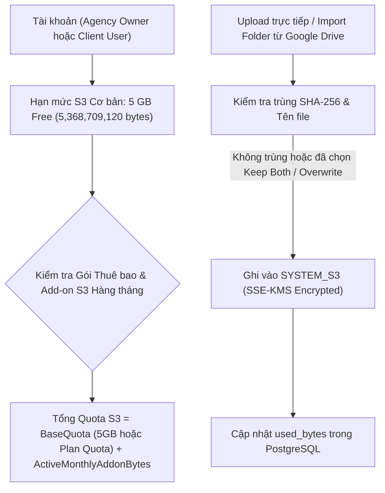
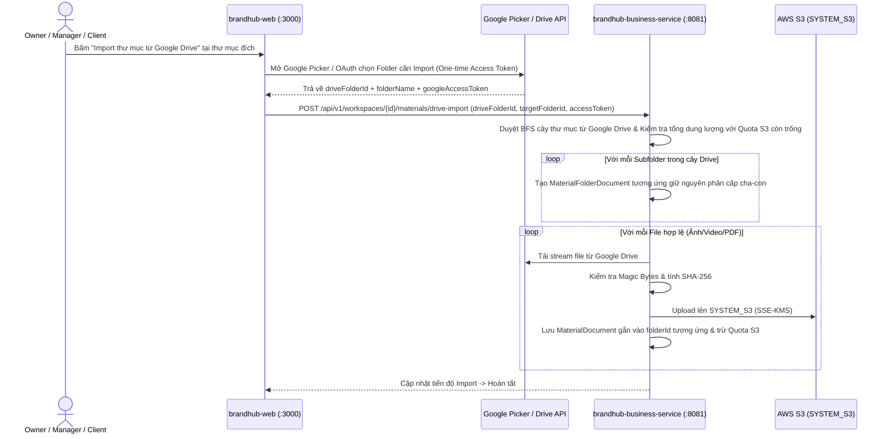
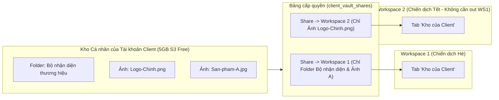
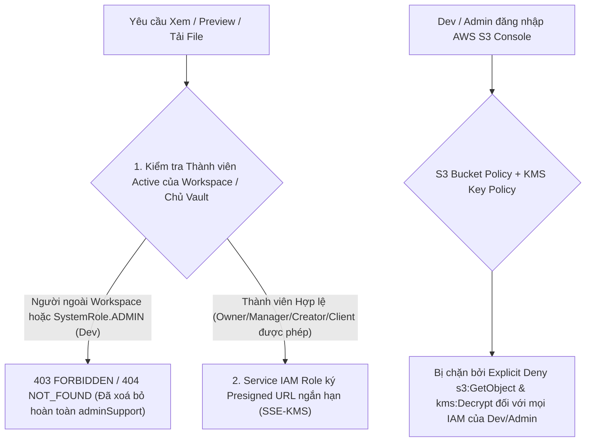

# Thiết kế & Đặc tả Kỹ thuật (Spec): Tái kiến trúc Kho Tài nguyên (Repository) — Lưu trữ S3 5GB Free, Cây Thư mục Đa cấp, Import Google Drive, Chống Trùng Ảnh/Tên File, Kho Riêng của Client & Bảo mật Chống Dev/Người ngoài Xem Ảnh

- **Ngày tạo**: 2026-11-04
- **Phạm vi dịch vụ**: `brandhub-business-service` (`:8081`), `brandhub-web` (`:3000`), `brandhub-infrastructure` (AWS S3 & KMS Policy)
- **Quy mô công việc (Size)**: **Project** (Thay đổi lớn liên thông Mô hình Lưu trữ, Cơ sở dữ liệu PostgreSQL + MongoDB, Phân quyền Bảo mật và Giao diện Kho tài nguyên).
- **Phương án kỹ thuật được chọn**: **Phương án 1** — Lưu trữ mặc định và duy nhất trên `SYSTEM_S3` (5GB Free/tài khoản + thuê bao mua thêm S3 hàng tháng), tách collection `material_folders` cho cây thư mục nhiều cấp, định danh trùng nội dung bằng `SHA-256` kèm hộp thoại 3 lựa chọn (`Skip` / `Keep Both` / `Overwrite`), tách **Kho cá nhân của Client (`Client Personal Vault`)** liên kết đa Workspace qua bảng chia sẻ `client_vault_shares`, và bảo mật 2 lớp (Gỡ quyền `SystemRole.ADMIN`/`adminSupport` trong code + S3 Bucket Policy & KMS Policy chống Dev xem ảnh).

---

## 1. Bối cảnh & Mục tiêu (Intent & Why)

### 1.1. Vấn đề hiện tại
1. **Phụ thuộc vào Google Drive đồng bộ hai chiều (`USER_GDRIVE`) gây vướng xác minh quyền nhạy cảm của Google**:
   - Trước đây hệ thống ưu tiên lưu trực tiếp và đồng bộ định kỳ (`CustomerDriveSyncService`) với Google Drive của Owner bằng quyền rộng (`https://www.googleapis.com/auth/drive`), vốn đòi hỏi quy trình xét duyệt bảo mật khắt khe của Google mà dự án không xin cấp được.
   - Hạn mức S3 mặc định hiện tại trong [`StorageQuotaService.java`](file:///D:/capstone/brandhub/brandhub-business-service/src/main/java/com/brandhub/business/service/material/StorageQuotaService.java) chỉ có `2 GB` (`BASIC_BYTES = 2_147_483_648L`).
2. **Kho tài nguyên phẳng, thiếu tổ chức thư mục và thiếu sắp xếp theo Tên**:
   - [`MaterialDocument.java`](file:///D:/capstone/brandhub/brandhub-business-service/src/main/java/com/brandhub/business/document/MaterialDocument.java) chưa hỗ trợ thư mục (`folderId`), người dùng không thể tạo cây thư mục nhiều cấp (nested folders) hoặc import cả một cây thư mục từ Google Drive vào quản lý như Drive.
   - Bộ lọc sắp xếp trong [`MaterialListRequest.java`](file:///D:/capstone/brandhub/brandhub-business-service/src/main/java/com/brandhub/business/dto/request/MaterialListRequest.java) mới chỉ có `newest` và `oldest`, thiếu sắp xếp theo Tên (`A → Z`, `Z → A`) và giao diện chưa phân tầng rõ ràng giữa khu vực `--- folder` và `--- file`.
3. **Chưa kiểm soát trùng lặp ảnh và trùng tên file**:
   - Khi người dùng tải lên cùng một bức ảnh nhiều lần hoặc tải file trùng tên trong cùng một thư mục, hệ thống chưa phát hiện để hỏi người dùng (**Bỏ qua / Giữ cả hai / Ghi đè**), dẫn đến lãng phí dung lượng S3 và rối loạn tên file.
4. **Tài nguyên của Client bị khoá cứng trong một Workspace**:
   - Khi tài khoản `CLIENT` làm việc ở nhiều Workspace (hoặc chuyển sang chiến dịch/Workspace mới mà không rời Workspace cũ), các tài nguyên họ từng gửi không có kho riêng để tái sử dụng, buộc phải tải lên lại và tốn nhân đôi dung lượng S3.
5. **Rủi ro lộ lọt hình ảnh nội bộ cho người ngoài Workspace hoặc Dev/Admin hệ thống**:
   - Trong [`MaterialAccessPolicy.java`](file:///D:/capstone/brandhub/brandhub-business-service/src/main/java/com/brandhub/business/service/material/MaterialAccessPolicy.java#L51-L53), tài khoản có `SystemRole.ADMIN` (dev/support) vẫn được cấp cờ `adminSupport = true` để xem, preview và tải ảnh của bất kỳ Workspace nào. Ngoài ra trên AWS S3, nếu không khoá Bucket Policy và KMS, dev có quyền truy cập AWS Console vẫn mở xem trực tiếp được ảnh của khách hàng.

### 1.2. Mục tiêu (Goals)
1. **Kho S3 mặc định 5GB Free & Thuê bao mua thêm S3 hàng tháng**:
   - Ngừng sử dụng Google Drive của Owner làm nơi lưu trữ trực tiếp (`USER_GDRIVE`). Toàn bộ tài nguyên của Website lưu mặc định trên **AWS S3 (`SYSTEM_S3`)**.
   - Mỗi tài khoản (cả tài khoản **Agency Owner** lẫn tài khoản **Client cá nhân**) được cấp mặc định **5 GB Miễn phí** (`BASIC_BYTES = 5_368_709_120L`, tức $5 \times 1024^3$ bytes).
   - Khi dùng hết 5 GB Free, người dùng có thể nâng cấp gói thuê bao (`PLUS`, `ENTERPRISE`) hoặc **đăng ký thuê bao mua thêm dung lượng S3 theo tháng (Monthly Storage Add-on)** được cấu hình linh hoạt trong DB.
2. **Import 1 lần Folder từ Google Drive về Kho S3**:
   - Người dùng có thể chọn một Folder từ Google Drive của họ (sử dụng Google Picker API / OAuth đọc một lần khi người dùng chọn) để **Import toàn bộ cây thư mục con và file hợp lệ về thẳng S3**, tái tạo nguyên vẹn cấu trúc thư mục trong Repository và tính trực tiếp vào hạn mức S3 (bỏ hoàn toàn cơ chế đồng bộ định kỳ ngầm).
3. **Quản lý Cây Thư mục Đa cấp (Nested Folders) & Hiển thị Phân tầng + Sort**:
   - Hỗ trợ tạo thư mục nhiều cấp lồng nhau, đổi tên, di chuyển (move file/folder sang thư mục khác), xoá vào thùng rác và khôi phục đệ quy.
   - Bổ sung Sort theo **Thời gian** (`newest`, `oldest`) và **Tên** (`name_asc`, `name_desc` hỗ trợ chuẩn bảng chữ cái tiếng Việt).
   - Mặc định khi không chọn sort: hiển thị theo thời gian upload lên website (mới nhất trước). Khi có hoặc không có sort, giao diện luôn **phân tầng từ trên xuống dưới thành 2 khu vực tách biệt**:
     ```text
     --- folder
     folder 1, folder 2
     --- file
     file 1, file 2
     ```
4. **Xử lý Trùng Ảnh (Nội dung), Trùng Tên File & Quản lý Phiên bản File (File Versioning `v1, v2, v3...`)**:
   - Phát hiện trùng nội dung ảnh (bằng mã băm `SHA-256`) và trùng tên file (`normalizedName`) trong thư mục/kho hiện tại.
   - Khi phát hiện trùng, hệ thống hỏi người dùng với **3 lựa chọn**:
     - **Bỏ qua (`SKIP`)**: Huỷ tải file mới, giữ nguyên file hiện có.
     - **Giữ cả hai (`KEEP_BOTH`)**: Tạo bản ghi `MaterialDocument` mới với tên tự động đánh số `ten-file (1).png` và lưu thành object S3 độc lập.
     - **Ghi đè / Tạo phiên bản mới (`OVERWRITE`)**: Lưu trạng thái file hiện tại vào lịch sử phiên bản (`material_versions` — `v1, v2...`), nâng `versionNumber` hiện hành của `MaterialDocument` lên phiên bản mới (`v2, v3...`), giữ nguyên `materialId` để không gãy liên kết ở Post/Task. Người dùng có thể **xem lịch sử các version, tải xuống version cũ, khôi phục (restore) một version cũ làm bản hiện hành, hoặc xoá vĩnh viễn từng version cũ** để giải phóng dung lượng S3 (vì các version đang lưu trên S3 đều tính vào hạn mức S3, tạo động lực mua thêm gói S3 khi cần giữ nhiều lịch sử). Đồng thời vẫn giữ nguyên luồng phân nhánh sáng tạo `RAW -> RETOUCHED -> WATERMARKED`.
5. **Kho Cá nhân của Client (`Client Personal Vault`) & Tab "Kho của Client"**:
   - Mỗi tài khoản user đóng vai trò `CLIENT` có một **Kho cá nhân riêng trên S3** (5GB Free mặc định + mua thêm theo tháng).
   - Mọi file mà Client từng gửi/upload vào các Workspace trước đây đều nằm trong Kho cá nhân này.
   - Khi tham gia Workspace mới (không cần rời Workspace cũ), Client có thể chọn cấp quyền (share/mount) bất kỳ file hoặc folder nào từ Kho cá nhân của mình vào Workspace đó mà **không cần upload lại** và **không tốn nhân đôi dung lượng S3**.
   - Trong Repository của mỗi Workspace có tab/khu vực **"Kho của Client"**, **chỉ hiển thị đúng những file/folder mà Client đã bấm chọn cho phép đưa vào Workspace đó** để các thành viên trong Workspace lấy ra sử dụng ngay.
6. **Bảo mật Tuyệt đối: Người ngoài Workspace & Dev/Admin không xem được ảnh**:
   - **Tầng ứng dụng**: Gỡ bỏ hoàn toàn nhánh `SystemRole.ADMIN` / `adminSupport` trong `MaterialAccessPolicy` và `MaterialReadService`. Không một API nào cho phép Dev hay System Admin xem danh sách, xem chi tiết, preview hay tải ảnh của user trong Workspace. Người ngoài Workspace bị chặn tuyệt đối (`403/404`).
   - **Tầng hạ tầng S3 & KMS**: Bật S3 `Block Public Access`, mã hoá toàn bộ object bằng **AWS KMS Customer Managed Key (`SSE-KMS`)**, áp dụng **S3 Bucket Policy + KMS Key Policy** chỉ cho phép duy nhất IAM Role thực thi của service gọi `s3:GetObject` / `kms:Decrypt` và `Deny` tường minh mọi IAM User/Role của Dev/Admin trên AWS Console.

### 1.3. Phi mục tiêu (Non-Goals & Anti-Goals)
- **Không** duy trì đồng bộ 2 chiều hay quét ngầm định kỳ (`CustomerDriveSyncService`) với Google Drive của người dùng.
- **Không** tự động phơi bày toàn bộ Kho cá nhân của Client cho một Workspace nếu Client chưa chủ động chọn file/folder đó để chia sẻ vào Workspace.
- **Không** giữ lại bất kỳ backdoor hay header `X-Support-Ticket` nào cho phép Dev/Admin xem ảnh của khách hàng.

---

## 2. Các Phương án Kiến trúc Đã Cân nhắc (Approaches)

| Phương án | Mô tả | Ưu điểm | Nhược điểm / Đánh đổi | Quyết định |
| :--- | :--- | :--- | :--- | :--- |
| **Phương án 1 (Đã chọn)** | Tách collection `material_folders` + Định danh trùng bằng `SHA-256` + Kho cá nhân Client liên kết đa Workspace qua `client_vault_shares` + S3 `SSE-KMS` & Bucket Policy | - Tách bạch rõ khu vực `--- folder` và `--- file` kèm sort độc lập.<br>- Chia sẻ file từ Kho Client sang nhiều Workspace không nhân đôi dữ liệu S3 và luôn đồng bộ.<br>- Bảo mật kín từ code đến S3 mà vẫn giữ hiệu năng upload/streaming. | Cần thêm collection `material_folders`, `client_vault_shares` và cập nhật bộ lọc truy vấn. | **CHỌN** |
| **Phương án 2** | Gộp chung Folder và File vào cùng collection `materials` (`mediaKind = "FOLDER"`) | Ít collection hơn. | Làm bẩn `MaterialDocument`, dễ gây lỗi tính toán quota S3, watermark và khó phân trang riêng 2 tầng Folder/File. | Loại bỏ |
| **Phương án 3** | Nhân bản (`Clone`) bản ghi `MaterialDocument` mỗi khi Client chia sẻ sang Workspace mới | Giữ nguyên câu query `workspace_id` cũ. | Lệch dữ liệu khi Client đổi tên/xoá file; lỗi giải phóng dung lượng S3 khi 1 file vật lý bị trỏ bởi nhiều bản ghi độc lập. | Loại bỏ |

---

## 3. Thiết kế Chi tiết (Detailed Design)

### 3.1. Mô hình Lưu trữ S3 Mặc định 5GB Free & Thuê bao Mua thêm S3 Hàng tháng



1. **Cập nhật Hạn mức Cơ bản 5 GB (`StorageQuotaService.java`)**:
   - Đổi hằng số `BASIC_BYTES`:
     ```java
     public static final long BASIC_BYTES = 5_368_709_120L; // 5 GiB (5 * 1024 * 1024 * 1024 bytes)
     ```
   - Trong migration PostgreSQL của `billing_plan_versions`: cập nhật gói cơ bản (`BASIC` / `PERSONAL`) có `storage_limit_bytes = 5368709120`.
2. **Thuê bao Mua thêm Dung lượng S3 Hàng tháng (`storage_addon_plans` & `storage_addon_subscriptions`)**:
   - Cho phép cả **Agency Owner** (mua cho Agency) và **Client User** (mua cho Kho cá nhân Client) đăng ký gói mua thêm S3 theo chu kỳ hàng tháng (30 ngày) qua SePay.
   - **[Quyết định của User & Bảng giá ước tính mặc định trong DB]** (lưu trong bảng cấu hình `storage_addon_plans` để team dễ dàng chỉnh sửa sau mà không cần sửa code):
     | Mã gói (`code`) | Tên hiển thị | Dung lượng cộng thêm (`extra_bytes`) | Giá thuê bao tháng ước tính (`price_monthly` VND) |
     | :--- | :--- | :--- | :--- |
     | `S3_ADDON_25GB` | Gói mở rộng +25 GB S3 | `26,843,545,600` (25 GiB) | `49,000 VND / tháng` |
     | `S3_ADDON_100GB` | Gói mở rộng +100 GB S3 | `107,374,182,400` (100 GiB) | `149,000 VND / tháng` |
     | `S3_ADDON_500GB` | Gói mở rộng +500 GB S3 | `536,870,912,000` (500 GiB) | `499,000 VND / tháng` |
   - **[Quyết định kỹ thuật của Builder — Schema Thanh toán Đa đối tượng]**:
     - Mở rộng bảng `billing_orders` cho phép `agency_id` nullable khi `payer_scope = 'CLIENT_VAULT'` (ràng buộc `CHECK ((payer_scope = 'AGENCY' AND agency_id IS NOT NULL) OR (payer_scope = 'CLIENT_VAULT' AND user_id IS NOT NULL))`), tái sử dụng nguyên vẹn luồng tạo QR và webhook SePay hiện có.
     - Công thức tính `effectiveQuota`:
       ```java
       long baseQuota = paidPlanQuota != null ? paidPlanQuota : BASIC_BYTES; // tối thiểu 5 GB Free
       long activeAddonBytes = sumActiveStorageAddonSubscriptions(ownerScopeId); // các gói có status='ACTIVE' và current_period_end > now()
       long effectiveQuota = Math.addExact(baseQuota, activeAddonBytes);
       ```
     - Khi gói thuê bao S3 mua thêm hết hạn mà chưa gia hạn: dữ liệu đã tải lên **không bị mất**, nhưng nếu `used_bytes > effectiveQuota` thì kho chuyển sang chế độ **Chỉ đọc (Read-only)** — chặn upload mới cho tới khi gia hạn hoặc xoá bớt file.
3. **Ngắt luồng lưu trữ trực tiếp `USER_GDRIVE`**:
   - Mọi lượt tạo phiên tải lên mới (`StorageQuotaService.reserve`) luôn định tuyến vào `provider = "SYSTEM_S3"`.
   - Tắt hoàn toàn cronjob đồng bộ ngầm [`CustomerDriveSyncService.sync()`](file:///D:/capstone/brandhub/brandhub-business-service/src/main/java/com/brandhub/business/service/material/CustomerDriveSyncService.java).

---

### 3.2. Cây Thư mục Đa cấp (Nested Folders), Phân tầng Hiển thị & Sort

#### 3.2.1. Cấu trúc Collection `material_folders` (MongoDB)
Tạo document mới `MaterialFolderDocument` (`collection = "material_folders"`):
```java
@Document(collection = "material_folders")
public class MaterialFolderDocument {
    @Id
    private String id; // UUID string

    @Field("scope_type")
    private String scopeType; // "WORKSPACE" | "CLIENT_VAULT"

    @Field("workspace_id")
    private String workspaceId; // Có giá trị khi scopeType = "WORKSPACE"

    @Field("owner_user_id")
    private String ownerUserId; // Có giá trị khi scopeType = "CLIENT_VAULT" (Kho riêng của Client)

    private String name; // Tên hiển thị (ví dụ: "Chiến dịch Tết 2027")

    @Field("normalized_name")
    private String normalizedName; // Chuẩn hoá NFC + viết thường phục vụ tìm kiếm & chống trùng tên

    @Field("sort_key")
    private String sortKey; // Khoá Collation tiếng Việt phục vụ sort A-Z / Z-A chuẩn xác

    @Field("parent_folder_id")
    private String parentFolderId; // null nếu nằm ở thư mục gốc (Root)

    @Field("ancestor_ids")
    private List<String> ancestorIds; // Danh sách ID từ Root -> parentFolderId (tối đa 16 cấp) để dựng Breadcrumb & chống vòng lặp

    @Field("drive_source_folder_id")
    private String driveSourceFolderId; // Lưu ID folder Google Drive nếu được tạo từ luồng Import

    @Field("deleted_at")
    private Instant deletedAt;

    @Field("deleted_by")
    private String deletedBy;

    @Field("purge_after")
    private Instant purgeAfter;

    @Field("created_by")
    private String createdBy;

    @Field("created_at")
    private Instant createdAt;

    @Field("updated_at")
    private Instant updatedAt;
}
```
- **Index MongoDB**:
  - `{ scope_type: 1, workspace_id: 1, parent_folder_id: 1, deleted_at: 1, normalized_name: 1 }`
  - `{ scope_type: 1, owner_user_id: 1, parent_folder_id: 1, deleted_at: 1, normalized_name: 1 }`
  - `{ ancestor_ids: 1 }`

#### 3.2.2. Mở rộng `MaterialDocument`
Trong [`MaterialDocument.java`](file:///D:/capstone/brandhub/brandhub-business-service/src/main/java/com/brandhub/business/document/MaterialDocument.java), bổ sung các trường:
- `scopeType` (`"WORKSPACE"` | `"CLIENT_VAULT"` — mặc định `"WORKSPACE"` cho dữ liệu cũ của Agency; các file cũ do `CLIENT` upload được migrate sang `"CLIENT_VAULT"`)
- `ownerUserId` (`String` — ID của tài khoản Client sở hữu nếu `scopeType == "CLIENT_VAULT"`)
- `folderId` (`String`, nullable — `null` nghĩa là nằm ở Root)
- `ancestorFolderIds` (`List<String>` — hỗ trợ tìm kiếm, xoá đệ quy và kiểm tra quyền chia sẻ theo cây thư mục)
- `contentHash` (`String` — mã băm `SHA-256` hex chữ thường của nội dung file)
- `sortKey` (`String` — chuỗi chuẩn hoá phục vụ sắp xếp tên tiếng Việt)

#### 3.2.3. Các Thao tác Quản lý Thư mục (Folder Operations)
- **Tạo thư mục (`POST /folders`)**: Kiểm tra độ sâu tối đa (`<= 16` cấp). Nếu trùng `normalizedName` trong cùng `parentFolderId` (chưa xoá), trả lỗi `409 FOLDER_NAME_CONFLICT`.
- **Đổi tên thư mục (`PATCH /folders/{folderId}`)**: Cập nhật `name`, `normalizedName`, `sortKey` (kiểm tra không trùng tên với thư mục cùng cấp).
- **Di chuyển thư mục / file (`POST /folders/{folderId}/move`, `POST /materials/{materialId}/move`)**:
  - Chặn di chuyển một thư mục vào chính nó hoặc vào thư mục con của nó (`targetFolderId` không được nằm trong `ancestorIds` của `folderId`).
  - Cập nhật `parentFolderId` và tính lại mảng `ancestorIds` / `ancestorFolderIds` cho toàn bộ thư mục con và file bên trong.
- **Xoá thư mục (`DELETE /folders/{folderId}`)**:
  - Chuyển `deletedAt = now`, `purgeAfter = now + 30 days` cho thư mục đó và toàn bộ thư mục con + file bên trong (có `ancestorIds`/`ancestorFolderIds` chứa `folderId`). Khi khôi phục (`POST /folders/{folderId}/restore`), khôi phục lại toàn bộ cây con.

#### 3.2.4. Quy tắc Sắp xếp (Sort) & Hiển thị Phân tầng (`--- folder` / `--- file`)
- Mở rộng tham số `sort` trong [`MaterialListRequest.java`](file:///D:/capstone/brandhub/brandhub-business-service/src/main/java/com/brandhub/business/dto/request/MaterialListRequest.java):
  - `newest` *(Mặc định khi không truyền sort)*: Thời gian tải lên website mới nhất trước (`created_at DESC`).
  - `oldest`: Thời gian tải lên website cũ nhất trước (`created_at ASC`).
  - `name_asc`: Tên từ A → Z (`sort_key ASC, normalized_name ASC, created_at DESC`).
  - `name_desc`: Tên từ Z → A (`sort_key DESC, normalized_name DESC, created_at DESC`).
- **Cấu trúc hiển thị phân tầng bắt buộc trên UI & API**:
  - Tại mọi thư mục (Root hoặc thư mục con), giao diện luôn tách thành **2 tầng từ trên xuống dưới**:
    ```text
    --- folder
    folder 1, folder 2
    --- file
    file 1, file 2
    ```
    - **Tầng trên (`--- folder`)**: Danh sách các thư mục con trực tiếp (`parentFolderId == currentFolderId`), sắp xếp theo đúng tiêu chí `sort` đang chọn (mặc định theo thời gian tạo mới nhất).
    - **Tầng dưới (`--- file`)**: Danh sách các file trực tiếp (`folderId == currentFolderId`), sắp xếp theo đúng tiêu chí `sort` đang chọn (mặc định theo thời gian upload mới nhất).

---

### 3.3. Import Một Folder từ Google Drive vào Repository (Quản lý như Drive)



- **Đặc điểm cốt lõi**:
  - **Không cần xin quyền đồng bộ ngầm**: Chỉ đọc một lần tại thời điểm người dùng chọn folder để sao chép toàn bộ cây thư mục và file hợp lệ sang S3. Sau khi import xong, toàn bộ thư mục và file được quản lý trực tiếp trên Repository của website (đổi tên, di chuyển, xoá, tìm kiếm, sort) hoàn toàn độc lập với Google Drive.
  - **Tính thẳng vào 5GB S3 (+ gói mua thêm)**: Mọi file import về đều được kiểm tra và trừ trực tiếp vào hạn mức S3 của tài khoản.

---

### 3.4. Xử lý File Ảnh Bị Trùng (Nội dung) & Trùng Tên File

#### 3.4.1. Cơ chế Phát hiện Trùng lặp (Duplicate Detection)
Khi người dùng tải file lên một thư mục (`folderId`) trong Workspace hoặc Kho Client:
1. **Tính mã băm ở Client (`contentHash`)**: Trình duyệt sử dụng `crypto.subtle.digest('SHA-256', fileBuffer)` để tính mã `SHA-256` trước khi gọi tạo phiên upload (và Backend xác minh lại khi promote/confirm).
2. **Kiểm tra trước khi Upload (`POST /materials/upload-session`)**:
   - Kiểm tra trong phạm vi kho hiện tại (`workspaceId` hoặc `ownerUserId` của Kho Client, với `deletedAt == null`):
     - **Trùng tên file (`SAME_NAME`)**: Trong cùng thư mục đích (`folderId`), đã tồn tại một file có cùng `normalizedName`.
     - **Trùng nội dung ảnh (`SAME_IMAGE_CONTENT`)**: Đã tồn tại một bức ảnh có cùng mã băm `contentHash` (`SHA-256`) và `fileSize` (ưu tiên khớp file trùng nằm trong cùng `folderId` trước, nếu không có thì lấy file trùng gần nhất trong kho).
3. **Phản hồi khi có xung đột**:
   - Nếu phát hiện trùng và request đang để `conflictResolution = "ASK"` (mặc định), API trả về `409 MATERIAL_DUPLICATE_CONFLICT` kèm thông tin file đang có sẵn (`existingMaterialId`, `existingName`, `existingFolderId`, `existingFolderName`, `conflictType`: `SAME_NAME` | `SAME_IMAGE_CONTENT` | `BOTH`).

#### 3.4.2. Hộp thoại 3 Lựa chọn cho Người dùng (`conflictResolution`) & Quản lý Phiên bản File (File Versioning)
Trên giao diện Web, khi gặp xung đột, hiển thị modal hỏi người dùng với **3 lựa chọn**:
1. **Bỏ qua (`SKIP`)**:
   - Huỷ tải file mới lên S3, không tốn thêm dung lượng.
2. **Giữ cả hai (`KEEP_BOTH`)**:
   - **Cơ chế lưu vật lý khi chọn `KEEP_BOTH` (Tách thành 2 file độc lập)**:
     - Nếu trùng tên trong cùng `folderId`, tự động đánh số tên file mới thành `ten-file (1).png`, `ten-file (2).png`... (nếu chỉ trùng nội dung ảnh ở thư mục khác mà không trùng tên ở thư mục hiện tại thì giữ nguyên tên file mới).
     - Lưu thành một `MaterialDocument` mới với object S3 riêng và tính quota bình thường, đảm bảo khi người dùng xoá hoặc cập nhật 1 trong 2 file về sau sẽ không bao giờ làm hỏng file còn lại.
3. **Ghi đè / Tạo phiên bản mới (`OVERWRITE`) — Hệ thống Quản lý File Version (`v1, v2, v3...`)**:
   - **Cơ chế Lưu Lịch sử Phiên bản (`material_versions`)**:
     - Khi người dùng chọn **Ghi đè (`OVERWRITE`)** lên một file đã có (`existingMaterialId`), hệ thống **không xoá mất bản cũ ngay**, mà đẩy trạng thái hiện tại của `MaterialDocument` (bao gồm `s3Key` cũ, `fileSize` cũ, `contentHash` cũ, `mimeType` cũ, `versionNumber` cũ, `createdBy`, `createdAt`) sang một bản ghi trong collection `material_versions`.
     - Sau đó, cập nhật bản ghi `MaterialDocument` chính (`existingMaterialId`) trỏ tới `s3Key` của file mới vừa upload, nâng số hiệu phiên bản hiển thị `currentVersionNumber = currentVersionNumber + 1` (ví dụ từ `v1` lên `v2`), cập nhật `fileSize`, `contentHash`, `updatedAt = now`.
     - Giữ nguyên `materialId` để mọi bài đăng (`Post`), nhiệm vụ (`Task`) và các bản phái sinh (`RETOUCHED` / `WATERMARKED` có `parentMaterialId`) tự động nhận diện được file mà không bị gãy liên kết.
   - **Cách tính Dung lượng S3 cho File Version**:
     - Mỗi phiên bản lịch sử (`v1`, `v2`...) còn lưu giữ trên S3 đều là một object thực tế nên **được cộng vào tổng dung lượng S3 đang sử dụng (`used_bytes`)** của tài khoản (5GB Free + các gói mua thêm S3 hàng tháng).
     - Người dùng có thể mở bảng **"Lịch sử phiên bản" (`Version History`)** ngay trong trang Chi tiết File (`MaterialDetailPanel`) để:
       1. **Xem & Tải xuống** bất kỳ phiên bản cũ nào (`v1`, `v2`...).
       2. **Khôi phục (`Restore Version`)** một phiên bản cũ trở lại làm phiên bản hiện hành (`current`).
       3. **Xoá vĩnh viễn một phiên bản cũ (`Delete Version`)** để giải phóng ngay dung lượng S3 của phiên bản đó (`MaterialPurgeAccounting.release`). Khi xoá toàn bộ `MaterialDocument` và dọn sạch khỏi thùng rác, toàn bộ các version con trong `material_versions` cũng được xoá khỏi S3 và hoàn lại tổng dung lượng của tất cả các version.

#### 3.4.3. Cấu trúc Collection `material_versions` (MongoDB)
```java
@Document(collection = "material_versions")
public class MaterialVersionDocument {
    @Id
    private String id; // UUID string

    @Field("material_id")
    private String materialId; // ID của MaterialDocument gốc

    @Field("workspace_id")
    private String workspaceId;

    @Field("owner_user_id")
    private String ownerUserId; // Dùng khi thuộc CLIENT_VAULT

    @Field("version_number")
    private Integer versionNumber; // 1, 2, 3...

    @Field("s3_key")
    private String s3Key; // Key vật lý trên SYSTEM_S3 của phiên bản này

    @Field("storage_provider")
    private String storageProvider; // "SYSTEM_S3"

    @Field("file_size")
    private Long fileSize; // Dung lượng tính vào quota S3

    @Field("mime_type")
    private String mimeType;

    @Field("content_hash")
    private String contentHash; // SHA-256

    @Field("reservation_id")
    private String reservationId; // Liên kết với agency_storage_reservations / client_vault_reservations để giải phóng quota khi xoá version

    @Field("created_by")
    private String createdBy;

    @Field("created_at")
    private Instant createdAt;
}
```
- **So sánh rõ ràng 3 khái niệm Lưu trữ Vật lý trong Hệ thống**:
  | Trường hợp | Số `MaterialDocument` | Số Object trên S3 | Cách tính Quota S3 |
  | :--- | :--- | :--- | :--- |
  | **1. Chọn `Giữ cả hai (KEEP_BOTH)` khi trùng file** | **2 bản ghi riêng** (`anh.png` và `anh (1).png`) | **2 object độc lập** | Tính dung lượng cả 2 file (xoá file này không ảnh hưởng file kia) |
  | **2. Chọn `Ghi đè (OVERWRITE)` (File Versioning)** | **1 bản ghi duy nhất** (kèm lịch sử `v1, v2...` trong `material_versions`) | **Mỗi version là 1 object trên S3** | Tính tổng dung lượng các version đang giữ (xoá bớt version cũ sẽ trả lại dung lượng S3 ngay) |
  | **3. Chia sẻ file từ `Kho của Client` sang Workspace khác** | **1 bản ghi gốc duy nhất** trong `CLIENT_VAULT` (kèm liên kết ở `client_vault_shares`) | **Chỉ 1 object duy nhất** | **Chỉ tính 1 lần duy nhất** vào kho Client (chia sẻ sang 10 Workspace cũng tốn **0 byte** S3 phát sinh) |

---

### 3.5. Kho Riêng của Client (`Client Personal Vault`) & Tái sử dụng Đa Workspace



#### 3.5.1. Nguyên lý hoạt động & Quy tắc Quota
1. **[Quyết định kỹ thuật của Builder — Quyền sở hữu Quota & Lưu trữ của Client]**:
   - Mỗi tài khoản người dùng có vai trò `CLIENT` sở hữu một kho lưu trữ cá nhân (`scopeType = "CLIENT_VAULT"`, `ownerUserId = user.id`) với hạn mức mặc định **5 GB S3 Free** (quản lý trong bảng `client_vault_storage_usage` theo `user_id`).
   - Khi tài khoản `CLIENT` tải file lên (dù tải từ trang Kho cá nhân hay tải lên khi đang đứng trong một Workspace $W_1$), file được lưu vào `CLIENT_VAULT` của Client đó và **trừ vào hạn mức 5GB S3 của chính tài khoản Client đó**.
   - Nếu Client tải file lên khi đang ở trong Workspace $W_1$, hệ thống tự động tạo bản ghi cấp quyền trong `client_vault_shares` cho $W_1$ để file xuất hiện ngay trong tab **"Kho của Client"** của $W_1$ (và có thể đính kèm vào Task/Post trong $W_1$).
   - Các bản ghi `MaterialDocument` cũ do user có role `CLIENT` tải lên trước đây sẽ được tự động migrate sang `scopeType = "CLIENT_VAULT"`, `ownerUserId = createdBy` kèm bản ghi `client_vault_shares` cho `workspaceId` cũ để Client có thể tái sử dụng ngay ở Workspace mới.
2. **Tái sử dụng ở Workspace mới mà không cần rời Workspace cũ & không tốn nhân đôi S3**:
   - Khi Client tham gia thêm Workspace $W_2$ (không cần rời $W_1$), tại tab **"Kho của Client"** của $W_2$, Client bấm **"Chọn từ Kho cá nhân của tôi" (`Share from My Vault`)** và tick chọn những file hoặc folder đã từng tải lên ở $W_1$ (hoặc trong kho riêng).
   - Hệ thống tạo bản ghi `client_vault_shares` liên kết `resourceId` (`FOLDER` hoặc `MATERIAL`) với `workspaceId = W_2`.
   - **Không nhân bản file trên S3, không tốn thêm 1 byte dung lượng S3 nào**.
3. **Hiển thị theo sự cho phép (Strict Opt-in)**:
   - Tab **"Kho của Client"** ở mỗi Workspace **chỉ hiển thị đúng những file/folder mà Client đã bấm chọn cho phép đưa vào Workspace đó**.
   - Nếu Client thu hồi quyền chia sẻ (`DELETE /shares/{shareId}`) ở một Workspace, Workspace đó không còn nhìn thấy file/folder đó nữa trong tab **"Kho của Client"**, trong khi file gốc trong Kho cá nhân của Client và ở các Workspace khác vẫn nguyên vẹn.

#### 3.5.2. Cấu trúc Collection `client_vault_shares` (MongoDB)
```java
@Document(collection = "client_vault_shares")
public class ClientVaultShareDocument {
    @Id
    private String id;

    @Field("owner_user_id")
    private String ownerUserId; // Tài khoản Client sở hữu tài nguyên

    @Field("workspace_id")
    private String workspaceId; // Workspace được cấp quyền xem & sử dụng

    @Field("client_profile_id")
    private String clientProfileId; // Hồ sơ Client tương ứng trong Workspace đó

    @Field("resource_type")
    private String resourceType; // "FOLDER" | "MATERIAL"

    @Field("resource_id")
    private String resourceId; // ID của MaterialFolderDocument hoặc MaterialDocument

    @Field("shared_at")
    private Instant sharedAt;

    @Field("shared_by")
    private String sharedBy;
}
```

---

### 3.6. Bảo mật File: Chặn Người ngoài Workspace & Chặn Dev/Admin Hệ thống Xem Ảnh



#### Lớp 1: Gỡ bỏ hoàn toàn quyền truy cập của `SystemRole.ADMIN` / Dev trong Code (`MaterialAccessPolicy.java`)
1. Trong [`MaterialAccessPolicy.java`](file:///D:/capstone/brandhub/brandhub-business-service/src/main/java/com/brandhub/business/service/material/MaterialAccessPolicy.java):
   - **Xoá bỏ hoàn toàn** nhánh kiểm tra `SystemRole.ADMIN` và cờ `adminSupport`:
     ```java
     // XOÁ BỎ HOÀN TOÀN:
     if (systemRoles.findByUserId(actor.getId()).map(value -> value.getSystemRole() == SystemRole.ADMIN).orElse(false)) { ... }
     ```
   - Xoá bỏ `MaterialSupportTicketPolicy`, header `X-Support-Ticket` và các hàm audit `adminSupport` trong `MaterialController`, `MaterialReadService`, `MaterialTrashService`.
   - Quy tắc cứng: Chỉ thành viên đang `ACTIVE` của chính Workspace đó (hoặc Agency Owner của Workspace đó, hoặc chính chủ `ownerUserId` của Kho Client) mới có quyền liệt kê, xem chi tiết, preview hoặc tải file. Mọi tài khoản người ngoài Workspace hoặc Dev/System Admin đều bị từ chối với `403 WORKSPACE_ACCESS_DENIED` / `404 MATERIAL_NOT_FOUND`.

#### Lớp 2: Cấu hình S3 Bucket Policy + Mã hoá AWS KMS (`SSE-KMS`) Chặn Dev Xem Ảnh trên AWS Console
**[Quyết định kỹ thuật của Builder — Sử dụng `SSE-KMS` kết hợp S3 Bucket Policy & KMS Key Policy]**:
Để đảm bảo Dev vào AWS S3 Console cũng không mở xem được ảnh của người dùng, đồng thời vẫn giữ nguyên hiệu năng `Presigned PUT`, `CopyObject`, tua video `HTTP Range` (tới 200MB) và cho phép `brandhub-publisher-service` đăng ảnh/video lên Facebook/Instagram/TikTok:
1. **Mã hoá `SSE-KMS` bắt buộc cho mọi Object**:
   - Cấu hình `StorageClientRouter` đính kèm `ServerSideEncryption.AWS_KMS` (`ssekmsKeyId = repository.storage.system-s3.kms-key-id`) khi upload/copy object trên S3, kèm Encryption Context `workspace_id` / `owner_user_id`.
2. **S3 Bucket Policy & KMS Key Policy bằng Terraform khoá chặt quyền đọc của Dev/Admin**:
   - Triển khai qua bộ module **Terraform** chuẩn tại [`brandhub-infrastructure/prod/terraform/4. repository-s3-prod/`](file:///D:/capstone/brandhub/brandhub-infrastructure/prod/terraform/4.%20repository-s3-prod) (`providers.tf`, `variables.tf`, `kms.tf`, `s3.tf`, `iam-service-policy.tf`, `outputs.tf`, `terraform.tfvars`):
     - `aws_s3_bucket_public_access_block`: Bật `block_public_acls = true`, `ignore_public_acls = true`, `block_public_policy = true`, `restrict_public_buckets = true`.
     - `aws_kms_key.repository_media` (`kms.tf`): Tách biệt quyền Quản trị Key (`AllowKeyAdministrationWithoutDataDecrypt` cho root/admin mà không cấp `kms:Decrypt`) và quyền Mã hoá/Giải mã dữ liệu (`AllowRuntimeServiceRoleCryptographicOperations` chỉ cho `brandhub-ec2-ecr-pull` / service IAM Role), kèm mệnh đề `DenyHumanDevAndAdminFromDecryptingUserMedia` chặn `kms:Decrypt` với mọi IAM User/Role khác.
     - `aws_s3_bucket_policy.repository` (`s3.tf`): Đặt mệnh đề `DenyHumanDevAndAdminFromReadingUserRepositoryMedia` (`Effect: "Deny"`, `Action: ["s3:GetObject", "s3:GetObjectVersion"]`) trên `repository/*`, `staging/*`, `client-vault/*` cho mọi Principal có `aws:PrincipalArn != runtime_service_role_arn` (kể cả IAM User của Dev hay tài khoản Admin vào AWS Console cũng bị từ chối `AccessDenied` khi cố bấm mở hoặc tải file).
3. **Presigned URL ngắn hạn & Riêng tư**:
   - Link preview và download chỉ được ký bởi IAM Role của `brandhub-business-service` sau khi đã vượt qua `MaterialAccessPolicy` (TTL tối đa 120–300 giây, kèm header `Cache-Control: private, no-store`).

---

### 3.7. Đặc tả API (REST Endpoints)

#### 3.7.1. API Thư mục & Duyệt Kho Phân tầng (`--- folder` / `--- file`)
- `GET /api/v1/workspaces/{workspaceId}/materials/browser`
  - **Query params**: `folderId` (nullable, mặc định Root), `tab` (`LIBRARY` | `CLIENT_VAULT` | `AI_DRAFTS` | `TRASH`), `sort` (`newest` | `oldest` | `name_asc` | `name_desc`, mặc định `newest`), `search`, `mediaKind`, `type`, `purpose`, `clientProfileId`, `page`, `size`.
  - **Response**:
    ```json
    {
      "currentFolder": { "id": "...", "name": "Chiến dịch Hè", "parentFolderId": null },
      "breadcrumbs": [{ "id": "...", "name": "Chiến dịch Hè" }],
      "folders": [
        { "id": "f1", "name": "Folder 1", "createdAt": "...", "updatedAt": "...", "itemCount": 12 }
      ],
      "files": {
        "items": [ ...MaterialResponse ],
        "meta": { "page": 0, "size": 20, "total": 45 }
      }
    }
    ```
- `POST /api/v1/workspaces/{workspaceId}/materials/folders`: Tạo thư mục mới (`{ name, parentFolderId }`).
- `PATCH /api/v1/workspaces/{workspaceId}/materials/folders/{folderId}`: Đổi tên thư mục (`{ name }`).
- `POST /api/v1/workspaces/{workspaceId}/materials/folders/{folderId}/move`: Di chuyển thư mục (`{ targetParentFolderId }`).
- `DELETE /api/v1/workspaces/{workspaceId}/materials/folders/{folderId}`: Xoá thư mục vào thùng rác.
- `POST /api/v1/workspaces/{workspaceId}/materials/folders/{folderId}/restore`: Khôi phục thư mục từ thùng rác.
- `POST /api/v1/workspaces/{workspaceId}/materials/{materialId}/move`: Di chuyển file sang thư mục khác (`{ targetFolderId }`).

#### 3.7.2. API Kiểm tra & Giải quyết Trùng Ảnh / Trùng Tên File & Quản lý Phiên bản (File Versioning)
- `POST /api/v1/workspaces/{workspaceId}/materials/upload-session`
  - Mở rộng `CreateUploadSessionRequest` thêm:
    - `folderId` (`String`, nullable)
    - `contentHash` (`String`, SHA-256 hex)
    - `conflictResolution` (`"ASK"` | `"SKIP"` | `"KEEP_BOTH"` | `"OVERWRITE"`, mặc định `"ASK"`)
    - `overwriteMaterialId` (`String`, nullable)
  - Nếu `conflictResolution == "ASK"` và phát hiện trùng `contentHash` hoặc trùng tên trong `folderId`, trả về HTTP `409 Conflict` (`errorCode = "MATERIAL_DUPLICATE_CONFLICT"`) kèm chi tiết file trùng để UI hiển thị hộp thoại 3 nút (**Bỏ qua / Giữ cả hai / Ghi đè tạo version mới**).
- `GET /api/v1/workspaces/{workspaceId}/materials/{materialId}/versions`: Lấy danh sách lịch sử các phiên bản (`v1, v2, v3...`) của file (kèm dung lượng, người tải lên, thời gian).
- `POST /api/v1/workspaces/{workspaceId}/materials/{materialId}/versions/{versionId}/restore`: Khôi phục một phiên bản cũ làm phiên bản hiện hành của file.
- `POST /api/v1/workspaces/{workspaceId}/materials/{materialId}/versions/{versionId}/download`: Tải xuống một phiên bản cụ thể trong lịch sử.
- `DELETE /api/v1/workspaces/{workspaceId}/materials/{materialId}/versions/{versionId}`: Xoá vĩnh viễn một phiên bản cũ khỏi S3 và giải phóng ngay dung lượng S3 tương ứng.

#### 3.7.3. API Import Thư mục từ Google Drive
- `POST /api/v1/workspaces/{workspaceId}/materials/drive-import`
  - **Body**: `{ "driveFolderId": "...", "googleAccessToken": "...", "targetFolderId": null, "conflictResolution": "KEEP_BOTH" }`
  - **Response**: `{ "jobId": "...", "status": "RUNNING", "totalFiles": 24, "importedFiles": 0 }`
- `GET /api/v1/workspaces/{workspaceId}/materials/drive-import/{jobId}`: Lấy trạng thái tiến trình import.

#### 3.7.4. API Kho Cá nhân của Client (`Client Personal Vault`) & Chia sẻ vào Workspace
- `GET /api/v1/client-vault/browser`: Duyệt cây thư mục và file trong Kho cá nhân của tài khoản Client (phân tầng `folders` và `files`, hỗ trợ sort `newest`, `oldest`, `name_asc`, `name_desc`).
- `GET /api/v1/client-vault/storage-usage`: Xem dung lượng đã dùng trên hạn mức 5GB S3 Free (+ dung lượng mua thêm hàng tháng) của Client.
- `POST /api/v1/client-vault/folders`, `PATCH /api/v1/client-vault/folders/{id}`, `DELETE /api/v1/client-vault/folders/{id}`: Quản lý thư mục trong Kho cá nhân Client.
- `POST /api/v1/workspaces/{workspaceId}/client-vault/shares`: Client bấm chọn danh sách `folderIds` / `materialIds` từ Kho cá nhân của mình để cho phép hiển thị trong tab **"Kho của Client"** của `workspaceId`.
- `DELETE /api/v1/workspaces/{workspaceId}/client-vault/shares/{shareId}`: Client thu hồi quyền hiển thị file/folder khỏi `workspaceId`.

#### 3.7.5. API Thuê bao Mua thêm Dung lượng S3 Hàng tháng
- `GET /api/v1/storage/addons`: Danh sách các gói thuê bao mua thêm dung lượng S3 hàng tháng (`+25 GB`, `+100 GB`, `+500 GB`).
- `POST /api/v1/storage/addons/checkout`: Tạo đơn đăng ký/gia hạn gói dung lượng S3 theo tháng cho Agency hoặc tài khoản Client.

---

### 3.8. Thiết kế Giao diện Người dùng (`brandhub-web`)

1. **Thanh Điều hướng & Tabs trong Kho Tài nguyên (`/workspaces/:id/library`)**:
   - **Kho tài liệu Workspace (`active`)**: Chứa cây thư mục và file của Workspace.
   - **Kho của Client (`client-vault`)**: Chỉ hiển thị các thư mục và file mà Client đã chọn cấp quyền cho Workspace này. Nếu người dùng đang đăng nhập là `CLIENT`, có nút **"Chọn file/thư mục từ Kho cá nhân của tôi"** (mở modal duyệt Kho cá nhân của Client để tick chọn đưa vào Workspace ngay mà không cần upload lại).
   - **Bản nháp AI (`drafts`)** & **Thùng rác (`trash`)**.
2. **Thanh Công cụ (`MaterialToolbar.tsx`)**:
   - Đường dẫn **Breadcrumb** (`Kho tài liệu > Chiến dịch Tết > Ảnh sản phẩm`) cho phép bấm quay lại bất kỳ cấp thư mục cha nào.
   - Nút **"+ Tạo thư mục"** và nút **"Import Folder từ Google Drive"** (thay thế hoàn toàn thẻ kết nối đồng bộ Drive cũ).
   - Bộ chọn **Sắp xếp (Sort)**:
     - `Mới nhất (Mặc định)` (`newest`)
     - `Cũ nhất` (`oldest`)
     - `Tên: A → Z` (`name_asc`)
     - `Tên: Z → A` (`name_desc`)
   - Thanh hiển thị dung lượng S3: `Đã dùng X GB / 5.0 GB (S3)` kèm nút **"Mua thêm dung lượng S3"** khi sắp đầy hoặc đã hết.
3. **Bố cục Phân tầng Thư mục & Tệp tin**:
   - Tầng trên (`--- Thư mục`): Lưới các thẻ Folder (`folder 1, folder 2...`), hiển thị icon thư mục, tên thư mục, menu Đổi tên / Di chuyển / Xoá. Bấm vào thẻ để đi vào thư mục con.
   - Tầng dưới (`--- Tệp tin`): Lưới các thẻ File (`file 1, file 2...`) nằm trong thư mục hiện tại, bổ sung hành động **Di chuyển tới thư mục...**.
4. **Modal Xử lý Trùng File (`DuplicateResolutionModal.tsx`) & Bảng Lịch sử Phiên bản (`MaterialVersionHistoryPanel.tsx`)**:
   - Khi tải lên file bị trùng ảnh (`SHA-256`) hoặc trùng tên trong thư mục hiện tại, hiển thị rõ file đang có sẵn và 3 nút hành động: **Bỏ qua**, **Giữ cả hai (`tên (1).ext`)**, **Ghi đè (Lưu thành version mới `v2, v3...`)**.
   - Trong trang Chi tiết File (`MaterialDetailPanel`), hiển thị huy hiệu phiên bản hiện tại (ví dụ `v2`) và danh sách **Lịch sử phiên bản** cho phép bấm **Tải xuống**, **Khôi phục về bản này**, hoặc **Xoá bớt bản cũ để giải phóng S3**.

---

## 4. Những phần để Builder quyết định khi triển khai (Left to the Builder)
- Chi tiết cấu hình kích thước chunk/buffer khi stream file từ Google Drive sang S3 trong `DriveFolderImportService` (đảm bảo không tràn bộ nhớ heap với file video lớn tới 200MB).
- Cách tổ chức migration SQL đánh số phiên bản tiếp theo trong `brandhub-business-service` cho bảng `storage_addon_plans`, `storage_addon_subscriptions` và `client_vault_storage_usage`.
- Thiết kế giao diện chi tiết của modal chọn file từ Kho cá nhân Client và modal tiến trình Import Google Drive, tuân thủ hệ thống component Shadcn/Tailwind sẵn có của `brandhub-web`.
