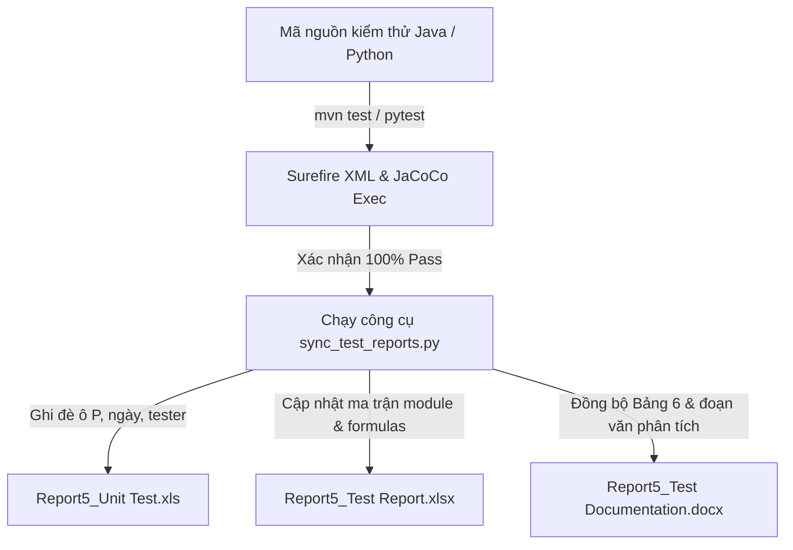

# BrandHub - Quy Trình Kiểm Thử & Đồng Bộ Báo Cáo Report 5

Tài liệu này hướng dẫn chi tiết quy trình kiểm thử tự động, chuẩn hóa mã nguồn test và cách sử dụng công cụ tự động hóa để đồng bộ kết quả vào bộ 3 tài liệu nghiệm thu Report 5 của đồ án tốt nghiệp:
1. **`Report5_Unit Test.xls`** *(Unit Test Cases & Execution Matrix)*
2. **`Report5_Test Report.xlsx`** *(System / Integration Test Report)*
3. **`Report5_Test Documentation.docx`** *(Báo cáo kiểm thử tổng hợp)*

---

## 1. Cơ Chế Hoạt Động



- **Mặc định:** Khi chạy lệnh kiểm thử `mvn test` hoặc `pytest`, hệ thống sinh báo cáo kỹ thuật ở thư mục `target/surefire-reports` và `jacoco.exec`. Các công cụ này **không tự động ghi đè** vào các file Excel/Word nghiệm thu đồ án vì các file báo cáo có cấu trúc ma trận kiểm thử đặc thù (Normal / Abnormal / Boundary matrix).
- **Giải pháp tự động hóa:** Bộ công cụ `FormReportDA/scripts/sync_test_reports.py` đóng vai trò cầu nối: đọc danh sách FR đã hoàn thiện, tự động đánh dấu `Passed (P)`, cập nhật tên Tester, ngày thực thi, tính lại toàn bộ tỷ lệ % Test Coverage, và đồng bộ tự động số liệu vào Bảng 6 của file Word.

---

## 2. Quy Trình 4 Bước Chuẩn

### Bước 1: Viết Mã Nguồn & Ca Kiểm Thử (Unit / Integration Test)
Khi thêm mới hoặc chỉnh sửa tính năng:
1. **Thư mục Backend Java:** `brandhub-business-service/src/test/java/com/brandhub/business/`
   - `service/*ServiceImplTest.java`: Viết Unit Test cho tầng nghiệp vụ (Service layer) sử dụng JUnit 5 + Mockito.
   - `controller/*ControllerTest.java`: Viết Integration Test cho tầng API Endpoint sử dụng Spring `@WebMvcTest` hoặc `@SpringBootTest`.
2. **Tiêu chuẩn thiết kế ca kiểm thử:**
   - **Normal Case (Ca thông thường / Happy Path):** Dữ liệu hợp lệ, trả về mã HTTP 200/201, dữ liệu mong đợi.
   - **Abnormal Case (Ca bất thường / Ngoại lệ):** Sai thông tin xác thực (401/403), vi phạm ràng buộc dữ liệu (400), tài nguyên không tồn tại (404), trùng lặp dữ liệu (409).
   - **Boundary Case (Ca biên):** Chuỗi rỗng, độ dài tối đa cho phép, phân trang trang đầu/cuối, giới hạn số lượng.

---

### Bước 2: Chạy Kiểm Thử Xác Nhận (Verification)
Mở terminal tại thư mục service tương ứng để chạy kiểm thử:

#### 1. Backend Spring Boot 3 (`brandhub-business-service`):
```bash
# Chạy toàn bộ test của service:
mvn test

# Hoặc chỉ chạy kiểm thử cho các class bạn vừa sửa để tiết kiệm thời gian:
mvn test '-Dtest=MailTemplateServiceImplTest,AgencyServiceImplTest'
```

#### 2. AI Service Python (`brandhub-ai-service`):
```bash
pytest tests/unit/
```

> **Lưu ý:** Chỉ chuyển sang Bước 3 khi màn hình hiển thị:
> `Tests run: X, Failures: 0, Errors: 0, Skipped: 0` và `BUILD SUCCESS`.

---

### Bước 3: Chạy Script Tự Động Đồng Bộ Vào Bộ 3 File Báo Cáo
Mở terminal tại thư mục gốc dự án (`d:\ProjectCode\BrandHub`) và sử dụng script `brandhub-infrastructure/final_report/scripts/sync_test_reports.py`.

#### Kịch bản 3.1: Cập nhật cho toàn bộ 32 FR của Trung
```bash
python brandhub-infrastructure/final_report/scripts/sync_test_reports.py --author Trung
```
*Script sẽ tự động:*
- Quét qua 32 sheet FR của Trung (Module Profile 3.3.1–3.3.4, Agency & Workspace 3.4.1–3.4.21, Mail Template & Watermark 3.6.10, 3.6.15, 3.6.28–3.6.32).
- Điền `Executed By = Trung`, đánh dấu `P` cho toàn bộ các cột `UTCID`, cập nhật ngày hôm nay.
- Tính toán lại toàn bộ sheet `Statistics` trong `Report5_Unit Test.xls` (751 Passed).
- Làm mới sheet `Test Statistics` trong `Report5_Test Report.xlsx`.
- Đồng bộ lại Bảng 6 và đoạn văn phân tích trong `Report5_Test Documentation.docx`.

#### Kịch bản 3.2: Cập nhật cho tính năng mới của thành viên khác (khi dự án hoàn thiện dần)
Khi bạn Lộc, Phước, Tuấn hoặc Ân hoàn thành thêm các FR mới:
```bash
# Ví dụ cập nhật các FR 3.5.1, 3.5.2, 3.5.3 do bạn Lộc test:
python brandhub-infrastructure/final_report/scripts/sync_test_reports.py --frs 3.5.1,3.5.2,3.5.3 --tester Loc

# Ví dụ cập nhật các FR Publishing do bạn Phước test:
python brandhub-infrastructure/final_report/scripts/sync_test_reports.py --frs 3.8.1,3.8.2,3.8.3 --tester Phuoc
```

#### Kịch bản 3.3: Chỉ cần làm mới và tính toán lại công thức / thống kê
```bash
python brandhub-infrastructure/final_report/scripts/sync_test_reports.py --sync-all
```

---

### Bước 4: Kiểm Tra Nhanh & Commit Lên Git
1. Mở file [Report5_Unit Test.xls](file:///d:/ProjectCode/BrandHub/brandhub-infrastructure/final_report/Report5_Unit%20Test.xls) và [Report5_Test Report.xlsx](file:///d:/ProjectCode/BrandHub/brandhub-infrastructure/final_report/Report5_Test%20Report.xlsx) kiểm tra sheet `Statistics` để xác nhận số ca Passed và tỷ lệ % Coverage đã tăng lên.
2. Commit lên Git để lưu trữ lịch sử:
```bash
git add brandhub-infrastructure/final_report/
git commit -m "test: execute unit tests and sync Report 5 test reports"
git push
```

---

## 3. Bảng Tham Chiếu Phân Công FR & Test Scope

| Thành viên | Trách nhiệm kiểm thử chính trong đồ án | Số FR | Trạng thái Unit Test |
| :--- | :--- | :---: | :---: |
| **Trung** *(Test Lead)* | **Authentication** (3.2.1–3.2.9), **Profile** (3.3.1–3.3.4), **Agency & Workspace** (3.4.1–3.4.21), **Content & Task** (3.6.10, 3.6.15, 3.6.28–3.6.32), Tổng hợp Report 5 | **32 FR** | **751 / 751 Passed (100%)** |
| **Lộc** | Media Package (3.5.1–3.5.10), Content (3.6.1–3.6.3, 3.6.36), AI Template (3.7.4, 3.7.5) | ~16 FR | Sẽ thực thi các sprint tiếp theo |
| **Phước** | Content Approval (3.6.4–3.6.9, 3.6.22–3.6.27), Publishing (3.8.1–3.8.16) | ~28 FR | Sẽ thực thi các sprint tiếp theo |
| **Tuấn** | Material & Hashtag (3.6.11–3.6.21, 3.6.33–3.6.35), Billing (3.9.1–3.9.7), Admin Health (3.10.3) | ~20 FR | Sẽ thực thi các sprint tiếp theo |
| **Ân** | AI Trending & Video (3.7.1–3.7.3, 3.7.6–3.7.12), Admin Management (3.10.1–3.10.12) | ~20 FR | Sẽ thực thi các sprint tiếp theo |

---

## 4. Xử Lý Các Vấn Đề Thường Gặp (Troubleshooting)

1. **Lỗi `Permission denied` hoặc file đang bị khóa khi chạy script:**
   - **Nguyên nhân:** File Excel hoặc Word đang mở bởi một ứng dụng khác.
   - **Khắc phục:** Đóng các cửa sổ Excel và Word trước khi chạy script.
2. **Lỗi `win32com.client` không tìm thấy Excel:**
   - **Nguyên nhân:** Máy tính chưa cài đặt Microsoft Excel hoặc thiếu thư viện `pywin32`.
   - **Khắc phục:** Chạy `pip install pywin32 openpyxl xlrd xlwt python-docx`.
3. **Thêm test case mới vào file Excel:**
   - Khi thêm một cột test case mới (`UTCID19`, `UTCID20`...), hãy đảm bảo mã test case bắt đầu bằng chữ `UTC` ở dòng 9. Script sẽ tự động nhận diện số lượng test case mà không cần chỉnh sửa code Python.
