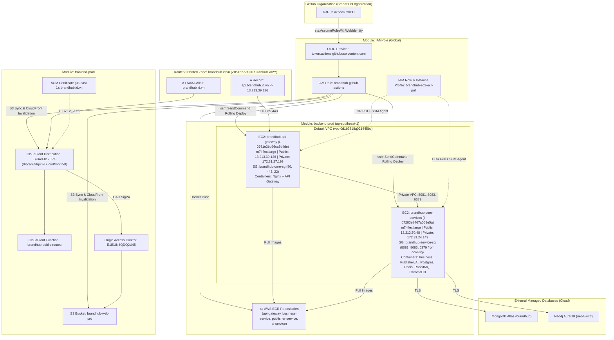

# BrandHub AWS Production Infrastructure (Terraform)

Thư mục này quản lý toàn bộ hạ tầng AWS Production đang chạy thực tế của hệ thống **BrandHub** (AWS Account `821014378805`, Region chính `ap-southeast-1` + `us-east-1` cho CloudFront ACM), được chia thành 3 module độc lập và đã đồng bộ 100% với Terraform State (`No changes`):

```text
terraform/
├── 1. IAM-role/      # Quản lý GitHub OIDC Provider, IAM Role cho CI/CD (FE + BE) & IAM Role/Instance Profile cho EC2
├── 2. frontend-prod/ # Quản lý S3 (brandhub-web-prd), CloudFront Distribution + OAC + Function, ACM SSL & Route53 brandhub.id.vn
└── 3. backend-prod/  # Quản lý 2 máy chủ EC2 (API Gateway + Core Services), Security Groups, 4 ECR Repositories & Route53 api.brandhub.id.vn
```

---

## 1. Sơ đồ Kiến trúc Triển khai (Architecture Topology)



---

## 2. Chi tiết 3 Module Terraform

### 2.1. [`1. IAM-role/`](./1.%20IAM-role) — Xác thực OIDC & Phân quyền Deploy (8 resources)
| Resource | Tên trên AWS | Chức năng |
| :--- | :--- | :--- |
| `aws_iam_openid_connect_provider.github_actions` | `token.actions.githubusercontent.com` | Xác thực OIDC cho GitHub Actions (không dùng static key). |
| `aws_iam_role.github_actions` | `brandhub-github-actions` | Role cho toàn bộ repo trong `BrandHubOrganization/*`. |
| `aws_iam_role_policy.github_actions_frontend` | `brandhub-github-actions-policy` | Cho phép upload S3 `brandhub-web-prd` và xóa cache CloudFront. |
| `aws_iam_role_policy.github_actions_backend_cicd` | `brandhub-github-actions-ecr-ssm` | Cho phép push ảnh lên 4 ECR repos và gửi lệnh deploy qua AWS SSM tới 2 EC2. |
| `aws_iam_role.ec2_ecr_pull` | `brandhub-ec2-ecr-pull` | Role gắn vào 2 máy chủ EC2. |
| `aws_iam_role_policy.ec2_ecr_pull` | `brandhub-images-read` | Cho phép EC2 pull image từ 4 ECR repos của BrandHub. |
| `aws_iam_role_policy_attachment.ec2_ssm_managed_instance_core` | `AmazonSSMManagedInstanceCore` | Cho phép quản trị và chạy CD trên EC2 qua AWS Systems Manager (không cần mở cổng SSH cho CI/CD). |
| `aws_iam_instance_profile.ec2_ecr_pull` | `brandhub-ec2-ecr-pull` | Instance Profile gắn vào 2 EC2 instances. |

### 2.2. [`2. frontend-prod/`](./2.%20frontend-prod) — Hạ tầng Web Frontend (14 resources)
| Resource | Tên / ID trên AWS | Chức năng |
| :--- | :--- | :--- |
| `aws_route53_zone.brandhub_public` | `Z05162771CDXOXNDXG0PY` (`brandhub.id.vn`) | Public Hosted Zone quản lý tên miền chính. |
| `aws_route53_record.*` | `A`, `AAAA`, `TXT`, `CNAME` | Trỏ `brandhub.id.vn` vào CloudFront, xác thực Google Search Console & ACM DNS validation. |
| `aws_acm_certificate.frontend` | `c43f6142-8a25-48d7-bef7-e7ee706f0e10` (`us-east-1`) | Chứng chỉ SSL/TLS cho `brandhub.id.vn`. |
| `aws_s3_bucket.web` (+ 4 cấu hình bảo mật) | `brandhub-web-prd` (`ap-southeast-1`) | Lưu trữ static build của `brandhub-web` (Block Public Access 100%, mã hóa `AES256`, chỉ cho phép CloudFront OAC đọc). |
| `aws_cloudfront_origin_access_control.web` | `E1I5UN4QDQ2U45` | OAC ký request SigV4 từ CloudFront vào S3私有. |
| `aws_cloudfront_function.public_routes` | `brandhub-public-routes` | Rewrite `/privacy` và `/terms` về `/index.html` ở tầng viewer-request. |
| `aws_cloudfront_distribution.web` | `E4BAXJI176PI5` (`d2jcah89lqu02l.cloudfront.net`) | CDN phân phối `brandhub.id.vn`, HTTP/2, IPv6, SPA fallback `403`/`404` $\rightarrow$ `/index.html` (`200`). |

### 2.3. [`3. backend-prod/`](./3.%20backend-prod) — Hạ tầng Backend, ECR & Mạng nội bộ (23 resources)
| Resource | Tên / ID trên AWS | Chức năng |
| :--- | :--- | :--- |
| `aws_instance.brandhub["api_gateway"]` | `i-0761e3bd96ca5d4de` (`brandhub-api-gateway`) | EC2 `m7i-flex.large` (`10 GB` `gp3`), chạy Nginx (Let's Encrypt TLS) + `brandhub-api-gateway`. |
| `aws_instance.brandhub["core_services"]` | `i-07283e8467a059e5a` (`brandhub-core-services`) | EC2 `m7i-flex.large` (`20 GB` `gp3`), chạy `business-service`, `publisher-service`, `ai-service`, `postgres`, `redis`, `rabbitmq`, `chromadb`. |
| `aws_security_group.brandhub_core` | `sg-06d2b9232706a8347` (`brandhub-core-sg`) | Mở port `80`/`443` (IPv4 & IPv6) ra internet và `22` cho IP Admin. |
| `aws_security_group.brandhub_service` | `sg-042b2bafd616d436b` (`brandhub-service-sg`) | Chỉ cho phép `brandhub-core-sg` gọi vào các port `8081` (Business), `8083` (Publisher), `6379` (Redis) và `22` cho IP Admin. |
| `aws_ecr_repository.applications` (+ Lifecycle) | `brandhub/{api-gateway,business-service,publisher-service,ai-service}` | Lưu trữ Docker image (`IMMUTABLE` tags, scan on push, giữ baseline `deploy-*` và 15 bản build gần nhất). |
| `aws_route53_record.api` | `api.brandhub.id.vn` (`A`) | Trỏ về Public IP `13.213.39.126` của EC2 Backend. |

---

## 3. Lệnh Kiểm tra & Vận hành

Kiểm tra trạng thái đồng bộ của từng module (tất cả đều đã khớp `No changes`):

```powershell
# 1. Kiểm tra IAM & OIDC
cd "D:\capstone\brandhub\brandhub-deloy\terraform\1. IAM-role"
terraform plan

# 2. Kiểm tra Frontend (S3 + CloudFront + ACM + Route53)
cd "D:\capstone\brandhub\brandhub-deloy\terraform\2. frontend-prod"
terraform plan

# 3. Kiểm tra Backend (EC2 + Security Group + ECR + API DNS)
cd "D:\capstone\brandhub\brandhub-deloy\terraform\3. backend-prod"
terraform plan
```

---

## 4. Hướng dẫn Triển khai sang Tài khoản AWS Mới (New AWS Account Checklist)

Khi chuyển sang một tài khoản AWS hoàn toàn mới, bạn thực hiện theo **4 bước** dưới đây:

### Bước 1: Xóa State & Import cũ của tài khoản cũ
Trong cả 3 thư mục (`1. IAM-role/`, `2. frontend-prod/`, `3. backend-prod/`), xóa hoặc đổi tên các file gắn với tài khoản cũ trước khi chạy `terraform apply`:
- Xóa file `imports.tf` (vì `imports.tf` chứa ID/ARN của tài khoản cũ `821014378805`).
- Xóa file `terraform.tfstate` và `terraform.tfstate.backup`.

---

### Bước 2: Các biến cần thay đổi trong `terraform.tfvars` của từng Module

#### A. Module `2. frontend-prod/terraform.tfvars`
| Biến | Giá trị hiện tại | Cần đổi thành gì ở Account mới? |
| :--- | :--- | :--- |
| `s3_bucket_name` | `"brandhub-web-prd"` | **BẮT BUỘC ĐỔI** nếu bucket ở account cũ chưa xóa (tên S3 bucket là duy nhất trên toàn cầu). Ví dụ: `"brandhub-web-prd-v2"`. |
| `domain_name` | `"brandhub.id.vn"` | Giữ nguyên nếu dùng lại tên miền `brandhub.id.vn` (nhớ cập nhật 4 Name Servers mới của Route53 tại nhà đăng ký tên miền trước khi chờ ACM validate). |
| `google_site_verification` | `"google-site-verification=..."` | Giữ nguyên hoặc thay bằng mã xác thực mới nếu đổi domain. |
| `oac_name` | `"oac-brandhub-web-devtest..."` | Có thể đặt lại cho gọn, ví dụ `"oac-brandhub-web-prd"`. |

#### B. Module `3. backend-prod/terraform.tfvars`
| Biến | Giá trị hiện tại | Cần đổi thành gì ở Account mới? |
| :--- | :--- | :--- |
| `aws_account_id` | `"821014378805"` | **BẮT BUỘC ĐỔI** sang AWS Account ID 12 chữ số của tài khoản mới. |
| `vpc_id` | `"vpc-0d1b3818a021445bc"` | **BẮT BUỘC ĐỔI** sang `vpc-...` (Default VPC hoặc VPC mới) của tài khoản mới (`aws ec2 describe-vpcs`). |
| `subnet_id` | `"subnet-0626c9575c4b6e6a3"` | **BẮT BUỘC ĐỔI** sang Public Subnet ID nằm trong VPC của tài khoản mới (`aws ec2 describe-subnets`). |
| `admin_ip` | `"113.22.73.80/32"` | Đổi sang IP Public hiện tại của máy bạn (`<IP>/32`) hoặc chạy script `.\update-admin-ip.ps1`. |
| `instances[*].key_name` | `"brandhub-core-prod"` / `"brandhub-service"` | **BẮT BUỘC**: Tạo trước 2 EC2 Key Pair tương ứng trên AWS Region `ap-southeast-1` của tài khoản mới (hoặc đổi tên key trong `terraform.tfvars` khớp với Key Pair bạn tạo). |
| `instances[*].ami` | `"ami-058799d8c91389327"` | Giữ nguyên nếu cùng Region `ap-southeast-1` (Amazon Linux 2023), hoặc đổi nếu khác Region. |

#### C. Module `1. IAM-role/terraform.tfvars`
| Biến | Giá trị hiện tại | Cần đổi thành gì ở Account mới? |
| :--- | :--- | :--- |
| `aws_account_id` | `"821014378805"` | **BẮT BUỘC ĐỔI** sang AWS Account ID 12 chữ số của tài khoản mới. |
| `frontend_s3_bucket_name` | `"brandhub-web-prd"` | Phải trùng khớp với `s3_bucket_name` đã đặt bên `2. frontend-prod/terraform.tfvars`. |
| `ec2_instance_ids` | `["i-0761e3bd96ca5d4de", "i-07283e8467a059e5a"]` | Sau khi chạy `3. backend-prod` tạo ra 2 EC2 mới, lấy 2 Instance ID mới từ `terraform output` của `3. backend-prod` điền vào đây rồi chạy lại `terraform apply` trong `1. IAM-role`. |
| `github_org` | `"BrandHubOrganization"` | Giữ nguyên nếu vẫn deploy từ GitHub Org `BrandHubOrganization`. |

---

### Bước 3: Thứ tự chạy `terraform apply` trên Tài khoản AWS mới

1. **Chạy `1. IAM-role` trước** (để tạo sẵn Instance Profile `brandhub-ec2-ecr-pull` cho EC2 và OIDC Role cho GitHub Actions):
   ```powershell
   cd "D:\capstone\brandhub\brandhub-deloy\terraform\1. IAM-role"
   terraform init && terraform apply
   ```
2. **Chạy `2. frontend-prod`** (tạo Route53 Hosted Zone `brandhub.id.vn`, S3, CloudFront, ACM):
   - *Lưu ý*: Ngay khi Route53 Hosted Zone được tạo, lấy 4 Name Servers (`aws route53 get-hosted-zone`) cập nhật vào nhà đăng ký tên miền `brandhub.id.vn` để bước xác thực DNS của ACM Certificate hoàn tất.
   ```powershell
   cd "D:\capstone\brandhub\brandhub-deloy\terraform\2. frontend-prod"
   terraform init && terraform apply
   ```
3. **Chạy `3. backend-prod`** (tạo 2 EC2, Security Groups, 4 ECR Repositories và bản ghi `api.brandhub.id.vn`):
   ```powershell
   cd "D:\capstone\brandhub\brandhub-deloy\terraform\3. backend-prod"
   terraform init && terraform apply
   ```
4. **Cập nhật lại `ec2_instance_ids` trong `1. IAM-role/terraform.tfvars`**:
   - Copy `api_gateway_instance_id` và `core_services_instance_id` từ output của `3. backend-prod` dán vào `1. IAM-role/terraform.tfvars` $\rightarrow$ chạy `terraform apply` trong `1. IAM-role`.

### Bước 4: Cập nhật GitHub Secrets / Variables (nếu dùng CI/CD)
Trên GitHub Organization / Repositories, cập nhật các biến liên quan đến Account mới:
- `AWS_ROLE_ARN`: `arn:aws:iam::<NEW_ACCOUNT_ID>:role/brandhub-github-actions`
- `EC2_INSTANCE_ID` (hoặc `SERVICE_EC2_INSTANCE_ID` / `BACKEND_EC2_INSTANCE_ID`): ID của 2 máy EC2 mới
- `CLOUDFRONT_DISTRIBUTION_ID` & `S3_BUCKET` (trong repo `brandhub-web`)

